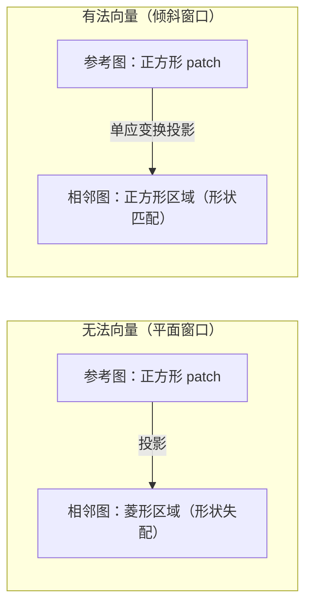
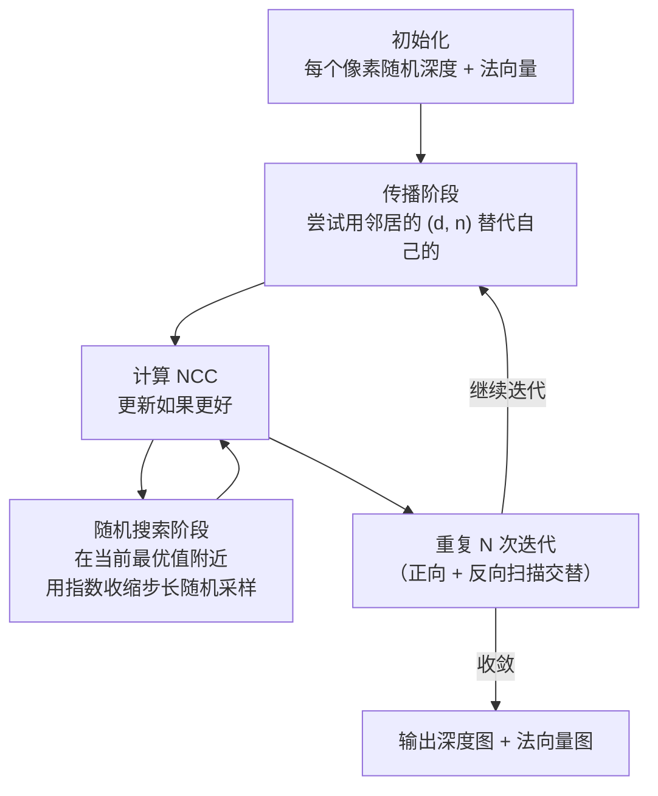
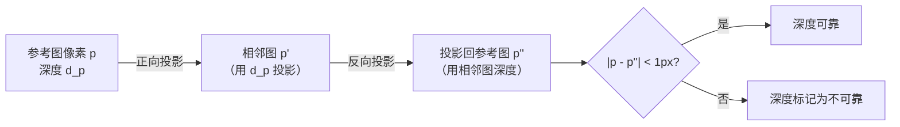

# PatchMatch 深度估计：给每个像素一个深度值

SfM 阶段结束后，COLMAP 有了每张图精确的相机位姿，以及几千到几十万个稀疏三维点。这些三维点只覆盖了有 SIFT 特征的区域——角点、纹理丰富的斑块——大片的平滑区域（墙面、地面、天空）完全没有点。

MVS（Multi-View Stereo，多视角立体视觉）的任务是把稀疏点云变成**稠密深度图**：给参考图中每个像素估计一个深度值。深度图和位姿合在一起就能生成稠密点云，进而重建出有完整表面的三维模型。

COLMAP 的 MVS 核心算法是 **PatchMatch Stereo**，它对每张图独立估计深度图，再在下一章融合成统一的点云。

## 核心思路：光度一致性

**正确的深度假设应该让不同视角看起来一致**。如果某个像素的深度猜对了，把这个三维点投影到相邻图中，对应区域的纹理外观应该和原图相似。如果深度猜错了，投影位置就错了，外观会不一致。

这个原理叫**光度一致性（photometric consistency）**，用 NCC（归一化互相关）或 ZNCC 量化：

$$
\text{NCC}(W_i, W_j) = \frac{\sum_{p \in W} (I_i(p) - \bar{I}_i)(I_j(p') - \bar{I}_j)}{\sqrt{\sum_p (I_i(p)-\bar{I}_i)^2 \cdot \sum_p (I_j(p')-\bar{I}_j)^2}}
$$

$W$ 是参考图上以像素为中心的小窗口，$p'$ 是把窗口内像素用当前深度假设投影到相邻图中的对应位置，$\bar{I}$ 是窗口内的平均亮度。NCC 值在 $[-1, 1]$ 之间，越接近 1 说明两个窗口越相似，深度假设越可能正确。

**为什么用 NCC 而不是直接像素差（SSD）**：NCC 对整体亮度偏移和缩放不敏感——不同相机的曝光参数不同，同一个表面在两张图中亮度可以有系统性差异，NCC 减去均值并归一化，消除了这种差异。

## 深度 + 法向量：两个联合优化的变量

每个像素需要估计两个东西，不只是深度：

**深度 $d$**：像素对应的三维点沿相机光轴方向的距离。

**法向量 $\mathbf{n}$**：三维点所在表面的法向量，用于**倾斜窗口（slanted window）**匹配。

为什么需要法向量？对一个倾斜的平面，如果投影窗口是平行于图像平面的正方形，那投影到相邻视角后，对应区域是一个菱形——两个形状不一样，NCC 会偏低即使深度完全正确。法向量让窗口形变匹配实际的表面朝向，更准确。

法向量确定后，投影时用单应矩阵（homography）而不是简单的透视投影，使窗口在相邻图中的对应形状更准确。

## PatchMatch 算法：随机传播代替穷举搜索

对每个像素穷举所有可能的深度和法向量需要 $O(N^3)$ 的搜索（深度范围 × 法向量空间），完全不可行。PatchMatch 的关键思想是：**好的深度估计会传播到相邻像素**。

原理：如果某个像素的深度和法向量估计是正确的，那么它的邻居（在同一表面上）的深度和法向量应该和它接近。PatchMatch 利用这一点，用"传播"代替"搜索"：

**初始化**：每个像素随机赋一个 $[d_{\min}, d_{\max}]$ 内的深度和随机单位法向量。初始值都是错的，但通过迭代会逐渐收敛。$d_{\min}$ 和 $d_{\max}$ 来自 SfM 稀疏点云的深度范围（自动估计）。

**传播**：对每个像素 $(x, y)$，检查能不能用上方像素 $(x, y-1)$ 或左侧像素 $(x-1, y)$ 的 $(d, \mathbf{n})$ 来替代自己的当前假设——如果邻居的假设在自己这里 NCC 更高，就接受。反向扫描时从右下角开始，传播右邻和下邻的假设。

**随机搜索**：在当前最优 $d_0$ 附近，以 $d_0 \pm r$ 的步长随机采样若干个候选深度（$r$ 从 $d_{\max}-d_{\min}$ 开始，每轮乘以收缩因子 0.5），找到更好的就更新。同样对法向量做随机扰动搜索。

**为什么这有效**：正确的深度估计从纹理丰富的像素扩散出去，逐渐覆盖到纹理稀少的区域。几轮迭代后，大多数像素都从邻居那里"继承"了合理的深度假设，随机搜索只做细化。

## 多视图一致性：不只看一张相邻图

COLMAP 的 PatchMatch 在计算 NCC 时不只用一张相邻图，而是从所有相邻图中选最一致的若干张，计算**聚合代价**：

$$
C(d, \mathbf{n}) = -\frac{1}{|\mathcal{N}|} \sum_{j \in \mathcal{N}} \text{NCC}(W_i, W_j(d, \mathbf{n}))
$$

相邻图的选择基于分辨率和视角差：选视角差适中（既有足够视差，又不至于遮挡变化太大）的图。通常每张参考图选 4–10 张相邻图参与深度估计。

多视图聚合提升了深度图在纹理稀少区域的稳定性，单张相邻图的偶然噪声被平均掉了。

## 几何一致性过滤

PatchMatch 迭代结束后，有些像素的深度估计仍然不可靠（遮挡区域、反光面、无纹理区域）。COLMAP 用**几何一致性（geometric consistency）**过滤：

对参考图中像素 $p$，把它用估计深度投影到相邻图中得到 $p'$，再用相邻图的深度估计把 $p'$ 投影回参考图，得到 $p''$。如果 $\|p - p''\|$ 超过阈值（默认 1 像素），说明两张图的深度估计不一致，这个像素的深度标记为不可靠。

通常 60–80% 的像素通过几何一致性检查，剩余的在深度图融合阶段会被过滤掉。

## GPU 加速

PatchMatch 的计算是高度并行的：每个像素的 NCC 计算完全独立，传播只需要读取邻居值。COLMAP 的 `dense_stereo` 命令用 CUDA 实现，把整个 PatchMatch 迭代放在 GPU 上运行，比 CPU 快 20–50 倍。GPU 加速是 MVS 实用化的关键——一张 2000×1500 的图像，CPU 可能需要几分钟，GPU 只需要几秒。

## COLMAP 的深度估计参数

`colmap patch_match_stereo` 的主要参数：

| 参数 | 默认值 | 含义 |
|------|--------|------|
| `PatchMatchStereo.max_image_size` | 2000 | 处理前的最大边长（超出则下采样） |
| `PatchMatchStereo.window_radius` | 5 | NCC 窗口半径（像素），实际窗口大小 $(2r+1)^2$ |
| `PatchMatchStereo.window_step` | 1 | 窗口内采样步长（>1 时近似计算，更快但不精确）|
| `PatchMatchStereo.num_samples` | 15 | 随机搜索采样次数 |
| `PatchMatchStereo.num_iterations` | 5 | PatchMatch 迭代轮数 |
| `PatchMatchStereo.geom_consistency` | true | 是否做几何一致性过滤 |

**调优建议**：
- 显存不足时先降 `max_image_size`（对精度影响有限）
- 纹理稀少场景加大 `window_radius`（增加 NCC 的统计样本数，但速度降低）
- 追求速度时 `window_step=2` 能快一倍，精度损失通常可接受

## 深度图的局限

PatchMatch 对以下情况估计效果差，在深度图中会出现"空洞"：

- **无纹理区域**（白墙、天花板）：NCC 无法区分不同深度，随机噪声
- **反光/镜面**：NCC 的基础假设（朗伯反射）不成立
- **细小物体**（电线、树枝）：小于 NCC 窗口大小，信号被窗口内的背景淹没
- **遮挡边界**：前景和背景的深度在窗口内混合

这些空洞会在下一章的深度图融合中被处理：只保留多视角一致的部分，空洞区域不生成点云。

## 小结

PatchMatch 深度估计把位姿已知的多视图配准问题转化为每像素的优化：用光度一致性（NCC）作为目标，用随机初始化 + 邻域传播 + 随机搜索的迭代策略代替穷举，联合估计深度和法向量。几何一致性过滤去掉不可靠的估计，为下一步融合提供干净的输入。

**知识链接**：
- ← [Bundle Adjustment 实现](/系列/colmap_deep_dive/06_BundleAdjustment) — 深度估计依赖精确相机位姿
- → [深度图融合与稠密点云生成](/系列/colmap_deep_dive/08_深度图融合与点云生成) — 多张深度图如何合并成统一点云

上一章：[Bundle Adjustment 在 COLMAP 中的实现](./06_BundleAdjustment) | 下一章：[深度图融合与稠密点云生成](./08_深度图融合与点云生成)
