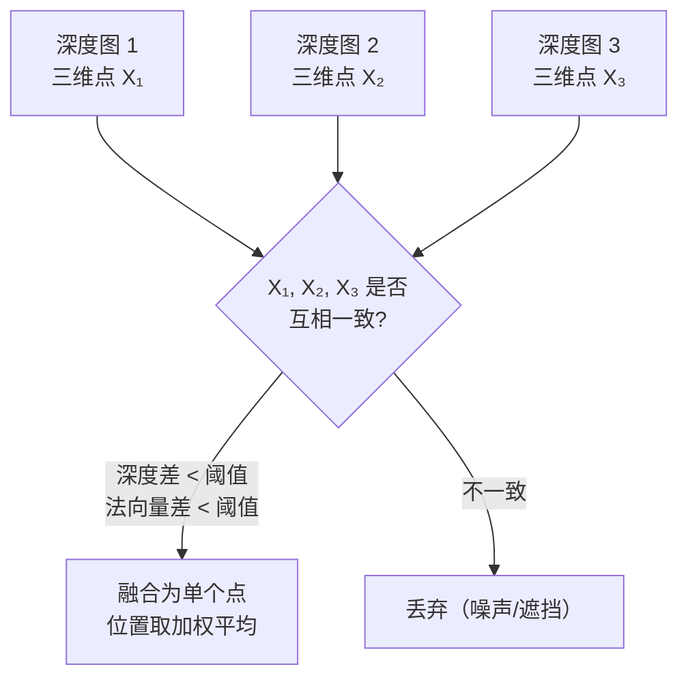

# 深度图融合：把多张深度图合并成统一点云

第 07 章结束时，COLMAP 给每张图都估计出了一张深度图——图中每个（可靠的）像素对应一个深度值和法向量。但这些深度图是**各自独立估计的**，同一个表面可能在 10 张图里各自估计了一次，得到 10 个略有差异的三维点。直接把它们叠加会得到一个密密麻麻、充满重复点的噪声点云。

深度图融合（depth map fusion）的目标是：**保留多视图一致的可靠点，消除重复和噪声，生成一个干净的稠密点云。**

## 融合的核心思路：多视图投票

一个三维点"可信"的判断标准：它不只被一张图的深度估计支持，而是在多张图中都能找到一致的深度观测。



COLMAP 的融合算法（来自论文 *Pixelwise View Selection for Unstructured Multi-View Stereo*）逐像素地执行这个检查：对参考图中的每个像素，用它的深度和相机位姿把它投影到其他每张图中，检查那张图中同一位置的深度估计是否一致。

## 一致性判据的两个条件

对参考图中的像素 $p$（位姿 $C_i$，深度 $d_i$，法向量 $\mathbf{n}_i$）和相邻图 $j$（位姿 $C_j$，在位置 $p'$ 处的深度 $d_j'$，法向量 $\mathbf{n}_j'$）：

**深度一致性**：

$$
\frac{|d_i^{(j)} - d_j'|}{d_j'} < \epsilon_d
$$

其中 $d_i^{(j)}$ 是把像素 $p$ 用深度 $d_i$ 投影到图 $j$ 后得到的深度，$d_j'$ 是图 $j$ 在该位置自己的深度估计。用相对深度差（而非绝对值）是因为近处的深度精度要求更高。默认阈值 $\epsilon_d = 0.01$（1%）。

**法向量一致性**：

$$
\mathbf{n}_i \cdot \mathbf{n}_j' > \cos(\epsilon_n)
$$

法向量夹角不超过阈值 $\epsilon_n$（默认 25°）。不同视角下对同一表面的法向量估计应该相近；如果差很多，说明两个点不在同一表面上（可能是遮挡边界或噪声）。

一个像素需要同时满足这两个条件的相邻图数量达到 `min_num_consistent`（默认 2）才被保留。

## 融合产生的稠密点

通过一致性检查的像素，在多张图中都有对应的深度观测。COLMAP 用这些观测的加权平均（权重由 NCC 分数和视角差决定）计算最终的三维点坐标和法向量。

每个融合出来的点携带：
- 三维坐标 $(X, Y, Z)$
- 法向量 $\mathbf{n}$（由各视图法向量加权平均）
- RGB 颜色（从参考图的像素颜色采样）
- 被多少张图支持（视图数量）

输出文件是 `dense/0/fused.ply`，PLY 格式，包含上述每个点的属性。

## 重复点的消除

同一个三维点可能在多张图里都通过了一致性检查，会被单独计算一遍。融合器通过追踪"哪些图像的哪些像素已经贡献了某个三维点"来避免重复添加：一旦一个像素的深度已经被某个参考图融合使用，它在其他图中被再次检查时会被标记为"已使用"，不再产生新的点。

这个机制使稠密点云中每个物理表面位置只生成一个点，避免了密度不均的问题（靠近多张图的区域不会生成多个重叠点）。

## 融合参数

`colmap stereo_fusion` 的主要参数：

| 参数 | 默认值 | 含义 |
|------|--------|------|
| `StereoFusion.min_num_pixels` | 5 | 一个融合点至少需要被多少像素支持（合并前的子像素级支持数） |
| `StereoFusion.max_num_pixels` | 10000 | 上限，防止密集区域消耗过多内存 |
| `StereoFusion.max_traversal_depth` | 100 | 一致性检查向相邻图传播的最大深度 |
| `StereoFusion.max_reproj_error` | 2.0 | 融合点允许的最大重投影误差（像素） |
| `StereoFusion.max_depth_error` | 0.01 | 深度一致性阈值（相对误差） |
| `StereoFusion.max_normal_error` | 25° | 法向量一致性阈值 |
| `StereoFusion.check_num_images` | 50 | 每个像素最多检查多少张相邻图 |

**调优方向**：
- 点云太稀疏：降低 `min_num_pixels`（保留被更少视图支持的点），或降低 `max_depth_error`/`max_normal_error`（放宽一致性要求）
- 点云太嘈杂：提高 `min_num_pixels`，要求更多视图支持
- 内存不足：降低 `check_num_images`（减少每像素检查的相邻图数量）

## 稠密点云到表面网格

融合输出的 `fused.ply` 是点云，不是网格。如果需要三角网格（用于渲染、测量、3D 打印），COLMAP 提供了 [泊松表面重建（Poisson Surface Reconstruction）](/前置知识/020a_前置知识_Poisson表面重建从点云到水密网格) 作为后处理步骤：

```
colmap poisson_mesher \
  --input_path dense/0/fused.ply \
  --output_path dense/0/meshed-poisson.ply
```

泊松重建利用每个点的法向量，把点云转化为一个封闭的光滑曲面。另一个选项是 Delaunay 网格：

```
colmap delaunay_mesher \
  --input_path dense/0 \
  --output_path dense/0/meshed-delaunay.ply
```

Delaunay 方法更保守，对细节保留更好但对噪声也更敏感；泊松方法更平滑，对孔洞和噪声有隐式填补，但可能在薄结构处过度平滑。

## 融合结果的质量评估

看 `fused.ply` 时，常见问题和原因：

| 问题 | 可能原因 |
|------|----------|
| 大片空洞 | 无纹理区域（墙面、地面）深度估计不可靠，一致性检查未通过 |
| 表面飘浮噪声点 | `min_num_pixels` 太低，或有错误的深度估计通过了一致性检查 |
| 边缘毛刺 | 遮挡边界处深度跳变，法向量不一致 |
| 重叠区域密度不均 | 相机分布不均匀，某些区域被更多图覆盖 |

空洞是 MVS 的固有局限，不能完全消除。对需要完整表面的应用，通常在泊松重建后用手动或半自动的孔洞填补工具处理。

## 与 SfM 稀疏点云的关系

稠密点云和 SfM 稀疏点云描述同一个场景，但精度和用途不同：

| 属性 | SfM 稀疏点云 | MVS 稠密点云 |
|------|-------------|-------------|
| 点的数量 | 数千–数十万 | 数百万–数亿 |
| 每点精度 | 极高（Bundle Adjustment 优化） | 中等（受深度估计精度限制） |
| 覆盖率 | 只有纹理特征点 | 所有可见纹理区域 |
| 主要用途 | 相机位姿估计、NeRF/3DGS 输入 | 表面重建、测量、可视化 |

**对 NeRF/3DGS**：直接使用 SfM 稀疏点云即可，MVS 稠密点云不是必须的。但稠密点云可以作为 3DGS 的初始点（`3dgs --init_from_ply fused.ply`），特别是在初始化效果差的场景里。

## 小结

深度图融合把各自独立的深度估计通过多视图一致性投票合并：只保留在多张图中深度和法向量都一致的点，同时消除重复。结果是一个覆盖所有可见纹理区域的稠密点云，加上可选的泊松/Delaunay 网格。到这里，COLMAP 的完整重建流程就走完了——稀疏点云 + 相机位姿来自 SfM，稠密点云来自 MVS。

**知识链接**：
- ← [PatchMatch 深度估计](/系列/colmap_deep_dive/07_PatchMatch深度估计) — 融合的输入：每张图的深度图
- → [完整 Pipeline 走读与参数调优](/系列/colmap_deep_dive/09_完整Pipeline走读与参数调优) — 从命令行到最终点云的实际操作流程

上一章：[PatchMatch 深度估计](./07_PatchMatch深度估计) | 下一章：[完整 Pipeline 走读与参数调优](./09_完整Pipeline走读与参数调优)
