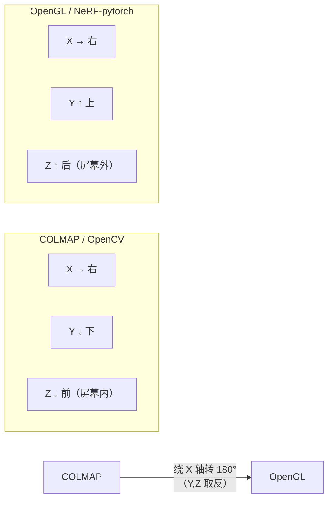

# COLMAP 输出与下游对接

SfM 跑完后，`sparse/0/` 里有三个二进制文件。大多数下游框架（NeRF、3DGS、MVSNet、OpenMVG 等）都以 COLMAP 的输出格式作为输入标准之一。这一章讲清楚这三个文件的内容结构，以及如何把它们转化成各框架需要的格式。

## 三个输出文件

### cameras.bin / cameras.txt

记录所有相机的内参。每条记录对应一个相机模型，不是一张图像——如果所有图像共享同一台相机，这里只有一条。

文本格式（`cameras.txt`）每行含义：

```
# Camera list with one line of data per camera:
#   CAMERA_ID, MODEL, WIDTH, HEIGHT, PARAMS[]
# Number of cameras: 1
1 SIMPLE_RADIAL 4032 3024 2847.52 2016.0 1512.0 -0.0821
```

字段解释：
- `1`：相机 ID
- `SIMPLE_RADIAL`：相机模型（单焦距 + 单径向畸变）
- `4032 3024`：图像宽高（像素）
- `2847.52`：焦距 f（像素单位）
- `2016.0 1512.0`：主点坐标 (cx, cy)（像素单位，通常接近图像中心）
- `-0.0821`：径向畸变系数 k₁

不同相机模型的 `PARAMS[]` 字段数不同，与第 06 章相机模型表对应。

### images.bin / images.txt

记录每张图像的外参（在世界坐标系中的位姿）和观测到的特征点。

文本格式每张图像占两行：

```
# Image list with two lines of data per image:
#   IMAGE_ID, QW, QX, QY, QZ, TX, TY, TZ, CAMERA_ID, NAME
#   POINTS2D[] as (X, Y, POINT3D_ID)
1 0.9997 -0.0024 -0.0221 0.0092 -0.3142 0.1853 1.7621 1 image_001.jpg
1024.3 856.7 412  2841.9 1203.4 -1  ...
```

第一行的字段：
- `IMAGE_ID`：图像编号
- `QW QX QY QZ`：旋转四元数（从世界坐标系到相机坐标系）
- `TX TY TZ`：平移向量（从世界坐标系到相机坐标系）
- `CAMERA_ID`：引用 cameras.bin 里的哪台相机
- `NAME`：原始图像文件名

第二行是该图像检测到的所有特征点，格式为 `(X, Y, POINT3D_ID)` 的列表：
- `X Y`：像素坐标
- `POINT3D_ID`：对应哪个三维点，`-1` 表示该特征点未三角化

### points3D.bin / points3D.txt

记录所有三维点的坐标、颜色和可见性信息。

```
# 3D point list with one line of data per point:
#   POINT3D_ID, X, Y, Z, R, G, B, ERROR, TRACK[] as (IMAGE_ID, POINT2D_IDX)
412 1.2341 -0.8923 3.4521 142 87 63 0.3241 1 834  3 1201  7 422 ...
```

字段：
- `POINT3D_ID`：三维点编号
- `X Y Z`：世界坐标系下的三维坐标
- `R G B`：从参考图采样的颜色（0-255）
- `ERROR`：该点的平均重投影误差（像素）
- `TRACK[]`：哪些图像的哪个特征点观测到这个点，格式为 `(IMAGE_ID, 特征点索引)` 对

## 用 Python 读取输出

COLMAP 提供了官方 Python 脚本读取这些文件，放在源码仓库 `scripts/python/read_write_model.py`。安装 `pycolmap` 包后也可以直接用：

```python
import pycolmap

# 读取二进制格式
reconstruction = pycolmap.Reconstruction("project/sparse/0")

# 遍历相机
for camera_id, camera in reconstruction.cameras.items():
    print(f"相机 {camera_id}: 焦距={camera.focal_length:.1f}px, "
          f"尺寸={camera.width}x{camera.height}")

# 遍历已注册图像
for image_id, image in reconstruction.images.items():
    # image.cam_from_world 是 pycolmap.Rigid3d，从世界到相机
    R = image.cam_from_world.rotation.matrix()   # 3x3 旋转矩阵
    t = image.cam_from_world.translation          # 3维平移向量
    print(f"图像 {image.name}: 位姿已注册")

# 遍历三维点
for point3d_id, point in reconstruction.points3D.items():
    xyz = point.xyz      # numpy array [X, Y, Z]
    rgb = point.color    # numpy array [R, G, B]
    err = point.error    # 平均重投影误差
```

不使用 pycolmap 时，用官方脚本里的函数：

```python
import sys
sys.path.append("path/to/colmap/scripts/python")
from read_write_model import read_model

cameras, images, points3D = read_model("project/sparse/0", ext=".bin")
```

## 坐标系约定

COLMAP 的外参存储的是从世界坐标系变换到相机坐标系的变换：

$$
\mathbf{x}_{\text{cam}} = R \cdot \mathbf{X}_{\text{world}} + \mathbf{t}
$$

其中 $R$ 是旋转矩阵（由四元数 $(q_w, q_x, q_y, q_z)$ 转化），$\mathbf{t}$ 是平移向量。

**相机在世界坐标系中的位置**（常用于可视化）：

$$
\mathbf{c} = -R^T \cdot \mathbf{t}
$$

**从相机坐标系到世界坐标系**（$c2w$ 矩阵，NeRF 框架常用）：

$$
\begin{bmatrix} R^T & -R^T \mathbf{t} \\ 0 & 1 \end{bmatrix}
$$

注意 COLMAP 相机坐标系是右手系，Z 轴朝前（OpenCV 约定）。部分 NeRF 框架（如 NeRF-pytorch）使用 OpenGL 约定（Z 轴朝后、Y 轴朝上），需要做轴变换。

## 转换为 transforms.json（NeRF 输入格式）

大多数 NeRF 框架（nerfstudio、instant-ngp、NeRF-pytorch）使用 `transforms.json` 作为相机位姿输入。以下是从 COLMAP 输出转换的核心逻辑：

```python
import json
import numpy as np
import pycolmap

def colmap_to_transforms_json(sparse_path, image_root, output_path):
    reconstruction = pycolmap.Reconstruction(sparse_path)
    
    # 从 images 里取一个相机内参（假设单相机）
    cam_id = next(iter(reconstruction.cameras))
    camera = reconstruction.cameras[cam_id]
    
    # nerfstudio 格式：fl_x, fl_y, cx, cy, w, h（像素单位）
    out = {
        "fl_x": camera.focal_length_x,
        "fl_y": camera.focal_length_y,
        "cx": camera.principal_point_x,
        "cy": camera.principal_point_y,
        "w": camera.width,
        "h": camera.height,
        "frames": []
    }
    
    for image_id, image in reconstruction.images.items():
        # COLMAP: w2c（世界到相机）；NeRF 需要 c2w（相机到世界）
        w2c = np.eye(4)
        w2c[:3, :3] = image.cam_from_world.rotation.matrix()
        w2c[:3, 3] = image.cam_from_world.translation
        c2w = np.linalg.inv(w2c)
        
        # COLMAP 是 OpenCV 轴（Z 朝前，Y 朝下）
        # nerfstudio/instant-ngp 是 OpenGL 轴（Z 朝后，Y 朝上）
        # 绕 X 轴转 180°：对 Y 和 Z 列取反
        c2w[:3, 1:3] *= -1
        
        out["frames"].append({
            "file_path": f"{image_root}/{image.name}",
            "transform_matrix": c2w.tolist()
        })
    
    with open(output_path, "w") as f:
        json.dump(out, f, indent=2)
```

也可以直接用 nerfstudio 的命令行工具，它内置了 COLMAP 导入：

```bash
ns-process-data images \
  --data project/images \
  --output-dir project/nerfstudio \
  --colmap-model-path project/sparse/0
```

## 对接 3D Gaussian Splatting

3DGS（`gaussian-splatting`）原生支持 COLMAP 格式，直接传入 COLMAP 输出目录：

```bash
python train.py \
  -s project \              # 包含 images/ 和 sparse/0/ 的根目录
  --eval                    # 划分训练/测试集
  --resolution 1            # 原始分辨率
```

3DGS 用稀疏点云 `points3D.bin` 初始化高斯球的位置和颜色，稀疏点云质量直接影响初期收敛速度。如果同时有稠密点云 `fused.ply`，可以用它替代稀疏点初始化：

```bash
python convert.py \
  -s project \
  --no-gpu                  # 仅做格式转换，不跑 COLMAP

# 然后把 fused.ply 复制到 project/input.ply（3DGS 会自动检测）
cp project/dense/0/fused.ply project/input.ply
```

## 对接 instant-ngp

instant-ngp 使用与 nerfstudio 相同的 `transforms.json` 格式（NeRF 框架事实标准）。COLMAP 官方在 `scripts/python/` 里提供了 `colmap2nerf.py`：

```bash
python colmap2nerf.py \
  --images project/images \
  --colmap_db project/database.db \
  --colmap_camera_model OPENCV \
  --run_colmap \
  --aabb_scale 16 \
  --out project/transforms.json
```

`--aabb_scale` 控制场景包围盒大小，室内场景用 4–8，室外用 16–64。

## 对接其他框架

| 框架 | 输入格式 | 转换方法 |
|------|----------|----------|
| NeRF-pytorch | `transforms_train.json` | `colmap2nerf.py` |
| MVSNet / TransMVSNet | COLMAP 文本格式 | `model_converter --output_type TXT` |
| OpenMVG | 通用 SfM 格式（JSON） | `openMVG_main_openMVG2openMVS` |
| Meshroom (AliceVision) | SfM Data JSON | 第三方脚本 |
| GLOMAP | COLMAP 数据库 | 直接读取 `.db` |

## 常见坐标系陷阱

对接时最常见的错误来自坐标系约定不一致，表现为重建看起来翻转了或方向反了。



从 COLMAP 转换到 OpenGL 轴：取 c2w 矩阵的第 2、3 列（Y 和 Z 轴方向）乘以 -1，或等价地右乘：

$$
M_{\text{OpenGL}} = M_{\text{c2w}} \cdot \begin{bmatrix} 1 & & \\ & -1 & \\ & & -1 \\ & & & 1 \end{bmatrix}
$$

nerfstudio 的 `ns-process-data` 会自动处理这个转换，手动转换时需要自己做。

## 稀疏点云的直接用途

`points3D.bin` 里的稀疏点云除了给 3DGS 初始化，还有几个直接用途：

**场景尺度估计**：如果有已知距离的参照物（比如标定板、测量尺），可以用稀疏点云中对应点的距离估计重建尺度，再乘以所有坐标（COLMAP 的尺度是任意的）。

**相机轨迹可视化**：提取每张图的相机位置（$c = -R^T t$），用点或线段连起来，可以直观地看拍摄路径是否合理。

**裁剪场景包围盒**：根据点云的坐标范围估计场景包围盒，传给 NeRF/3DGS 的 `aabb` 参数，避免框太大浪费容量。

## 小结

COLMAP 的三个输出文件是标准的 SfM 成果格式：`cameras.bin` 存内参，`images.bin` 存外参和特征观测，`points3D.bin` 存稀疏点云。主流 NeRF 和 3DGS 框架都有官方或社区工具直接消费这个格式，核心转换步骤是把 w2c 矩阵求逆得到 c2w，并根据目标框架的坐标轴约定做轴变换。

---

到这里，COLMAP 深入解析系列的全部十章都完成了。从 SIFT 特征提取，到特征匹配、对极几何、增量式 SfM、Bundle Adjustment，再到 PatchMatch MVS、深度图融合，最终到输出格式和下游对接——这构成了一个完整的三维重建基础。

**系列导航**：
- [01 系列导读与整体架构](./01_系列导读与整体架构)
- [02 SIFT 特征提取与描述](./02_SIFT特征提取与描述)
- [03 特征匹配策略](./03_特征匹配策略)
- [04 对极几何与位姿估计](./04_对极几何与位姿估计)
- [05 增量式 SfM](./05_增量式SfM)
- [06 Bundle Adjustment 在 COLMAP 中的实现](./06_BundleAdjustment)
- [07 PatchMatch 深度估计](./07_PatchMatch深度估计)
- [08 深度图融合与稠密点云生成](./08_深度图融合与点云生成)
- [09 完整 Pipeline 走读与参数调优](./09_完整Pipeline走读与参数调优)
- [10 COLMAP 输出与下游对接](./10_COLMAP输出与下游对接)（本章）
