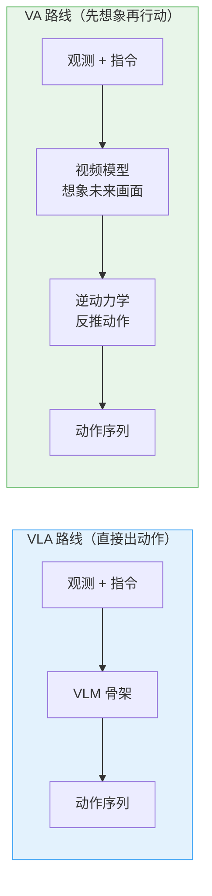
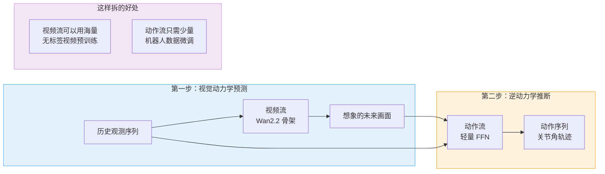
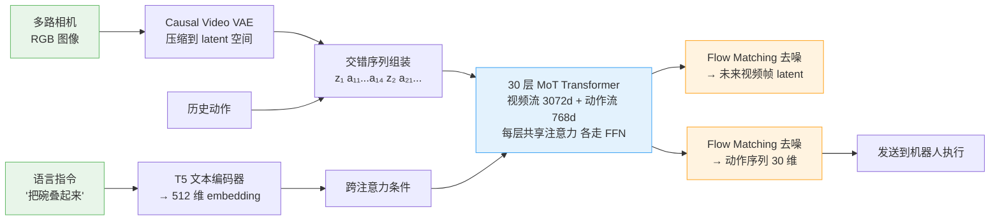
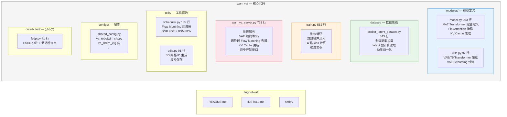
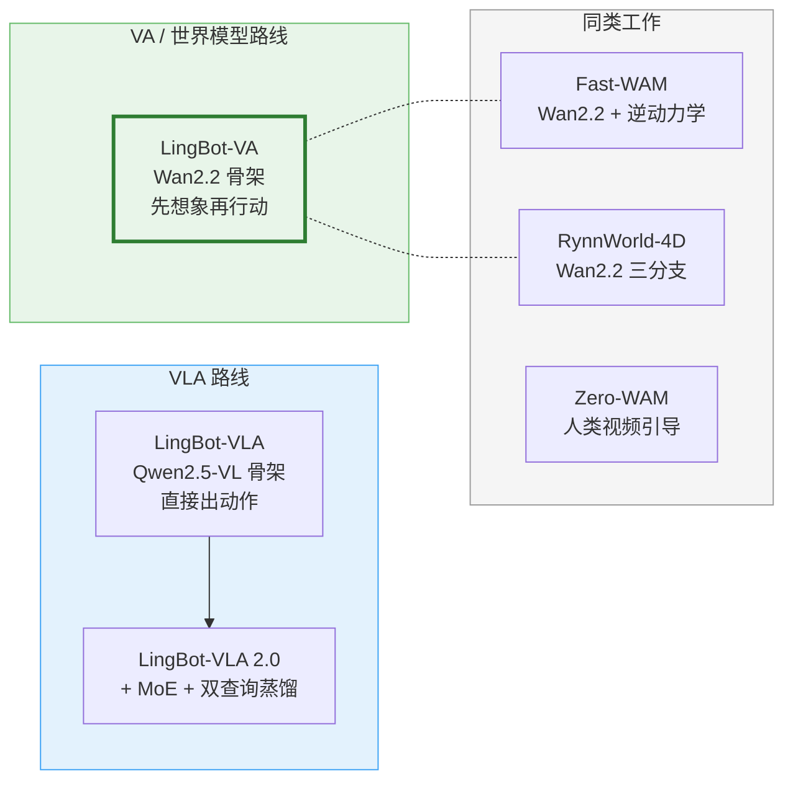

# 第 01 章 全景图：视频世界模型如何控制机器人

> 本章是全系列的入口。我们先不看任何实现细节，而是把 LingBot-VA 想解决的问题、它的整体设计选择、以及代码仓库的组织方式讲清楚，让你在后面读每一章时都知道"这块在整张图的哪个位置"。

## 一、一句话定位

LingBot-VA 是一个 5.3B 参数的视频-动作（Video-Action）世界模型：输入是几路相机图像加一句自然语言指令，输出是一段连续的机器人动作序列。它和 VLA（Vision-Language-Action）模型走的是完全不同的路线——**VLA 直接从观测映射到动作，VA 先用视频模型"想象"未来画面，再从画面变化反推动作**。

## 二、VLA 路线的瓶颈

以 [LingBot-VLA](/论文综述/139_LingBotVLA2_从基础到应用的实用VLA)、$\pi_0$ 为代表的 VLA 模型，把预训练的视觉语言模型（VLM）当骨架，直接从图像和语言条件生成动作。这条路线结构简单、推理快，但有一个根本性问题：**表征纠缠**。

VLA 只有一个监督信号——动作标签。但网络实际上要同时学三件完全不同的事：

| 能力 | 例子 | 依赖什么数据 |
|------|------|------------|
| 视觉场景理解 | 三个碗在桌上的位置、大小关系 | 图像-语言数据 |
| 物理动力学 | 推了小碗会不会把大碗撞倒 | 视频数据（含物理交互） |
| 运动控制 | 夹爪应该从哪个角度接近碗沿 | 机器人遥操作数据 |

三件事压缩在同一个网络里，用同一个动作 loss 监督。网络只能靠"模式匹配"——看到类似的画面就输出类似的动作——而不是真正理解物理规律。简单任务还行，一旦遇到需要"想一步"的长程任务（比如叠碗到第三个碗时需要预判前两个碗的稳定性），就容易崩。

## 三、LingBot-VA 的两步范式

LingBot-VA 的核心思路：**把"理解世界"和"输出动作"拆成两个独立的学习目标**。

| 步骤 | 输入 | 输出 | 由谁负责 | 监督信号 |
|------|------|------|----------|---------|
| 视觉动力学预测 | 历史观测 + 动作 | 未来几帧画面 | 视频流（Wan2.2, 5B 参数） | 视频帧重建 loss |
| [逆动力学](/前置知识/007b_前置知识_逆动力学模型与潜动作学习)推断 | "现在"+"想象的未来" | 动作序列 | 动作流（350M 参数） | 动作回归 loss |

**为什么选 Wan2.2 做视频流骨架**：Wan2.2 是一个在大规模视频数据上预训练的 5B 参数视频扩散模型。它已经从海量视频中学到了物理先验——物体掉落的轨迹、液体流动的方式、刚体碰撞的结果。把它当作视频流骨架，相当于给机器人装了一个"物理想象引擎"，不需要从机器人数据中重新学习这些物理规律。

## 四、整体数据流

从一次推理的角度看，LingBot-VA 做的事是一条线性链路：

整个流程可以用六个关键词概括：**编码 → 交错 → 注意力 → 去噪 → 执行 → 缓存**。后续每一章都聚焦其中一个环节。

## 五、代码仓库地图

LingBot-VA 的代码结构非常紧凑，核心文件不到 3000 行：

| 文件 | 行数 | 本系列对应章节 |
|------|------|--------------|
| `modules/model.py` | 903 | 第 02 章（MoT 双流）、第 03 章（FlexAttention 掩码） |
| `dataset/lerobot_latent_dataset.py` | 343 | 第 04 章（数据管线） |
| `train.py` | 552 | 第 05 章（双路训练） |
| `wan_va_server.py` | 731 | 第 06 章（推理服务） |
| `utils/scheduler.py` | 135 | 第 05 章（Flow Matching 调度） |
| `distributed/fsdp.py` | 41 | 第 05 章（FSDP 分片） |

## 六、六大设计选择

在读具体实现之前，先把 LingBot-VA 的六个关键设计选择摆出来——这些选择贯穿后续所有章节：

| 设计选择 | 具体做法 | 为什么这样选 | 对应章节 |
|----------|---------|-------------|---------|
| **骨架** | 用 Wan2.2-5B 视频扩散模型 | 已有物理先验，不需要从零学 | 第 02 章 |
| **双流** | 视频流 3072d + 动作流 768d，不对称 | 动作分布简单，不需要那么多参数 | 第 02 章 |
| **掩码** | FlexAttention 编译的 block mask | 把"谁能看见谁"的规则高效编码进注意力 | 第 03 章 |
| **噪声增强** | 训练时 50% 概率给历史视频掺噪 | 推理时只需半去噪，省一半计算 | 第 05 章 |
| **双路 loss** | 视频重建 + 动作回归，$\lambda=1$ | 两个能力同时训练、互相增强 | 第 05 章 |
| **KV Cache** | 缓存所有历史 token 的 K/V | 自回归推理时不重算历史，提供长程记忆 | 第 06 章 |

## 七、与同类工作的定位

| | LingBot-VA | [Fast-WAM](/系列/fastwam_deep_dive/) | [RynnWorld-4D](/系列/rynnworld4d_deep_dive/) |
|---|---|---|---|
| **视频骨架** | Wan2.2-5B | Wan2.2-1.3B/5B | Wan2.2-5B |
| **动作推断方式** | MoT 双流内联 | 独立逆动力学头 | Perceiver + Flow Matching |
| **训练时视频-动作耦合** | 共享注意力，联合训练 | 分阶段，先视频后动作 | 三分支渐进融合 |
| **KV Cache 长程记忆** | 有 | 有 | 无 |
| **异步推理** | 有（FDM 校正） | 有 | 无 |

LingBot-VA 的独特之处在于：**视频流和动作流在同一个 Transformer 里逐层交互**（通过共享注意力），而不是分开两个独立的网络。这让动作流在每一层都能直接利用视频流的中间表征，信息流通更充分。

---

> **下一章预告**：第 02 章将深入 `modules/model.py` 中的 `WanTransformer3DModel`，拆解视频流和动作流怎么共享一套注意力、各走各的 FFN，以及 RoPE 如何为 3D 视频 token 编码位置信息。
