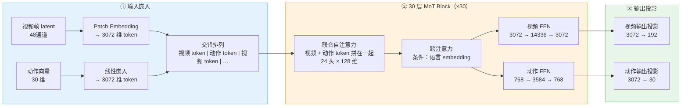
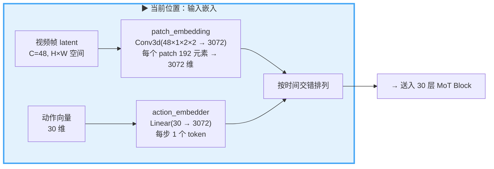
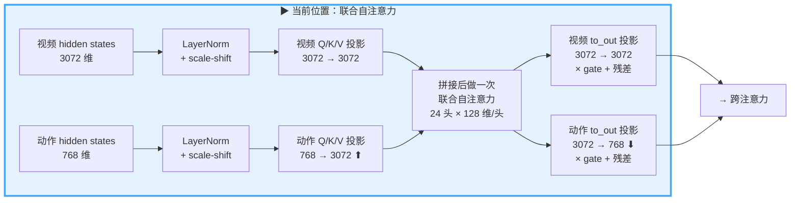
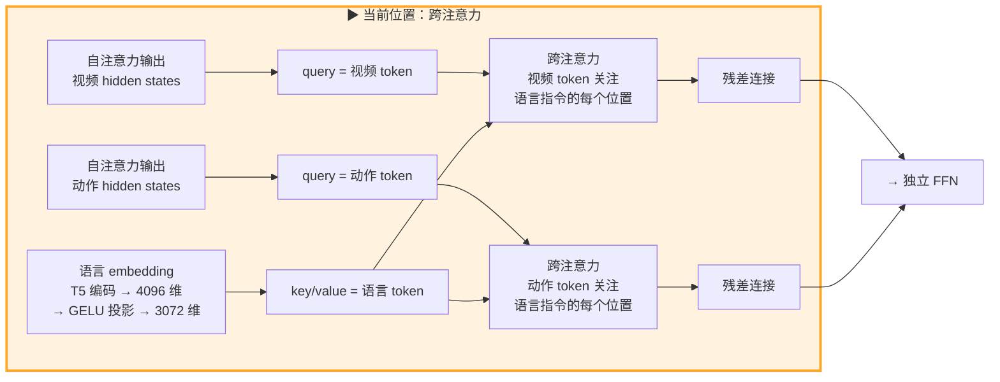
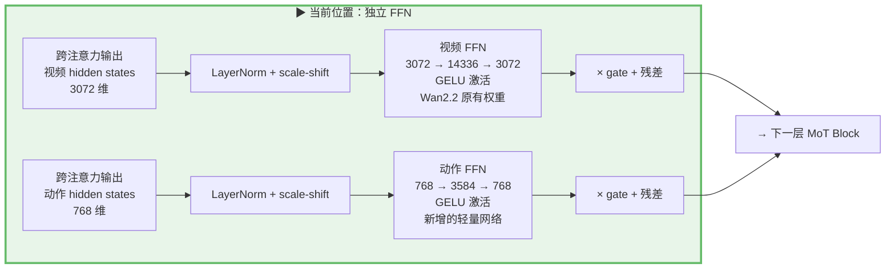
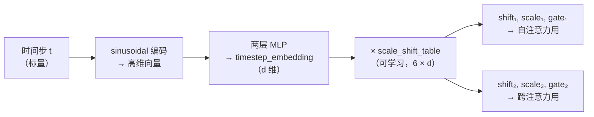
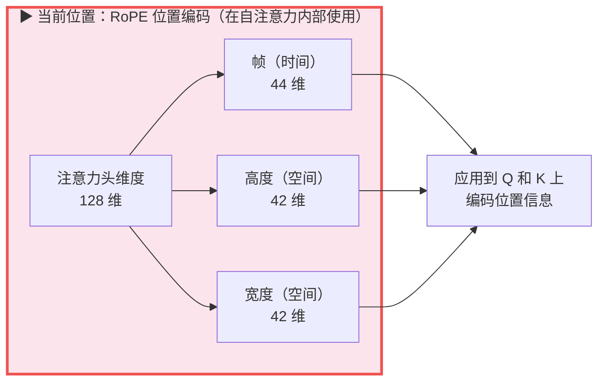
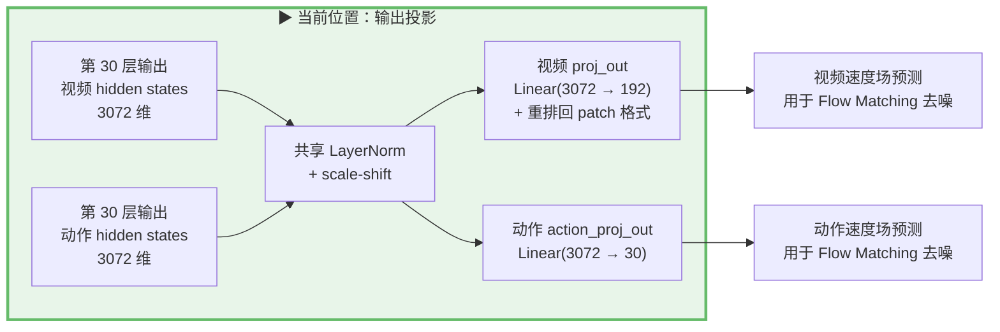

# 第 02 章 MoT 双流模型与不对称设计

> **前情提要**：第 01 章建立了全景图——LingBot-VA 先用视频模型"想象"未来画面，再从画面变化反推动作。本章深入模型核心，把 `WanTransformer3DModel` 从输入到输出完整走一遍：数据怎么进来、每一层内部怎么处理、最后怎么输出预测。

**知识链接**：

- [逆动力学模型与潜动作学习](/前置知识/007b_前置知识_逆动力学模型与潜动作学习) — 动作流的解码原理
- [KV Cache 与自回归解码](/前置知识/002m_前置知识_KV_Cache与自回归解码) — 推理时的缓存机制
- [因果注意力掩码](/前置知识/001g_前置知识_Causal_Attention因果注意力掩码) — 注意力设计基础

---

## 一、模型的整体结构

LingBot-VA 的核心是一个 30 层的 Transformer，叫 `WanTransformer3DModel`。它和普通 Transformer 最大的区别：**内部同时跑两条数据流——一条处理视频，一条处理动作**。两条流共享注意力层（在这里交换信息），但各有独立的 FFN（前馈网络，Feed-Forward Network——两层线性变换夹一个激活函数，负责在每个 token 内部做特征变换）。这种架构叫 **Mixture-of-Transformers（MoT）**。

下面这张图是整个模型从输入到输出的完整路径——后面每一节都会在这张图上标出"我们现在讲到哪里了"：



| 阶段 | 输入 | 输出 | 做什么 |
|------|------|------|--------|
| ① 输入嵌入 | 视频 latent + 动作向量 | 3072 维 token 序列 | 把不同模态统一成同维度的 token |
| ② MoT Block ×30 | token 序列 | 处理后的 token 序列 | 注意力交换信息 + FFN 变换特征 |
| ③ 输出投影 | 处理后的 token | 速度场预测 | 映射回各自目标空间 |

我们按这个顺序，从 ① 开始逐个讲。

## 二、输入嵌入：视频和动作怎么变成 token



两条流的输入完全不同——视频是高维的图像 latent，动作是低维的关节角向量——但都要变成统一格式的 token 才能送进 Transformer。

### 视频流：Patch Embedding

视频帧先经过 Causal Video VAE 压缩成 latent 表示（通道数 48），再按 patch 切块：

| 步骤 | 操作 | 数据形状变化 |
|------|------|-------------|
| 1. VAE 压缩 | 外部完成，不在本模型内 | RGB 图像 → latent: $48 \times H \times W$ |
| 2. Patch 切块 | 按 `patch_size = (1, 2, 2)` 的窗口展平 | 每个 patch 包含 $48 \times 1 \times 2 \times 2 = 192$ 个元素 |
| 3. 线性投影 | `patch_embedding` 把 192 维映射到 3072 维 | 192 → 3072 |

`patch_size = (1, 2, 2)` 的含义：时间维度不做 patch 化（保持帧级分辨率），空间维度 2 倍下采样。一帧 latent 尺寸为 $48 \times H \times W$，patch 化后产生 $(H/2) \times (W/2)$ 个 token——每个 token 代表原始画面中一小块区域的特征。

### 动作流：线性嵌入

动作本身就是低维向量（双臂机器人 30 维：每条臂 7 维关节角 + 7 维末端姿态 + 1 维夹爪），直接通过一个线性层映射到 3072 维。每个动作步产生 1 个 token。

### 交错序列组装

嵌入后的视频 token 和动作 token 按时间顺序交错排列：

$$
[\underbrace{z_t}_{\text{一帧的所有 patch token}},\ \underbrace{a_{t,1},\ a_{t,2},\ \ldots,\ a_{t,\tau}}_{\tau\ \text{个动作 token}},\ z_{t+1},\ a_{t+1,1},\ \ldots]
$$

**这个公式在做什么**：把"看到什么画面"和"做了什么动作"按时间交替排列，形成"观测 → 动作 → 下一帧观测"的因果叙事序列。

::: details 📐 公式详解（点击展开）

| 子表达式 | 它是谁 | 它在干嘛 |
|---------|--------|---------|
| $z_t$ | **场景快照** | 第 $t$ 帧经 VAE 压缩、patch 化后的所有空间 token（如 $(H/2) \times (W/2)$ 个） |
| $a_{t,1} \ldots a_{t,\tau}$ | **精细动作序列** | 第 $t$ 帧到第 $t+1$ 帧之间的 $\tau$ 步关节动作（保证高频控制） |
| 交错排列 | **时间线叙事** | [因果注意力](/前置知识/001g_前置知识_Causal_Attention因果注意力掩码)天然建模"看到 → 做了 → 世界变了"的时间链 |

**用人话读**："每个视频帧的 token 后面紧跟 $\tau$ 个动作 token，然后是下一帧——按时间顺序排好。"

**为什么交错而不是先视频后动作**：交错让动作 token 直接关注最近的视频帧，视频帧也能看到刚执行过的动作——两种信息在注意力层自然融合，不需要额外的跨模态对齐模块。
:::

在 RoboTwin 配置中，$\tau = 16$（`action_per_frame = 16`），即每个视频帧关联 16 个动作 token。

## 三、单层 MoT Block 的完整数据流

交错排列好的 token 序列进入 30 层 MoT Block。每一层内部做三件事：联合自注意力、跨注意力、独立 FFN。下面逐步拆解。

### 3.1 联合自注意力：两条流交换信息的唯一通道



**这一步接收什么**：两条流各自的 hidden states——视频流 3072 维，动作流 768 维。

**这一步输出什么**：更新后的 hidden states，维度不变（视频 3072，动作 768）。

**内部每一步**：

| 步骤 | 操作 | 视频流 | 动作流 |
|------|------|--------|--------|
| 1 | LayerNorm | 对 3072 维做 norm | 对 768 维做 norm |
| 2 | scale-shift 仿射变换 | $\hat{h} = \text{Norm}(h) \times (1 + \text{scale}) + \text{shift}$ | 同左，参数来自 timestep embedding |
| 3 | Q/K/V 投影 | 3072 → 3072（维度不变） | **768 → 3072（升维！）** |
| 4 | 拼接 | 视频 token 和动作 token 的 Q/K/V 拼成一个序列 | |
| 5 | 注意力计算 | 在 3072 维空间（24 头 × 128 维/头）做标准自注意力 | |
| 6 | 拆分 + 输出投影 | 3072 → 3072 | **3072 → 768（降维回去）** |
| 7 | gate × 输出 + 残差 | 乘以 gate（来自 timestep embedding），加回原始 hidden states | 同左 |

**关键点：维度适配**。视频流的隐层维度是 3072，动作流是 768——差 4 倍。但联合自注意力要求所有 token 在同一维度空间计算。所以动作流的 Q/K/V 投影矩阵把 768 维**升到** 3072 维（第 3 步），注意力做完后再由 `to_out` 投影**降回** 768 维（第 6 步）。投影后，两种 token 在注意力层的计算完全对等——共享相同的 24 个注意力头、相同的 128 维/头。

**gate 机制的作用**：gate 值来自去噪过程的 timestep embedding。在噪声很重的早期阶段，gate 可以学到接近零的值，让网络主要依赖自身状态而不是注意力更新——相当于网络可以选择"这一步噪声太大，注意力信息不可靠，暂时忽略"。

### 3.2 跨注意力：语言条件注入



**这一步接收什么**：自注意力更新后的 hidden states（作 query）+ 语言 embedding（作 key/value）。

**这一步输出什么**：融合了语言条件信息的 hidden states。

**内部过程**：用视频 token（或动作 token）作 query，语言 embedding 作 key/value，做一次跨注意力。这让每个 token 都能完整关注到语言指令"把碗叠起来"的所有位置。语言 embedding 来自 T5 文本编码器，原始维度 4096，通过一个 GELU 投影层映射到 3072 维后作为 key/value。结果通过残差连接加回。

### 3.3 独立 FFN：各走各的



**这一步接收什么**：跨注意力更新后的 hidden states。

**这一步输出什么**：经过非线性变换的 hidden states，维度不变。

**内部过程**：视频 token 走 Wan2.2 原有的大 FFN（内部维度 14336，约为隐层的 4.7 倍），动作 token 走独立的小 FFN（内部维度约 3584，约为 768 的 4.7 倍）。同样用 scale-shift-gate 机制引入时间步信息。

**这是两条流唯一各走各路的地方**——注意力层拼在一起算，FFN 各算各的。视频 FFN 用的是 Wan2.2 预训练好的权重，参数量大；动作 FFN 是新加的，参数量只有视频 FFN 的约 1/16。

### 3.4 scale-shift-gate：贯穿三步的时间步条件

上面三步（自注意力、跨注意力、FFN）在做 LayerNorm 和残差连接时，都用了 scale、shift、gate 三个操作。这三个操作的作用各不相同：

**scale（缩放）**：逐元素乘以一个系数向量，放大或缩小 norm 后每个维度的值。

**shift（偏移）**：逐元素加上一个偏移向量，把 norm 后的分布整体平移。

**gate（门控）**：一个 0~1 之间的系数，乘在整个子模块（注意力或 FFN）的输出上，控制"这个子模块的更新要不要加回 hidden states"。gate 接近 0 意味着丢弃这一步的更新（等效于跳过这个子模块），gate 接近 1 意味着完整保留。

三者组合起来，一步操作的完整流程是：

```
h_in  → LayerNorm → × (1 + scale) + shift → 子模块（注意力或 FFN）→ × gate → + h_in（残差）
```

**这些系数从哪来**：它们编码了"当前去噪到第几步"这个时间信息。生成过程分两步：

1. **时间步 → embedding**：去噪过程的时间步 $t$（一个标量，表示当前噪声水平）先通过 sinusoidal 编码（和 Transformer 里的位置编码原理一样——用不同频率的正弦/余弦函数把一个标量展开成高维向量），再过一个两层 MLP，得到一个和隐层同维度的 `timestep_embedding` 向量。
2. **embedding → 6 组参数**：每层有一个可学习的 `scale_shift_table`，形状 $[6, d]$（6 行，每行 $d$ 维）。把 `timestep_embedding`（$d$ 维）分别和这 6 行做逐元素乘法，产出 6 个 $d$ 维向量——分别是自注意力的 (shift, scale, gate)、跨注意力的 (shift, scale, gate)。



**为什么要引入时间步条件**：同一个网络在去噪的不同阶段面临完全不同的任务。早期阶段输入几乎是纯噪声，注意力层能提取的有用信息很少——此时 gate 学到接近零的值，网络主要依赖自身状态。后期阶段噪声已经很少，注意力能提供精确的空间关系信息——gate 打开，注意力的更新被完整保留。scale 和 shift 则让每层的归一化统计量随去噪阶段自适应调整，而不是用固定的 LayerNorm。

## 四、RoPE：3D 位置编码



视频 token 有天然的三维结构（帧、高、宽），LingBot-VA 用 **3D 分频 RoPE**（旋转位置编码，Rotary Position Embedding——通过旋转 Q/K 向量来编码位置信息）为每个 token 标记"它在哪"。

### 三维分频策略

128 维的注意力头维度被分成三段，分别编码三个轴：

| 轴 | 分配维度 | 说明 |
|---|---|---|
| 帧（时间） | $128 - 2 \times \lfloor 128/3 \rfloor = 44$ 维 | 最多维度——时间变化对视频最重要 |
| 高度（空间） | $\lfloor 128/3 \rfloor = 42$ 维 | |
| 宽度（空间） | $\lfloor 128/3 \rfloor = 42$ 维 | |

每一段用标准 RoPE 频率：$f_k = \theta^{-2k/d}$，其中 $\theta = 10000$。三段频率拼接后，通过 `torch.polar` 转成复数形式应用到 Q 和 K 上。

### 动作 token 的位置编码

动作 token 没有空间结构（高度和宽度都是 1），它的 grid ID 需要特殊处理：

- **帧轴**：$\tau$ 个动作 token 的帧坐标分别为 $f + 1/(\tau+1),\ f + 2/(\tau+1),\ \ldots,\ f + \tau/(\tau+1)$——用小数偏移"夹在"相邻视频帧之间
- **高度和宽度轴**：设为 $-1$

这个设计让 RoPE 自然编码了"这个动作发生在哪两帧之间"的时间关系：动作 token 的帧坐标是两个整数帧之间的小数，注意力层通过 RoPE 就能感知到时间先后。

## 五、输出投影：从 hidden states 到预测



30 层 Transformer Block 处理完后，hidden states 需要映射回各自的目标空间。

**视频流输出**：
1. 过共享的 LayerNorm + scale-shift
2. 通过线性层 $\mathbb{R}^{3072} \to \mathbb{R}^{48 \times 1 \times 2 \times 2} = \mathbb{R}^{192}$
3. 重排回 patch 格式（与输入的 patch 化互逆）

输出的是下一帧 latent 的 [Flow Matching](/前置知识/000g_前置知识_Flow_Matching与连续归一化流) 速度场预测——在去噪循环中用于从噪声积分出干净的 latent。

**动作流输出**：
1. 过同样的共享 LayerNorm + scale-shift
2. 通过线性层 $\mathbb{R}^{3072} \to \mathbb{R}^{30}$

输出的是 30 维动作的 Flow Matching 速度场预测。

注意：两条流共享最终的 LayerNorm 和 scale-shift 参数（`norm_out` 和全局 `scale_shift_table`），但各用独立的线性投影层（`proj_out` vs `action_proj_out`）。

## 六、动作网络初始化：复制 + 缩放

动作流的所有模块（FFN、Q/K/V 投影、LayerNorm 等）都是新加的——Wan2.2 原模型里没有这些参数，需要从零初始化。

论文对比了三种初始化策略：

| 初始化策略 | 效果 | 问题 |
|-----------|------|------|
| 随机初始化 | 梯度剧烈抖动 | 动作流和视频流的输出方差差异巨大，联合注意力无法正常工作 |
| 直接复制视频流权重 | 训练稳定 | 维度不匹配（3072 vs 768），需要截断，信息损失 |
| **复制 + 缩放** | 训练稳定且收敛最快 | — |

最终采用的策略：从视频流权重中截取对应维度的子矩阵，然后乘以缩放系数 $\alpha$：

$$
\alpha = \sqrt{d_v / d_a} = \sqrt{3072 / 768} = 2
$$

**这个公式在做什么**：缩放系数补偿截断导致的方差缩小，让动作流的输出方差和视频流一致。

::: details 📐 公式详解（点击展开）

| 子表达式 | 它是谁 | 它在干嘛 |
|---------|--------|---------|
| $d_v = 3072$ | **视频流维度** | 原始模型的隐层宽度 |
| $d_a = 768$ | **动作流维度** | 新加模块的隐层宽度，只有视频流的 1/4 |
| $\sqrt{d_v / d_a}$ | **方差校正因子** | 从 3072 维截取到 768 维后，方差减小了 $d_a/d_v$ 倍，乘以 $\sqrt{d_v/d_a}$ 恢复原始方差 |

**用人话读**："从视频流权重里截出一小块给动作流用，然后把数值放大 2 倍，让两条流在注意力层的输出量级一致。"

**为什么方差要一致**：联合注意力中的 softmax 对输入的量级敏感。如果一条流的 Q/K 值系统性地比另一条小很多，注意力权重会严重偏向大值那条流，小值那条流几乎被忽略。
:::

## 七、设计复盘：为什么是这样的架构

到这里，整个模型从输入到输出的完整路径已经走完。现在可以回过头来讨论几个设计选择背后的原因。

### 7.1 为什么两条流放在同一个 Transformer 里

最直观的替代方案是：视频模型和动作模型完全分开，视频模型输出预测的未来帧，动作模型读取视频模型的输出再推断动作。LingBot-VA 没有这样做——它把两条流放在**同一个 Transformer 里**，让它们在每一层的注意力中交换信息。

好处在于：动作 token 在**每一层**都能直接读取视频流的中间表征。如果分开两个独立模型，动作模型只能看到视频模型的**最终输出**——30 层处理后的结果。但很多对动作有用的信息可能在中间层的表征里更明显（比如物体的运动方向、接触状态），到了最终输出层反而被压缩成了像素级的 latent。共享注意力让动作流不必等到最后，每一层都能直接"窃听"视频流的思考过程。

### 7.2 为什么动作流的维度只有视频流的 1/4

| | 视频流 | 动作流 | 比例 |
|---|---|---|---|
| **隐层维度** | $d_v = 3072$ | $d_a = 768$ | 4:1 |
| **FFN 内部维度** | 14336 | ~3584 | 4:1 |
| **参数量** | ~5B | ~350M | ~14:1 |
| **职责** | 预测未来画面（高维像素级信号） | 推断动作（30 维低维向量） |

动作是一个低维信号——双臂机器人的动作是一个 30 维向量，其分布远比包含像素级纹理的视频简单。动作流不需要自己建模完整的视觉动力学，它只需要在注意力层"读取"视频流的中间表征，然后用一个轻量的 FFN 把这些信息映射到 30 维动作即可。

更关键的经济账：视频流用的是 Wan2.2 预训练好的 5B 参数权重（已经学会了物理先验），动作流的 350M 参数全部从头训练。如果动作流和视频流一样大，训练成本会翻数倍，但收益有限——因为动作流的核心信息（未来画面长什么样）已经由视频流通过注意力层提供了。

### 7.3 为什么 FFN 各走各的、注意力共享

注意力层做的是"token 之间交换信息"——视频 token 需要看到动作 token（知道机器人刚执行了什么动作），动作 token 需要看到视频 token（知道未来画面的预测）。这种跨模态信息交换必须在同一个注意力层里完成。

FFN 做的是"每个 token 内部的特征变换"——视频 token 的特征是 3072 维的视觉表征，动作 token 的特征是 768 维的控制信号，两者的信息结构完全不同。共享 FFN 权重既不合理（维度不同），也没必要（特征语义不同）。

## 八、训练与推理的两条前向路径

`WanTransformer3DModel` 有两个前向方法，分别服务于训练和推理：

### 训练路径 `forward_train`

训练时一个 episode 的所有时间步**并行计算**：

1. 把全序列（带噪 token + 干净 token）组装成四部分：noisy_latent、clean_latent、noisy_action、clean_action
2. 拼接成一个大序列，用 FlexAttention 的 block mask 控制可见性（详见[第 03 章](./03_FlexAttention注意力掩码_谁能看见谁)）
3. 所有层并行处理整个序列
4. 分拆输出，分别计算视频 loss 和动作 loss

### 推理路径 `forward`

推理时逐 chunk 自回归生成：

1. 每次只输入当前 chunk 的 token（一个视频帧 + $\tau$ 个动作）
2. 通过标准注意力（不用 FlexAttention）
3. 利用 [KV Cache](/前置知识/002m_前置知识_KV_Cache与自回归解码) 避免重算历史 token
4. 先去噪视频帧，再去噪动作（两阶段）

两条路径的核心区别：训练时用 FlexAttention 让所有时间步并行；推理时用 KV Cache 让每步只计算新 token。

---

> **下一章预告**：第 03 章将深入 `FlexAttnFunc` 类，拆解四种 token（noisy latent、clean latent、noisy action、clean action）之间的可见性规则——谁能看见谁、为什么要这样设计。
