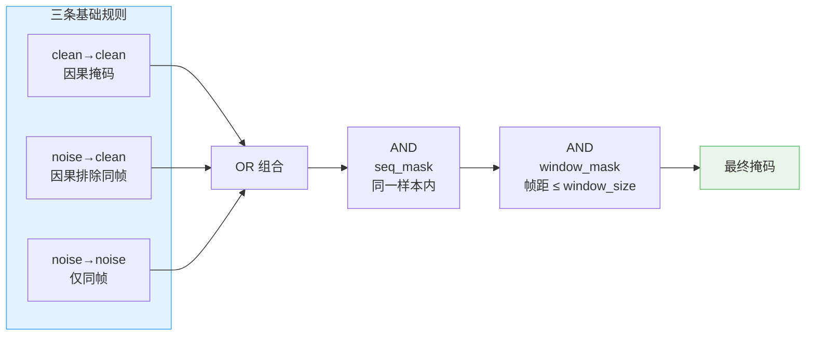

# 第 03 章 FlexAttention 注意力掩码：谁能看见谁

> **前情提要**：第 02 章拆解了 MoT 双流架构——视频流和动作流共享注意力、各走各的 FFN。本章聚焦注意力中最精巧的部分：训练时如何用 FlexAttention 的 block mask 精确控制四种 token 之间的可见性规则。

**知识链接**：

- [因果注意力掩码](/前置知识/001g_前置知识_Causal_Attention因果注意力掩码) — 标准因果掩码的基础
- [Flow Matching 与连续归一化流](/前置知识/000g_前置知识_Flow_Matching与连续归一化流) — 带噪/干净 token 的来源

---

## 一、为什么需要自定义掩码

标准的因果注意力掩码只有一条规则：每个 token 只能看到自己和前面的 token。但 LingBot-VA 的训练序列里有**四种性质完全不同的 token**，它们需要不同的可见性规则：

| token 类型 | noise_id | 含义 | 数量（举例） |
|-----------|----------|------|------------|
| **noisy latent**（带噪视频） | 0 | 需要被去噪的视频 token，是模型的**预测目标** | 多 |
| **clean latent**（干净视频） | 1 | 真实观测或经噪声增强的历史视频 token，是**上下文** | 多 |
| **noisy action**（带噪动作） | 0 | 需要被去噪的动作 token，是模型的**预测目标** | 少 |
| **clean action**（干净动作） | 1 | 真实执行过的历史动作，是**上下文** | 少 |

noise_id = 0 表示"带噪声、需要被去噪"，noise_id = 1 表示"干净的、作为条件"。

**核心直觉**：带噪 token 是"考试题目"，干净 token 是"参考答案"。考试规则是：你可以参考过去的答案（因果性），但不能偷看同一时刻其他考试题目的答案（否则就是信息泄漏）。

## 二、三条掩码规则

LingBot-VA 的注意力掩码由三条基础规则的**或组合**构成，再叠加两层全局约束：

### 规则 1：clean → clean（因果掩码）

$$
M_{\text{c2c}}(q, k) = \mathbb{1}[\text{noise}_q = 1] \cdot \mathbb{1}[\text{noise}_k = 1] \cdot \mathbb{1}[\text{frame}_k \leq \text{frame}_q]
$$

**这个公式在做什么**：干净 token 之间用标准因果掩码——只能看到当前帧及之前帧的干净 token。

::: details 📐 公式详解（点击展开）

| 子表达式 | 它是谁 | 它在干嘛 |
|---------|--------|---------|
| $\mathbb{1}[\text{noise}_q = 1] \cdot \mathbb{1}[\text{noise}_k = 1]$ | **双方身份检查** | 确认 query 和 key 都是干净 token |
| $\mathbb{1}[\text{frame}_k \leq \text{frame}_q]$ | **时间因果约束** | key 的帧索引不能超过 query 的帧索引 |

**用人话读**："干净 token 只能看到时间上在自己前面（含同帧）的其他干净 token。"

**为什么是标准因果**：干净 token 之间不存在信息泄漏风险——它们本身就是 ground truth，互相看到不会导致作弊。
:::

### 规则 2：noise → clean（因果但排除同帧）

$$
M_{\text{n2c}}(q, k) = \mathbb{1}[\text{noise}_q = 0] \cdot \mathbb{1}[\text{noise}_k = 1] \cdot \mathbb{1}[\text{frame}_k < \text{frame}_q]
$$

**这个公式在做什么**：带噪 token 可以看到**严格在自己之前帧**的干净 token，但**不能看到同帧的干净 token**。

::: details 📐 公式详解（点击展开）

| 子表达式 | 它是谁 | 它在干嘛 |
|---------|--------|---------|
| $\mathbb{1}[\text{noise}_q = 0] \cdot \mathbb{1}[\text{noise}_k = 1]$ | **身份检查** | query 是带噪的（预测目标），key 是干净的（参考上下文） |
| $\mathbb{1}[\text{frame}_k < \text{frame}_q]$ | **严格因果** | key 的帧索引必须**严格小于** query——排除了同帧 |

**用人话读**："要去噪的 token 可以参考之前帧的真实观测，但不能偷看自己这帧的答案。"

**为什么排除同帧**：如果带噪 token 能看到同帧的干净 token，它就直接复制答案了，不需要学习任何东西。排除同帧迫使模型必须从过去的信息中**预测**当前帧。
:::

### 规则 3：noise → noise（仅限同帧）

$$
M_{\text{n2n}}(q, k) = \mathbb{1}[\text{noise}_q = 0] \cdot \mathbb{1}[\text{noise}_k = 0] \cdot \mathbb{1}[\text{frame}_k = \text{frame}_q]
$$

**这个公式在做什么**：带噪 token 只能看到**同帧**的其他带噪 token，不能看到其他帧的带噪 token。

::: details 📐 公式详解（点击展开）

| 子表达式 | 它是谁 | 它在干嘛 |
|---------|--------|---------|
| $\mathbb{1}[\text{noise}_q = 0] \cdot \mathbb{1}[\text{noise}_k = 0]$ | **身份检查** | 两边都是带噪 token |
| $\mathbb{1}[\text{frame}_k = \text{frame}_q]$ | **同帧约束** | 只能看到自己这帧的带噪同伴 |

**用人话读**："同一道考题的各部分之间可以互相参考（同帧的视频 patch 和动作 token 互相看到），但不能看到其他时刻的考题。"

**为什么只限同帧**：不同帧的带噪 token 各自处于不同的去噪阶段，它们的噪声模式不同。如果能互相看到，模型可能利用"其他帧的噪声模式"来推断当前帧的内容，而不是真正学会从上下文预测。限制为同帧内互看保证了模型只能利用空间关系（同一帧内不同 patch 之间的位置关系），而不是利用跨帧的噪声相关性。
:::

### 注意：没有 clean → noise 规则

仔细观察三条规则，会发现缺了一种组合：**干净 token 看带噪 token**。这是有意为之——干净 token 是上下文，它不需要关注带噪 token 的内容。带噪 token 是"草稿"，让干净 token 去关注草稿没有意义。

## 三、三条规则的组合

最终的掩码是三条规则的**或**组合，再叠加两层全局约束：

| 层级 | 约束 | 作用 |
|------|------|------|
| 基础规则 | clean2clean OR noise2clean OR noise2noise | 按 token 类型定义可见性 |
| 全局约束 1 | seq_mask | 不同 batch 样本之间互不可见 |
| 全局约束 2 | block_window_mask | 帧距超过 window_size 的 token 互不可见 |

**window_mask 的作用**：训练时随机采样 window_size ∈ [4, 64]（见 `_prepare_input_dict` 中的 `random.randint(4, 64)`），限制注意力的时间范围。这既节省计算量（不需要关注太远的历史），又是一种正则化——强迫模型学会在有限的上下文窗口内做出预测。

## 四、可见性全景：四种 token 看到什么

把三条规则合起来，每种 token 的视角如下：

| query 类型 \ key 类型 | clean latent | clean action | noisy latent | noisy action |
|---|---|---|---|---|
| **clean latent** | 因果（≤ 当前帧） | 因果（≤ 当前帧） | 不可见 | 不可见 |
| **clean action** | 因果（≤ 当前帧） | 因果（≤ 当前帧） | 不可见 | 不可见 |
| **noisy latent** | 严格因果（< 当前帧） | 严格因果（< 当前帧） | 仅同帧 | 仅同帧 |
| **noisy action** | 严格因果（< 当前帧） | 严格因果（< 当前帧） | 仅同帧 | 仅同帧 |

这张表的对角线结构揭示了设计哲学：

- **干净 token 的世界是独立的**：它们只互相看到，完全不受带噪 token 的干扰
- **带噪 token 能利用过去的干净上下文**：这是从历史观测推断未来的信息来源
- **带噪 token 只在同帧内互相协作**：同一帧的视频 patch 和动作 token 可以互相帮助（例如动作 token 从同帧的视频 patch 中获取空间信息），但不能跨帧泄漏

## 五、帧索引的设计：chunk_size 的作用

掩码中的"帧索引"并不是原始的帧编号，而是经过 chunk_size 分组后的**块索引**：

| token 类型 | 帧索引计算 | 含义 |
|-----------|-----------|------|
| 视频 token | `原始帧号 // chunk_size * 2` | 偶数索引 |
| 动作 token | `原始帧号 // chunk_size * 2 + 1` | 奇数索引 |

**为什么乘以 2 并偏移**：这让同一个 chunk 内的视频帧和动作帧有不同的帧索引——视频帧索引是偶数，动作帧索引是奇数。配合 noise2clean 的"严格小于"规则，同一 chunk 的带噪动作 token 可以看到同一 chunk 的干净视频 token（奇数 > 偶数），但带噪视频 token 不能看到同一 chunk 的干净动作 token（偶数 < 奇数不成立）。

这精确实现了 VA 范式的因果关系：**先有视频（观测），再有动作（控制）**——在同一时间步内，动作可以依赖观测，但观测不依赖动作。

## 六、跨注意力掩码

除了自注意力的复杂掩码，跨注意力（语言条件注入）使用简单得多的掩码：

$$
M_{\text{cross}}(q, k) = \mathbb{1}[\text{seq}_q = \text{seq}_k] \cdot \mathbb{1}[\text{seq}_q \geq 0] \cdot \mathbb{1}[\text{seq}_k \geq 0]
$$

**这个公式在做什么**：跨注意力只要求 query 和 key 属于同一个 batch 样本——每个 token 可以完整地关注语言指令的所有位置。

::: details 📐 公式详解（点击展开）

| 子表达式 | 它是谁 | 它在干嘛 |
|---------|--------|---------|
| $\mathbb{1}[\text{seq}_q = \text{seq}_k]$ | **样本匹配** | 确保 query（视频/动作 token）和 key（语言 token）属于同一个样本 |
| $\mathbb{1}[\text{seq} \geq 0]$ | **有效性检查** | 排除 padding token（padding 的 seq_id 设为 -1） |

**用人话读**："每个 token 完整地看到自己对应的语言指令，不受时间因果或噪声类型的限制。"

**为什么跨注意力不需要因果约束**：语言指令是全局条件，每个时间步都需要完整地理解"把碗叠起来"这条指令。限制某些 token 只能看到指令的一部分没有意义。
:::

## 七、训练掩码 vs 推理机制

掩码只在训练时使用。推理时不用 FlexAttention，而是用标准注意力 + [KV Cache](/前置知识/002m_前置知识_KV_Cache与自回归解码) 实现等效的因果性：

| | 训练 | 推理 |
|---|---|---|
| **注意力模式** | FlexAttention（`attn_mode="flex"`） | 标准 SDPA（`attn_mode="torch"`） |
| **因果性实现** | 编译的 block mask | KV Cache 中只存储已处理的历史 token |
| **并行度** | 整个 episode 所有帧并行 | 逐 chunk 自回归 |
| **信息泄漏防护** | 精确的 noise/clean 可见性规则 | 天然不存在——推理时没有"未来的干净 token" |

推理时不需要区分 noisy/clean token 的掩码，因为推理是自回归的：每一步只有当前 chunk 的 token 作为 query，历史 token 的 K/V 已经缓存好——天然满足因果性。

## 八、Padding 处理

训练时整个序列（noisy_latent + clean_latent + noisy_action + clean_action）需要 padding 到 128 的整数倍（FlexAttention 的 block size 要求）。padding 的处理：

- padding token 的 `seq_id` 和 `frame_id` 都设为 -1
- seq_mask 要求 $\text{seq}_q \geq 0$ 且 $\text{seq}_k \geq 0$，自动排除了所有 padding token
- padding 不参与任何注意力计算

---

> **下一章预告**：第 04 章将拆解数据管线——VAE 如何编码多相机图像、动作如何归一化、以及 latent 预计算如何加速训练。
