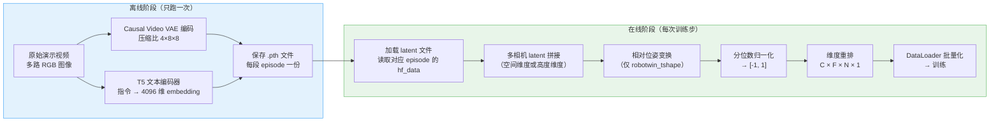
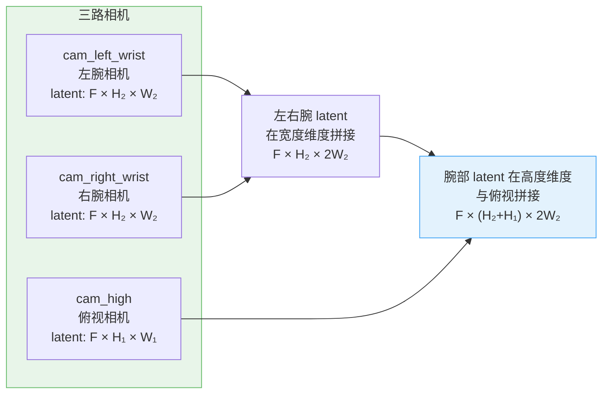
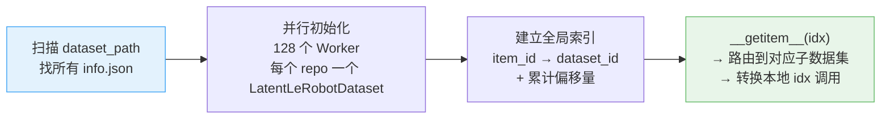

# 第 04 章 数据管线与动作归一化

> **前情提要**：第 03 章拆解了 FlexAttention 的四种 token 可见性规则。本章走到数据这一侧——一条机器人演示数据怎么从原始视频和关节角变成送进 Transformer 的 latent tensor，以及动作归一化为什么用分位数而不是均值方差。

**知识链接**：

- [Causal Video VAE](/前置知识/000v_前置知识_因果视频VAE与潜空间压缩) — 视频压缩到 latent 空间的工具
- [Flow Matching 与连续归一化流](/前置知识/000g_前置知识_Flow_Matching与连续归一化流) — 训练目标的基础

---

## 一、数据管线全景

一条训练样本的生命周期分为**离线预计算**和**在线加载**两个阶段：



这个分离的好处很明显：VAE 编码和 T5 编码是计算瓶颈，预计算后可以多次复用，训练时只需读磁盘，不需要在 GPU 上跑大模型推理。

## 二、LeRobot 数据格式

LingBot-VA 的数据管线建立在 [LeRobot 数据集格式](https://github.com/huggingface/lerobot) 之上。LeRobot 是 HuggingFace 维护的机器人数据标准，把每个演示存成带时间戳的帧序列：

| 字段 | 类型 | 含义 |
|------|------|------|
| `action` | float tensor | 关节角、末端姿态等控制信号 |
| `observation.images.*` | 视频文件路径 | 各路相机的 RGB 图像 |
| `episode_index` | int | 所属 episode 编号 |
| `frame_index` | int | episode 内的帧序号 |

`LatentLeRobotDataset` 继承 `LeRobotDataset`，在加载动作数据的同时，用本地的预计算 latent 文件替换视频加载，跳过实时的 VAE 编码。

**latent 文件的组织方式**：每段 episode 的每路相机对应一个 `.pth` 文件，路径格式为：
```
latents/chunk-{episode_chunk:03d}/{camera_key}/episode_{episode_index:06d}_{start_frame}_{end_frame}.pth
```

一个 `.pth` 文件包含：latent 张量、帧 ID 列表、latent 的高宽信息、以及对应指令的 T5 embedding。

## 三、多相机 latent 拼接

RoboTwin 任务用三路相机：一路俯视（cam_high）和两路腕部（cam_left_wrist、cam_right_wrist）。三路 latent 的分辨率不同，不能直接拼接，需要特殊处理：



这种"T 形"拼接（`robotwin_tshape`）的设计考虑了两点：腕部相机分辨率相同可以直接横拼；俯视相机提供全局场景理解，腕部相机提供局部操作精度，纵向叠加而不是横向叠加可以让每一帧的空间布局更接近人类的直觉理解。

拼接后的 latent 统一通过 `out_dict['latents'] = out_dict['latents'].permute(3, 0, 1, 2)` 转换为 `C × F × H × W` 格式，以匹配 VAE latent 的标准通道优先排列。

## 四、CFG Dropout：无分类器引导训练

跨注意力条件是语言 embedding，推理时需要支持 [无分类器引导（CFG）](/前置知识/000p_前置知识_无分类器引导CFG与条件生成)。CFG 需要模型在训练时也见过"无条件"样本，否则无条件推理会崩。

做法很简单：以概率 `cfg_prob` 把语言 embedding 替换为预计算好的"空 embedding"（`empty_emb`，对应空字符串的 T5 输出）：

```python
if torch.rand(1).item() < self.cfg_prob:
    text_emb = self.empty_emb
```

这一行代码在每个训练样本加载时随机执行，让模型同时学会"有条件去噪"和"无条件去噪"两种模式。推理时，CFG 公式把两种预测的差值放大：$\hat{v} = v_{\text{uncond}} + s \cdot (v_{\text{cond}} - v_{\text{uncond}})$，引导系数 $s$ 默认为 5.0（见 `va_robotwin_cfg.py` 的 `guidance_scale=5`）。

## 五、动作对齐与填充

动作序列的时间戳和视频 latent 的时间戳未必完全对齐（latent 文件记录了哪些帧被编码成了 latent，起始帧可能和原始动作数据的起始帧不同）。`_action_post_process` 负责对齐、裁剪、填充：

**步骤一：时间对齐**

`act_shift = latent_frame_ids[0] - local_start_frame`

`latent_frame_ids[0]` 是 latent 文件实际开始的帧，`local_start_frame` 是 meta 中记录的起始帧。两者之差就是动作序列需要跳过的帧数——跳过 `act_shift` 帧后，动作和 latent 的时间起点对齐。

**步骤二：帧步长与前置填充**

视频帧之间有 `frame_stride`（通常等于 `action_per_frame`，即每帧对应多少个动作步）。在对齐后的动作序列前面填充 `frame_stride * 4` 个零动作，原因是：第一帧 latent 的"动作"表示机器人从静止开始的初始化动作，实际上是零向量。

**步骤三：动作通道重排（robotwin_tshape）**

RoboTwin 的双臂机器人原始动作格式：左臂 7 维末端位姿（索引 0-6）、左臂夹爪（索引 7）、右臂 7 维末端位姿（索引 8-14）、右臂夹爪（索引 15），加上关节角等其他通道。

通过 `used_action_channel_ids` 选取和重排感兴趣的通道，并通过 `inverse_used_action_channel_ids` 把重排后的通道映射回标准顺序，确保归一化统计数据（q01/q99）的维度匹配。

**步骤四：相对位姿变换（robotwin_tshape）**

末端位姿（平移 + 四元数）被转换为相对于第一帧的**相对位姿**：

$$
\Delta p_t = p_t - p_0, \quad \Delta R_t = R_0^{-1} \cdot R_t
$$

**这个公式在做什么**：把绝对末端位姿转成相对于起始位置的增量，消除不同 episode 之间起始位置的差异，让模型学习的是"动作增量"而不是"绝对位置"。

::: details 📐 公式详解（点击展开）

| 子表达式 | 它是谁 | 它在干嘛 |
|---------|--------|---------|
| $p_t - p_0$ | **平移增量** | 相对于起始位置的平移偏移，消除不同任务起始位置的差异 |
| $R_0^{-1} \cdot R_t$ | **旋转增量** | 相对于起始朝向的旋转变化，用四元数实现（scipy Rotation 运算） |
| $\Delta p_0 = 0,\ \Delta R_0 = I$ | **第一帧归零** | 起始帧的相对位姿始终是零——所有 episode 的起始状态统一了 |

**用人话读**："把每个 episode 的关节位置'归零'——记录的是'从起点移了多少'，而不是'在哪里'。"

**为什么用相对位姿**：绝对末端位姿的范围在不同任务间差异巨大（桌子左侧的任务 vs 右侧的任务），分位数归一化的统计量很难覆盖所有情况。相对位姿的范围主要由"动作幅度"决定，不同 episode 的幅度更一致。
:::

## 六、分位数归一化

归一化把动作值映射到 $[-1, 1]$：

$$
a_{\text{norm}} = \frac{a - q_{01}}{q_{99} - q_{01} + \varepsilon} \times 2 - 1
$$

**这个公式在做什么**：用训练集的 1% 和 99% 分位数作为归一化边界，把动作值线性映射到 $[-1, 1]$，然后截断到 $[-1.5, 1.5]$。

::: details 📐 公式详解（点击展开）

| 子表达式 | 它是谁 | 它在干嘛 |
|---------|--------|---------|
| $q_{01}$ | **下界** | 训练集动作的 1% 分位数——"几乎最小值" |
| $q_{99}$ | **上界** | 训练集动作的 99% 分位数——"几乎最大值" |
| $a - q_{01}$ | **平移** | 把下界对齐到 0 |
| $\frac{a - q_{01}}{q_{99} - q_{01}}$ | **缩放** | 把 [q01, q99] 范围映射到 [0, 1] |
| $\times 2 - 1$ | **中心化** | 把 [0, 1] 映射到 [-1, 1] |
| $\varepsilon = 10^{-6}$ | **稳定项** | 防止动作范围为零时除以零（夹爪维度在某些 episode 可能几乎不动） |

**用人话读**："找出训练数据里最小的那 1% 和最大的那 1%，用它们作为边界做线性缩放，超出边界的值截断到 ±1.5。"

**为什么不用均值/方差归一化**：动作分布不一定是高斯分布。关节角度通常有物理边界（比如腕部旋转不超过 180 度），分布往往是均匀的或者有多峰结构。均值/方差归一化会把所有值压缩到均值附近，边界处的动作被过度压缩；分位数归一化直接用数据实际范围，更符合真实动作的分布。
:::

截断到 $[-1.5, 1.5]$ 而不是 $[-1, 1]$ 是有意设计的：训练时见过少量超出 $[q_{01}, q_{99}]$ 范围的异常值（归一化后 > 1 或 < -1），截断到 $[-1.5, 1.5]$ 而不是 $[-1, 1]$ 给这些异常值留了一点空间，推理时对未见过的动作幅度有一定鲁棒性。

RoboTwin 配置的 q01/q99 统计数据存在 `va_robotwin_cfg.py` 里，每个动作通道有独立的统计数据，反映了不同通道（平移 vs 旋转 vs 夹爪）的动态范围差异。

## 七、动作张量的最终格式

经过所有处理后，动作张量的形状变为 `C × F × N × 1`，其中：

| 维度 | 含义 | 数值（RoboTwin） |
|------|------|----------------|
| C | 动作通道数 | 30 |
| F | latent 帧数 | 取决于 episode 长度 |
| N | 每帧关联的动作步数 | `frame_stride`（通常 = `action_per_frame` = 16） |
| 1 | 空间"宽度"（无实际意义） | 1 |

最后一个维度的 1 是为了让动作 tensor 和视频 latent tensor 有相同的维度数（`C × F × H × W`），方便统一的 patch embedding 接口：`action_embedder` 把 `C = 30` 映射到 `3072`，把 `F × N × 1` 平展为 token 序列。

同时，动作有效性掩码 `actions_mask`（形状相同，bool 类型）标记哪些动作步是真实数据（True）、哪些是填充的零（False）。训练时只对 mask 为 True 的动作步计算 loss。

## 八、MultiLatentLeRobotDataset：多数据集混合

`MultiLatentLeRobotDataset` 把多个 `LatentLeRobotDataset` 实例拼接成一个大数据集：



多进程初始化（128 个 worker）是必要的，因为每个 LeRobot 数据集初始化需要读取 meta 信息和检查文件存在性，串行初始化几百个数据集会很慢。

全局索引的实现简单而高效：维护一个 `item_id_to_dataset_id` 字典和每个子数据集的累计偏移量 `acc_dset_num`，`__getitem__` 时查表确定属于哪个子数据集，减去偏移量得到本地索引。

---

> **下一章预告**：第 05 章将进入训练循环，拆解双路 Flow Matching 的噪声调度（SNR shift + BSMNTW 加权）、噪声历史增强技巧、以及 FSDP 分布式训练配置。
