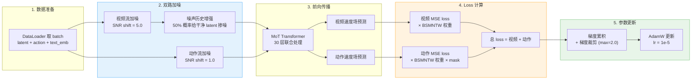
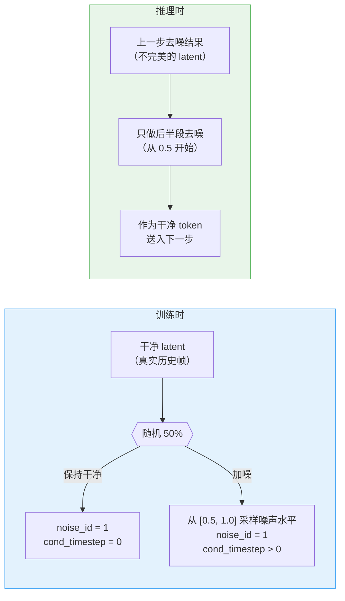
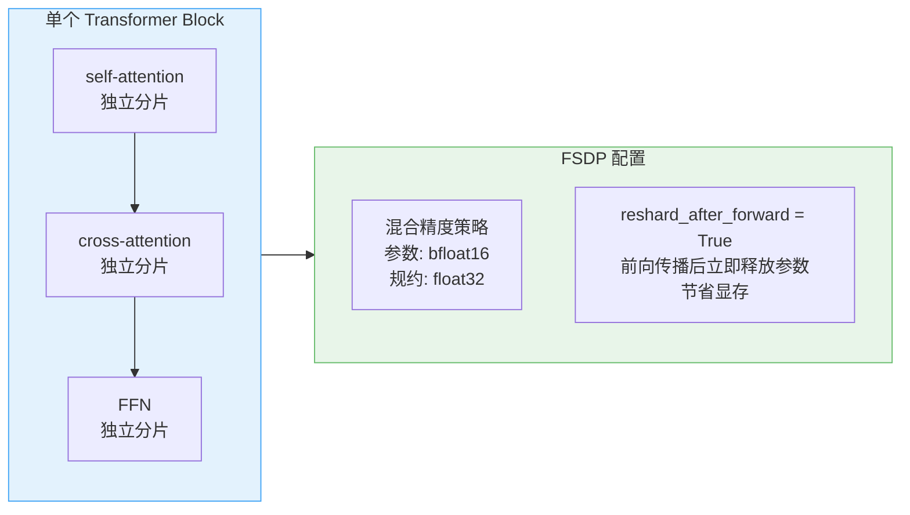

# 第 05 章 双路 Flow Matching 训练

> **前情提要**：第 04 章拆解了数据管线——latent 预计算、多相机拼接、分位数归一化。本章进入训练循环的核心：视频流和动作流各自怎么加噪、loss 怎么算、噪声历史增强如何与推理时的部分去噪配合，以及 FSDP 分布式训练的工程配置。

**知识链接**：

- [Flow Matching 与连续归一化流](/前置知识/000g_前置知识_Flow_Matching与连续归一化流) — 训练目标的基础
- [MoT 双流模型与不对称设计](./02_MoT双流模型与不对称设计) — 本章的训练对象

---

## 一、训练循环全景

整个训练步可以拆成五个阶段：

核心设计：视频流和动作流使用**不同的噪声调度器**（不同的 SNR shift），但共用同一个 Transformer 做前向传播，最终 loss 直接相加（$\lambda = 1$）。

## 二、Flow Matching 噪声调度

### 线性插值加噪

[Flow Matching](/前置知识/000g_前置知识_Flow_Matching与连续归一化流) 的加噪过程是一个从干净样本 $x_0$ 到纯噪声 $\epsilon$ 的线性插值：

$$
x_t = (1 - \sigma_t) \cdot x_0 + \sigma_t \cdot \epsilon
$$

**这个公式在做什么**：在干净数据和随机噪声之间做线性混合，$\sigma_t$ 控制混合比例——$\sigma_t = 0$ 是纯干净数据，$\sigma_t = 1$ 是纯噪声。

::: details 📐 公式详解（点击展开）

| 子表达式 | 它是谁 | 它在干嘛 |
|---------|--------|---------|
| $x_0$ | **干净样本** | 视频 latent 或动作向量，来自真实演示数据 |
| $\epsilon$ | **高斯噪声** | 与 $x_0$ 同形状的标准正态噪声 |
| $\sigma_t$ | **噪声水平** | 由调度器在 $[\sigma_{\min}, \sigma_{\max}]$ 区间内生成，越大噪声越多 |
| $(1 - \sigma_t)$ | **信号保留率** | 干净数据在混合中的权重 |

**用人话读**："把干净数据和随机噪声按比例混合，比例由时间步 $t$ 决定。"

**为什么用线性插值而不是加性噪声**：线性插值直接连接 $x_0$ 和 $\epsilon$，定义了一条从数据到噪声的直线路径。模型的任务是学习这条路径上的速度场 $v_t = \epsilon - x_0$——给定 $x_t$，预测应该往哪个方向走才能从噪声回到干净数据。
:::

训练目标是让模型预测速度场 $v_t = \epsilon - x_0$，loss 是预测值和真实速度场之间的 MSE。

### SNR Shift：拉高噪声水平

$\sigma_t$ 不是均匀分布的——通过 SNR shift 参数 $s$ 把噪声水平整体拉高：

$$
\sigma'_t = \frac{s \cdot \sigma_t}{1 + (s - 1) \cdot \sigma_t}
$$

**这个公式在做什么**：用 shift 参数 $s$ 把噪声调度曲线向上弯曲，让模型在训练时见到更多高噪声样本。

::: details 📐 公式详解（点击展开）

| 子表达式 | 它是谁 | 它在干嘛 |
|---------|--------|---------|
| $\sigma_t$ | **原始噪声水平** | 均匀分布在 $[\sigma_{\min}, \sigma_{\max}]$ |
| $s$ | **shift 参数** | 控制噪声水平的偏移程度，$s > 1$ 拉高噪声，$s = 1$ 不变 |
| $\frac{s \cdot \sigma_t}{1 + (s-1)\sigma_t}$ | **变换后的噪声水平** | 单调递增函数，$\sigma_t = 0$ 时仍为 0，$\sigma_t = 1$ 时仍为 1，中间值被拉高 |

**用人话读**："把噪声调度曲线向上弯，让中间时间步的噪声更大，模型在训练时更多地练习'重噪声去噪'。"

**为什么视频和动作用不同的 shift**：视频 latent 是高维信号（48 通道、空间分辨率高），需要更强的噪声才能有效训练——shift = 5.0 意味着中间时间步的噪声比标准调度高很多。动作是低维信号（30 维），分布简单，不需要那么多高噪声训练——shift = 1.0 等于不做偏移。
:::

LingBot-VA 的配置：

| | 视频流 | 动作流 |
|---|---|---|
| **SNR shift** | 5.0 | 1.0（无偏移） |
| **推理步数** | 25 步 | 50 步 |
| **CFG 引导系数** | 5.0 | 1.0（无引导） |

动作流推理步数反而更多（50 vs 25），因为动作精度对机器人控制至关重要——多花一倍的去噪步换取更精确的动作预测。

## 三、BSMNTW 加权

并非所有时间步的 loss 权重都相等。LingBot-VA 使用 **BSMNTW（Bell-Shaped Monotonic Non-increasing Timestep Weighting）**——一个钟形权重曲线，让中间噪声水平的 loss 权重最大。原始权重经高斯核计算后，再归一化和基线校正：

$$
w_t = \exp\left(-2 \left(\frac{t - T/2}{T}\right)^2\right), \quad \hat{w}_t = (w_t - w_{\min}) \cdot \frac{T}{\sum_t (w_t - w_{\min})}
$$

**这个公式在做什么**：给时间步分配钟形权重——接近 $T/2$（中等噪声）的时间步权重最大，两端（纯噪声或几乎干净）的时间步权重最小，归一化后权重总和等于 $T$。

::: details 📐 公式详解（点击展开）

| 子表达式 | 它是谁 | 它在干嘛 |
|---------|--------|---------|
| $\frac{t - T/2}{T}$ | **归一化偏离中心的距离** | 离中心越远，这个值越大 |
| $-2(\cdot)^2$ | **高斯核** | 让远离中心的时间步被快速压低 |
| $\exp(\cdot)$ | **钟形曲线** | 峰值在 $t = T/2$，两侧对称衰减 |
| $w_t - w_{\min}$ | **基线校正** | 减去最小值让边缘权重降到 0 |
| $\cdot T / \sum$ | **归一化** | 让权重总和等于 $T$，平均权重为 1 |

**用人话读**："中等噪声水平的训练样本最重要，极端噪声（太多或太少）的样本权重低。"

**为什么这样加权**：纯噪声时模型几乎无法提取任何有用信息，loss 高但学不到东西；几乎干净时模型已经很容易预测，loss 低但也学不到新东西。中间噪声水平是模型真正需要学习"如何从部分信息中重建"的区域——把 loss 权重集中在这里，训练效率最高。
:::

## 四、噪声历史增强：训练时掺噪，推理时省一半

这是 LingBot-VA 最巧妙的训练技巧之一。

### 问题：推理时干净 token 从哪来？

训练时，序列中有干净 token（历史帧的真实 latent）和带噪 token（需要去噪的 latent）。但推理时没有"真实"的历史帧——模型只有自己上一步去噪得到的结果。如果训练时干净 token 永远是完美的真实数据，推理时却是模型自己生成的（有误差的）数据，这个分布偏移会导致误差累积。

### 解决：以 50% 概率给干净 token 加噪

训练时，以 50% 概率从 $[0.5, 1.0]$ 均匀采样一个噪声水平，给干净 latent 加上对应强度的噪声。这个被加噪的 latent 仍然标记为 `noise_id = 1`（干净类型），但它的 `cond_timestep` 不再是 0——告诉模型"这个'干净' token 其实有噪声，处理时要考虑"。

推理时的配合：模型不需要从纯噪声（$\sigma = 1$）开始做完整去噪，只需要从 $\sigma = 0.5$ 开始做后半段去噪。因为训练时已经见过 $[0.5, 1.0]$ 范围内的带噪"干净" token，推理时用半去噪的结果作为干净 token 不会造成分布偏移。

**收益**：推理时视频流的去噪步数直接减半（从 25 步完整去噪变成约 12-13 步部分去噪），推理速度提升约一倍——一个训练技巧换来的纯推理加速。

需要注意：噪声历史增强**只作用于视频流**（`noisy_cond_prob=0.5`），动作流不做（`noisy_cond_prob=0.0`）。因为动作流的"干净" token 是真实执行过的历史动作，精度很高，没有分布偏移问题。

## 五、双路 Loss 计算

### 训练目标

两条流的训练目标都是 MSE loss——预测的速度场 $\hat{v}_t$ 和真实速度场 $v_t = \epsilon - x_0$ 之间的均方误差：

$$
\mathcal{L} = \mathcal{L}_{\text{video}} + \mathcal{L}_{\text{action}}
$$

**这个公式在做什么**：视频重建 loss 和动作回归 loss 直接相加，权重 $\lambda = 1$，没有额外的平衡系数。

::: details 📐 公式详解（点击展开）

| 子表达式 | 它是谁 | 它在干嘛 |
|---------|--------|---------|
| $\mathcal{L}_{\text{video}}$ | **视频 loss** | 预测速度场 $\hat{v}_t$ 和真实速度场 $v_t = \epsilon - x_0$ 的 MSE，按 BSMNTW 加权，按帧归一化 |
| $\mathcal{L}_{\text{action}}$ | **动作 loss** | 同样是 MSE + BSMNTW 加权，但额外乘以 `actions_mask`，只对真实动作步计算 |
| $\lambda = 1$ | **权重** | 两个 loss 不加额外权重，直接相加 |

**用人话读**："视频预测 loss 加上动作预测 loss，两者权重相等。"

**为什么不加权重平衡**：视频 loss 和动作 loss 的量级因为各自的 BSMNTW 加权和归一化已经大致对齐。实验中发现 $\lambda = 1$ 就能让两条流同步收敛，不需要额外调权重。
:::

### 视频 Loss

视频 loss 的计算按帧归一化：对每帧内的所有空间位置和通道求和，然后除以元素数量，最后跨帧取平均。乘以 BSMNTW 权重后，每帧的贡献由其时间步的噪声水平决定。

### 动作 Loss

动作 loss 和视频 loss 结构相同，但多一步：乘以 `actions_mask`。[第 04 章](./04_数据管线与动作归一化)提到，动作序列中的填充零标记为 False，只有真实动作步参与 loss 计算。归一化时也只除以 mask 为 True 的元素数量，避免填充零稀释 loss。

### 梯度累积

每 `gradient_accumulation_steps` 步做一次实际的参数更新。在累积阶段，loss 被除以累积步数（等效于在多个 mini-batch 上做平均），梯度照常累积但不执行 optimizer.step()。累积期间通过 `set_requires_gradient_sync(False)` 关闭 FSDP 的梯度同步——不需要每个 mini-batch 都做 AllReduce，只在真正更新参数时同步一次。

## 六、优化器与学习率

| 超参数 | 值 | 说明 |
|--------|-----|------|
| 优化器 | AdamW（fused） | PyTorch 的 fused 实现，在 GPU 上一次性完成所有操作 |
| 学习率 | $10^{-5}$ | 相当保守，因为骨架已预训练 |
| $\beta_1, \beta_2$ | 0.9, 0.95 | $\beta_2 = 0.95$ 比默认值 0.999 更激进，适合视频模型 |
| weight decay | 0.1 | 较强的正则化 |
| warmup | 10 步线性 warmup | 非常短，从 0 线性升到目标学习率后保持恒定 |
| 梯度裁剪 | max norm = 2.0 | 防止训练爆炸 |
| 批量大小 | 1（每 GPU） | 视频 latent 占显存大，每 GPU 只放一个样本 |
| 总步数 | 50000 步 | RoboTwin 配置 |

批量大小只有 1 是因为 5B 参数模型 + 完整 episode 的视频 latent 几乎占满了 GPU 显存。通过梯度累积（RoboTwin 配置为 1，Libero 配置为 10）来等效增大 batch size。

## 七、FSDP 分布式训练

LingBot-VA 使用 PyTorch 的 [FSDP（Fully Sharded Data Parallel）](https://pytorch.org/docs/stable/fsdp.html) 做分布式训练，把模型参数、梯度、优化器状态分散到多个 GPU 上。

### 分片策略

分片粒度是**每个 Transformer Block 内部的子模块**：

每个 Block 的 self-attention、cross-attention、FFN 各自被 `fully_shard` 包裹，然后整个 Block 再包一层，最后整个 model 再包一层。这种嵌套分片确保了最细粒度的显存管理——前向传播到某个子模块时才从其他 GPU 收集该子模块的完整参数，用完立即释放（`reshard_after_forward=True`）。

### 混合精度策略

| 阶段 | 精度 | 原因 |
|------|------|------|
| 参数存储和前向传播 | bfloat16 | 节省显存和计算 |
| 梯度规约（AllReduce） | float32 | 保证数值稳定性，多 GPU 求和时 bfloat16 精度不够 |

### 激活检查点

每个 Transformer Block 都被 `checkpoint_wrapper` 包裹。前向传播时不保存中间激活值，反向传播时重新计算——用时间换显存。对于 30 层、每层处理完整 episode 的大模型，不开激活检查点根本放不进显存。

## 八、随机化参数

训练过程中有四个随机化维度，增强模型的泛化能力：

| 随机化 | 范围 | 作用 |
|--------|------|------|
| **噪声时间步** | 均匀采样 | 每帧独立采样，同一 batch 内不同帧的噪声水平不同 |
| **噪声历史增强** | 50% 触发，[0.5, 1.0] 范围 | 让模型适应不完美的干净 token |
| **chunk_size** | [1, 4] 随机整数 | 控制帧分组大小，影响注意力掩码的帧索引分配 |
| **window_size** | [4, 64] 随机整数 | 控制注意力的时间窗口宽度 |

chunk_size 和 window_size 的随机化特别重要——推理时 chunk_size 固定为 `frame_chunk_size`（RoboTwin 配置为 2），window_size 固定为 `attn_window`（72）。训练时用随机值让模型在多种分组和窗口大小下都能工作，推理时选择的固定值在训练分布的覆盖范围内。

## 九、CFG Dropout 与训练的配合

[第 04 章](./04_数据管线与动作归一化)提到数据集层面以 `cfg_prob = 0.1` 概率替换语言 embedding 为空 embedding。这个概率值的选择有讲究：太高会让模型"忘记"语言条件的重要性，太低则无条件预测不够好——10% 是经验上的平衡点。

推理时，视频流用 CFG 引导系数 5.0（强引导），动作流用 1.0（不引导）。动作不做 CFG 引导是因为动作空间是低维连续值，不像视频需要语言条件来"锚定"生成方向——动作的方向已经由视频帧间的变化隐式确定了。

## 十、检查点保存

每隔 `save_interval` 步（RoboTwin 为 1000 步）保存一次模型权重：

1. 通过 `get_model_state_dict` 把 FSDP 分片的参数收集到 rank 0
2. 转换为 bfloat16 精度（减小文件大小）
3. 用 safetensors 格式保存（比 PyTorch 的 .bin 更安全、加载更快）
4. 同时保存模型 config.json，格式与 diffusers 预训练模型一致

保持与预训练模型相同的存储格式，让 resume 训练或推理部署可以直接用 `load_transformer` 加载，不需要额外的格式转换。

---

> **下一章预告**：第 06 章将进入推理服务端，拆解 VAE streaming 编码、两阶段去噪（先视频后动作）、KV Cache 的四种操作、以及异步流水线与前向动力学校正如何协同压低延迟。
