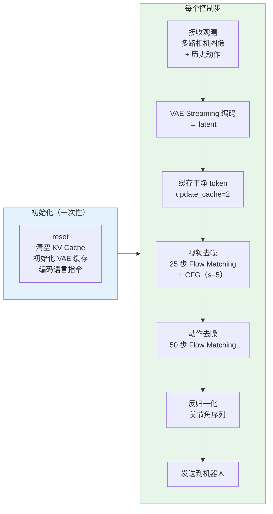
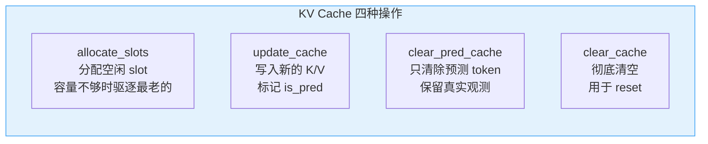
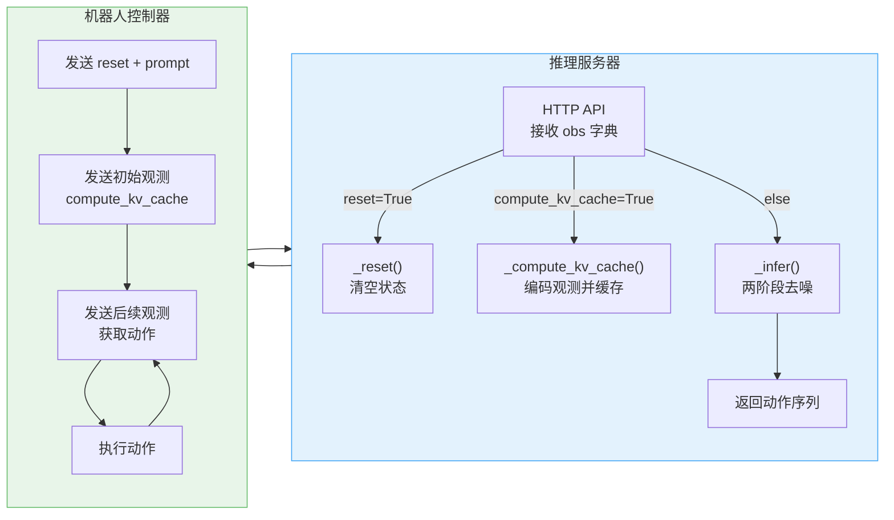
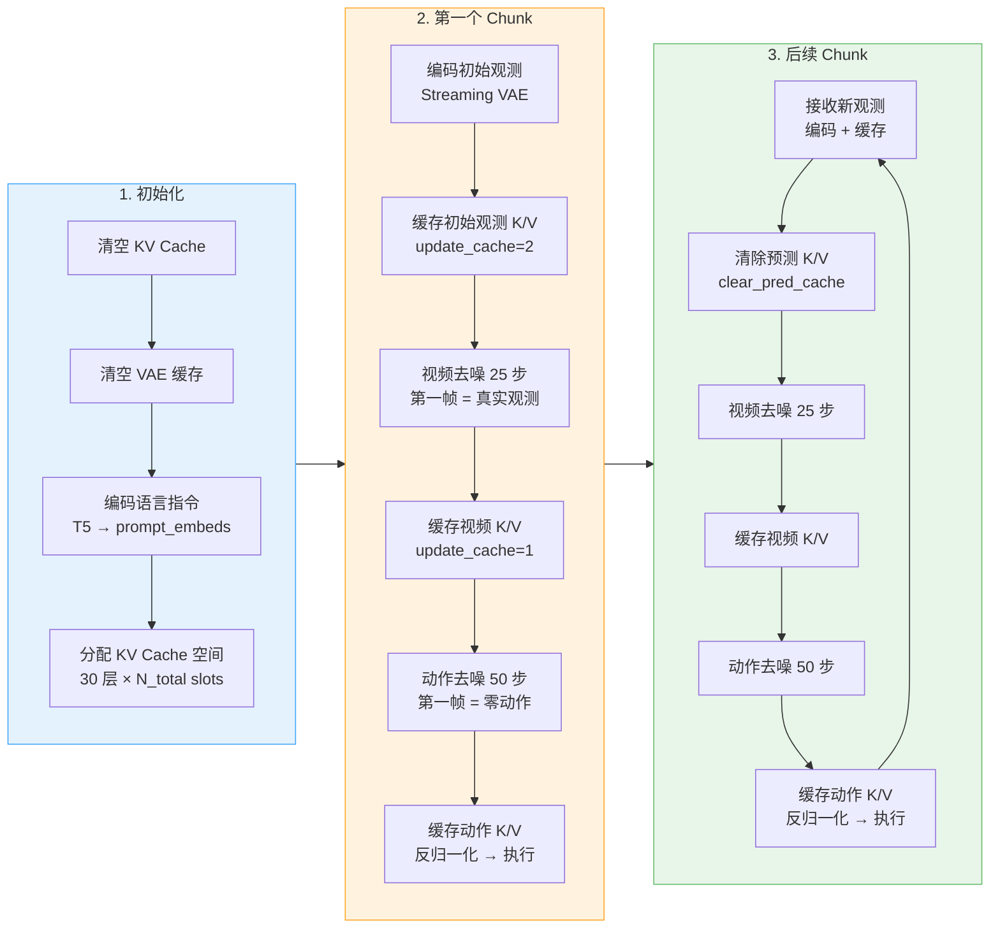

# 第 06 章 推理服务与 KV Cache 管理

> **前情提要**：第 05 章拆解了双路 Flow Matching 训练——SNR shift 噪声调度、BSMNTW 加权、噪声历史增强。本章是系列的终章，进入推理服务端：模型怎么从一帧初始观测开始，逐 chunk 自回归地生成视频帧和动作序列，KV Cache 如何实现长程记忆，以及两阶段去噪、CFG、异步流水线怎么协同工作。

**知识链接**：

- [KV Cache 与自回归解码](/前置知识/002m_前置知识_KV_Cache与自回归解码) — 推理时的缓存机制
- [无分类器引导（CFG）](/前置知识/000p_前置知识_无分类器引导CFG与条件生成) — 引导系数的作用
- [Causal Video VAE](/前置知识/000v_前置知识_因果视频VAE与潜空间压缩) — 视频编码与解码

---

## 一、推理全景

推理服务接收来自机器人控制器的请求，执行一个三阶段循环：

整个推理是**先编码观测、再去噪视频、最后去噪动作**的严格串行流水线。视频去噪完成后，其结果（去噪后的 latent）作为 KV Cache 的一部分供动作去噪使用——动作流从视频流的中间表征中读取"未来画面"信息来推断动作。

## 二、VAE Streaming 编码

推理时需要把多路相机图像编码为 latent。不同于训练时用预计算的离线 latent，推理时用 **Streaming VAE** 实时编码。

### 为什么需要 Streaming

标准 VAE 编码需要一次性输入完整视频序列。但推理是逐 chunk 进行的——每个控制步只有当前帧的图像，不可能等到整个 episode 结束再编码。

`WanVAEStreamingWrapper` 解决了这个问题：它利用 Wan2.2 VAE 内部 `WanCausalConv3d` 的因果卷积特性，维护一个 `feat_cache` 列表，存储每层因果卷积的历史特征。每次只输入新的帧，卷积层从缓存中读取历史特征完成计算——效果等价于把所有帧一次性编码，但内存开销从 $O(T)$ 降到 $O(1)$。

### 多相机编码（robotwin_tshape）

RoboTwin 的三路相机编码方式和[第 04 章](./04_数据管线与动作归一化)描述的拼接策略一致，但推理时的实现有一个区别：**俯视相机和腕部相机用不同的 VAE 实例**。

| 相机 | 分辨率 | VAE 实例 |
|------|--------|---------|
| cam_high（俯视） | 256 × 320 | `streaming_vae` |
| cam_left_wrist + cam_right_wrist（腕部） | 128 × 160 | `streaming_vae_half` |

两个 VAE 实例权重相同，但各自维护独立的 `feat_cache`。这是因为 Streaming VAE 的因果卷积缓存与输入分辨率绑定——不同分辨率的相机混用同一个缓存会导致形状不匹配。

编码完成后的拼接顺序：左右腕在宽度维度拼接 → 与俯视在高度维度拼接 → 取均值（$\mu$）→ latent 归一化。

## 三、KV Cache：长程记忆的四种操作

KV Cache 是推理时最重要的数据结构。它存储了所有历史 token 的 Key 和 Value，让自回归生成时不需要重新计算历史 token 的注意力表征。

### 缓存结构

每个 Transformer Block 的自注意力层维护一个缓存字典：

| 字段 | 形状 | 含义 |
|------|------|------|
| `k` | $[B, N_{\text{total}}, H, D]$ | 缓存的 Key 张量 |
| `v` | $[B, N_{\text{total}}, H, D]$ | 缓存的 Value 张量 |
| `id` | $[N_{\text{total}}]$ | 每个 slot 的递增 ID，用于识别时间顺序 |
| `mask` | $[N_{\text{total}}]$（bool） | 哪些 slot 被占用 |
| `is_pred` | $[N_{\text{total}}]$（bool） | 哪些 slot 存的是预测（去噪）结果而非真实观测 |

$N_{\text{total}}$ 是缓存总容量，由注意力窗口大小和每 chunk 的 token 数决定：

$$
N_{\text{total}} = \frac{W}{2} \cdot T_{\text{latent}} + \frac{W}{2} \cdot T_{\text{action}}
$$

**这个公式在做什么**：KV Cache 的总容量由注意力窗口大小和每 chunk 的 token 数决定，视频和动作各占一半窗口。

::: details 📐 公式详解（点击展开）

| 子表达式 | 它是谁 | 它在干嘛 |
|---------|--------|---------|
| $W$ | **注意力窗口** | `attn_window`，默认 72，控制模型能"记住"多远的历史 |
| $W/2$ | **半窗口** | 视频和动作各占一半窗口容量 |
| $T_{\text{latent}}$ | **每 chunk 视频 token 数** | $= F_{\text{chunk}} \cdot H / p_h \cdot W / p_w$，由 chunk 大小和 patch 化决定 |
| $T_{\text{action}}$ | **每 chunk 动作 token 数** | $= F_{\text{chunk}} \cdot \tau$，$\tau = 16$ 为每帧动作步数 |

**用人话读**："缓存能存半个窗口的视频 token 加半个窗口的动作 token，总容量固定，满了就驱逐最老的。"

**为什么容量固定**：固定容量保证显存占用恒定，不会随 episode 变长而 OOM。超出容量时 LRU 驱逐最旧的 token——最近的历史比远古历史更重要。
:::

### 四种操作

**allocate_slots**：为新的 K/V 腾出空间。如果有足够的空闲 slot，直接分配；如果缓存已满，按 `id` 从小到大排序，驱逐最旧的 slot（LRU 策略），为新数据腾出空间。这保证了缓存始终保留**最近的**历史信息。

**update_cache**：把新计算的 Key/Value 写入分配好的 slot，同时标记 `is_pred` 标志——如果这是去噪步（`update_cache=1`），标记为预测；如果这是缓存真实观测（`update_cache=2`），标记为非预测。

**clear_pred_cache**：只清除 `is_pred=True` 的 slot，保留真实观测的 K/V。这在每个推理 chunk 开始时调用——上一个 chunk 的去噪过程中写入的预测 K/V 被清除，因为新 chunk 会重新去噪。

**clear_cache**：彻底清空所有 slot，用于 episode 重置时。

### update_cache 参数的三种模式

`update_cache` 参数控制缓存行为：

| 值 | 含义 | 使用场景 |
|---|------|---------|
| 0 | **不更新缓存**，只读取已有 K/V 做注意力 | 去噪循环的中间步——每次推理步都重新计算 Q/K/V，但不写入缓存 |
| 1 | **写入并标记为预测** | 去噪循环的最后一步——把最终去噪结果的 K/V 写入缓存 |
| 2 | **写入并标记为真实观测** | 缓存真实观测——把编码后的干净 latent/action 的 K/V 写入缓存 |

这个设计的精妙之处：去噪循环中间步的 K/V 是临时的（每一步噪声水平不同，K/V 也不同），不需要缓存；只有最后一步的 K/V 代表去噪完成的"干净"结果，才值得缓存。而缓存真实观测（模式 2）在 `_compute_kv_cache` 中调用，把编码后的干净 latent 和预处理后的干净动作写入缓存，供后续 chunk 的注意力查询使用。

## 四、两阶段去噪

每个 chunk 的推理分为两个串行阶段：先去噪视频，再去噪动作。

### 第一阶段：视频去噪

1. 从纯噪声 $\epsilon$ 开始，形状为 $[1, 48, F_{\text{chunk}}, H, W]$
2. 设置 25 步推理调度（`num_inference_steps=25`）
3. 每一步：
   - 把当前带噪 latent 送入 Transformer（`action_mode=False`）
   - Transformer 在注意力层读取 KV Cache 中的历史 token
   - 输出速度场预测，应用 CFG 引导
   - 用调度器做一步更新：$x_{t-1} = x_t + \hat{v}_t \cdot (\sigma_{t-1} - \sigma_t)$
4. 最后一步（`update_cache=1`）：把去噪完成的 K/V 写入缓存

### 第二阶段：动作去噪

1. 从纯噪声 $\epsilon$ 开始，形状为 $[1, 30, F_{\text{chunk}}, 16, 1]$
2. 设置 50 步推理调度（`action_num_inference_steps=50`）
3. 每一步：
   - 把当前带噪动作送入 Transformer（`action_mode=True`）
   - Transformer 在注意力层读取 KV Cache 中的所有历史 token（包括第一阶段刚缓存的视频 K/V）
   - 输出速度场预测（动作不做 CFG，`action_guidance_scale=1`）
   - 用动作调度器做一步更新
4. 最后一步：把去噪完成的动作 K/V 写入缓存

**为什么先视频后动作**：动作流需要从视频流的 K/V 中读取"未来画面"信息。如果两者同时去噪，动作流在注意力层只能看到上一个 chunk 的视频 K/V（过时的），看不到当前 chunk 的视频预测。先去噪视频并缓存其 K/V，动作流就能利用最新的视频预测来推断动作。

## 五、CFG 在推理中的实现

视频去噪时使用 [CFG 引导](/前置知识/000p_前置知识_无分类器引导CFG与条件生成)，引导系数 $s = 5$。实现方式是 **batch 复制**：

1. 把输入 latent 复制一份，形成 batch size = 2
2. 第一份用正常的语言 embedding（条件预测 $v_{\text{cond}}$）
3. 第二份用空的 negative embedding（无条件预测 $v_{\text{uncond}}$）
4. 合并预测：$\hat{v} = v_{\text{uncond}} + s \cdot (v_{\text{cond}} - v_{\text{uncond}})$

KV Cache 的 batch 维度也相应设为 2——两份缓存分别服务条件和无条件两条推理路径。

动作去噪的 CFG 引导系数为 1（`action_guidance_scale=1`），等效于不做 CFG——动作方向已经由视频帧间变化隐式确定，不需要语言条件的额外引导。

## 六、条件帧处理

每个 chunk 的第一帧有特殊处理。在第一个 chunk（`frame_st_id=0`）时：

- **视频**：第一帧的 latent 被替换为初始观测的编码结果（`latent_cond`），对应的时间步设为 0（完全干净）。去噪只作用于后续帧，第一帧始终保持为真实观测。
- **动作**：第一帧的动作被替换为全零向量（机器人从静止开始），对应时间步设为 0。

后续 chunk 不需要条件帧——KV Cache 中已经有完整的历史信息。

## 七、推理模式

`VA_Server` 支持两种推理模式：

### 服务器模式（server）

通过 HTTP 接口与机器人控制器交互。控制循环：

控制器先发 reset 初始化，然后交替发送观测和接收动作。`_compute_kv_cache` 在发送动作之前被调用——把当前观测编码并缓存到 KV Cache，然后 `_infer` 用缓存的历史信息去噪生成下一步的动作。

### 图像到视频-动作模式（i2va）

从单张初始图像出发，自回归地生成多个 chunk 的视频和动作序列，最后用 VAE 解码回 RGB 视频并保存。这是一个纯生成模式——没有真实的机器人在闭环执行，用于可视化和评估模型的"想象"能力。

## 八、动作后处理

去噪完成的动作张量需要反归一化才能发送给机器人：

$$
a = \frac{a_{\text{norm}} + 1}{2} \cdot (q_{99} - q_{01} + \varepsilon) + q_{01}
$$

**这个公式在做什么**：把归一化后的 $[-1, 1]$ 动作值反变换回物理单位（弧度、米等），是[第 04 章](./04_数据管线与动作归一化)归一化公式的逆运算。

::: details 📐 公式详解（点击展开）

| 子表达式 | 它是谁 | 它在干嘛 |
|---------|--------|---------|
| $(a_{\text{norm}} + 1) / 2$ | **从 [-1,1] 回到 [0,1]** | 中心化的逆操作 |
| $\cdot (q_{99} - q_{01} + \varepsilon)$ | **恢复范围** | 把 [0,1] 放大到 [0, q99-q01] |
| $+ q_{01}$ | **恢复偏移** | 加回下界，恢复到物理量程 |

**用人话读**："把模型输出的 [-1,1] 动作值按照训练时的统计数据还原成关节角度、末端位移等物理量。"
:::

反归一化后，通过 `used_action_channel_ids` 把通道重排回机器人控制器期望的标准顺序（左臂位姿、左臂夹爪、右臂位姿、右臂夹爪、关节角）。

## 九、推理时的显存管理

5.3B 参数模型 + KV Cache + VAE 的显存占用很大，需要精细管理：

| 策略 | 做法 | 节省 |
|------|------|------|
| **VAE/T5 offload** | VAE 和 T5 编码器平时放 CPU，需要时搬到 GPU | 省约 3-4 GB |
| **两个 VAE 实例** | robotwin_tshape 模式下俯视和腕部用独立 VAE，编码完立即清理 | 避免缓存冲突 |
| **KV Cache 容量控制** | 按 `attn_window` 固定缓存大小，超出时驱逐最旧的 | 显存恒定 |
| **推理完清理** | 每步推理后调用 `torch.cuda.empty_cache()` | 回收碎片 |
| **i2va 模式分阶段** | 先生成 latent 并删除 Transformer，再加载 VAE 解码 | 峰值显存不叠加 |

`enable_offload` 控制 VAE 和 T5 是否常驻 GPU。在显存充裕时关闭 offload 可以省去 CPU-GPU 搬运的开销。

## 十、完整推理时序

把所有组件串起来，一个 episode 的完整推理时序如下：

每个后续 chunk 开始时先调 `clear_pred_cache`——清除上一个 chunk 去噪过程中标记为 `is_pred=True` 的 K/V slot，但保留所有 `is_pred=False` 的真实观测 K/V。然后编码新观测、缓存、去噪、执行——循环往复直到任务完成。

KV Cache 让模型在推理时拥有了**长程记忆**：每一步的注意力计算都能访问到所有历史 chunk 的 K/V（在窗口大小限制内），相当于模型记住了"之前发生过什么"。这对长程任务（比如连续叠三个碗）至关重要——模型需要记住前两个碗已经叠好了，才能正确规划第三个碗的抓取位置。

---

> 这是 LingBot-VA 深度解析系列的最后一章。全系列从[全景图](./01_全景图_视频世界模型如何控制机器人)出发，经过 [MoT 双流架构](./02_MoT双流模型与不对称设计)、[FlexAttention 掩码](./03_FlexAttention注意力掩码_谁能看见谁)、[数据管线](./04_数据管线与动作归一化)、[双路训练](./05_双路FlowMatching训练)，最终到推理服务，完整走通了一个 5.3B 参数视频-动作世界模型的设计、训练、部署全流程。核心收获：视频模型不只是"生成好看的视频"，它学到的物理先验可以直接驱动机器人在真实世界中完成复杂操作任务。
