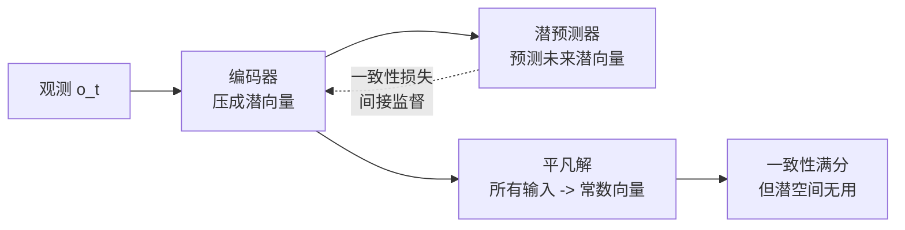

# 第一章：离散时间世界模型的局限

本章不做推导，只把问题钉死：为什么"预测下一帧 / 下一步"这条离散时间路线，从根上就注定不灵活、不物理、且容易坍塌。把痛点讲清楚，才能理解第二章的 PT-Flow 为什么要那样设计。

---

**知识链接**

- [世界模型基础](/前置知识/000t_前置知识_世界模型基础) — 世界模型的定义与常见形态
- [Flow Matching 与连续归一化流](/前置知识/000g_前置知识_Flow_Matching与连续归一化流) — 另一种"学速度场"的思路，务必分清两种时间
- [常微分方程 ODE——直觉与数值求解](/前置知识/001b_前置知识_常微分方程ODE直觉与数值求解) — 连续时间语言

---

## 一 物理世界是连续的

我们身处的世界，空间和时间都是连续的。物体在连续时间里移动、碰撞、形变，整个过程由物理定律支配，而物理定律本身就是以微分方程的形式写出来的。人在感知和决策时也天然适应连续变化——你看一个人伸手去拿杯子，看到的不是"每秒 30 张静止图片"，而是一段连续的、速度时快时慢的运动。

但几乎所有当代 AI 模型都在离散时间上工作：视频被建模成图像帧序列，决策被求解成固定间隔的时间步。这种离散化对工程实现是必要的近似，但当它成为建模的**唯一视角**时，就与物理世界的连续性产生了根本性错位。

## 二 局限一：僵硬，无法处理不规则采样

离散时间模型把数据切成固定间隔的帧，这带来一个隐性约束——数据必须**按时对齐**。训练时要帧率一致，生成时每一步也对应固定的时间跨度。

这在现实中经常不成立。真实传感器采样会抖动、会丢帧；不同数据集的帧率不一样；我们有时还希望生成训练数据里不存在的"中间帧"（时间超分辨率）。离散模型面对这些情况要么无法处理，要么需要专门的重采样预处理，而重采样本身又会引入误差。

一句总结：**离散时间把"时间间隔"硬编码进了模型结构，于是模型失去了对时间间隔的控制权。**

## 三 局限二：只学表观转移，学不到连续物理

第二个问题更本质。离散模型学的是"给定当前帧，预测下一帧"，这个目标只看两帧之间的关系，完全无视两帧之间发生了什么。模型因此变成一个"模仿视频"的机器——它能把表观变化复制得很像，却没有被迫去内部化底层连续的高阶物理规律。

这导致一个实际后果：模型在训练数据覆盖的时间间隔上表现很好，一旦要求它外推到不同时间尺度，就会露馅。因为它学到的是"每隔 Δt 走一步"的映射，而不是"任意时刻的速度是多少"。真正的物理系统应该由一个速度场（或加速度场）描述，时间间隔只是积分步长，可以自由选择——离散模型没有这个自由度。

## 四 局限三：潜空间世界模型的表示坍塌

为了摆脱逐像素重建的高昂代价，近年出现了一类**潜空间世界模型**：先把观测编码到紧凑潜空间，在潜空间里预测未来，再由解码器还原成图像。其中最著名的是 JEPA（Joint Embedding Predictive Architecture）家族。

JEPA 的做法是联合学习一个编码器和一个潜预测器：编码器把观测压成潜向量，预测器预测"未来观测的潜向量"，训练信号是"预测潜向量"与"真实未来潜向量"之间的一致性损失。

问题出在这个一致性损失上。它是**间接监督**——只要求预测的潜向量和编码器编出的潜向量一致，却不直接约束潜向量本身应该表达什么。在这种间接目标下，潜空间存在平凡解：编码器可以把所有输入都压成同一个常数向量，预测器输出这个常数，"一致性"完美满足，但潜空间毫无信息。这就是**表示坍塌（representation collapse）**。

JEPA 的既有对策是加外部正则（如让潜向量服从某种分布、或加方差项防止坍缩），但这些正则往往以牺牲表达能力为代价——潜空间被"拉直"了、变光滑了，却也丢掉了原始特征里的丰富结构。

> 读图重点：坍塌的根源是那条虚线——损失只约束"预测潜向量 ≈ 真实潜向量"，而编码器有动机把两者一起压成常数来作弊。注意：这条损失从不直接告诉潜向量"你该表达什么"。

## 五 与 Flow Matching 的关键区别

读到这里，熟悉生成模型的读者会想到 [Flow Matching](/前置知识/000g_前置知识_Flow_Matching与连续归一化流)：它同样学一个随时间变化的速度场、同样用 ODE 求解器生成，为什么它没有上面这些问题？

关键在于**两种"时间"的含义完全不同**。

| 维度 | Flow Matching 的时间 $t$ | PT-Flow 的时间 $\tau$ |
|------|------------------------|----------------------|
| 含义 | 插值进度参数 | 真实物理时间 |
| 取值范围 | 人为设定，通常归一化到 $[0,1]$ | 任务实际经过的时间（可归一化） |
| 起点 | 纯噪声 | 当前真实观测 |
| 终点 | 数据样本 | 目标状态 / 未来帧 |
| 监督信号 | 噪声到数据的已知插值方向 | 从真实轨迹差分估计的物理速度 |
| 用途 | 从无到有生成样本 | 预测真实世界未来的演化 |

Flow Matching 的 $t$ 是一根人为拉出来的"从噪声通向数据"的进度条——它根本不关心物理时间；PT-Flow 的 $\tau$ 是机器人真的走了几秒。这个区别决定了 Flow Matching 用来"生成"，而 PT-Flow 用来"预测物理系统的未来"。

## 六 ODEWorld 想要拿到什么

理解了三条局限，ODEWorld 的目标就清楚了。它要构造一个**连续时间的潜空间世界模型**，同时具备：

1. **任意时间分辨率**：因为是连续速度场 + ODE 积分，可以在任意时刻求值，不受训练帧率限制，能做时间超分辨率、能填补丢帧。
2. **反向预测**：把积分方向取反（$v \to -v$）就能倒放，这是连续 ODE 结构天然具备、离散模型没有的能力。
3. **不发生表示坍塌**：通过对潜速度场施加**直接**监督来绕开 JEPA 的间接监督陷阱。
4. **面向规划的信息**：学到的潜空间要能作为规划用的子目标，服务下游策略学习。

下一章进入 PT-Flow 的两个核心设计，看它如何用"动力学表示解耦"和"直接一阶监督"把这四件事同时实现。

## 本章小结

- 物理世界连续，但主流世界模型都在离散时间上建模，由此产生三类问题。
- 离散模型的僵硬、只学表观转移、以及 JEPA 的表示坍塌，是三个独立但同源的痛点。
- Flow Matching 与 PT-Flow 都学速度场，但对"时间"的定义不同：前者是插值进度，后者是物理时间。
- ODEWorld 的目标：连续时间、任意分辨率、可反向、不坍塌、面向规划。
