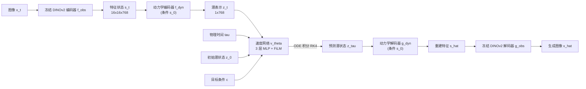

# 第三章：ODEWorld 架构与训练

前情提要：第二章确立了 PT-Flow 的两个设计——动力学表示解耦、直接一阶监督。本章把 PT-Flow 装进一个完整系统，看 DINOv2、动力学编解码器、FiLM 速度网络、Savitzky-Golay 滤波如何各就各位，以及训练和推理的两条流水线。

---

**知识链接**

- [DINOv2 视觉特征提取器](/前置知识/013b_前置知识_DINOv2视觉特征提取器) — ODEWorld 的冻结视觉骨干
- [Cross Attention 与交替注意力机制](/前置知识/001e_前置知识_Cross_Attention与交替注意力机制) — 动力学编解码器的实现方式
- [AdaLayerNorm 条件化归一化](/前置知识/001f_前置知识_AdaLayerNorm条件化归一化) — FiLM 条件注入的近亲
- [图像质量指标 PSNR SSIM LPIPS](/前置知识/011c_前置知识_图像质量指标_PSNR_SSIM_LPIPS) — 评估生成质量的指标

---

## 一 整体架构

ODEWorld 的架构可以分成三层：最外层是冻结的 DINOv2 视觉编码器/解码器，把像素和"视觉特征状态"互相转换；中间是 PT-Flow 的动力学编解码器；最内层是一个轻量的速度网络。三层各司其职，训练时只有中间层和最内层被更新。

> 读图重点：右侧整条"解码"路径（$g_{\text{dyn}} \to g_{\text{obs}}$）只在需要看图时使用；对策略学习而言，$z_\tau$ 本身就是有用的紧凑子目标，不必解码回图像。

### 互动架构图

把上面三层结构动手走一遍，并拖动物理时间 τ 看积分过程：

<ODEWorldArchitecturePlayground />

## 二 视觉骨干：冻结的 DINOv2

直接用原始像素当状态有两个麻烦：像素维度太高，且用它估计速度目标 $\dot{s}_t$ 时数值不稳定。ODEWorld 的做法是先用一个**冻结**的预训练 DINOv2 编码器把图像 $x_t$ 投影到特征空间，即 $s_t = f_{\text{obs}}(x_t)$、$\hat{x}_t = g_{\text{obs}}(s_t)$，其中 $f_{\text{obs}}$ 是冻结的 DINOv2，$g_{\text{obs}}$ 是一个专门训练的、把 DINO 特征还原成图像的解码器。这个特征状态 $s_t$ 的维度是 $16 \times 16 \times 768$，相比原始像素在估计速度时数值更稳。

解码器 $g_{\text{obs}}$ 按 RAE 的做法，用 L1、LPIPS 和对抗损失三项联合训练：

$$
\mathcal{L}_{\text{DINO-recon}}(x_t) = \mathcal{L}_1(\hat{x}_t, x_t) + \omega_L\, \mathcal{L}_{\text{LPIPS}}(\hat{x}_t, x_t) + \omega_G\, \lambda\, \mathcal{L}_{\text{GAN}}(\hat{x}_t, x_t)
$$

**这个公式在做什么**：训练一个能把 DINO 特征还原成清晰、逼真图像的解码器——L1 保证像素级接近，LPIPS 保证感知相似，对抗损失保证视觉真实感。

::: details 📐 公式详解（点击展开）

| 子表达式 | 它是谁 | 它在干嘛 |
|---------|--------|---------|
| $\mathcal{L}_1(\hat{x}_t, x_t)$ | **像素级误差** | 生成图与真实图的逐像素 L1 距离，管"大体对不对" |
| $\mathcal{L}_{\text{LPIPS}}$ | **感知误差** | 用预训练网络的特征距离衡量"看起来像不像" |
| $\mathcal{L}_{\text{GAN}}$ | **真实感损失** | 判别器逼解码器产出更逼真的纹理细节 |
| $\omega_L, \omega_G, \lambda$ | **三项权重** | 平衡三种目标，防止某一项压倒其他 |

**用人话读**："让解码器既在像素上接近、在感知上相似、又看起来足够真实。"

**为什么需要三项而不是只用 L1**：只用 L1 会得到模糊图像，只用对抗损失会得到有伪影但锐利的图像，三者叠加是生成式视觉重建的标准折中。
:::

关键点是：**在训练 PT-Flow 时，$f_{\text{obs}}$ 和 $g_{\text{obs}}$ 都被冻结**。论文发现 PT-Flow 足够表达，能在 DINO 特征空间里维持"潜规划"与"重建"的一致，最终靠冻结解码器生成高质量图像。冻结视觉骨干把可训练参数压到很小，也让训练稳定。

## 三 动力学编解码器：单 token 表示变化

PT-Flow 的 $f_{\text{dyn}}$ 和 $g_{\text{dyn}}$ 用交叉注意力块实现。编码器 $f_{\text{dyn}}(s_t; s_0) = z_t$ 用一组**可学习的 query token**，去注意 $s_t$（当前特征）和 $s_0$（初始特征）这两个 key/value，产出紧凑的潜表示。解码器 $g_{\text{dyn}}$ 结构对称，但把 $s_0$ 作为 query，把 $z_t$ 作为 key/value——也就是说，它必须"用 $s_0$ 提供的静态上下文，结合 $z_t$ 提供的动力学信息"来重建 $s_t$。这个 query/key 的角色互换，正是强迫 $z_t$ 不携带静态内容的结构性约束。

一个令人惊讶的结果是：**一个 token 就够用了**。$z_t \in \mathbb{R}^{1\times768}$，相比特征状态 $s_t \in \mathbb{R}^{16\times16\times768}$，压缩了 256 倍，却仍能支撑高保真重建。这支撑了潜空间世界模型的核心洞见——原始像素里有大量冗余，底层动力学可以被一个很小的表示捕获。

这个单 token 的潜状态，就是后面速度网络的输入，也是策略学习时的子目标。它足够紧凑，使得"潜空间里的规划"极其轻量。

## 四 速度网络与时间条件

速度网络的输入是 $z_t, z_0, c$ 和物理时间 $t$。实现上极其轻量：一个 **3 层 MLP**，$z_t, z_0, c$ 直接拼接后输入；时间 $t$ 则通过 **FiLM（Feature-wise Linear Modulation）** 层注入——FiLM 用时间 $t$ 生成一组逐通道的缩放和平移系数，作用在 MLP 的中间特征上。

为什么时间要单独用 FiLM 而不是简单拼接？因为速度场对时间的依赖是"全局调制"性质的——同一个位置在任务早期和晚期，速度方向和大小可能完全不同（比如靠近把手时减速、拉动时加速）。FiLM 让时间直接调节整个网络的激活幅度，比把它当普通输入维度更容易表达这种全局的时变行为。

## 五 两处让目标速度更准的工程改进

### 5.1 时间重缩放与到达条件后的静止

直接用真实物理时间 $t$ 训练会有数值问题：$t$ 的量级随任务长度变化很大。ODEWorld 改用归一化时间 $\tau = t / L$，其中 $L$ 是一个归一化视野长度，约等于期望的规划长度：

$$
\tau = \frac{t}{L}
$$

**这个公式在做什么**：把真实物理时间按规划长度归一化，使 $\tau$ 在训练中大致落在 $[0,1]$，稳定网络的数值行为。

::: details 📐 公式详解（点击展开）

| 子表达式 | 它是谁 | 它在干嘛 |
|---------|--------|---------|
| $t$ | **真实物理时间** | 从初始状态起经过的实际时长 |
| $L$ | **归一化视野长度** | 约等于期望的规划长度，一个可调超参 |
| $\tau$ | **归一化时间** | 训练时输入网络的时间，范围近似 $[0,1]$ |

**用人话读**："把秒数除以预期的规划时长，得到一个大致在 0 到 1 之间的无量纲时间。"

**为什么需要它**：不同任务时长差异大，若不归一化，时间输入的量级会让网络难以泛化；归一化后，不同任务共享同一套时间尺度。注意 $\dot{s}_\tau$ 与 $\dot{s}_t$ 相差一个 $L$ 的缩放，在时间维度上等价。
:::

配套的一个假设是：**当系统到达目标条件 $c$ 后便进入静止状态**。因此，当归一化时间超过训练序列最后一帧的时间 $\tau_c$ 时，把未来状态固定为最后一帧，并让速度场趋近于零。这避免了模型在"任务已完成后"继续臆造运动。

### 5.2 Savitzky-Golay 导数滤波

第二个改进关乎监督信号的质量。$\dot{s}_t$ 若用最简单的相邻帧差分 $(s_{t+1}-s_t)/\Delta t$ 估计，会把观测里的高频抖动手动放大成巨大的速度噪声，污染 $\dot{z}_t$ 这个监督目标。ODEWorld 改用 **Savitzky-Golay（SG）导数滤波器**：在大小为 $2k+1$ 的滑动窗口内，用一个低阶多项式对位置序列做最小二乘拟合，再对拟合多项式求导得到平滑速度：

$$
\dot{s}_t = \sum_{i=-k}^{k} w_i\, s_{t+i}
$$

论文用窗口 $2k+1 = 5$，得到的核为 $w = \frac{1}{10}[-2, -1, 0, 1, 2]$。

**这个公式在做什么**：用滑动窗口内若干帧位置的加权和来估计当前速度，权重由局部多项式最小二乘拟合给出，既平滑又保形。

::: details 📐 公式详解（点击展开）

| 子表达式 | 它是谁 | 它在干嘛 |
|---------|--------|---------|
| $\{s_{t-k},\dots,s_{t+k}\}$ | **窗口内的位置** | 当前时刻前后的若干帧状态 |
| $w_i$ | **固定权重** | SG 核系数，由低阶多项式最小二乘拟合预计算，无需网络学习 |
| $\sum_i w_i s_{t+i}$ | **平滑速度** | 加权和给出当前时刻的速度估计 |

**用人话读**："用窗口里几帧位置的加权和当速度，权重按局部多项式拟合算出，噪声被压掉、形状还保留。"

**为什么不用高斯平滑或普通差分**：高斯平滑会盲目平均、把速度峰值抹平（抹掉任务的起停细节）；普通差分会放大抖动。SG 滤波器通过局部多项式拟合，在数值精度和时间平滑之间取得良好折中，让投影出的 $\dot{z}_t$ 既光滑又物理准确。对照下图三种做法：
:::

> 读图重点：红色有限差分曲线剧烈抖动，几乎无法作为监督目标；蓝色 SG 曲线紧贴绿色真实速度，把高频噪声滤掉但保留了速度的上升与回落形状。

## 六 训练与推理

**训练目标**是两项的加权和：

$$
\mathcal{L} = \lambda_{\text{rec}}\, \mathcal{L}_{\text{dyn-recon}} + \lambda_{v}\, \mathcal{L}_{v}
$$

**这个公式在做什么**：同时优化"重建得准"和"速度预测得准"，两项各自负责表示质量和动力学质量。

::: details 📐 公式详解（点击展开）

| 子表达式 | 它是谁 | 它在干嘛 |
|---------|--------|---------|
| $\mathcal{L}_{\text{dyn-recon}}$ | **重建项** | 第二章的动力学重建损失，保信息、防坍塌 |
| $\mathcal{L}_{v}$ | **速度项** | 第二章的直接一阶监督损失，学动力学 |
| $\lambda_{\text{rec}}, \lambda_{v}$ | **权重** | 平衡两项；论文发现都设为 1 就足够好 |

**用人话读**："表示要保得住、速度要测得准，各占一半权重。"

**为什么默认都取 1**：论文强调不需要调权重就能得到合理结果，这本身说明 PT-Flow 框架对超参不敏感，是学习稳健性的一个证据。
:::

训练时冻结 $f_{\text{obs}}$ 和 $g_{\text{obs}}$，只更新 $f_{\text{dyn}}, g_{\text{dyn}}, v_\theta$。

**推理**用一个现成的 ODE 求解器（如四阶 Runge-Kutta，RK4）从 $z_0$ 积分到任意 $\tau \in [0,1]$ 得到 $z_\tau$，然后分两路使用：

1. **视频生成**：$z_\tau \to s_\tau = g_{\text{dyn}}(z_\tau; s_0) \to \hat{x}_\tau = g_{\text{obs}}(s_\tau)$，得到图像帧。
2. **策略学习**：$z_\tau$ 直接作为紧凑的、动力学上有意义的子目标，给下游策略一个稳定的低维目标，绕开高维视觉规划。

推理速度是这套设计的另一大优势：因为速度场只是一个浅 MLP，且整个积分发生在极紧凑的潜流形上，数值积分非常轻，支持实时视频生成和快速迭代的潜空间规划，从而支撑闭环控制。

## 本章小结

- 视觉骨干用冻结 DINOv2，另训一个 $g_{\text{obs}}$ 解码器（L1 + LPIPS + GAN）还原图像。
- 动力学编解码器用交叉注意力实现，单 token 的 $z_t$ 就足以承载变化信息；解码器以 $s_0$ 为 query、$z_t$ 为 key/value，结构性防止 $z_t$ 携带静态内容。
- 速度网络是 3 层 MLP，时间用 FiLM 注入。
- 时间重缩放 $\tau = t/L$ 与到达后静止假设，保证数值稳定和物理合理；Savitzky-Golay 滤波给出光滑保形的速度目标。
- 训练最小化 $\lambda_{\text{rec}}\mathcal{L}_{\text{dyn-recon}} + \lambda_v \mathcal{L}_v$（默认都取 1）；推理用 RK4 积分，供视频生成与策略学习两用。

下一章看实验：连续时间具体换来了哪些离散模型做不到的能力。
