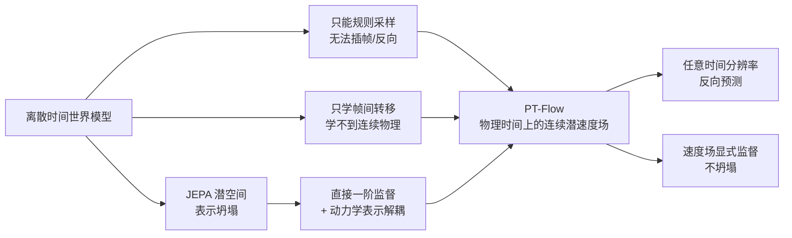

# ODEWorld 深度解析：物理时间流 PT-Flow 与连续潜空间世界模型

> 空间和时间在物理上是连续的，但几乎所有的世界模型都活在离散时间步里。ODEWorld 把"预测未来"重新表述成"在压缩潜空间里沿物理时间积分一个速度场"，一举拿到任意时间分辨率、反向预测、以及不会坍塌的表示。

## 系列定位

这个系列逐层拆解 ODEWorld（*ODEWorld: A Continuous Predictive Architecture via Physical-Time Flow*，arXiv:2607.27924）。它不是又一个"预测下一帧"的视频模型，而是提出了一套新的时间观：**Physical-Time Flow（PT-Flow）**——把数据的底层动力学建模成一个定义在真实物理时间上的连续潜速度场，未来预测等于用 ODE 求解器做一次时间积分。

这套思路与 [Flow Matching](/前置知识/000g_前置知识_Flow_Matching与连续归一化流) 表面相似（都学一个随时间变化的速度场、都用 ODE 求解器生成），但对"时间"的理解完全不同：Flow Matching 的时间 $t$ 是人为构造的插值进度（从噪声到数据的过渡参数），而 PT-Flow 的时间 $\tau$ 是真实物理时间（机器人执行任务经过的秒数）。理解这个区别，是理解整个方法的关键。

## 核心矛盾

现有世界模型——无论是像素级视频预测，还是 JEPA 式的潜空间预测——几乎都是**离散时间**的，由此带来三个结构性问题：

**第一，不灵活。** 离散模型把时间切成固定间隔的帧序列，只能处理规则采样、按时对齐的数据；面对不规则采样或丢帧就束手无策，也无法生成"两帧之间"的中间帧。

**第二，不物理。** 只学"这一帧到下一帧"的像素/传感器转移，模型只能模仿表观变化，学不到底层的、连续的高阶物理，本质上是"模仿视频"而非"理解世界"。

**第三，会坍塌。** JEPA 式潜空间世界模型（联合学习编码器和潜预测器）长期受**表示坍塌（representation collapse）**困扰：潜空间可能退化成平凡解，需要额外正则化，代价是牺牲表征能力。

ODEWorld 用一个连续时间框架同时回应这三点：

> 读图重点：左边三个局限各自来自不同根源，右边 PT-Flow 用两个设计（动力学表示解耦、直接一阶监督）分别化解，最终同时获得"灵活"和"不坍塌"两种性质。

## 互动架构总览

下面这个组件把 ODEWorld 的七个环节画成一条流水线，并配了一个"物理时间积分"演示：拖动或播放物理时间 τ，看速度场如何被 ODE 一步步积分成未来，还能一键切换正向/反向。

<ODEWorldArchitecturePlayground />

## 章节目录

| 章节 | 标题 | 解决的问题 |
|------|------|------------|
| 01 | [离散时间世界模型的局限](./01_离散时间世界模型的局限) | 为什么"预测下一帧"这条路注定不灵活、不物理、会坍塌 |
| 02 | [PT-Flow 的两大设计](./02_PTFlow的两大设计) | 动力学表示解耦 + 直接一阶监督如何构造可学的连续速度场 |
| 03 | [ODEWorld 架构与训练](./03_ODEWorld架构与训练) | DINOv2 特征、动力学编解码器、FiLM 速度网络、Savitzky-Golay 滤波 |
| 04 | [实验：从视频生成到策略学习](./04_实验从视频生成到策略学习) | 连续时间带来了哪些离散模型做不到的能力 |

## 阅读前提

- 线性代数、微积分与神经网络训练常识。
- [常微分方程 ODE——直觉与数值求解](/前置知识/001b_前置知识_常微分方程ODE直觉与数值求解)——连续时间建模的语言。
- [Flow Matching 与连续归一化流](/前置知识/000g_前置知识_Flow_Matching与连续归一化流)——同样学速度场，务必分清两种"时间"。
- [雅可比向量积 JVP](/前置知识/015g_前置知识_雅可比向量积JVP与自动微分)——"直接一阶监督"的数学工具。
- [世界模型基础](/前置知识/000t_前置知识_世界模型基础)——世界模型要解决什么。

## 贯穿例子

全文使用论文中的真实片段 **"机器人先靠近抽屉把手、再拉出抽屉"**（来自 LIBERO 数据集）。这段运动天然包含两个速度阶段——接近把手时先快后慢、到达时几乎停住，拉动时再次加速——因此它能直观检验"速度场是否编码了每个阶段的正确瞬时速度"。

## 延伸阅读

- [世界模型强化学习综述](/论文综述/S10_世界模型强化学习综述)——世界模型在决策中的整体图景。
- [Dreamer4 可扩展 Transformer 世界模型](/论文综述/092_Dreamer4_可扩展Transformer世界模型)——同为潜空间世界模型，可对照其表示学习方式。
- [GigaWorld-Policy 世界动作模型](/论文综述/160_GigaWorldPolicy05_更快更强的世界动作模型)——把世界模型用于策略的另一条工程路线。
