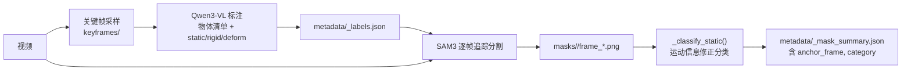

# 第 2 章：场景分解——VLM 标注与逐帧分割掩码

> **本章目标**：讲清楚步骤 1 和步骤 2 的完整工作——Qwen3-VL 怎么从视频关键帧中识别出所有物体并给它们分类，分类结果怎么和 SAM3 的逐帧掩码结合起来，以及这两步的输出格式是什么。

---

## 1. 为什么不直接用通用分割模型

最直接的想法是把 SAM 之类的分割模型跑在每一帧上，然后把物体找出来。这样做有两个问题：

1. **不知道哪些是"物体"**。视频帧里包含桌面、地板、墙壁、灯光反射……SAM 会分割一切，但 OVOW 只需要独立的可操作物体。
2. **不知道怎么分类**。后续流水线需要知道每个物体是 static、rigid 还是 deform，这是纯粹的语义判断，基于运动的分析可以辅助但无法独立做决定。

OVOW 的解决方案是先用视觉语言模型（VLM）做语义层面的"物体清单"，再用 SAM3 做每帧的像素级定位。两者输入互补：VLM 负责理解"有什么"，SAM3 负责说清楚"在哪里"。

---

## 2. 步骤 1：Qwen3-VL 语义标注

### 关键帧采样

步骤 1 不对所有帧运行 VLM，而是采样少量关键帧送给 Qwen3-VL。代码在 `masking/qwen_sam3_video_masks.py`，输出的关键帧存入 `keyframes/` 目录。

### 标注协议的设计

VLM 接收关键帧图像和一段精心设计的系统提示（`_build_qwen_api_label_prompt()`，第 559 行），要求它以 JSON 格式输出一个物体列表。每个物体条目的结构是：

```json
{
  "name": "coffee_mug",
  "num": 1,
  "visual_description": "white ceramic mug with a handle, partially filled with dark liquid",
  "category": "rigid",
  "reason": "solid container that will translate/rotate but not deform",
  "is_occluded": true,
  "occluded_by": "notebook"
}
```

`category` 字段只能是三个值之一：`"static"`、`"rigid"`、`"deform"`。

提示里对标注规则有明确约束，防止 VLM 给出后续步骤无法处理的结果：

- **具体性**：名字要足够具体，区分视野里所有同类物体（用 `red_apple` 不用 `apple`）
- **互斥性**：每个视觉实体只出现一次，不能分为"杯子"和"杯子把手"
- **英文单数小写**：`coffee_mug` 而不是 `Coffee Mugs`
- **超过阈值就聚合**：场景里物体太多时，把同类小物体合并成一组标注
- **遮挡 >10% 才标注 is_occluded**：小的边缘遮挡忽略，明显遮挡需要标记被谁遮挡（`occluded_by`），为后续 Amodal3R 遮挡补全做准备
- **禁用词**：不能用 `box`、`object`、`thing`、`item`、`container`、`shape` 这类过于笼统的词作为名字
- **忽略背景**：桌面、地板、墙壁、灯光不需要标注

### 标注的三种模式

`run_masks()` 函数（第 1855 行）支持三种标注模式，通过 `--label-category-mode` 参数切换：

- **legacy**：先跑 SAM3 得到所有候选 mask，再用 VLM 对这些 mask 做类别归属
- **single_pass**：直接让 VLM 从关键帧图像标注物体列表，再送 SAM3 追踪定位
- **dual_pass**：先做一次粗粒度标注，再做细粒度标注，两次结果合并

默认（`run_video.sh`）使用 `single_pass` 模式——VLM 先给出物体清单，SAM3 按清单做精确定位。

### 步骤 1 的输出

步骤 1 把标注结果写入 `metadata/<name>_labels.json`，结构大致是：

```json
{
  "objects": [
    {"name": "coffee_mug", "category": "rigid", "is_occluded": true, "occluded_by": "notebook", ...},
    {"name": "notebook",   "category": "static", ...},
    {"name": "plush_bear", "category": "deform", ...}
  ]
}
```

---

## 3. 静态/刚体/形变的判定逻辑

VLM 的分类是基于语义的，但 OVOW 会在掌握掩码序列之后用运动信息来修正它。修正逻辑在 `_classify_static()`（第 294 行）：

**判定为 static 的条件**（同时满足）：

1. 所有有效帧上，当前帧掩码与锚点帧掩码的 IoU 高于 `static_iou_thresh`（默认 0.9）
2. 掩码质心在帧间的像素移动量低于 `static_motion_px`（默认 5 像素）
3. 有效帧数量不低于 `min_valid_frames`

`high_iou_thresh` 和 `high_iou_motion_mult` 用于快速路径：如果 IoU 极高（>0.95），允许稍大的像素移动（阈值乘以 `high_iou_motion_mult`）也判定为 static——捕捉"几乎没动但相机移动导致轻微 IoU 变化"的情况。

`occlusion_area_ratio` 是另一个保护条款：如果某帧的掩码面积相比锚点帧大幅减小（遮挡比例超过阈值），该帧不计入 static 判定的统计，避免因遮挡导致错误分类。

**结果**：`_classify_static()` 的返回值覆写 VLM 的原始分类。被判定为 static 的物体会在后续步骤 6 里直接锁定位姿而不做追踪；VLM 认为是 deform 但运动分析认为是 static 的，也会被降级为 static 处理。

---

## 4. 步骤 2：SAM3 逐帧掩码生成

### SAM3 是什么

SAM3（Segment Anything 3D）是 SAM2 的扩展，可以在给定参考点或参考掩码的情况下，对视频进行时序一致的实例追踪分割。OVOW 用它的关键能力是：给出一个锚点帧上的物体位置，SAM3 自动传播到所有其他帧并保持实例一致性。

### client-server 协议

SAM3 的模型在 `ovow-sam3` 环境下，而步骤 2 运行在 `ovow-opg` 环境。进程间通信通过 client-server 协议完成：

- `engine/tools/sam3_client.py`：步骤 2 调用，把分割任务序列化后发给 SAM3 server
- SAM3 server（`ovow-sam3` 环境）：接收任务，运行 SAM3，把掩码结果序列化写回磁盘

对于每个物体，client 发送的信息包括：视频路径、物体名称、锚点帧编号、锚点帧上的参考提示（点或框）。SAM3 server 返回每一帧的分割掩码。

如果 SAM3 server 未启动，步骤 2 会 fallback 到直接调用 SAM3（在同一进程里），但需要手动安装 `ovow-sam3` 依赖。

### 掩码格式

每个物体的掩码以 PNG 序列存储在 `masks/<obj_name>/` 目录下：

```
masks/
  coffee_mug/
    frame_000000.png   # 0 = 背景，255 = 物体
    frame_000001.png
    ...
  notebook/
    frame_000000.png
    ...
```

文件名格式 `frame_{fid:06d}.png`，fid 与视频帧号一一对应。

### 步骤 2 的输出

步骤 2 把分割统计结果写入 `metadata/<name>_mask_summary.json`：

```json
{
  "objects": [
    {
      "name": "coffee_mug",
      "anchor_frame": 12,
      "valid_frames": 38,
      "mask_dir": "masks/coffee_mug",
      "category": "rigid"
    },
    ...
  ],
  "total_objects": 3
}
```

其中 `anchor_frame` 是掩码面积最大的帧，也是后续步骤 6 用于重建的关键帧。如果 `total_objects` 为 0，步骤 2 直接报错退出，因为没有任何物体意味着场景分解失败。

---

## 5. 数据流小结



> `_labels.json` 是语义层，`_mask_summary.json` 是像素层加运动校正层。下游步骤只消费 `_mask_summary.json` 和 `masks/`——步骤 3（形变视频）和步骤 6（刚体重建）各自从这里读取自己需要的物体的掩码。

---

## 本章小结

- 步骤 1 让 Qwen3-VL 从关键帧里生成物体清单，输出结构化 JSON，包含名字、类别和遮挡关系。VLM 用语义判断回答"有什么"，`_classify_static()` 用运动信息校正"是否真的在动"。
- 步骤 2 用 SAM3 把物体清单中的每个物体定位到每一帧的像素掩码，以 client-server 协议跨 conda 环境运行。
- 两步的核心输出：`_mask_summary.json`（物体元数据）+ `masks/<obj>/frame_*.png`（像素掩码），是整条流水线后续所有步骤的共同基础。

---

**延伸阅读**：
- [第 1 章：总览](./01_总览_单目视频到实例级4D场景的完整流水线) — 流水线全貌与环境划分
- [第 3 章：场景几何](./03_场景几何_VGGT相机轨迹与点云估计) — 相机轨迹、深度和点云的估计

[→ 第 3 章：场景几何](./03_场景几何_VGGT相机轨迹与点云估计)
