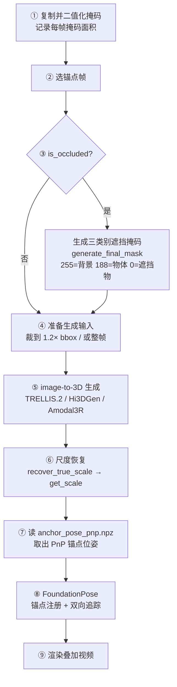
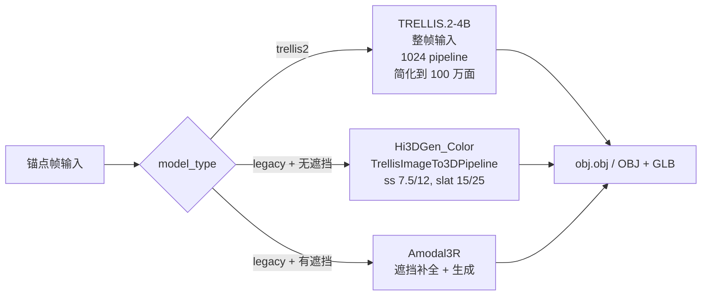

# 第 4 章：刚体重建与尺度恢复——从锚点帧到度量位姿

> **本章目标**：拆解步骤 6 的完整内部流程——锚点帧怎么选、遮挡对象怎么补全、image-to-3D 生成怎么分派、尺度怎么从单帧的 PnP + RoMaV2 + L-BFGS-B 恢复成度量值、FoundationPose 又怎么在尺度确定之后把位姿推广到所有帧。这一章按代码里真实的执行顺序讲，而不是按直觉里"先定位姿再定尺度"的顺序。

---

## 1. 步骤 6 的实际执行顺序

步骤 6（`step6_reconstruct_rigid`）由 shell 调度、`batch_scene_pipeline.process_object` 逐物体执行。单个物体的处理分成九段，顺序是固定的：



最关键的一点是 **⑥ 在 ⑧ 之前**：OVOW 先把网格缩放到真实尺寸，再让 FoundationPose 去定位姿。原因是追踪阶段每帧都要把网格投影到图像上和掩码比对，如果网格尺寸错了，投影尺寸就错了，追踪会在错误的尺度上漂移。尺度是一个全局的、只算一次的标量；位姿是逐帧的、需要时序一致性的量——先解全局量，再解逐帧量，误差不会互相污染。

---

## 2. 锚点帧选取

锚点帧由 `ScaleConfig.anchor_frame_mode` 决定，环境变量 `OPG_SCALE_ANCHOR_FRAME_MODE` 可以覆盖：

| 模式 | 行为 |
|------|------|
| `max_mask`（默认） | 取掩码面积最大的帧：`anchor_idx = argmax(mask_areas)` |
| `fixed` | 用显式指定的 `scale_cfg.anchor_frame`，并裁剪到 `[0, n-1]`；如果该帧掩码为空则回退到 `max_mask` |

选最大面积帧的实质理由是：面积大意味着物体离相机近、可见区域完整、纹理信息多，image-to-3D 的输入质量最高；同时深度值也最可靠（远处的像素深度误差更大）。

锚点帧提供四样输入：RGB 帧、深度图、二值掩码、相机内参 $K$。这四样同时被"生成"和"尺度恢复"使用。

---

## 3. 遮挡检测与生成输入

### 三类别遮挡掩码

`is_occluded=True` 的物体，`process_object` 调用 `pipeline_core.generate_final_mask(anchor_mask, anchor_depth, object_dir)`。这个函数不是简单地"膨胀掩码"，它要区分三类像素：

1. 对遮挡物区域做腐蚀；
2. 找面积 ≥ 100 像素的连通域（这些是候选遮挡块）；
3. 反复膨胀最多 50 次，直到接触物体边界；
4. 输出一张三值图：**255 = 背景，188 = 物体本体，0 = 遮挡物**。

这样 Amodal3R 就知道哪些像素是"物体本来的样子"、哪些是"被挡住、需要想象"的区域，而不是把遮挡物当成物体的一部分去生成。

### 两种输入准备

| 模型族 | 输入 | 原因 |
|--------|------|------|
| TRELLIS.2 族（`trellis2` / `t2` / `viat2`） | 锚点帧整幅 RGB | 模型自带预处理，整帧送入避免掩码边界伪影 |
| legacy 族 | `mask_image(rgb, mask)`：裁到掩码 bbox 的 1.2 倍，缩放到 518 | Hi3DGen/Amodal3R 期望物体充满画面 |

---

## 4. image-to-3D 生成

生成后端由 `GenerationConfig.model_type` 选择：



### TRELLIS.2 路径

`get_trellis2_pipeline()` 加载 `checkpoints/OnePoseViaGen/TRELLIS.2-4B`，调用：

```python
pipeline.run(num_samples=1, seed=..., preprocess_image=True, 
             pipeline_type="1024", max_num_tokens=49152)
```

再用 `o_voxel.postprocess.to_glb(aabb=[[-0.5]*3, [0.5]*3], decimation_target=1_000_000, texture_size=1024, remesh=True)` 转成带纹理的 GLB，同时导出 OBJ。`aabb=[[-0.5],[0.5]]` 说明输出网格被规范到单位立方体内——这正是"归一化尺度"的来源。

### Hi3DGen 路径

`get_hi3dgen_pipeline()` 加载 `checkpoints/OnePoseViaGen/Hi3DGen_Color`，走 `TrellisImageTo3DPipeline.run(preprocess_image=False, ss_guidance_strength=7.5, ss_sampling_steps=12, slat_guidance_strength=15, slat_sampling_steps=25)`。生成后网格绕 $X$ 轴旋转 $+\pi/2$，对齐到 FoundationPose 的坐标约定。

### Amodal3R 路径

`get_amodal3r_pipeline()` 加载 `checkpoints/OnePoseViaGen/Amodal3R`，以 `run_multi_image(image, mask, ...)` 调用。它先把遮挡区域"想象"完整，再生成网格，所以输出的是完整形状而不是只覆盖可见部分的壳。原理背景见 [TRELLIS.2 深度解析](/系列/trellis2_deep_dive/) 与 [混元 3D 生成模型 Hunyuan3D](/前置知识/016b_前置知识_混元3D生成模型Hunyuan3D)。

---

## 5. 尺度恢复：`get_scale` 的六步

尺度恢复由 `pipeline_core.recover_true_scale()` 触发，实际算法在 `fpose/recover_scale.py` 和 `locate/fit_object_scale.py` 的 `get_scale()` 里。它**只用锚点帧一帧**，但因为用了稠密匹配 + PnP + 连续优化，单帧已经足够。

### 5.1 建 RGBD 点云并裁出物体

用 Open3D 从锚点帧的 RGB + 深度建点云（`depth_scale=1000`，`depth_max=10.0` 米），再用掩码把物体区域裁出来。同时算掩码 bbox，供后续坐标还原使用。

### 5.2 图像内拟合桌面平面，推 FOV 和相机距离

`estimate_pose()` 先在**图像坐标系**里用 RANSAC 拟合一个平面（`distance_threshold=0.002`，`ransac_n=3`，`num_iterations=1000`）。注意这个平面和步骤 7 的场景地面平面不是一回事：它只是用来从平面的透视形变里推出相机视场角，再结合网格包围盒决定渲染时的相机距离——也就是"网格要放多远才能正好填满画面"。

### 5.3 球面采样 8 个视角渲染

用 PyTorch3D 的 `MeshRenderer` / `MeshRasterizer` / `SoftPhongShader`，在球面上采样 `num_samples=8` 个视角（phi/theta 均匀分布，另有 z-up 与旋转-up 两种朝向变体），每个视角渲染一张归一化网格的图像，同时保留该视角的深度图。

### 5.4 RoMaV2 稠密匹配，选最佳视角

对 8 张渲染图逐一和真实物体裁剪图做 RoMaV2 匹配：

- 每对采样 `ROMAV2_NUM_MATCHES=2000` 个匹配；
- 保留置信度 `> ROMAV2_CERT_TH=0.3` 的匹配；
- **匹配数最多的那个视角**就是 `best_pose`。

RoMaV2 在这里替代了早期版本的 SuperGlue。区别在机制上：SuperGlue 是"先检测关键点（SuperPoint）再做图神经网络匹配"的稀疏流程，在弱纹理和部分遮挡下容易找不到点；RoMaV2 是稠密匹配器，直接在两张图上回归稠密对应场再采样，不依赖独立的检测步骤。工程上还有一个现实原因：SuperGlue 的许可证不允许再分发，已从 OVOW 移除；`OPG_MATCHER` 设成任何非 `romav2` 的值会直接抛 `RuntimeError`。

### 5.5 反投影 + PnP-RANSAC

匹配点还只是 2D-2D。有了渲染视角的深度图，可以把渲染图上的匹配点反投影成网格表面的三维点 $\{P_j^\text{mesh}\}$；真实图上的匹配点按 bbox 比例缩放回原图坐标 $\{(u_j, v_j)\}$。

于是每对匹配给出一个 2D-3D 对应 $(P_j^\text{mesh}, u_j, v_j)$，用 OpenCV 的 `solvePnPRansac` 求解：

```python
cv2.solvePnPRansac(world_points, match_points_on_raw, K,
                   distCoeffs=np.zeros(4),
                   iterationsCount=100,
                   reprojectionError=8.0,
                   confidence=0.99,
                   flags=cv2.SOLVEPNP_ITERATIVE)
```

得到 `world_2_cam`——把当前（仍是单位尺度的）网格摆到真实帧视角下的相机位姿。`reprojectionError=8.0` 像素放得比较宽，因为匹配点本身有噪声，RANSAC 会把一致的那部分挑出来。PnP 的几何原理见 [相机模型与针孔投影](/前置知识/014a_前置知识_相机模型与针孔投影) 和 [RANSAC 鲁棒估计](/前置知识/014d_前置知识_RANSAC鲁棒估计)。

### 5.6 一维 L-BFGS-B 求尺度

最后一步只剩一个未知数：网格要放大多少倍。OVOW 直接在匹配点对上最小化点到点距离：

$$
\hat{s} = \arg\min_{s} \sum_{j=1}^{M} \left\| s \cdot \left( M_\text{w2c} \, P_j^\text{mesh} \right) - Q_j^\text{pcd} \right\|_2^2
$$

**这个公式在做什么**：把网格点按当前位姿摆好，再乘以尺度 $s$，然后和深度点云里对应的三维点比距离；把所有匹配点的这个距离平方加起来，找让总和最小的 $s$。这是一个单变量最小化，用 L-BFGS-B 从初值 0.25 出发求解。

::: details 📐 公式详解（点击展开）

| 子表达式 | 它是谁 | 它在干嘛 |
|---------|--------|---------|
| $P_j^\text{mesh}$ | 第 $j$ 个匹配点所对应的网格表面三维点 | 由渲染视角的深度反投影得到 |
| $M_\text{w2c}$ | PnP-RANSAC 解出的网格→相机变换（$4\times4$） | 决定网格的朝向和位置，不含尺度 |
| $s$ | 待求的尺度（标量） | 唯一的优化变量 |
| $Q_j^\text{pcd}$ | 真实帧上第 $j$ 个匹配像素处取到的场景点云三维点 | 由 `select_point(pcd, match_points_on_raw, img_size)` 在点云里取最近点 |
| $M$ | 匹配点数量 | 参与求和的项数 |

**为什么这样写**：位姿已经由 PnP 定下来了，剩下的误差主要来自"网格太小/太大"。沿相机视线方向缩放等价于改变物体到相机的距离，而点到点距离对尺度是凸的二次函数，单变量 L-BFGS-B 一次就能收敛。这里用的是**预建立对应关系**的点到点距离，不是 Chamfer 距离——Chamfer 要在两个方向上各做一次最近邻搜索，而这里的对应关系已经由 PnP 的匹配点给出，直接比较即可。

**初值 0.25 的意义**：归一化网格装在单位立方体里，真实物体通常不到 1 米；0.25 米是个合理的量级起点，避免优化器从过大或过小的值出发。

:::

求解后返回 $M = S \cdot M_\text{w2c}$（$S$ 是把 $s$ 写进对角线的 4×4 缩放矩阵），写入 `mid_files/anchor_pose_pnp.npz`，键为 `M`、`K`、`scale`、`mesh_state='initial'`。网格顶点随即乘以 $s$。

### 5.7 为什么常驻服务把迭代次数设成 0

`recover_scale()` 里还有一个可选的朝向-尺度交替精修循环，次数由 `OPG_SCALE_REFINE_ITERS` 控制：**独立运行时默认 3，常驻服务里被强制设为 0**（`opg_server.py` 在导入任何模块之前就设好这个环境变量）。

循环每轮做：FoundationPose `register(est_refine_iter=3)` 更新网格朝向 → 导出 `rotated_model.obj` → 对旋转后的网格重跑一次 `get_scale` → 基础网格和旋转网格同时乘新尺度。最终 `final_scale` 是各轮尺度的乘积。

代码在这个循环里还留了一个保护：如果某轮解出的尺度落在 $[0.5, 1.5]$ 之外就跳过该轮。注意它是 `i = i - 1; continue`——在 Python 的 `for` 循环里递减循环变量并不会重跑这一轮，实际效果只是"跳过这次结果"，不是"重试"。

常驻服务之所以能安全地设 0，是因为 RoMaV2 的匹配精度已经足够：实测每轮尺度修正量小于 2%，渲染图与真实图的像素差小于 3/255，也就是说循环本身已经不再带来有效收益，初始 PnP 解就是收敛解。这是"更好的匹配器让旧的后处理变得不必要"的典型例子。

---

## 6. 逐帧位姿：注册 + 双向追踪

尺度确定后，`estimate_poses(...)` 在缩放后的网格上做位姿估计。关键参数：

```python
estimate_poses(..., est_refine_iter=5, track_refine_iter=3,
               anchor_idx=anchor_idx, pnp_anchor_pose=...)
```

### 6.1 锚点注册与 PnP 候选

在锚点帧调用 `est.register(K, rgb, depth, ob_mask, iteration=5)`。同时构造两个备选位姿：

- `pnp_raw`：第 5.5 节 PnP 解出的原始位姿；
- `pnp_refined`：把 `pose_last` 设成 `pnp_raw`，再跑 `track_one(iteration=3)` 精修。

三个候选都用同一个 IoU 指标打分（投影网格包围盒 vs 掩码包围盒）。**只有当 PnP 候选的 IoU 比 FoundationPose 结果高出 0.02 以上时才替换**。这条规则解决一个具体的失效：FoundationPose 的 register 在深色物体或接近轴对称的物体上容易发生 180° 翻转，而 PnP 来自纹理匹配，通常不会翻——两者互补。

### 6.2 质量门与重注册

每帧算一次投影 IoU。低于 `quality_iou_th=0.3` 时，用 **mask-gated 输入**重新注册：掩码之外的 RGB 和深度全部置零。代码注释直说了目的——"让多实例的相似物体不互相漂移"。每帧会被标记成 `ok` / `reregistered` / `low_quality` / `no_mask`，写入 `pose_result/pose_quality.json`。

### 6.3 双向传播与跳变重注册

从锚点帧出发，先 `for i in range(anchor_idx+1, T)` 向后追踪；然后把 `pose_last` 恢复到锚点位姿，再向前追踪到第 0 帧。两个方向的结果拼起来，中间帧由距离更近的一侧决定。

追踪用 `track_one(iteration=3)`。如果某帧相对上一帧的平移跳变超过 `jump_th = 0.5 × mesh_diameter`，就在该帧重新注册而不是继续追踪——大跳变通常意味着跟踪已经丢失，继续追只会越漂越远。

可选还有 SE(3) 平滑（平移取均值、四元数对齐符号后取归一化均值），窗口默认 0 即关闭，只在质量门通过的帧上生效。

### 6.4 静态物体的位姿锁定

static 物体不做追踪。`lock_static_poses` 在步骤 6 结束后运行，从 `pose_result/poses.json` 出发写 `poses_locked.json`：

| 模式 | 做法 |
|------|------|
| `full` | 所有帧直接复制锚点帧（最大掩码面积帧）的 4×4 位姿 |
| `rot_only` | 保留每帧的平移，只把旋转锁定为锚点帧的旋转 |

`full` 是对"这个物体根本没动"的最强假设；`rot_only` 允许物体随场景有微小位移但仍然不发生转动。默认用哪种由 `LOCK_STATIC_MODE` 决定。

### 6.5 相机系与世界系

`poses.json` / `poses_locked.json` 里存的是**相机坐标系**位姿 $cT_o$。世界坐标系位姿由外参换算：

$$
{}^{w}T_o = \left(E_t\right)^{-1} \; {}^{c}T_o
$$

**这个公式在做什么**：$E_t$ 把世界点变到第 $t$ 帧相机系，所以它的逆把相机系位姿变回世界系。这样所有帧的位姿都落在同一个由 VGGT 第一帧定义的坐标系里，后续接地和组装可以直接比较。

::: details 📐 公式详解（点击展开）

| 子表达式 | 它是谁 | 它在干嘛 |
|---------|--------|---------|
| ${}^{c}T_o$ | 物体在相机系下的位姿 | FoundationPose 直接输出（相对该帧相机） |
| $E_t$ | 第 $t$ 帧外参（世界→相机） | 来自 `result.npz` 的 `extrinsics[t]` |
| $E_t^{-1}$ | 相机→世界 | 把位姿换到统一坐标系 |
| ${}^{w}T_o$ | 物体在世界系下的位姿 | 步骤 8/9/10 的输入 |

**用人话读**：想知道"物体在世界里的哪儿"，就用"相机在世界里的哪儿"去乘"物体在相机里的哪儿"。

:::

---

## 7. 步骤 6 的产物

| 路径 | 内容 | 谁消费 |
|------|------|--------|
| `objects/<name>/model/...` | 生成阶段产出的原始网格文件 | — |
| `objects/<name>/mid_files/scaled_mesh.obj` | 缩放后的度量网格 | 步骤 7、10、13 |
| `objects/<name>/mid_files/anchor_pose_pnp.npz` | `M`、`K`、`scale`、`mesh_state` | 步骤 6 内部（PnP 候选） |
| `objects/<name>/anchor_file/intrinsic.txt` | 锚点帧内参 | `get_scale` |
| `objects/<name>/pose_result/poses.json` | 每帧相机系位姿 | 步骤 7/9/10 |
| `objects/<name>/pose_result/poses_locked.json` | 静态物体的锁定位姿 | 步骤 7/9 |
| `objects/<name>/pose_result/pose_quality.json` | 每帧质量门状态 | 调试 |
| `objects/<name>/pose_result/foundationpose_timing.json` | 注册/追踪耗时 | 性能分析 |
| `objects/<name>/normal_video_converted.mp4` | 网格叠加视频 | 人工检查 |

另外，整个 step6 运行结束会写 `object_errors_step6.json`、`object_status_step6.json` 和 `summary.json`；单物体失败不会中断整批（`--continue-on-object-error 1`），失败的物体可以由步骤 16 重试。

---

## 本章小结

- 步骤 6 的九个阶段有严格顺序，**尺度恢复在位姿估计之前**：先解全局的度量尺度，再用它去解逐帧位姿。
- 锚点帧默认取掩码面积最大的帧（`max_mask`），也可以显式指定（`fixed`）。
- 遮挡物体先生成三类别遮挡掩码（背景/物体/遮挡物），再交给 Amodal3R；无遮挡物体走 TRELLIS.2 或 Hi3DGen。所有生成结果的网格都在单位包围盒里，即"归一化尺度"。
- `get_scale` 只用锚点帧一帧：建 RGBD 点云 → 图像内 RANSAC 推 FOV → 8 视角渲染 → RoMaV2 稠密匹配选最佳视角 → 反投影 + PnP-RANSAC 求位姿 → 一维 L-BFGS-B 最小化点到点 L2 求尺度（初值 0.25）。
- 朝向-尺度交替精修的循环次数在独立运行时是 3，**常驻服务里是 0**——RoMaV2 的匹配精度让后续迭代不再有收益。
- FoundationPose 在缩放后的网格上做锚点注册，PnP 位姿作为候选（IoU 高出 0.02 才替换，用于修正 180° 翻转），质量门低于 0.3 时用 mask-gated 输入重注册，然后双向追踪，跳变超过半个直径就重注册。
- static 物体不追踪，用 `poses_locked.json` 锁定位姿；`full` 锁全部，`rot_only` 只锁旋转。

---

**延伸阅读**：
- [6DoF 位姿估计与 ADD-S 评测指标](/前置知识/015f_前置知识_6DoF位姿估计与ADD-S评测指标) — FoundationPose 的任务定义与评测
- [RANSAC 鲁棒估计](/前置知识/014d_前置知识_RANSAC鲁棒估计) — PnP-RANSAC 与图像内平面拟合
- [相机模型与针孔投影](/前置知识/014a_前置知识_相机模型与针孔投影) — PnP 的坐标系基础
- [TRELLIS.2 深度解析](/系列/trellis2_deep_dive/) — image-to-3D 生成原理
- [混元 3D 生成模型 Hunyuan3D](/前置知识/016b_前置知识_混元3D生成模型Hunyuan3D) — Hi3DGen 后端
- [第 5 章：形变物体](./05_形变物体_Motion324四维生成与逐帧位姿追踪) — 形变分支的 4D 生成与位姿追踪

[→ 第 5 章：形变物体](./05_形变物体_Motion324四维生成与逐帧位姿追踪)
