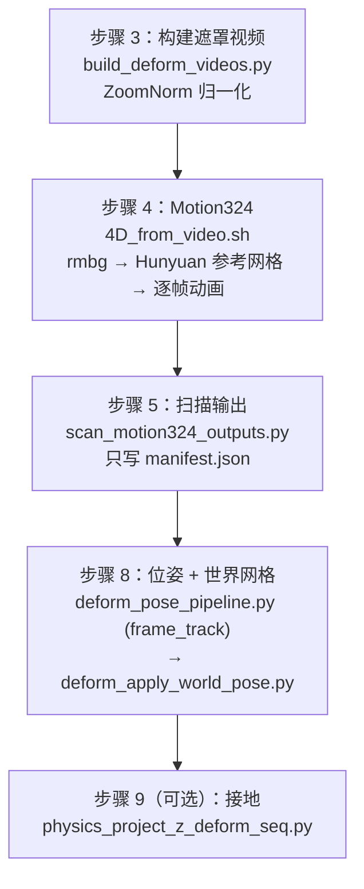
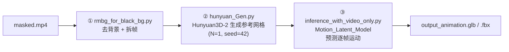
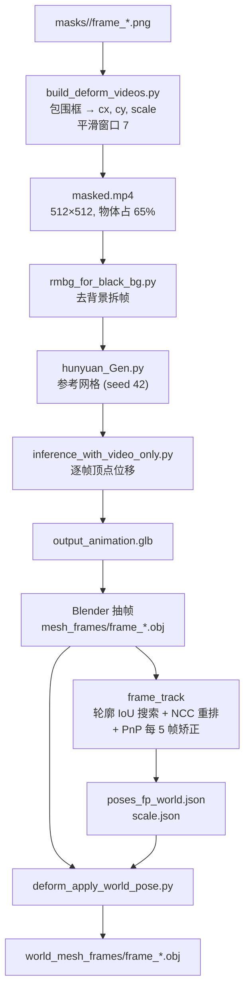

# 第 5 章：形变物体——Motion324 四维生成与逐帧位姿追踪

> **本章目标**：讲清楚形变分支的完整链路——为什么形变物体需要独立的 4D 生成、ZoomNorm 遮罩视频怎么把相机运动从物体形变里剥离出去、Motion324 怎么产出拓扑一致的逐帧网格、`frame_track` 又怎么在不依赖深度的情况下把每帧网格摆到正确位姿。最后把形变网格变到世界坐标系。

---

## 1. 形变分支的四个阶段

形变物体走一条和刚体完全不同的路径，涉及步骤 3、4、5、8（步骤 9 可选）：



注意步骤 5 做的事情很少——它只是一次**输出扫描**，把 Motion324 散落在 `<obj>_processed/` 里的动画文件和参考网格找出来，汇总成 `manifest.json`。真正的位姿估计在步骤 8。

---

## 2. 步骤 3：ZoomNorm 遮罩视频

`build_deform_videos.py` 读 `metadata/<name>_mask_summary.json`，挑出所有 `category == "deform"` 的物体，给每个物体写一段**只含该物体的视频**。

### 2.1 为什么必须归一化

Motion324 在纯物体、固定构图的视频上训练。原始视频有两个它不认识的自由度：

1. **相机运动**：镜头推近时物体在画面里变大，网络会把这个"变大"理解成形变。
2. **物体在画面中的位置**：物体飘来飘去会让网络学到一个虚假的整体位移。

ZoomNorm 把这两个自由度压掉：每帧从掩码算包围框，把物体的包围框尺寸归一化到画面的固定比例，把包围框中心平移到画面中心。这样送进网络的序列里，**画面变化只剩下"形状"这一种**。

### 2.2 归一化参数的算法

对第 $t$ 帧，从掩码得到包围框 $(x_0, y_0, w, h)$，然后：

$$
c_x^{(t)} = x_0 + \tfrac{w}{2}, \qquad
c_y^{(t)} = y_0 + \tfrac{h}{2}, \qquad
s^{(t)} = \frac{\rho \cdot S}{\max(w, h)}
$$

**这个公式在做什么**：$c_x, c_y$ 是物体在画面里的中心，缩放倍数 $s$ 是"目标尺寸除以物体当前的较大边长"。把画面绕中心平移 $-c$ 再缩放 $s$ 倍，物体就总是居中、同样大。

::: details 📐 公式详解（点击展开）

| 子表达式 | 它是谁 | 它在干嘛 |
|---------|--------|---------|
| $x_0, y_0, w, h$ | 掩码包围框的左上角与宽高（像素） | 从 `_bbox_from_mask` 得到，`min_box` 保证不小于几个像素 |
| $c_x^{(t)}, c_y^{(t)}$ | 物体包围框中心 | 平移目标：把这一点搬到画面中心 |
| $S$ | 输出画布边长，默认 `--normalize-out-size 512` | 归一化后的视频分辨率 |
| $\rho$ | 目标占比，默认 `--normalize-target-ratio 0.65` | 物体较大边长占画布的比例：0.65 意味着物体占 65% |
| $s^{(t)}$ | 该帧的缩放倍数 | 由 `min_scale` / `max_scale` 截断，防止掩码异常时爆掉 |

**为什么用 $\max(w,h)$ 而不是面积**：用较大边长可以保证物体在任何长宽比下都完整落进画布，不会被裁掉。用面积做归一化时，细长物体会被放大到超出边界。

**为什么要临时平滑**：$s^{(t)}$、$c_x^{(t)}$、$c_y^{(t)}$ 各自按窗口 7（`--normalize-smooth 7`）做滑动平均，两端用边缘填充。不平滑的话，掩码在帧间的抖动会变成归一化参数的抖动，而 Motion324 会把这个抖动当成真实的形变信号——网络无法区分"物体在抖"和"镜头在抖"。

:::

### 2.3 输出

对每个形变物体：

```
motion324_inputs/<video_name>/<obj_name>/
  masked.mp4              # 归一化后的遮罩视频（黑底）
  normalize_meta.json     # 每帧的 cx, cy, scale, bbox, valid_mask
```

顶层另有一份 `motion324_inputs/<video_name>/deform_manifest.json`，记录 `video_name`、`width/height`（归一化后）、`num_frames` 和每个物体的 `masked.mp4` 路径。

`normalize_meta.json` 里的参数在这里其实**用不上**——形变物体的位姿由步骤 8 直接在原始视频上求解，而不是把归一化坐标系的结果反变换回来。这份元数据主要用于诊断（检查某帧的包围框是否异常）。

---

## 3. 步骤 4：Motion324 生成 4D 网格

步骤 4 对每个形变物体执行一次 `third_party/Motion324/scripts/4D_from_video.sh <masked.mp4> --backend hunyuan`，该脚本内部有三段：



### 3.1 去背景与拆帧

`rmbg_for_black_bg.py` 把遮罩视频拆成逐帧 RGB，并把背景压成纯黑。虽然步骤 3 已经用掩码遮过一遍，这一步还会再清理一次边缘（掩码边界常有半透明像素）。

### 3.2 参考网格生成

`hunyuan_Gen.py` 用 Hunyuan3D-2 从输入帧生成一个**参考网格**。脚本固定 `--N 1 --n 0 --skip 256 --seed 42`，即只生成一个样本、用固定种子。参考网格是整个 4D 序列的**拓扑模板**：后面所有帧共享它的顶点编号和三角面连接。原理背景见 [混元 3D 生成模型 Hunyuan3D](/前置知识/016b_前置知识_混元3D生成模型Hunyuan3D)。

hunyuan 后端会额外跑 `convert_fbx.py` 做格式转换；`trellis2` 后端则跳过转换。

### 3.3 动画预测

`inference_with_video_only.py` 加载 `model.Pcd_motion.Motion_Latent_Model`（checkpoint `ckpt_0000000000060000.pt`），关键参数：

| 参数 | 值 | 含义 |
|------|-----|------|
| `training.num_shape_samples` | 16384 | 参考网格上的采样点数 |
| `training.num_pcd_samples` | 4096 | 每帧点云采样数 |
| `training.frames` | 256 | 时间维容量 |
| `start_frame` | 0 | 从第一帧开始 |

模型的任务可以这样理解：给定参考网格和逐帧图像，为每一帧预测参考网格上每个点应该移动到哪——也就是一组逐顶点位移。因为拓扑不变，这些位移直接构成 morph target。

### 3.4 输出

Motion324 把结果写到**输入视频所在目录**下的 `<video_stem>_processed/`：

```
motion324_inputs/<video_name>/<obj_name>/masked_processed/
  masked_rgb/                      # 拆帧后的 RGB
  Hunyuan_Gen_Input/               # 参考网格（*_hunyuan_original_wo_remap_converted.fbx 等）
  animation/
    output_animation.glb
    output_animation.fbx
```

---

## 4. 步骤 5：扫描输出

`scan_motion324_outputs.py` 遍历 `motion324_inputs/<video_name>/*/`，对每个含 `masked.mp4` 的目录，在 `masked_processed/` 里找两样东西：

- **参考网格**：依次尝试 `*_hunyuan_original_wo_remap.glb` → `*_hunyuan_original_watertight.glb` → `*_hunyuan_original_wo_remap_converted.fbx`
- **动画**：`animation/output_animation.glb` → `animation/output_animation.fbx`

结果写 `motion324_outputs/<video_name>/manifest.json`：

```json
{
  "video_name": "...",
  "objects": [
    {
      "name": "plush_bear",
      "masked_video": ".../masked.mp4",
      "processed_dir": ".../masked_processed",
      "animation": ".../animation/output_animation.glb",
      "ref_mesh": ".../Hunyuan_Gen_Input/xxx_converted.fbx"
    }
  ]
}
```

某一步产物缺失时对应字段为 `null`，步骤 8 会据此报错或跳过。

---

## 5. 步骤 8（上）：`frame_track` 位姿求解

这是形变分支的核心。`deform_pose_pipeline.py --pose-mode frame_track` 要解决的问题是：**Motion324 给的每帧网格是"归一化坐标系里的形状"，我需要知道它在真实视频的每一帧里摆在哪里。**

### 5.1 先抽帧网格并归一化到参考网格

`_export_mesh_frames()` 调用 Blender 脚本 `blender_export_mesh_frames.py`，把 `output_animation.glb` 按 `--frame-count` 采样成 `mesh_frames/frame_*.obj`。然后 `_normalize_mesh_frames_to_ref()` 把每帧网格的坐标系对齐到 `scaled_ref_mesh.obj`——因为动画 GLB 里的 morph target 可能带自己的局部变换，不处理的话各帧会整体偏移。对齐参数写 `mesh_frames_scale_info.json`。

于是我们得到 `mesh_map: 帧号 → 该帧网格路径`，每帧一个网格。

### 5.2 关键设计：深度退出求解回路

`batch_config_uplegacy.json` 里有一句说明：`frame_track` 模式下"**深度退出求解回路，FoundationPose 仅兜底**"。这是形变分支和刚体分支最大的差别。

原因是**形变网格和深度图不可能精确吻合**。Motion324 预测的形状本身有误差（它没见过真实深度），而 VGGT 的深度也有误差。让两个都不可靠的量互相拟合，结果会很差。OVOW 改用**轮廓**作为唯一的硬约束：

- 轮廓来自 SAM3 的掩码，精度高且和形变无关（人眼边界就是物体边界）；
- 深度只用于兜底的 FoundationPose 初始估计，不参与主求解。

### 5.3 每帧的求解：平移闭式解 + 旋转暴力搜索

`_solve_frame()` 对一帧做两级搜索。基础操作是 `_align_translation()`，它给定旋转，**闭式**解出平移：

1. 把网格顶点投影到像素，得到投影包围框的宽高 $p_w, p_h$；
2. 和掩码包围框的宽高 $m_w, m_h$ 比，得到尺寸比 $s = \sqrt{p_w p_h / (m_w m_h)}$，把平移向量的模长乘以 $s$（对透视投影来说，沿光轴缩放等价于画面上的尺寸缩放）；
3. 再算投影包围框中心和平移后的新中心，把像素偏差用深度 $Z$ 和焦距换算成平移修正：$\Delta t_x = (c_x^\text{mask} - c_x^\text{proj}) \cdot Z / f_x$；
4. 迭代 3 次收敛。

给定平移之后，旋转用一个**两级暴力搜索**：

| 级 | 搜索范围 | 步长 | 候选数 |
|----|---------|------|--------|
| 粗 | 三个欧拉角各 $\pm 12°$ | $6°$ | $5^3 - 1 = 124$ |
| 细 | 三个欧拉角各 $\pm 4°$ | $2°$ | $5^3 - 1 = 124$ |

每个候选：先重新闭式对齐平移，再渲染网格的低分辨率（1/4）轮廓，和掩码算 IoU。取 IoU 最高的候选进入下一级。

**为什么敢用暴力搜索**：搜索空间是三维旋转，但候选只有 124 个，且每个候选的评估是"光栅化 + 一次交集/并集"，在 GPU 上极快。相比之下，基于梯度的位姿优化在轮廓这种不可微目标上容易陷入局部极小；暴力搜索反而更稳。

### 5.4 外观重排（NCC 消歧）

轮廓 IoU 有一个固有的对称性缺陷：一个杯子的正面和背面轮廓几乎一样。于是 `_app_rerank()` 在"轮廓接近最优"的候选池里，用**外观**再挑一次：

1. 从轮廓分数前若干名里挑出 $|IoU - IoU_\text{best}| \le 0.05$ 的候选（默认最多 6 个）；
2. 对每个候选渲染彩色图，用掩码区域裁出物体，缩到 128×128；
3. 和真实帧的同区域算灰度 NCC（归一化互相关）；
4. 在 NCC 上减去一个惩罚项 $\lambda \cdot \|\theta_\text{cand} - \theta_\text{init}\|$（默认 $\lambda=0.004$/度），偏向和传播初始位姿更接近的候选。

**为什么要加旋转惩罚**：真实帧和渲染图的光照、材质不同，NCC 会被这些差异愚弄。惩罚项让"连续性"在打平时胜出——宁可相信相邻帧之间的位姿不该突变。

### 5.5 锚点选择与双向传播

`frame_track` 不只用一帧做锚点。它把视频按三等分切段，**每段选掩码面积最大的一帧**作为候选锚点，再加上全局最大帧和 PnP 帧，逐一求解并打分。最终：

- 主锚点：轮廓 IoU 最高的候选；但如果某个候选来自 PnP 且分数在最优的 0.10 以内，优先用它（PnP 的朝向通常更可靠）。
- 次锚点：和主锚点间隔至少 $1/3$ 视频长度、且自身 IoU ≥ 0.30 的候选。次锚点和主锚点在同一帧上的旋转差必须 ≤ 30°才被接受，否则丢弃。

然后用 `_propagate()` 从主锚点向两侧逐帧求解，每帧用上一帧的位姿作为初始值。有了可信的次锚点，就把"较远的那一半"从次锚点重新传播一遍——这修正了长序列上累积的漂移。

### 5.6 关键帧 PnP 矫正

每 `PNP_EVERY = 5` 个帧步长，`_maybe_pnp()` 会做一次 2D-3D PnP（`reprojectionError=6.0`，`iterationsCount=300`，至少 10 个内点），然后把 PnP 结果再做一次小范围轮廓精修。只有当精修后的 IoU 不比当前差超过 0.02 时才采用。

这是"局部轮廓搜索"和"全局 PnP 约束"之间的定期校准：轮廓搜索容易在有歧义的帧上飘走，PnP 用纹理匹配把它拉回来，但只有 PnP 结果本身站得住（IoU 不退化）才接受。

### 5.7 质量门

| 状态 | 阈值 | 含义 |
|------|------|------|
| `ok` | IoU ≥ 0.30 | 可用 |
| `low_quality` | 0.12 ≤ IoU < 0.30 | 可用但标记 |
| `invalid` | IoU < 0.12 | 丢弃 |
| `no_mask` | 掩码像素 < `min_mask_pix` | 该帧不可见 |

IoU 低于 0.12 时还会尝试一次 FoundationPose 的 `register` 兜底，仅当兜底结果的 IoU 更高时才替换。

质量信息写 `pose_result/pose_quality.json`，供后续步骤判断哪些帧可信。

### 5.8 尺度恢复

形变物体也要恢复度量尺度。`_run_recover_scale()` 调用 `recover_deform_scale.py`，后者复用刚体分支的 `fpose.recover_scale.recover_scale()`，区别只在锚点选取：它遍历所有运行帧，按 `mask_stride` 映射到最近的掩码帧，取掩码面积最大的那一帧。

结果写 `scale.json`。步骤 8 的 `deform_apply_world_pose.py` 会用这个尺度缩放顶点。

---

## 6. 步骤 8（下）：变换到世界坐标系

`deform_apply_world_pose.py` 把每帧网格从相机坐标系搬到世界坐标系：

$$
V_\text{world}^{(t)} = R^{(t)} \, V_\text{cam}^{(t)} + \mathbf{t}^{(t)}
$$

**这个公式在做什么**：$R^{(t)}$ 和 $\mathbf{t}^{(t)}$ 来自 `poses_fp_world.json` 的第 $t$ 帧位姿（已经从相机系转成世界系），作用是把该帧网格的每个顶点 $\mathbf{v}$ 旋转加平移，得到它在世界坐标系里的位置。

::: details 📐 公式详解（点击展开）

| 子表达式 | 它是谁 | 它在干嘛 |
|---------|--------|---------|
| $V_\text{cam}^{(t)}$ | 第 $t$ 帧网格的顶点矩阵，形状 $N \times 3$ | 来自 `mesh_frames/frame_*.obj`，乘以 `scale.json` 的尺度 |
| $R^{(t)}$ | 位姿矩阵左上 $3\times3$ 的旋转 | 来自 `poses_fp_world.json` |
| $\mathbf{t}^{(t)}$ | 位姿矩阵右上 $3\times1$ 的平移 | 同上 |
| $V_\text{world}^{(t)}$ | 世界坐标系下的顶点 | 写入 `world_mesh_frames/frame_*.obj` |

**代码里的写法**是 `verts_world = (R @ verts.T).T + t`——把 $N\times3$ 的顶点矩阵转置成 $3\times N$，左乘 $R$，再转置回来，最后加平移。

:::

输出目录 `world_mesh_frames/frame_*.obj` 是步骤 9（可选接地）和步骤 10/14（组装）的输入。

---

## 7. 步骤 9（可选）：形变序列接地

`physics_project_z_deform_seq.py` 对形变序列逐帧做几何接地。开关是 `PHYSICS_ENABLE`，默认流水线里 `--deform-force-poses 1` 会让组装直接读 `world_mesh_frames/` 而跳过接地版本，所以这一步在默认 13 步里不跑。接地算法本身在第 6 章讲。

---

## 8. 形变分支的完整数据流



---

## 本章小结

- 形变分支走步骤 3 → 4 → 5 → 8（+ 可选 9），和刚体分支完全独立。
- 步骤 3 的 ZoomNorm 用包围框把物体居中、缩放到固定占比（默认 512 画布、占 65%），并对参数做窗口 7 的时序平滑。目的是让 Motion324 只看到形状变化，看不到相机运动。
- 步骤 4 的 Motion324 分三段：去背景拆帧 → Hunyuan3D 生成参考网格（拓扑模板）→ Motion-Latent 模型预测逐帧顶点位移，输出 `output_animation.glb`。
- 步骤 5 只扫描并汇总输出到 `manifest.json`，不做计算。
- 步骤 8 的 `frame_track` 是形变分支的核心：**深度不参与主求解**，用掩码轮廓做约束；每帧先闭式解平移，再用 ±12°/6° + ±4°/2° 两级旋转暴力搜索最大化轮廓 IoU；在轮廓近优的候选里用 NCC 外观重排（带旋转惩罚）；锚点按视频三等分选取并双向传播，可信次锚点重解远半段；每 5 帧用 PnP 校准一次。
- 位姿确定后，`deform_apply_world_pose.py` 把每帧网格变换到世界坐标系，写入 `world_mesh_frames/`。

---

**延伸阅读**：
- [混元 3D 生成模型 Hunyuan3D](/前置知识/016b_前置知识_混元3D生成模型Hunyuan3D) — Motion324 的参考网格生成后端
- [相机模型与针孔投影](/前置知识/014a_前置知识_相机模型与针孔投影) — 平移闭式解里像素偏差到三维平移的换算
- [RANSAC 鲁棒估计](/前置知识/014d_前置知识_RANSAC鲁棒估计) — 关键帧 PnP 矫正
- [第 4 章：刚体重建与尺度恢复](./04_刚体重建与尺度恢复_从锚点帧到度量位姿) — 刚体分支的位姿链路，与本章的 `frame_track` 形成对照
- [第 6 章：物理接地、组装、渲染与评测](./06_物理接地组装渲染与评测) — 接地与 morph target 组装

[→ 第 6 章：物理接地、组装、渲染与评测](./06_物理接地组装渲染与评测)
