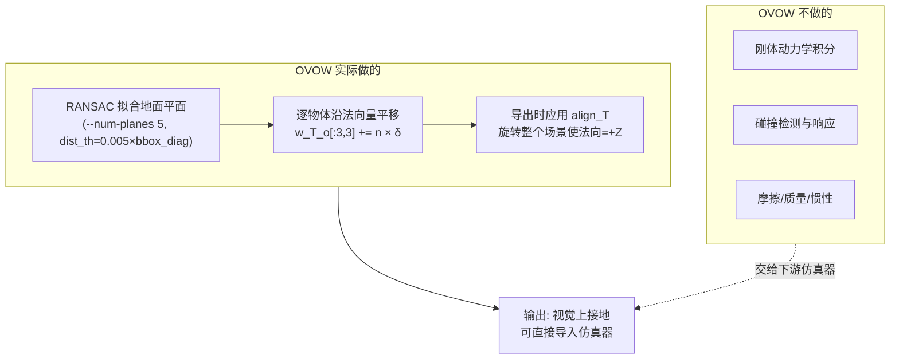
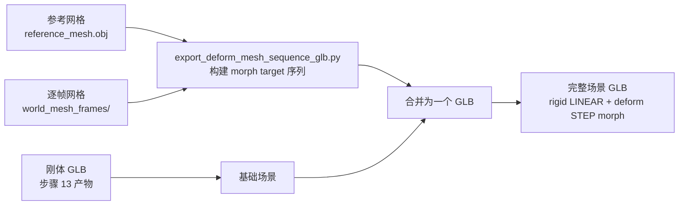
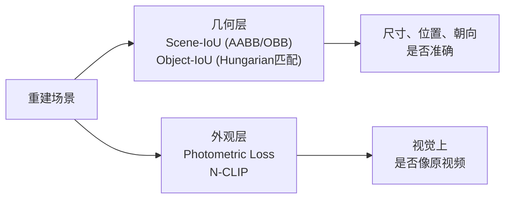
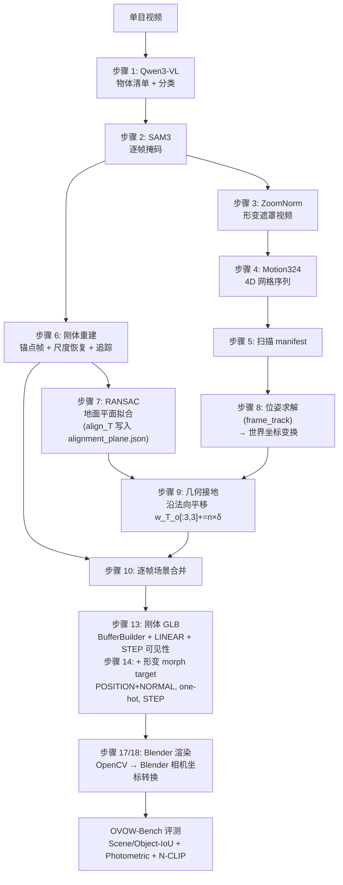

# 第 6 章：物理接地、组装、渲染与评测

> **本章目标**：讲清楚流水线最后半段——怎么从场景点云里拟合出地面平面、怎么解决法向量的正负歧义、所谓"物理接地"到底做了什么（以及没做什么）、刚体和形变两套网格怎么组装成一个 GLB、Blender 怎么逐帧渲染，以及 OVOW-Bench 用什么指标衡量结果。

---

## 1. 为什么需要"接地"

前五章产出的网格和位姿都在 VGGT 定义的世界坐标系里。这个坐标系的原点和朝向完全由第一帧相机决定——它是任意的。物体可能悬在半空，地面可能倾斜 30 度，整个场景的"上"方向没有任何物理含义。

对仿真来说这是不可接受的：仿真器需要一个明确的竖直方向（重力方向）和一个明确的地面（碰撞面）。OVOW 的做法是从场景点云里把地面找出来，然后把整个场景旋转到"地面法向 = +Z"的规范姿态，再让每个物体落到地面上。

这一步叫"物理接地"（physics grounding），但它的实现比名字朴素得多——**没有任何刚体动力学仿真**，全部是几何计算。

---

## 2. 步骤 7：RANSAC 地面平面拟合

`fit_plane_align.py` 从步骤 3 产出的场景点云 `scene_point_cloud_frame_all.ply` 里拟合地面平面。

### 为什么用 RANSAC 而不是最小二乘

点云里绝大部分点不是地面——桌面上的杯子、书本、背景墙、以及深度估计的噪声点都会污染拟合。普通最小二乘会被这些离群点严重带偏。RANSAC 的思路是：随机采样三个点确定一个平面，统计有多少点落在这个平面的容差带内（内点），重复许多次，保留内点最多的那个平面。原理见 [RANSAC 鲁棒估计](/前置知识/014d_前置知识_RANSAC鲁棒估计)。

`fit_plane_align.py` 的 RANSAC 参数：

| 参数 | 值 | 含义 |
|------|-----|------|
| `--num-planes` | 5 | 拟合并保留最优的候选平面数 |
| `dist_th` | `0.005 × bbox_diag` | 内点距离阈值，自适应于场景尺度——场景越大，允许的容差越松 |
| `--max-iter` | 2000 | RANSAC 采样次数 |

**为什么 `dist_th` 要乘以包围盒对角线**：场景的尺度差异很大，一个书桌场景和一个仓库场景绝对尺度完全不同。用固定的绝对阈值（如 5mm）在大场景里太严、在小场景里又太松。乘以场景包围盒的对角线把阈值归一化到场景尺度，让同一套参数在不同场景下都有合理的行为。

拟合结果是平面方程：

$$
n_x x + n_y y + n_z z + d = 0
$$

**这个公式在做什么**：用四个系数定义一个无限大的平面——法向量 $\mathbf{n} = (n_x, n_y, n_z)$ 指明平面朝哪个方向，$d$ 指明平面离原点多远。

::: details 📐 公式详解（点击展开）

| 子表达式 | 它是谁 | 它在干嘛 |
|---------|--------|---------|
| $\mathbf{n} = (n_x, n_y, n_z)$ | 平面法向量（单位长度） | 垂直于平面的方向，也是"重力反方向"的候选 |
| $d$ | 平面偏移量 | 平面到世界原点的有符号距离 |
| $(x, y, z)$ | 世界坐标系里的点 | 用来判断点是否在平面上 |

**用人话读**：把所有满足这个方程的 $(x,y,z)$ 连起来，就是一张无限大的平板；法向量告诉你这张板朝哪边。

:::

拟合结果写入 `alignment_plane.json`，内容包含 `plane`（法向量和偏移）、`R`（旋转矩阵，令法向 → +Z）、`t`（平移）、`T`（完整 4×4 对齐变换 `align_T`）以及 `gravity_sign_mode`。

### 法向量的正负歧义

平面方程有一个内在的符号歧义：$\mathbf{n}$ 和 $-\mathbf{n}$ 配上一个符号相反的 $d$ 描述的是**同一个平面**。但对"哪边是上"来说，这两个解完全相反——选错了整个场景就会上下颠倒。

`fit_plane_align.py` 提供三种消歧模式（`--gravity-sign-mode`），**默认是 `object_region`**：

| 模式 | 判断依据 | 适用场景 |
|------|---------|---------|
| `mesh_above` | 看拟合平面上方是否有更多网格点（物体应在平面上方） | 物体几何清晰时最可靠 |
| `object_region`（**默认**） | 用物体掩码区域推断——物体的投影区域在平面哪一侧、哪侧点密度更大 | 相机姿态异常或点云稀疏时的稳健选择 |
| `camera_up` | 用相机轨迹推断上方向：相机通常朝下看桌面，所以相机的"下方"就是重力方向 | 常规俯视/斜视拍摄 |

三种模式有优先级兜底：先试 `mesh_above`，如果分析出现歧义或异常，回退到 `object_region`，再回退到 `camera_up`。代码里 `GRAVITY_SIGN_MODE` 环境变量（默认 `object_region`）控制从哪一级开始。

`ensure_alignment()` 在正式组装前会检查 `alignment_plane.json` 里记录的 `gravity_sign_mode` 是否与当前配置一致；如果模式变了，它会重新拟合平面，避免复用旧的对齐结果导致上下颠倒。

---

## 3. 步骤 9：几何接地

### 两类接地

| 步骤 | 脚本 | 处理对象 | 输入 | 输出 |
|------|------|---------|------|------|
| 9a | `physics_project_z.py` | 刚体/静态 | `poses_fp_world.json` + `alignment_plane.json` | `poses_physics.json` |
| 9b | `physics_project_z_deform_seq.py` | 形变 | `world_mesh_frames/` + `alignment_plane.json` | `world_mesh_frames_physics/` |

### 核心操作：沿法向平移

接地的核心不是旋转每个物体，而是**沿地面法向平移**。`physics_project_z.py` 读取 `alignment_plane.json` 里的法向量 $\mathbf{n}$，然后对每个物体的每帧位姿做一个标量平移：

$$
{}^{w}T_o[:3,3] \mathrel{+}= \mathbf{n} \cdot \delta_i
$$

**这个公式在做什么**：取当前位姿矩阵的平移列，沿法向量方向加上偏移量 $\delta_i$，把物体向"地面法向朝上"的方向推动，使其最低点恰好接触地面。

::: details 📐 公式详解（点击展开）

| 子表达式 | 它是谁 | 它在干嘛 |
|---------|--------|---------|
| ${}^{w}T_o[:3,3]$ | 位姿矩阵最后一列的前三行（平移向量） | 物体在世界坐标系里的位置 |
| $\mathbf{n}$ | 地面法向量 | 接地方向——物体应该沿这个方向移动才能"落地" |
| $\delta_i$ | 物体 $i$ 的接地偏移量（标量） | 使物体最低点接触地面所需的沿法向的位移 |

**$\delta_i$ 怎么算**：把物体网格顶点投影到法向量方向，取最低的投影值，再和地面平面的偏移 $d$ 相减。结果是物体最低点"还差多少才到地面"。

**关键区分**：每个物体各自独立地沿 $\mathbf{n}$ 平移，**场景的旋转（让法向 = +Z）是在最终导出时统一应用的**，不是在这里每帧对每个物体单独旋转。

:::

旋转在哪里发生？在 `export_scene_glb_anim.py` 和 `export_scene_glb_with_deform.py` 里，组装 GLB 时把 `align_T`（`alignment_plane.json` 里的完整对齐变换）左乘到每个物体的世界位姿上：

$$
{}^{w}T_o^\text{final} = \text{align\_T} \cdot {}^{w}T_o
$$

**这个公式在做什么**：在 GLB 导出时把接地后的世界位姿再乘以对齐变换，把整个场景旋转到"地面法向 = +Z"的规范姿态——只做一次、统一做，不是对每个物体每帧分别旋转。

::: details 📐 公式详解（点击展开）

| 子表达式 | 它是谁 | 它在干嘛 |
|---------|--------|---------|
| $\text{align\_T}$ | `alignment_plane.json` 里的 $4\times4$ 对齐变换 | 把地面法向旋转到 $+Z$，包含旋转和可选平移 |
| ${}^{w}T_o$ | 物体在 VGGT 世界坐标系里的位姿（接地偏移后） | 由步骤 9 的 `poses_physics.json` 给出 |
| ${}^{w}T_o^\text{final}$ | 最终写入 GLB 的物体位姿 | 在"地面 = +Z"的规范坐标系下 |

**为什么把旋转推迟到导出**：接地（沿法向平移）和对齐（旋转）是两个独立操作，分开存储方便单独调试。如果法向量方向算错了（上下颠倒），只需要重算 `alignment_plane.json`，不需要重跑所有物体的位姿。

:::

**这样设计的另一个好处**：`scene_mesh_frames_all_world/` 里的逐帧 OBJ 仍然是 VGGT 原始世界坐标系的，方便直接和 `result.npz` 里的相机位姿对应；对齐只在最终 GLB 里生效，不影响调试中间产物。

### 可调的接地参数

| 环境变量 | 默认值 | 作用 |
|---------|--------|------|
| `PLANE_BOTTOM` | 0.03 m | 物体最低点距地面的目标间距（不完全贴地，留一点余量） |
| `PHYSICS_BOTTOM` | 0.10 m | 允许的最大接地深度（物体穿入地面的容差上限） |
| `PHYSICS_MAX_DROP` | 1.0 m | 单次接地允许的最大位移量 |
| `PHYSICS_ALLOW_DOWN` | 1 | 是否允许物体下移（有些物体已经在地面以下） |
| `PHYSICS_CONTACT` | 1 | 是否对接触中的物体做额外的接触修正 |

脚本还支持：

- `--contact-objects`：指定哪些物体视为"接触"，允许更紧的间距
- `--allow-down`：覆盖 `PHYSICS_ALLOW_DOWN`
- `--max-drop`：覆盖 `PHYSICS_MAX_DROP`
- `--plane-z {zero,minz,static_minz}`：地面 Z 值的决定方式
  - `zero`：以拟合平面本身为地面（最常用）
  - `minz`：以所有物体最低顶点为地面
  - `static_minz`：只以 static 物体的最低点为地面，忽略动态物体

### 这个"物理"到底做了什么，没做什么

**OVOW 的 physics grounding 不是物理仿真**。它没有刚体动力学、没有碰撞检测、没有摩擦、没有质量。它做的只有：

- 拟合一个平面；
- 逐物体沿法向平移到底部接触地面；
- 在 GLB 导出时统一旋转整个场景使法向 = +Z。



> 这个区分很重要：如果误以为 OVOW 做了物理仿真，就会误判它的失效模式。物体穿模、悬空、互相穿透都不是"仿真不稳定"，而是几何对齐误差。

---

## 4. 步骤 10：逐帧场景合并

`export_scene_mesh_frames.py` 把刚体和形变两套网格按帧合并成完整的场景：

- 刚体/静态：从 `objects/<name>/scaled_ref_mesh.obj` 读取网格，用 `poses_physics.json` 里的每帧位姿变换到世界坐标
- 形变：从 `world_mesh_frames_physics/`（若开启接地）或 `world_mesh_frames/` 读取每帧 OBJ

输出是 `scene_mesh_frames_all_world/frame_{:06d}.obj`——每帧一个完整场景的 OBJ 文件。这个目录主要给 Blender 渲染用，也是调试时最直观的中间产物（可以不进 Blender，直接用任何 OBJ 查看器看某一帧）。

---

## 5. 步骤 13/14：GLB 组装

### 为什么需要两种动画编码

GLB（glTF Binary）是仿真器和 3D 工具链通用的格式。但刚体和形变物体的动画语义不同：

- **刚体**：网格不变，只有节点（node）的 translation + rotation 随时间变化 → 用**关键帧动画**（node animation）
- **形变**：网格顶点每帧都不同 → 用 **morph target**（blend shape），每帧的权重向量指明"当前显示第几个形变目标"

OVOW 用两套编码分别处理，最后合并到同一个 GLB 场景里。

### 步骤 13：刚体 GLB（手写 BufferBuilder）

`export_scene_glb_anim.py` **不使用 pygltflib**，而是用一个手写的 `BufferBuilder` 类直接操作 glTF 的二进制结构，手动打包所有 accessor、bufferView 和 buffer。这样做的原因是 pygltflib 在写大量帧的动画数据时内存开销过高，而 BufferBuilder 可以流式写入、精确控制缓冲区布局。

刚体部分的构造：

1. 为每个刚体物体创建一个 mesh + node，挂上网格
2. 为每个 node 的平移和旋转各创建一条 animation channel，插值方式均为 `LINEAR`
3. 时间轴按视频帧率和帧号构造（`t = frame_idx / fps`）
4. **可见性控制**：`_append_visibility_scale_animation()` 对不可见帧写入 `[0.0, 0.0, 0.0]` 的 scale，可见帧写入 `[1.0, 1.0, 1.0]`，插值方式为 `STEP`（不允许两者之间插值，否则物体会渐变消失）。这是 glTF 里表达可见性的标准技巧——glTF 本身没有专门的 visible 属性可以动画化，缩放到零等价于消失。

输出 `scene_anim_blender_aligned_plane_v3.glb` 或物理接地版本 `scene_anim_blender_physics.glb`。

### 步骤 14：加入形变动画

`export_scene_glb_with_deform.py` 是组装的总调度，把刚体 GLB 和形变 morph target 合并：



### Morph Target 的构造细节

`export_deform_mesh_sequence_glb.py` 对每个形变物体：

1. **建立 morph target 序列**：以参考网格为基准（base mesh），每帧计算顶点与基准网格的差值。每个 morph target 包含两个属性：
   - `"POSITION"`：顶点位置增量 $\Delta V = V^{(t)} - V_\text{ref}$
   - `"NORMAL"`：法向量增量 $\Delta N = N^{(t)} - N_\text{ref}$
   
   **为什么要带法向量**：纯顶点位置的 morph 在渲染时会产生光照突变——顶点移动了但法向量没跟着变，镜面高光会闪烁。同步更新法向量让光照在变形过程中连续。

2. **初始权重**：基准网格的 `weights` 数组初始化为 `mesh_weights0`，其中 `mesh_weights0[0] = 1.0`，其余全 0——第一帧的形变目标设为激活，防止物体在动画开始前闪烁。

3. **one-hot 权重动画**：构造一个形状 `(num_frames, num_frames)` 的权重矩阵，`weights[i, i] = 1.0`，其余全 0。写入 AnimationSampler，插值方式为 `"STEP"`。

::: details 📐 一维 One-hot 权重的含义

```
时间轴:   t=0   t=1   t=2   t=3  ...
weights:  1000  0100  0010  0001  ...
```

每个时刻只有一个 morph target 的权重为 1，其余为 0。渲染器在时刻 $t$ 显示的就是第 $t$ 帧的完整形变状态。`STEP` 插值意味着在两帧之间不做插值——时刻 0.4 和时刻 0.9 都显示第 0 帧，到时刻 1.0 才跳到第 1 帧。

**为什么不用线性插值**：相邻帧的形变状态之间没有物理上的连续过渡语义。一个毛绒玩具被挤压的第 10 帧和第 11 帧之间的线性插值，会产生一个不真实的"平均形状"。One-hot + STEP 保证每一帧精确对应 Motion324 生成出来的那个网格。

代价是文件体积：50 帧的形变物体需要 50 组 POSITION+NORMAL 增量，约是单网格的 50 倍。这是 4D 表示不可避免的成本。

:::

4. **UV 迁移**：`_load_obj_uv_split_template()` 把 UV 坐标从参考网格迁移到目标网格。逐帧网格通常不带 UV（Motion324 不输出 UV），但纹理渲染需要 UV 来查表。迁移时假设网格拓扑不变（顶点数和面连接相同），直接用参考网格的 UV 索引。

最终输出 `scene_anim_blender_physics_with_deform.glb`（接地后）或 `scene_anim_blender_physics_with_deform_prephysics.glb`（接地前，用于调试对比）。

---

## 6. 步骤 17/18：Blender 渲染

### 相机重建

渲染需要把 VGGT 的相机轨迹搬到 Blender 里。两个坐标系不同：

- **OpenCV 约定**（VGGT 输出）：相机看向 $+Z$，$+Y$ 朝下，$+X$ 朝右
- **Blender 约定**：相机看向 $-Z$，$+Y$ 朝上，$+X$ 朝右

转换矩阵是：

$$
M_\text{cv} = \begin{pmatrix} 1 & 0 & 0 & 0 \\ 0 & -1 & 0 & 0 \\ 0 & 0 & -1 & 0 \\ 0 & 0 & 0 & 1 \end{pmatrix}
$$

**这个公式在做什么**：把 $Y$ 轴和 $Z$ 轴各翻转一次，就完成了 OpenCV 坐标系到 Blender 坐标系的转换。代码里写作 `cv_cam_to_bl_cam = diag([1,-1,-1,1])`，即绕 $X$ 轴旋转 180°。

::: details 📐 公式详解（点击展开）

| 子表达式 | 它是谁 | 它在干嘛 |
|---------|--------|---------|
| 第一行 $(1,0,0,0)$ | $X$ 映射 | 两个约定的 $X$ 都朝右，不翻转 |
| 第二行 $(0,-1,0,0)$ | $Y$ 映射 | OpenCV 的 $Y$ 朝下，Blender 朝上，翻转 |
| 第三行 $(0,0,-1,0)$ | $Z$ 映射 | OpenCV 的 $Z$ 朝前，Blender 朝后，翻转 |

**用人话读**：把相机坐标系绕 $X$ 轴转 180 度，就是 Blender 的相机朝向。

:::

每帧的 Blender 相机位姿由 $E_t$（VGGT 外参）左乘这个转换得到；焦距从 $K_t$ 的 $f_x$ 换算成 Blender 的 `camera.data.lens`（用传感器宽度和像素焦距的关系）。如果视频帧有变焦（$f_x$ 随时间变化），每帧都要重设焦距。

### 两条渲染路径

| 步骤 | 脚本 | 输出 | 用途 |
|------|------|------|------|
| 17 | `render_fullscene_deform_white_split_video` | 白模渲染 | 检查几何和运动，排除纹理干扰 |
| 18 | `render_fullscene_deform_textured_split_video` | 纹理渲染 | 最终视觉对比，和原视频逐帧对照 |

两条路径共用同一套相机重建和场景加载逻辑，区别只在材质。白模渲染是调试时的主力——它能立刻暴露网格穿模、漂浮、抖动这些问题，而这些在有纹理时往往看不出来。

---

## 7. OVOW-Bench：怎么衡量重建质量

OVOW 配套发布了一个评测基准，用四类指标衡量重建结果。

### 几何指标：Scene-IoU 与 Object-IoU

**Scene-IoU**：把重建场景和真值场景分别离散化成体素或采样点，计算交并比：

$$
\text{IoU} = \frac{|V_\text{pred} \cap V_\text{gt}|}{|V_\text{pred} \cup V_\text{gt}|}
$$

**这个公式在做什么**：把预测场景和真值场景各自离散成点集，算两个集合的"重叠面积占总覆盖面积的比例"——1 代表完全吻合，0 代表完全没有重叠。

::: details 📐 公式详解（点击展开）

| 子表达式 | 它是谁 | 它在干嘛 |
|---------|--------|---------|
| $V_\text{pred}$ | 预测场景的离散点集（体素或采样点） | 由重建网格采样得到 |
| $V_\text{gt}$ | 真值场景的离散点集 | 由参考扫描或 GT 网格采样得到 |
| $\|V \cap V'\|$ | 两个集合的交集大小 | "两者都有的点"的数量；对体素而言就是两张体素格都标记为占用的格子数 |
| $\|V \cup V'\|$ | 两个集合的并集大小 | "至少一方有的点"的数量 |

**IoU 为什么比单向覆盖率好**：单向覆盖率（Recall = $|V_\text{pred} \cap V_\text{gt}| / |V_\text{gt}|$）只看真值被覆盖了多少，容许预测集合"大包围"——预测一个巨大的凸壳能得满分。IoU 同时惩罚虚报（预测多了），因此在两个方向都有误差时更公平。

:::

给出两个变体：**AABB**（轴对齐包围盒）和 **OBB**（有向包围盒）。AABB 只看尺寸和位置，OBB 还看朝向——如果物体大小对但转反了，AABB 分数高而 OBB 分数低。

**Object-IoU**：先做 Hungarian 匹配（在预测物体和真值物体之间找最优一一对应），再对匹配上的物体对计算 IoU 并平均。为了处理对称物体，评测时会枚举该物体的对称变换，取最优分数——这和 6DoF 位姿评测里的 ADD-S 是同一个思路。

### 渲染指标：Photometric Loss 与 N-CLIP

**Photometric Loss**：从估计出的相机轨迹渲染场景，和原始视频帧逐像素比较（L1 或 LPIPS）。它衡量的是"重建结果在原始视角下看起来像不像"，对几何误差和纹理误差都敏感。

**N-CLIP**：用 CLIP 图像编码器提取渲染图和真值图的特征，计算特征相似度。相比逐像素指标，它对亮度、色偏、轻微几何偏移更宽容，更接近人类对"看起来是不是同一个东西"的判断。

### 四类指标的分工



> 几何指标和外观指标会分开报告，因为它们可以背离：一个网格尺寸正确但纹理错误的场景，几何分数高而 Photometric Loss 高；反过来，一张"看起来很像"但深度完全错误的渲染，N-CLIP 可能很高。分开看才能定位问题出在几何还是外观。

---

## 8. 完整流水线回顾

把六章串起来，一次完整运行的数据流是：



每一步的输出格式、依赖关系和失效模式都已经在前面的章节里拆开讲过。回头看，这条流水线的工程复杂度主要不在任何单一模型，而在**接缝**：不同模型各自定义自己的坐标系、尺度、帧率和数据格式，每一步都要做显式的转换和校验。这也是为什么 OVOW 需要 21 个步骤、三个 conda 环境，以及一整套中间文件约定。

---

## 本章小结

- 步骤 7 用 RANSAC 从场景点云拟合地面平面（`--num-planes 5`，距离阈值 `0.005 × bbox_diag`，采样 2000 次）。法向量符号通过 `object_region`（默认）→ `mesh_above` → `camera_up` 的优先级链消解歧义，对齐变换写入 `alignment_plane.json` 的 `align_T` 字段。
- 步骤 9 的"物理接地"是纯几何操作：逐物体沿法向量平移（`w_T_o[:3,3] += n × δ`）使最低点接触地面，场景的旋转（法向 → +Z）统一在 GLB 导出时由 `align_T` 一次性施加，不是在这里对每帧每物体分别旋转。它不做刚体动力学、碰撞检测或摩擦——这些交给下游仿真器。
- 步骤 13 用手写 `BufferBuilder`（非 pygltflib）构造刚体 GLB：平移和旋转用 `LINEAR` 插值，可见性用 scale `[0,0,0]` / `[1,1,1]` + `STEP` 插值。
- 步骤 14 为形变物体添加 morph target：每个 morph target 携带 `POSITION` 和 `NORMAL` 增量，初始权重 `weights[0]=1.0`，动画权重为 one-hot 矩阵，插值方式 `STEP`。
- 步骤 17/18 在 Blender 里渲染，相机需要从 OpenCV 约定转换到 Blender 约定（将 $Y$、$Z$ 各翻转，等效于绕 $X$ 轴旋转 180°）。
- OVOW-Bench 用两类四指标评测：几何层（Scene-IoU 的 AABB/OBB、Hungarian 匹配后的 Object-IoU）和外观层（Photometric Loss、N-CLIP）。

---

**延伸阅读**：
- [RANSAC 鲁棒估计](/前置知识/014d_前置知识_RANSAC鲁棒估计) — 地面平面拟合的鲁棒估计基础
- [6DoF 位姿估计与 ADD-S 评测指标](/前置知识/015f_前置知识_6DoF位姿估计与ADD-S评测指标) — Object-IoU 的对称物体处理与 ADD-S 同源
- [OVOW：从单目视频重建可仿真的 4D 场景](/论文综述/161_OVOW_单目视频重建可仿真4D场景) — 论文的实验结果与消融分析
- [第 5 章：形变物体](./05_形变物体_Motion324四维生成与逐帧位姿追踪) — morph target 的数据来源
- [第 1 章：总览](./01_总览_单目视频到实例级4D场景的完整流水线) — 回到流水线全貌

[← 返回系列目录](./)
