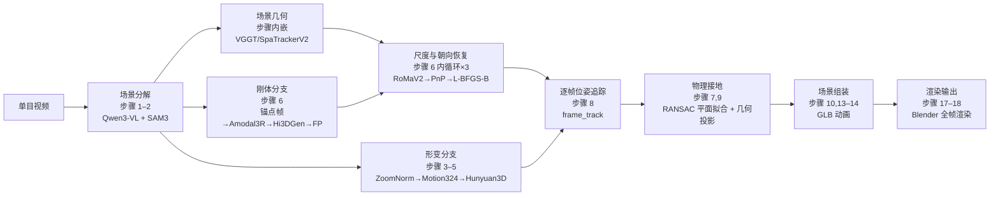

# OVOW 深度解析：从单目视频到可仿真实例级 4D 场景

> 这个系列只做一件事：拆解 OVOW（One Video, One World）的完整工作流——从一段普通单目视频出发，把桌面上的每一件物体各自重建成带位姿轨迹和形变动画的 3D 网格，再统一接地组装成一个可以直接导入仿真器的 GLB 场景。流水线把 Qwen3-VL、SAM3、VGGT、FoundationPose、RoMaV2、Motion324、Hunyuan3D 等十余个独立研究集成成一条自动化链条，本系列的任务就是把每个节点的输入、输出、算法选择和工程细节讲清楚。

## 这条流水线要解决的四个困难

把一段普通视频变成可仿真场景，面临四类根本性困难：

1. **尺度不可知。** 单目视频没有绝对尺度信息。桌上的杯子可以是缩小模型也可以是真实大小，视频里看起来一样。要把物体放进仿真器就必须知道它有多大——OVOW 把这个问题转化成图像匹配 + 几何优化。
2. **遮挡与不完整性。** 锚点帧里的物体往往被其他物体遮住一半。直接把可见部分送进 3D 生成网络，得到的是残缺网格。需要先用 Amodal（非模态）补全把遮挡区域填回来。
3. **形变物体无法用一个刚体网格描述。** 毛绒玩具、布料、植物在视频里会发生形变。把这类物体处理成一组随时间变化的网格（4D 网格序列），需要完全不同的生成路径。
4. **相机运动与物体运动耦合。** 场景几何（相机轨迹 + 深度）和物体位姿都是未知的，必须先解出场景几何作为参考坐标系，才能在其上求解物体的 6DoF 轨迹。

## 流水线鸟瞰

> 流水线分两条并行的物体处理分支（刚体和形变），共享同一套场景几何基准，最终在接地组装阶段合并。默认运行步骤 1 2 3 4 5 6 7 8 10 13 14 17 18，共 13 步；全部 21 步还包括物理接触精修、HDR 环境光生成、FLUX.2 单参考帧编辑等高级功能。

## 六章各自解决哪个问题

| 章节 | 这一章覆盖的步骤 | 核心内容 |
|------|---------------|---------|
| [01 总览：流水线架构与工程约束](./01_总览_单目视频到实例级4D场景的完整流水线) | — | 21 步全貌、默认 13 步选取逻辑、三 conda 环境划分、常驻模型服务架构、批量处理模式 |
| [02 场景分解：VLM 标注与逐帧分割](./02_场景分解_VLM标注与逐帧分割掩码) | 步骤 1–2 | Qwen3-VL 标注协议、static/rigid/deform 三分类判定、SAM3 client-server 协议、mask 输出格式 |
| [03 场景几何：相机轨迹与深度估计](./03_场景几何_VGGT相机轨迹与点云估计) | 步骤内嵌 | SpaTrackerV2/VGGT 前馈重建、result.npz 的三个数组、场景点云、世界坐标系基准 |
| [04 刚体重建与尺度恢复](./04_刚体重建与尺度恢复_从锚点帧到度量位姿) | 步骤 6 | 锚点帧选取、Amodal3R/FLUX.2 遮挡补全、Hi3DGen image-to-3D、FoundationPose 注册、迭代×3 尺度恢复循环 |
| [05 形变物体：4D 生成与逐帧位姿追踪](./05_形变物体_Motion324四维生成与逐帧位姿追踪) | 步骤 3–5,8–9 | ZoomNorm 遮罩视频、Motion324/Hunyuan3D 4D 生成、frame_track 双向追踪、形变世界网格序列 |
| [06 物理接地、组装、渲染与评测](./06_物理接地组装渲染与评测) | 步骤 7,10,13–14,17–18 | RANSAC 地面拟合、几何接地投影、morph target GLB 组装、Blender 全帧渲染、OVOW-Bench 指标 |

## 读这套文章需要的基础

正文在每个关键节点就地讲清楚基本原理，但如果想更深入理解某个组件，以下文章可以提前或同步阅读：

- [OVOW：从单目视频重建可仿真的 4D 场景](/论文综述/161_OVOW_单目视频重建可仿真4D场景) — 方法论和实验结论的精读，本系列聚焦工程实现，两者互补
- [VGGT：前馈式多视图三维重建](/前置知识/016a_前置知识_VGGT前馈式多视图三维重建) — 场景几何估计的骨干网络
- [TRELLIS.2 深度解析](/系列/trellis2_deep_dive/) — Hi3DGen/TRELLIS image-to-3D 的原理
- [混元 3D 生成模型 Hunyuan3D](/前置知识/016b_前置知识_混元3D生成模型Hunyuan3D) — Motion324 的 canonical mesh 生成后端
- [6DoF 位姿估计与 ADD-S 评测指标](/前置知识/015f_前置知识_6DoF位姿估计与ADD-S评测指标) — FoundationPose 的任务定义
- [RANSAC 鲁棒估计](/前置知识/014d_前置知识_RANSAC鲁棒估计) — 尺度恢复和地面拟合中的 RANSAC
- [相机模型与针孔投影](/前置知识/014a_前置知识_相机模型与针孔投影) — PnP 求解的坐标系基础
