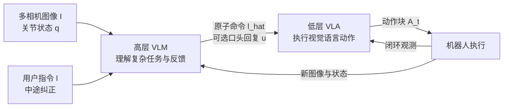
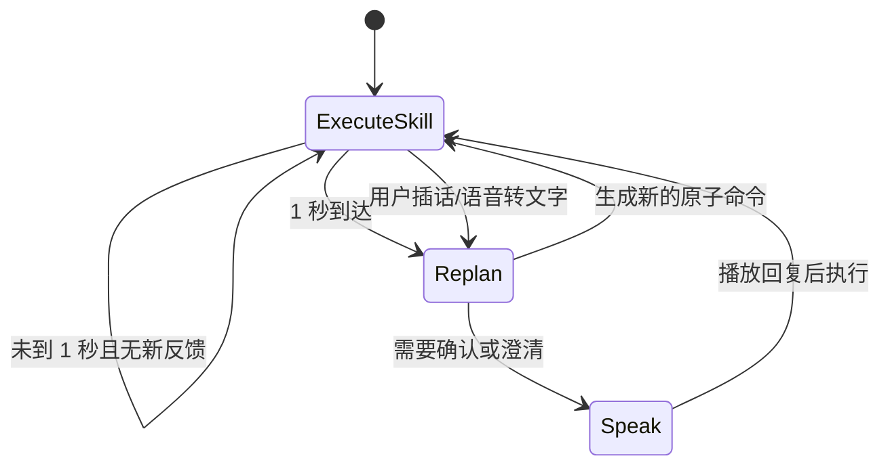
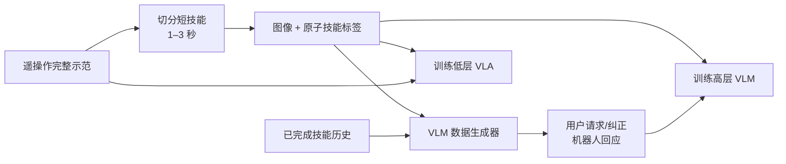

# 第一章：Hi Robot——层级 VLA 与开放式指令跟随

> **本章结论**：Hi Robot 没有要求一个低层策略同时理解“请做一个素食三明治、不要放番茄、我朋友要另一份肉类三明治”并立刻输出关节动作，而是增加一个高层视觉语言模型，把复杂指令和实时反馈改写成低层策略熟悉的原子技能。高层负责当前该做什么，低层负责怎样把这一步做出来。

**前情提要**：系列入口把机器人闭环拆成语义、硬件和接触三段。Hi Robot 位于最上游，解决用户意图如何进入动作系统；[行为克隆与 RL 微调范式](/前置知识/000d_前置知识_行为克隆与RL微调范式)解释示教数据如何训练低层策略；[OpenVLA](/论文综述/015_OpenVLA_开源视觉语言动作模型)和 [π₀](/论文综述/014_Pi0_通用机器人基础模型)提供 VLA 的背景。

**知识链接**：

- [系列目录](./index)
- [行为克隆与 RL 微调范式](/前置知识/000d_前置知识_行为克隆与RL微调范式)
- [视觉语言动作模型 VLA 综述](/论文综述/S03_视觉语言动作模型VLA综述)
- [π₀ 通用机器人基础模型](/论文综述/014_Pi0_通用机器人基础模型)
- 下一章：[NeuralActuator：神经执行器与无传感器力感知](./02_NeuralActuator_神经执行器与无传感器力感知)

## 1. 端到端低层策略卡在“指令太大”

假设机器人已经学会以下原子技能：拿起杯子、把杯子放入托盘、捡起一块面包、把面包放到盘子上。它可以很好地执行“把杯子放入托盘”，因为这句话和示教数据中的动作粒度相同。

问题出现在真实用户的表达方式：

> “请做一个素食三明治，不要放番茄；如果有火腿，再为朋友做一份带火腿的；先用离你近的面包，桌边那块不要碰。”

这句话同时包含目标、顺序、否定约束、条件分支和空间指代。直接把它与相机图像拼在一起交给一个低层 VLA，至少会出现四类冲突：

| 冲突 | 低层策略面对的困难 | 失败表现 |
|---|---|---|
| 时间跨度 | 当前动作只覆盖很短的动作块，无法保存整段任务的约束 | 做完第一步就忘记“不要放番茄” |
| 组合关系 | “为朋友再做一份”不是一个训练时固定的原子标签 | 只做一份或重复同一份 |
| 否定约束 | “不要碰桌边那块”需要把禁用对象持续写入状态 | 仍然按距离选择最近对象 |
| 中途反馈 | “那不是垃圾”“只留下黄色的”改变当前计划 | 继续执行旧动作，无法回滚 |

这不是单纯的模型容量问题。低层策略的训练目标是“在当前观测和短指令下生成动作”，而开放式任务需要另一个目标：“结合上下文，决定当前应该调用哪个已学技能”。Hi Robot 把这两个目标拆开。

## 2. 两层模型如何分工

视觉语言模型（Vision-Language Model, VLM）是能够读取图像和文字、输出文字的模型；视觉语言动作模型（Vision-Language-Action, VLA）则把输出空间扩展为机器人动作。Hi Robot 用 VLM 做高层决策，用 VLA 做低层动作执行。

它们的关系不是“高层模型替代低层策略”，而是高层输出低层可理解的语言接口：



> 关键观察是接口：高层的输出不是抽象的“计划 JSON”，而是类似“pick up the lettuce”“move the right arm to the left”的原子命令；低层策略仍然接收图像、关节位置和原子语言，并沿用它已有的动作能力。

### 2.1 高层输出什么

记用户在时刻 $t$ 给出的原始指令为 $ell_t$，相机图像为 $mathbf{I}^{1:n}_t$，高层改写后的原子命令为 $hat{ell}_t$，机器人需要说出的确认或解释为 $u_t$。高层的任务是从“用户说了什么 + 机器人当前看到了什么”得到下一步语言动作：

$$
p^{\mathrm{hi}}\left(\hat{\ell}_t,u_t\mid\mathbf{I}^{1:n}_t,\ell_t,\hat{\ell}_{0:t-1}\right).
$$

**这个公式在做什么**：把高层 VLM 定义成一个带上下文的语言决策器，它不是直接控制关节，而是在当前视觉状态下选择低层能够执行的下一项技能，并可生成一句面向人的回应。

::: details 📐 公式详解（点击展开）

| 子表达式 | 它是谁 | 它在干嘛 |
|---|---|---|
| $\mathbf{I}^{1:n}_t$ | **当前场景证据** | 多个相机在时刻 $t$ 看到的桌面、物体、机械臂和已完成状态 |
| $\ell_t$ | **用户当前意图** | 原始任务、约束或中途纠正，例如“只收拾垃圾” |
| $\hat{\ell}_{0:t-1}$ | **技能历史** | 已经执行过的原子命令，帮助模型避免重复和保持任务顺序 |
| $\hat{\ell}_t$ | **给低层的工作单** | 当前最适合执行的单步命令，如“pick up the cup” |
| $u_t$ | **给用户的反馈** | 确认、澄清或错误处理信息，可被语音播放但不会直接传给低层 |

**用人话读**：高层查看当前画面、用户要求和已经完成的步骤，决定机器人此刻要做哪一个小动作，以及是否需要向用户解释。

**为什么保留技能历史**：只看当前图像容易把多步任务当成独立单步分类；历史让“已经放过生菜”成为当前决策的条件，也能让合成数据生成器构造有前后关系的互动。
:::

### 2.2 低层输出什么

低层接收高层生成的 $hat{ell}_t$，把它和相机图像、关节位置一起映射为动作块 $mathbf{A}_t=[mathbf{a}_t,ldots,mathbf{a}_{t+H-1}]$。动作块不是一个瞬时位置，而是未来一小段控制信号；这样可以减少每个物理控制周期都运行大模型的开销。

Hi Robot 的低层使用基于 PaliGemma-3B 的 π₀ VLA，并增加连续动作的 Flow Matching action expert。这里的 Flow Matching 只承担“怎样生成连续动作块”的职责，具体数学形式可参考 [Flow Matching 前置知识](/前置知识/000g_前置知识_Flow_Matching与连续归一化流)，本章关注它与高层命令的接口。

## 3. 高层为什么不用固定规则树

固定规则树可以把“做三明治”拆成拿面包、放配料、合上面包，但面对以下变化就会迅速膨胀：

- 用户指定任意配料组合；
- 用户禁止某个配料；
- 用户根据当前物体外观临时修正目标；
- 任务执行到一半时插入新要求；
- 同一技能在单臂、双臂和移动双臂机器人上的可执行命令不同。

Hi Robot 的高层 VLM 利用视觉语言预训练获得物体、语言和常识的组合能力，再用真实机器人示教数据把这些能力约束到机器人的技能集合中。它的核心不是让 VLM 学会新的物理控制，而是让 VLM 学会“在当前机器人能力边界内选择合适的原子命令”。

### 3.1 运行频率的设计

高层推理比低层动作生成慢，却不需要每个控制周期运行。论文的实现采用两种触发：一秒经过后重新推理，或收到新的用户交互时立即重推理。低层在两次高层更新之间持续执行当前原子技能。



这个状态机解决了两个相反需求：低层不能停下来等待高层每一次思考，否则动作会断续；高层又不能只在任务开头思考，否则无法处理“那不是垃圾”这种依赖当前画面的反馈。

## 4. 数据工程：真实示教如何变成互动训练集

高层训练的关键难点是：现实中很少有人为每个完整示教写出大量“如果用户这样说，机器人应该怎样回应”的标注。Hi Robot 将数据构造成两层。

### 4.1 第一层是可执行技能数据

研究者先收集遥操作示范，每个 episode 有一个粗粒度的总目标，例如“清理桌面”或“制作三明治”。随后把长 episode 切成一到三秒左右的短技能，并从动作轨迹中提取一些基本移动原语。每条技能样本包含：

| 字段 | 内容 | 作用 |
|---|---|---|
| 图像序列 | 多个相机在技能附近的观测 | 让高层知道当前物体和机器人状态 |
| 技能标签 | 如“pick up one piece of lettuce” | 指定低层真正执行的目标 |
| 关节与动作记录 | 遥操作轨迹 | 训练低层 VLA 和验证技能是否可执行 |
| episode 历史 | 之前完成的技能 | 生成连贯而不是孤立的互动 |

### 4.2 第二层是 VLM 生成的互动数据

对每个“图像 + 技能标签”，再调用一个大视觉语言模型作为数据生成器，要求它想象一个合理的用户请求、用户插话和机器人回应。例如已知低层要执行“pick up the lettuce”，生成器可以构造“Can you add some lettuce for me?”，也可以在当前上下文下构造“我对乳制品过敏，请不要放奶酪”。

这一步不是让生成器编造动作，而是让它围绕**已经存在且可执行的技能**扩展语言覆盖。数据生成器还被提供之前的技能标签，因此能够生成“已经放了生菜，用户又要求加番茄”这样的有序互动，而不是每个样本都像任务第一帧。



> 图中最重要的约束是“先有可执行技能，再扩展语言表述”。如果生成器可以随意创造低层没有能力的动作，训练出来的高层会很会说，却会给低层下达无法完成的命令。

### 4.3 两个训练目标保持分离

高层 VLM 用自回归 next-token prediction，也就是让每个目标回复 token 在给定图像和用户指令时获得更高概率。低层 VLA 则使用示教动作和 Flow Matching 目标训练连续动作。两者共享相近的基础模型初始化，但训练数据和输出空间不同。

这种分离有一个实际好处：高层语言能力可以通过合成交互扩展，而不会直接改变低层的动作分布；低层动作能力也可以独立替换为另一个已验证的语言条件策略。

## 5. 真实任务中的闭环例子

以“只收拾黄色物品”为例，系统动作链如下：

1. 高层读取桌面图像，把“黄色”落到具体物体，而不是把它当作抽象字符串。
2. 高层输出“pick up the yellow cup”，低层 VLA 继续用它学过的抓取策略。
3. 机器人执行期间，用户说“leave the rest”。高层被立即触发，保留已完成状态并把下一项命令改为停止收拾其他物品。
4. 若用户说“that’s not trash”，高层重新检查当前图像和刚才的对象，把原本要放入垃圾桶的物体改回桌面或交给低层执行放回动作。

这里的“理解”不是单次语言问答，而是高层命令持续受到物理状态约束。高层若只看用户文本，无法知道当前夹爪是否已经拿着物体；若只看图像，无法知道用户刚刚新增了什么限制。Hi Robot 的收益来自两者的联合。

## 6. 实验结果应该怎样读

论文在 Table Bussing、Sandwich Making 和 Grocery Shopping 三类任务上评估复杂指令、插话和用户中断，并与 GPT-4o 直接做高层决策、以及不分层的 flat VLA 比较。原文报告 Hi Robot 的指令准确率整体比 GPT-4o 高四十多个百分点，并接近人工高层指挥；重要的不是一个孤立平均数，而是两个消融结论：

| 消融 | 去掉的组件 | 失败机制 |
|---|---|---|
| 无合成互动数据 | 只用人类标注技能 | 能对齐图像，却经常忽略“不要做什么”和中途澄清 |
| 无层级结构 | 用一个 flat 策略直接把复杂指令变成动作 | 容易回到默认行为，无法在每个原子步骤重新检查用户意图 |

这说明两个设计分别解决不同问题。合成数据扩大了语言表达和约束组合的覆盖；层级结构把“持续重读意图”和“执行一个已学技能”分到不同时间尺度。只有其中一个，系统仍会在另一处失败。

### 6.1 延迟是否足以支撑交互

论文给出的工程测量显示，低层策略在 RTX 4090 上完成图像编码、观测处理和十步动作预测总计约 73 ms，跨 Wi-Fi 约 86 ms；高层单步解码还要经历 prefill 和逐 token decode。因此高层不能每帧运行，低层也不能依赖高层持续提供新命令。这个数据解释了固定一秒重规划和“用户插话立即重规划”的折中。

## 7. 直接实现时的最小控制骨架

下面的伪代码只实现论文中已经说明的接口：高层低频输出原子命令，低层持续执行；用户新反馈触发高层立即更新。代码没有把高层内部的语言推理写成一个神秘函数，而是显式保存当前命令和已完成技能历史。

```python
history = []
current_skill = None
last_replan_time = 0.0

while robot_is_running:
    images, q = read_observation()
    user_text = read_new_user_feedback()  # 没有新反馈时返回 None

    time_due = now() - last_replan_time >= 1.0
    if current_skill is None or time_due or user_text is not None:
        current_skill, reply = high_level_vlm(
            images=images,
            user_text=user_text,
            skill_history=history,
        )
        speak_if_needed(reply)
        last_replan_time = now()

    action_chunk = low_level_vla(images, q, current_skill)
    send_action_chunk(action_chunk)

    if skill_is_complete(current_skill, images, q):
        history.append(current_skill)
        current_skill = None
```

代码中的 `current_skill` 是高层到低层的唯一工作接口；`history` 不是低层动作缓存，而是高层用来维持任务语义的状态。真实部署还必须把 `skill_is_complete` 做成可靠的状态判定，不能仅凭时间到达就认定抓取成功，否则一秒一次的重规划会把失败状态继续传给下一步。

## 8. 局限与设计边界

### 8.1 高层没有真正的长时记忆

论文明确观察到长上下文任务仍会失败。技能历史能提供局部顺序，却不是一个能检索整段对话、物体清单和失败原因的持久记忆。任务持续时间变长后，压缩、检索或结构化状态会比无限增加 prompt 更可靠。

### 8.2 高低层能力没有直接闭环训练

高层知道哪些命令出现在示教里，却不直接获得低层执行成功率；低层也不直接把“这个命令在当前场景无法完成”反馈给高层。两层通过训练样本间接耦合，因此可能出现高层命令语义正确但超过低层当前能力的情况。

### 8.3 错误恢复仍依赖覆盖

合成数据能增加“那不是垃圾”“我还要一块 KitKat”这类互动，但它不自动产生所有物理失败恢复轨迹。掉落物体、遮挡、抓取失败和人与机器人同时操作仍需要专门的失败数据与安全策略。

## 小结

Hi Robot 的核心不是增加一个会聊天的机器人，而是建立一个可执行的语言层级：高层 VLM 把开放式指令和实时反馈转为低层已经学会的原子技能，低层 VLA 在更高频率上执行动作块。合成数据解决语言组合覆盖，层级结构解决时间尺度和持续纠正，二者缺一都会退化。

对本系列的闭环来说，Hi Robot 只回答了“当前要做哪一步”。机器人是否真的按预期运动，还取决于执行器的摩擦、回差、热状态和负载；这些因素会让同一个位置命令在不同时间产生不同的实际响应。下一章进入 NeuralActuator，分析如何用历史遥测和可微仿真把这段硬件行为建模出来。

## 下一章预告

下一章分析 [NeuralActuator](./02_NeuralActuator_神经执行器与无传感器力感知)：它不把低成本舵机简化成固定的电流—力矩常数，而是用九帧命令、状态和执行器遥测历史预测等效广义力、外力、接触门控和电机状态。

## 论文原文

- [Hi Robot: Open-Ended Instruction Following with Hierarchical Vision-Language-Action Models](https://arxiv.org/abs/2502.19417)
- [Physical Intelligence 项目页](https://www.pi.website/research/hirobot)
