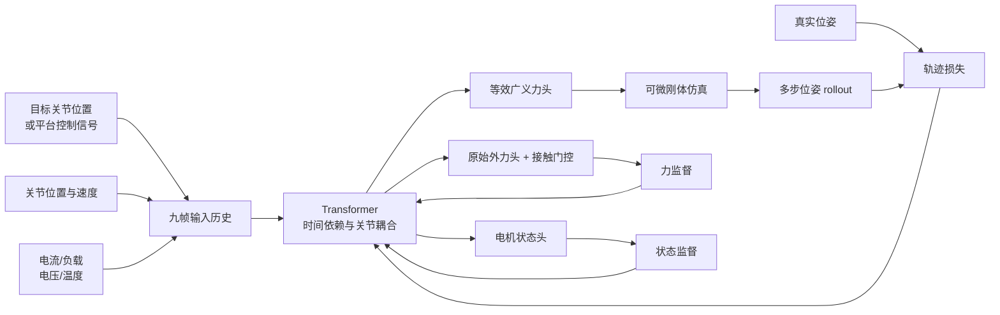
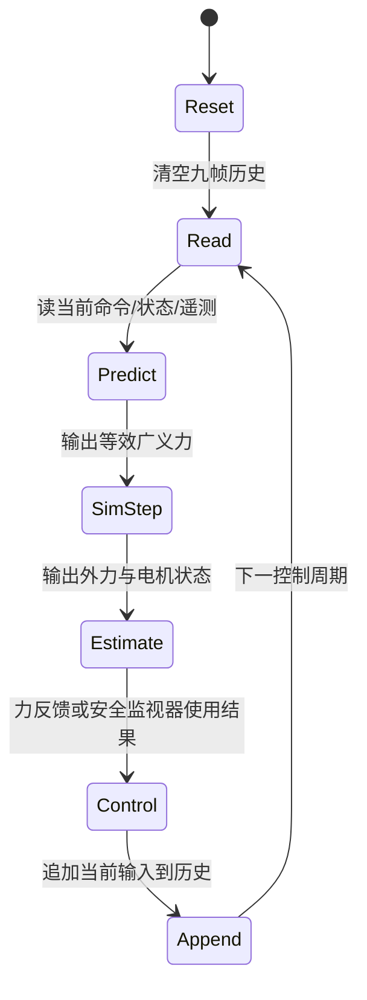

# 第二章：NeuralActuator——神经执行器与无传感器力感知

> **本章结论**：低成本舵机的“电流 × 力矩常数”不是可靠的关节力矩传感器。NeuralActuator 把命令、关节状态和电机遥测的短历史交给一个多任务 Transformer，输出驱动仿真所需的等效广义力，同时预测末端外力、接触概率和受限电机状态；等效驱动力通过可微仿真用位姿轨迹间接监督，因此不要求直接采集关节力矩标签。

**前情提要**：上一章的 Hi Robot 解决了“当前该执行哪个原子技能”。但低层策略发出的同一个目标位置，经过不同的摩擦、回差、齿轮负载和温度状态，可能产生不同运动和接触力。本章把这段硬件误差放回闭环。阅读前建议了解[机器人系统辨识深度解析](/系列/system_identification_deep_dive/index)、[正动力学与逆动力学](/前置知识/008e_前置知识_正动力学逆动力学与递归刚体算法)和[可微仿真](/系列/newton_engine_deep_dive/08_可微仿真_梯度怎么传回控制输入)。

**知识链接**：

- [系列目录](./index)
- [机器人系统辨识深度解析](/系列/system_identification_deep_dive/index)
- [执行器与关节局部模型](../system_identification_deep_dive/04_执行器与关节局部模型)
- [可微仿真：梯度怎么从仿真结果传回控制输入](/系列/newton_engine_deep_dive/08_可微仿真_梯度怎么传回控制输入)
- [机器人静力学、虚功与雅可比转置](/前置知识/008f_前置知识_机器人静力学虚功与雅可比转置)
- 上一章：[Hi Robot：层级 VLA 与开放式指令跟随](./01_Hi_Robot_层级VLA与开放式指令跟随)
- 下一章：[TAO-Force：力感知 VLA 与快慢控制](./03_TAO_Force_力感知VLA与快慢控制)

## 1. 为什么低成本执行器会破坏仿真对齐

理想化的机器人动力学把执行器输出当作已知关节力矩；低成本舵机通常只暴露目标位置、电流、PWM、总线电压和温度等信号。最常见的简化是用电流乘电机力矩常数：电流增加一倍，认为关节力矩也增加一倍。

这条近似在工业执行器上可能足够好，但在带高减速比、机械回差和内部闭环的位置舵机上会失效：

| 非理想因素 | 它改变了什么 | 只用固定比例会发生什么 |
|---|---|---|
| 齿轮摩擦 | 同样电流下可用于推动连杆的力不同 | 静止和运动阶段被错误地当成同一力矩 |
| 回差与滞回 | 输出取决于运动方向和过去受力 | 正反换向时仿真提前或滞后 |
| 电流饱和 | 目标误差很大时电机输出被限幅 | 仿真认为还能继续加速，真机却停在原地 |
| 温升与电压变化 | 电机常数和可用电流随状态变化 | 冷机调好的参数热机后漂移 |
| 外部接触 | 负载改变了跟踪误差和内部控制行为 | 由电流反推的“力矩误差”混入接触力 |

因此，真正需要学习的不是一个静态常数，而是“当前命令、当前状态和最近发生过什么”共同决定的有效驱动输入。

## 2. NeuralActuator 的输入输出边界

NeuralActuator 插在执行器遥测和可微刚体模拟器之间，同时共享表示给力感知头。它不是替换完整的刚体动力学，也不是把预测的 3D 力直接当作仿真状态更新的默认输入；在论文的主要隐式耦合设置中，只有等效广义力驱动仿真，外力头单独接受监督。



> 要区分两条路径：等效广义力通过“模型→仿真→位姿误差”得到间接监督；外力和电机状态有直接标签。把这两条路径混成一个“预测力矩监督”会误解论文的关键贡献。

### 2.1 九帧历史不是装饰

论文使用前八帧加当前帧构成九个 token。每一帧包含命令、关节位置、关节速度和平台可用的执行器遥测。历史让网络能观察“命令刚刚换向”“温度正在上升”“当前误差已经持续一段时间”等瞬态证据；单帧 MLP 只能看到这些现象的一个切片。

对 OpenManipulator-X，平台信号是电机电流；对 SO-101 是带符号的负载寄存器；对 Franka 则使用命令关节力矩及其电机侧状态。这个差异说明 NeuralActuator 的输入接口不是“电流专用网络”，而是“把平台可获得的执行器侧信号组织成历史序列”。

### 2.2 四个输出头

设九帧输入序列为 $mathbf{X}_t=(mathbf{x}_{t-8},\ldots,\mathbf{x}_t)$，共享 Transformer 编码后得到时间池化特征 $mathbf{h}_t$。四个任务头分别生成等效广义力、原始外力、接触门控和每个电机的状态分数：

$$
\begin{aligned}
\boldsymbol{\tau}^{\mathrm{pred}}_t &= g_{\tau}(\mathbf{h}_t),\\
\hat{\mathbf{f}}^{\mathrm{raw}}_t &= g_f(\mathbf{h}_t),\qquad g_t=\sigma(g_g(\mathbf{h}_t)),\\
\hat{\mathbf{f}}_t &= g_t\hat{\mathbf{f}}^{\mathrm{raw}}_t,\\
\mathbf{c}_t &= \sigma(g_c(\mathbf{h}_t)).
\end{aligned}
$$

**这个公式在做什么**：同一个时序表示同时服务四种闭环需求——让仿真运动得像真机、判断是否接触、估计接触力、判断某个电机是否处于受限状态。

::: details 📐 公式详解（点击展开）

| 子表达式 | 它是谁 | 它在干嘛 |
|---|---|---|
| $g_{\tau}(\mathbf{h}_t)$ | **仿真驱动头** | 输出仿真器真正需要的等效广义力；旋转关节对应力矩，夹爪平移通道对应广义力 |
| $g_f(\mathbf{h}_t)$ | **原始力猜测** | 在知道有无接触前，先给出 3D 外力幅值和方向的连续预测 |
| $g_t$ | **接触阀门** | 用一个介于 0 和 1 的门控抑制无接触阶段的伪力输出 |
| $g_t\hat{\mathbf{f}}^{\mathrm{raw}}_t$ | **最终外力** | 把“力的大小方向”和“当前是否应该有力”分开，减少无接触时的小数值噪声 |
| $\mathbf{c}_t$ | **状态告警头** | 为每个执行器输出正常/受限分数；论文只监督和评估 OpenManipulator-X 的 Joint 3 |

**用人话读**：模型先从历史中形成一个共享判断，再分别回答“仿真该施加多少驱动力”“现在有没有接触、接触力多大”“电机是否被机械阻碍”。

**为什么要把力拆成原始值和门控**：只做一个 3D 回归头时，网络必须同时学习“方向、幅值、零力区间”，无接触样本中的小偏差会直接变成假接触；门控让接触检测成为显式任务，并把无接触输出压向零。
:::

这里的 $hat{\mathbf{f}}_t$ 是末端 3D 合力，不是完整六维力/力矩扳手，也不定位多个接触点。读者应把它当作“单个末端合力估计”，不要把它等同于腕部六轴传感器的完整读数。

## 3. 等效广义力为什么不等于真实电机力矩

### 3.1 物理背景

机器人动力学可以用惯性、科氏/离心、重力和外力解释关节侧的总需求。若末端只考虑 3D 力，外力映射到关节侧的形式是 $J_v(q)^T\mathbf{f}^{\mathrm{ext}}$，具体的雅可比转置推导见[机器人静力学前置知识](/前置知识/008f_前置知识_机器人静力学虚功与雅可比转置)。

在低成本平台上，真实执行器输出和外力难以被完全分离：摩擦、回差和内部位置环的状态不可见。NeuralActuator 因而使用“等效广义力”作为仿真输入，让它承担复现真实位姿所需的总有效作用，而不声称输出是可校准的物理电机轴力矩。

### 3.2 直接参数化和残差参数化

模型可以完全直接预测等效广义力，也可以把固定的电流—力矩近似作为基线，再让网络学习残差：

$$
\boldsymbol{\tau}^{\mathrm{pred}}_t=
\begin{cases}
g_{\theta}(\mathbf{X}_t), & \text{direct},\\
\boldsymbol{\tau}_{\mathrm{base}}(u_t)+\Delta g_{\theta}(\mathbf{X}_t), & \text{residual}.
\end{cases}
$$

**这个公式在做什么**：比较两种“网络从哪里开始学习”的方案——一种不预设电流到力矩的关系，另一种保留一个物理近似并只学习它解释不了的部分。

::: details 📐 公式详解（点击展开）

| 子表达式 | 它是谁 | 它在干嘛 |
|---|---|---|
| $g_{\theta}(\mathbf{X}_t)$ | **自由预测器** | 直接从历史遥测生成仿真所需的广义力，不被固定比例限制 |
| $\boldsymbol{\tau}_{\mathrm{base}}(u_t)$ | **名义锚点** | 用电流或平台信号提供一个初始的物理先验 |
| $\Delta g_{\theta}(\mathbf{X}_t)$ | **误差修正器** | 学习摩擦、滞回、温度和接触等名义模型未解释的部分 |
| direct 与 residual | **两种归纳偏置** | direct 更能避开错误的线性先验，residual 在先验可靠时更容易训练 |

**用人话读**：direct 让网络从零学“命令和历史如何产生有效驱动”，residual 则先相信一个粗糙物理模型，再学它的偏差。

**为什么论文主实验选择 direct**：OpenManipulator-X 的固定电流—力矩关系本身不可靠，硬塞进 residual 会把错误先验写入每一个预测；direct 允许网络用历史和状态绕开这个限制。若换成标定质量更高的平台，residual 仍可能是更好的选择。
:::

“等效”二字决定了使用边界：输出适合驱动一个能复现轨迹的仿真器，适合提供接触反馈，但不能直接拿去做电机额定扭矩、齿轮安全裕量或结构应力认证。

## 4. 没有力矩标签，怎样训练驱动头

### 4.1 用位姿误差监督仿真结果

低成本舵机通常没有关节力矩传感器，甚至电流也不能可靠映射到关节力矩。NeuralActuator 的替代做法是：让网络输出等效广义力，把它送进可微仿真器，滚动得到未来关节位姿，再和真实轨迹比较。


### 4.2 状态转移必须完整

令仿真状态 $mathbf{s}_t=[mathbf{q}_t,\dot{\mathbf{q}}_t]$，$F_t$ 是在当前时间步执行刚体动力学积分的函数。隐式力耦合时，状态更新为：

$$
\mathbf{s}_{t+1}=F_t\left(\mathbf{s}_t,\boldsymbol{\tau}^{\mathrm{pred}}_t\right)=\mathrm{DiffSim}\left(\mathbf{s}_t,\boldsymbol{\tau}^{\mathrm{pred}}_t\right),\qquad \boldsymbol{\tau}^{\mathrm{pred}}_t=g_\theta(\mathbf{X}_t).
$$

**这个公式在做什么**：明确“网络输出不是最终标签，而是仿真一步的输入”；每一步仿真状态又会进入下一步的历史和动力学，因此误差会沿 rollout 累积并反过来约束早期预测。

::: details 📐 公式详解（点击展开）

| 子表达式 | 它是谁 | 它在干嘛 |
|---|---|---|
| $\mathbf{s}_t$ | **仿真当前状态** | 当前关节位置和速度，是状态转移的旧值 |
| $g_\theta(\mathbf{X}_t)$ | **当前驱动力猜测** | 根据当前九帧历史输出仿真器要接收的广义力 |
| $F_t$ | **物理推进器** | 把当前状态和驱动力积分为下一时刻状态 |
| $\mathbf{s}_{t+1}$ | **更新后的状态** | 既是当前步的输出，也会成为后续 rollout 的输入 |

**用人话读**：网络每一步猜一个有效驱动力，仿真器把这个猜测变成下一步关节状态，整条模拟轨迹最后和真机轨迹对齐。

**为什么需要多步 rollout**：单步误差可能被下一步重新校正，无法说明模型能否长期传播；多步 rollout 会暴露系统性偏差，例如摩擦方向错、延迟漏建模或负载变化没有进入历史。
:::

自动微分随后把末端位姿误差沿“仿真积分链”传回网络参数。这个机制与[可微仿真系列](/系列/newton_engine_deep_dive/08_可微仿真_梯度怎么传回控制输入)中的控制输入求导相同，区别在于这里被优化的输入生成器是一个带历史的执行器网络。

### 4.3 隐式耦合和显式耦合

论文比较两种外力进入仿真的方式：

| 耦合方式 | 状态更新使用什么 | 外力头的作用 | 适用解释 |
|---|---|---|---|
| 隐式耦合 | 只有等效广义力 | 直接用力标签训练，但不改状态更新 | 让等效力吸收复现轨迹所需的交互影响 |
| 显式耦合 | 等效广义力 + $J_v^T\hat{\mathbf{f}}$ | 预测外力直接进入仿真并受到 rollout 梯度约束 | 需要把力输出和动力学贡献绑定得更紧 |

隐式耦合的优点是优化更容易，因为网络不用同时解决“真实执行器力”和“外部力分解”的不可辨识问题；缺点是等效力可能把接触作用吸收进去，不能解释成纯粹的电机力矩。显式耦合更有物理结构，但若外力标签稀疏、坐标或符号不准，就会把错误的力直接写进状态更新。

## 5. 数据集 NAD 如何覆盖可辨识性

Neural Actuation Dataset（NAD，神经执行器数据集）不是只记录自由空间轨迹，而是把能区分不同因素的实验放在一起。论文用双臂 teleoperation：人操作 leader arm，follower arm 执行与 leader 关节状态对应的目标，并同步记录机器人状态、执行器遥测和外力标签。

| 数据子集 | 具体设计 | 能教会模型什么 |
|---|---|---|
| Free motion | 圆周、单关节扫掠、整臂伸展、空载抓取 | 固有摩擦、命令跟踪和关节耦合 |
| Force-labeled | 200–500 g 已知载荷、六轴传感器沿 ±X/±Y/±Z 推拉 | 负载变化与外力方向如何影响遥测和运动 |
| Motor condition | 用橡皮筋限制 Joint 3，再做有/无负载抓取 | 在轨迹相近而电流更高时识别机械受限 |
| Cross-platform | SO-101 与 Franka 的独立数据 | 检查输入接口和共享架构能否迁移到其他执行器族 |

训练、验证、测试按每类轨迹的 8:1:1 划分。这个细节很重要：若同一条长轨迹的相邻帧同时出现在训练和测试，模型只需记住局部时间纹理，不能证明它在新轨迹上的系统辨识能力。

### 5.1 为什么已知载荷可以提供力标签

对静止或近似静止地 holding 的物体，质量 $m$ 的重力可以提供一个基座坐标系的名义竖直力 $[0,0,-mg]^T$。它不是动态运动中的完整接触力真值，因为没有包含物体加速度、夹持摩擦和碰撞瞬态；论文把它作为 payload benchmark 的监督，而不是宣称覆盖所有交互。

因此，外力估计的任务边界必须写清：它学习的是数据分布中“末端合力与执行器历史之间的关系”，不是从无标签数据中自动恢复任意接触的完整物理真值。

## 6. 多任务损失如何防止某个头独占训练

NeuralActuator 同时有位姿、夹爪、外力、接触门控、电机状态和可选速度监督。一个概括性的总目标是：

$$
\mathcal{L}=\lambda_q\mathcal{L}_{\mathrm{joint}}+\lambda_g\mathcal{L}_{\mathrm{grip}}+\lambda_f\mathcal{L}_{\mathrm{force}}+\lambda_c\mathcal{L}_{\mathrm{gate}}+\lambda_m\mathcal{L}_{\mathrm{cond}}+\lambda_v\mathcal{L}_{\mathrm{vel}}.
$$

**这个公式在做什么**：把不同传感器和输出头的目标放进同一个训练循环，但通过权重和可用性掩码控制每个任务对网络更新的贡献。

::: details 📐 公式详解（点击展开）

| 子表达式 | 它是谁 | 它在干嘛 |
|---|---|---|
| $\mathcal{L}_{\mathrm{joint}}$ | **主体运动评分** | 衡量仿真关节位姿和真机位姿的差，是没有力矩标签时训练执行器头的主信号 |
| $\mathcal{L}_{\mathrm{grip}}$ | **夹爪尺度评分** | 单独缩放夹爪滑块误差，避免米制小数值被旋转关节角误差淹没 |
| $\mathcal{L}_{\mathrm{force}}+\mathcal{L}_{\mathrm{gate}}$ | **接触感知评分** | 同时要求力大小方向正确、无接触时门控关闭 |
| $\mathcal{L}_{\mathrm{cond}}$ | **电机状态评分** | 用受限/正常标签提供对机械异常敏感的辅助任务 |
| $\lambda_*$ | **任务音量旋钮** | 统一不同单位和数据覆盖范围；缺失标签的任务权重设为零 |

**用人话读**：一个共享时序表示同时接受“运动像不像”“力像不像”“接触门控对不对”和“电机是否受限”的约束，实际没有标签的任务不参与当前样本的 loss。

**为什么用多任务而不是只训练位姿**：只用位姿能训练出一个能 rollout 的等效驱动力，但外力和电机状态可能从共享表示中没有足够的可分信息；辅助监督迫使表示保留接触、负载和异常状态的线索。反过来，如果力标签坐标错或样本极少，过大的 $\lambda_f$ 会把动力学拟合拖偏，所以权重和数据覆盖必须一起验收。
:::

论文使用 Smooth L1/Huber 类回归和二元交叉熵。图中可以看到 Huber 在大误差区间从平方惩罚转为近似线性，适合含有接触冲击或少量异常标注的机器人数据；接触分类的二元交叉熵则会强烈惩罚“真实接触却给出接近零概率”和“无接触却给出接近一概率”。


> 左图看 Huber 的折中：小误差附近保留平滑二次曲线，大误差时不会像平方误差那样无限放大单个异常点。右图看接触门控的方向性：真实接触时概率越低惩罚越大，无接触时概率越高惩罚越大。

## 7. 实验结果怎样支持设计判断

### 7.1 轨迹 rollout

OpenManipulator-X 在 600 步、约 10 秒的 rollout 上，平均关节角 MAE 约为 J1 3.1°、J2 2.8°、J3 3.2°、J4 3.1°，夹爪单指滑动坐标 MAE 约 0.2 mm。长时间误差仍会累积，说明它是一个有用的动力学近似，不是永不发散的数字孪生。

### 7.2 外力感知

在六个轴向、最高约 9 N 的接触实验中，接触轨迹的力 MAE 在 100 步时约 0.36–0.39 N，在 500 步时约 0.38–0.57 N；无接触匹配轨迹的预测接近 0–0.02 N。已知载荷 benchmark 的平均力 MAE 约为 0.08–0.12 N，但约 50 g 以下的载荷接近低成本平台噪声底，不能把这些数值外推为任意微小接触都能可靠检测。

### 7.3 与经典基线的差异

论文适配了 ID-Linear、加入 Stribeck 摩擦和回差的 ID-Friction，以及 Generalized Momentum Observer。它们都依赖线性电流—力矩换算，并且使用每一步的真值机器人状态；NeuralActuator 则从自己的仿真 rollout 状态预测外力。payload benchmark 上的平均 force MAE 约为：ID-Linear 1.41 N，ID-Friction 1.23 N，GMO 0.66 N，NeuralActuator 0.12 N。

这个对比支持的不是“神经网络永远胜过物理模型”，而是更具体的结论：当低成本齿轮舵机的主要误差不是一个少量参数可解释的摩擦项，而是历史依赖、饱和和内部控制器状态时，固定参数模型很难从电流残差中分离外力。

### 7.4 电机状态估计

在 Joint 3 被橡皮筋机械限制的实验中，受限和正常轨迹可以很接近，但受限状态需要更高电流。NeuralActuator 的 accuracy 为 91.0%，recall 为 96.2%，AUC-ROC 为 0.95；这只表示对受控机械限制的识别能力，不等于已经完成通用电机健康诊断。

### 7.5 实时性与跨平台

论文给出的 OpenManipulator-X 实现约 1.44M 参数、GPU 平均推理 0.25 ms、P95 0.31 ms，单样本吞吐高于 4 kHz，足以覆盖 60 Hz 控制频率。它还在 SO-101 和 Franka 上测试，并把模型接到 NVIDIA Warp 的 Featherstone 积分器，说明“网络输出—可微仿真器”之间可以有适配层，不必绑定某一个模拟后端。

## 8. 在线部署的状态转移

论文强调在线 OpenManipulator-X 推断是严格因果的：当前周期只能使用当前已经到达的电流和状态，不能把未来帧塞进历史。完整状态应包含输入历史、上一时刻命令和仿真状态。



这里的 `Append` 必须发生在当前数据真正到达之后。若离线评估使用“记录轨迹中未来的平滑命令”替代在线可得命令，指标可能很好，却不能直接证明部署时可以因果推断。

### 8.1 最小实现骨架

下面的代码展示状态读、历史更新、网络推断和安全使用的顺序。它没有把模型输出直接写进电机，而是保留一个独立的安全层；真实系统应在此处加入力限幅、速度限幅、急停和失联回退。

```python
history = RingBuffer(length=9)
sim_state = reset_sim_state()

while controller_is_running:
    command = read_command()
    proprio = read_joint_state()
    telemetry = read_actuator_telemetry()  # current / voltage / temperature
    x_t = pack_features(command, proprio, telemetry)

    history.append(x_t)
    tau_surrogate, force_raw, contact_gate, motor_score = model(history.values())

    sim_state = differentiable_step(sim_state, tau_surrogate)
    force_estimate = contact_gate * force_raw

    next_command = controller_update(
        nominal_command=command,
        external_force=force_estimate,
        motor_score=motor_score,
    )
    next_command = safety_clamp(next_command)
    send_command(next_command)
```

代码中的 `tau_surrogate` 是仿真控制输入，不应被命名成“真实 torque”；`force_estimate` 是门控后的末端 3D 合力，不是六维 wrench；`motor_score` 在论文的 OpenManipulator-X 实验中只有 Joint 3 有标注。变量名若隐藏这些边界，部署时很容易把诊断分数误当成认证结果。

## 9. 不能忽略的局限

### 9.1 离线 rollout 不是任意命令的预测器

论文的离线多步评估使用每条轨迹完整记录的执行器遥测序列，因此它是“记录遥测条件下的 rollout”，不是“给模型一个从未执行过的未来命令，让它预测会产生什么电流和运动”。如果要做候选命令的反事实规划，还需要额外学习“命令如何产生未来遥测”的执行器响应模型。

### 9.2 外力监督仍然需要标签

NeuralActuator 在部署推断时不需要专用力/力矩传感器，但训练仍使用力传感器或已知载荷标签。所谓 sensorless 是 inference-time sensorless，不是 label-free，也不是无需校准的万能力觉。

### 9.3 一个合力不能描述多点接触

模型输出一个末端 3D resultant force，不能区分左指尖和右指尖分别受了多少力，也不提供接触位置、力矩或分布式接触。插拔、双点夹持和工具边缘接触需要更丰富的观测头。

### 9.4 等效力的物理可解释性有限

隐式耦合允许等效广义力吸收接触和未建模执行器效应，因此仿真轨迹可以很像真机，却不代表模型恢复了真实电机内部力矩。它更适合作为仿真对齐和控制接口，而不是作为机械设计的测量仪器。

## 小结

NeuralActuator 的设计链条是：

1. 用九帧历史把命令、状态和执行器遥测组织成能表达滞回与热状态的输入。
2. 用共享 Transformer 加四个输出头同时预测等效广义力、外力/接触门控和电机状态。
3. 用可微仿真把等效广义力转成位姿轨迹，以轨迹误差间接监督没有真实力矩标签的驱动头。
4. 用直接力标签和异常状态标签约束共享表示，让它不只会复现自由空间运动，还能提供无传感器力感知。

它为本系列补上了“硬件实际发生了什么”这一段，但它仍是低层信号模型，不决定复杂用户任务，也不自动生成高频柔顺控制。下一章把 NeuralActuator 产生的力信号与 VLA 表征、接触门控和[导纳控制](/前置知识/016a_前置知识_导纳控制与接触柔顺)接起来，分析 TAO-Force 如何把“知道正在接触”变成“立即改变运动”。

## 下一章预告

下一章分析 [TAO-Force](./03_TAO_Force_力感知VLA与快慢控制)：它在冻结预训练 VLA 的前提下，用 F-FiLM 将当前力和力历史注入视觉语言表示，同时预测动作块、目标力块和接触概率，再以低频 VLA、参考轨迹处理和高频导纳环形成快慢控制闭环。

## 论文原文

- [NeuralActuator：arXiv:2607.11734](https://arxiv.org/abs/2607.11734)
- [项目页与数据/代码入口](https://frank-zy-dou.github.io/projects/NeuralActuator/index.html)
