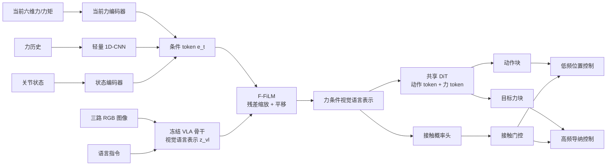
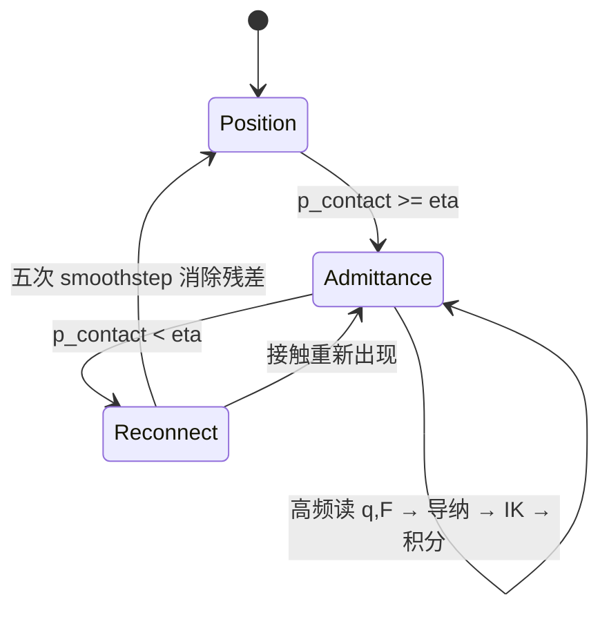
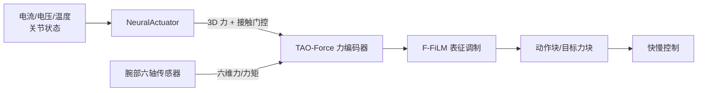

# 第三章：TAO-Force——力感知 VLA 与快慢控制

> **本章结论**：接触丰富任务需要同时修复两个缺口：视觉和语言模型未必看得出接触已经发生，低频 VLA 也来不及直接处理快速接触动力学。TAO-Force 用 F-FiLM 把力反馈注入冻结的视觉语言表示，用三个头预测动作块、目标力块和接触概率，再用接触门控选择低频位置跟踪或高频导纳控制。

**前情提要**：Hi Robot 把复杂任务分成可执行原子技能，NeuralActuator 让命令、执行器历史和外力估计进入低层闭环。本章把两类反馈接到 VLA：语义和视觉仍负责产生名义动作，力反馈负责改变动作生成与执行方式，导纳控制负责在接触发生的毫秒级时间尺度内调节运动。

**知识链接**：

- [系列目录](./index)
- 上一章：[NeuralActuator：神经执行器与无传感器力感知](./02_NeuralActuator_神经执行器与无传感器力感知)
- [导纳控制与接触柔顺](/前置知识/016a_前置知识_导纳控制与接触柔顺)
- [雅可比矩阵与微分运动学](/前置知识/003b_前置知识_雅可比矩阵与微分运动学)
- [机器人静力学、虚功与雅可比转置](/前置知识/008f_前置知识_机器人静力学虚功与雅可比转置)
- [Flow Matching 与连续归一化流](/前置知识/000g_前置知识_Flow_Matching与连续归一化流)
- [触觉仿真深度解析](/系列/tactile_simulation_deep_dive/index)

## 1. 接触任务的两个缺口

考虑四类任务：给重量不同但外观相同的罐子分类、沿黄瓜表面连续削皮、按压洗手液泵头、用橡皮擦擦白板。成功条件都不只由图像决定：

- 罐子是否装满，要通过提起时的负载差判断；
- 削皮需要让刀具沿表面保持合适压力；
- 泵头需要达到足够位移但不能用过大压力；
- 擦除需要持续接触，又不能因为摩擦变化把工具压死。

标准视觉语言动作模型（Vision-Language-Action, VLA）主要读取图像、语言和本体状态，输出位置或动作块。它有两个结构性问题：

| 缺口 | 具体原因 | 直接后果 |
|---|---|---|
| 感知缺口 | 接触开始、力的大小和方向可能只造成细微视觉变化 | 模型把“已接触”和“尚未接触”当成相似画面 |
| 控制缺口 | VLA 推理频率低于接触力变化频率 | 位置命令刚发出就被环境改变，下一次动作块到来前无法修正 |

只把力向量拼到输入端，可能仍然不够：预训练的视觉语言特征更强，微调梯度容易走视觉捷径；只增加一个高频力控分支也不够：策略没有在上游动作生成阶段理解力与任务目标的关系。TAO-Force 同时改造表征和执行器接口。

## 2. 总体架构：冻结语义，学习物理条件

TAO-Force 以 GR00T N1.5 为基础：Eagle 视觉语言骨干包含 SigLIP 视觉编码器和 Qwen 语言模型，动作头是 Diffusion Transformer（DiT，扩散 Transformer）式连续动作生成器。论文冻结预训练视觉语言骨干，只训练力编码器、F-FiLM、接触头和动作/力预测头。



> 这张图中“冻结骨干”和“训练新条件支路”是关键设计。力模块从零开始时不会破坏已有语义表示，训练稳定后再逐渐让物理反馈改变表示；动作生成和接触执行分别处于中频和高频，避免把所有时间尺度压进一个网络前向。

## 3. F-FiLM 如何让预训练表示真正看到力

Feature-wise Linear Modulation（FiLM，逐特征线性调制）用一个条件网络为每个特征通道生成缩放与平移。TAO-Force 的 F-FiLM 在此基础上使用力反馈条件，并把调制写成“从恒等映射开始的残差”：

$$
\begin{aligned}
\mathbf{e}_t&=\operatorname{Concat}\left[g_{\mathrm{cur}}(\mathbf{F}^{\mathrm{ext}}_t),g_{\mathrm{hist}}(\mathbf{F}^{\mathrm{ext}}_{t-H:t}),g_{\mathrm{state}}(\mathbf{s}_t)\right],\\
\Delta\boldsymbol{\gamma}_t,\boldsymbol{\beta}_t&=h_{\mathrm{film}}(\mathbf{e}_t),\\
\tilde{\mathbf{z}}^{\mathrm{vl}}_t&=\left(\mathbf{1}+\Delta\boldsymbol{\gamma}_t\right)\odot\mathbf{z}^{\mathrm{vl}}_t+\boldsymbol{\beta}_t.
\end{aligned}
$$

**这个公式在做什么**：把当前力、力的短期变化和机器人状态编码成条件，逐通道地调节视觉语言表示；调制网络初始化为零时，模型一开始等价于原来的 VLA，训练过程中才逐步学会使用物理反馈。

::: details 📐 公式详解（点击展开）

| 子表达式 | 它是谁 | 它在干嘛 |
|---|---|---|
| $g_{\mathrm{cur}}(\mathbf{F}^{\mathrm{ext}}_t)$ | **当前接触快照** | 表示此刻的力/力矩大小和方向 |
| $g_{\mathrm{hist}}(\mathbf{F}^{\mathrm{ext}}_{t-H:t})$ | **接触趋势观察员** | 用轻量 1D-CNN 捕捉力正在增加、释放或振荡的模式 |
| $g_{\mathrm{state}}(\mathbf{s}_t)$ | **本体参照系** | 告诉模型当前关节构型和运动状态，避免同一力在不同姿态下被解释成同一动作 |
| $(\mathbf{1}+\Delta\boldsymbol{\gamma}_t)\odot\mathbf{z}^{\mathrm{vl}}_t$ | **通道音量调节** | 放大或减弱已有视觉语言特征，残差形式保留原表示作为基线 |
| $+\boldsymbol{\beta}_t$ | **物理偏移** | 将与接触状态有关的新信息平移到表示空间 |

**用人话读**：力编码器告诉视觉语言表示“哪些通道现在应该更重视、表示中心应该往哪里移动”，但初始状态不改变原有 VLA。

**为什么使用残差恒等初始化**：如果一开始就用随机缩放和平移重写预训练特征，语义能力和动作先验会同时被破坏；令 $\Delta\boldsymbol{\gamma}=0$、$\boldsymbol{\beta}=0$ 后，训练初期的物理支路只需学习“何时偏离旧表示、偏离多少”。
:::

### 3.1 当前力和力历史不能互相替代

当前六维力/力矩适合判断“现在是否已经接触、力朝哪个方向”；短历史适合判断“接触是在建立、保持还是释放”。只给当前值，模型可能在同一个力值下无法区分按压开始和按压结束；只给历史而没有当前值，力控会引入响应延迟。状态编码器则补上坐标和姿态语义，因为相同的腕部力在不同关节构型下对应不同的运动修正。

## 4. 三个输出：动作、目标力和接触概率

TAO-Force 不让一个动作头同时承担所有任务。共享 DiT 接收分别加噪的动作 token 与力 token，让两个时间序列在共享自注意力中交互，但保持各自的输出头；接触概率则由一个轻量分类头直接从力条件表示预测。

设策略输入包括图像 $o_t$、语言 $l$、机器人状态 $\mathbf{s}_t$、力历史 $\mathcal{F}^{\mathrm{ext}}_t$，输出为动作块、目标力块和接触概率：

$$
\pi_{\theta,\phi}\left(o_t,l,\mathbf{s}_t,\mathcal{F}^{\mathrm{ext}}_t\right)
\mapsto
\left(\hat{\mathbf{a}}_{t:t+K},\hat{\mathbf{F}}^d_{t:t+K},\hat{p}^{c}_t\right).
$$

**这个公式在做什么**：明确 TAO-Force 的策略级接口——一个动作块负责名义运动，一个目标力块负责接触意图，一个接触概率负责在执行阶段选择控制分支。

::: details 📐 公式详解（点击展开）

| 子表达式 | 它是谁 | 它在干嘛 |
|---|---|---|
| $\hat{\mathbf{a}}_{t:t+K}$ | **名义动作计划** | 描述没有接触扰动时机器人应该怎样移动，由原有 VLA 动作先验约束 |
| $\hat{\mathbf{F}}^d_{t:t+K}$ | **目标交互计划** | 描述接触阶段希望跟踪的力/力矩时间序列 |
| $\hat{p}^{c}_t$ | **接触开关证据** | 判断当前是否应从位置控制切到高频力调节 |
| $K$ | **动作块长度** | 让策略以块为单位生成连续动作，同时由控制器在块内部插值和执行 |

**用人话读**：模型既要说“手往哪里走”，也要说“接触后希望保持多大力”，还要说“现在是否已经进入接触阶段”。

**为什么分成三个输出**：动作轨迹、目标力轨迹和接触状态的时间性质不同。把它们压成一个向量会让执行器无法知道何时应该切换控制规律；独立接触头可以在当前帧快速响应，而动作/力块继续保持时间上的连续性。
:::

## 5. 训练目标的三个改动

### 5.1 接触因果的力监督

如果在机器人尚未接触时，就用未来几帧的接触力作为监督，模型可能学到“看到某个物体就提前预测大力”，而不是根据当前接触证据作出判断。轻微的物体高度、工具位置或接触时刻变化，就会让这个提前量失效。

令 $c_t$ 表示当前时刻是否处于任务相关接触区间，原始示教力块为 $\mathbf{F}^{\star}_{t:t+K}$，TAO-Force 使用接触因果目标：

$$
\bar{\mathbf{F}}^{\star}_{t:t+K}=c_t\,\mathbf{F}^{\star}_{t:t+K}.
$$

**这个公式在做什么**：只有当前已经接触时，未来力块才保留示教力；当前未接触时，整段目标被置零，阻止模型用视觉时间模式提前“幻想”接触力。

::: details 📐 公式详解（点击展开）

| 子表达式 | 它是谁 | 它在干嘛 |
|---|---|---|
| $c_t$ | **当前接触证据** | 由标注或接触判定得到的 0/1 状态，控制力监督是否打开 |
| $\mathbf{F}^{\star}_{t:t+K}$ | **未来示教力块** | 真实演示中记录的接触力/力矩序列 |
| $c_t\mathbf{F}^{\star}_{t:t+K}$ | **因果目标** | 未接触时全为零，接触时恢复实际力曲线 |

**用人话读**：没有建立接触，就不要让未来接触力参与当前力块的答案；接触已经发生，才学习示教的力变化。

**为什么不是简单使用未来力**：直接使用未来力会把“即将接触”的视觉线索当作力本身，产生提前施力和接触时序漂移；门控监督把预测条件限制在当前真实交互状态上。
:::

### 5.2 力注意的模态 dropout

即使力已经接入表示，模型仍可能依靠视觉和本体状态中的捷径，例如“看到削皮器位于黄瓜旁边就预测一个固定压力”。TAO-Force 在力关键时间段部分遮挡视觉和本体特征，迫使模型在这些时刻使用力条件表示。

这不是把视觉永久删掉。非接触阶段视觉仍负责目标定位和轨迹生成；只有在物理交互决定成败的时间窗内，训练才降低视觉/本体的可用性，防止力通道成为从不被读取的旁路。

### 5.3 三项主损失

动作和目标力都用 Flow Matching 的速度场回归，接触概率用二元交叉熵。记动作速度场和目标力速度场分别为 $\hat{\mathbf{v}}^a$、$\hat{\mathbf{v}}^f$，示教目标为 $\mathbf{v}^{a,\star}$、$\bar{\mathbf{v}}^{f,\star}$，则总目标为：

$$
\mathcal{L}=\mathcal{L}_{\mathrm{act}}+\lambda_{\mathrm{force}}\mathcal{L}_{\mathrm{force}}+\lambda_{\mathrm{contact}}\mathcal{L}_{\mathrm{contact}}.
$$

**这个公式在做什么**：同时保持原有动作生成能力、学习接触时的目标力轨迹、训练一个能控制执行分支的接触概率；三个任务共同决定更新，而不是只优化动作误差。

::: details 📐 公式详解（点击展开）

| 子表达式 | 它是谁 | 它在干嘛 |
|---|---|---|
| $\mathcal{L}_{\mathrm{act}}$ | **动作保真项** | 让微调后的策略仍能生成与示教一致的名义动作，保护预训练 VLA 的能力 |
| $\mathcal{L}_{\mathrm{force}}$ | **交互目标项** | 让力 token 学会接触阶段的力/力矩时间变化，并使用接触因果目标 |
| $\mathcal{L}_{\mathrm{contact}}$ | **门控分类项** | 让当前帧的接触概率可用于切换快慢控制 |
| $\lambda_{\mathrm{force}},\lambda_{\mathrm{contact}}$ | **任务权重** | 调节物理交互任务相对动作生成的梯度强度 |

**用人话读**：动作头负责“轨迹走对”，力头负责“接触目标对”，门控头负责“控制切换时机对”。

**为什么不能只加大力损失**：力预测再准，如果动作生成忘了原来的语义和轨迹能力，非接触阶段也会退化；如果没有接触损失，执行器没有可靠的分支选择依据。三项损失的作用是互补而不是重复。
:::

图中的回归和分类曲线可以帮助理解这个目标：Smooth L1 在偶发力冲击时比纯平方误差更稳，接触二元交叉熵则把门控概率推向正确的两端。


> 左侧的线性尾部降低了异常接触样本对回归头的支配，右侧的两条曲线说明接触门控必须在真实状态对应的一侧获得高概率。

## 6. 快慢控制怎样填补控制缺口

### 6.1 频率分层

TAO-Force 的真实机器人配置采用四个时间层次：

| 环节 | 频率 | 作用 |
|---|---:|---|
| VLA 策略推理 | 5 Hz | 读取图像、语言、本体和力，生成动作/目标力块 |
| 观测缓冲 | 30 Hz | 提供较新图像和力序列，避免策略只看到稀疏快照 |
| 参考轨迹处理 | 267 Hz | 把动作块和力块稠密化、平滑和对齐 |
| 导纳控制 | 1000 Hz | 读当前关节与外力，闭环生成高频位置命令 |

这组频率说明“策略”和“控制器”不是一个东西。VLA 可以慢，因为它负责语义和较长时间的动作结构；导纳环必须快，因为接触力在一次策略推理等待期间就可能大幅变化。

### 6.2 参考处理不能被省略

动作块是低频稀疏参考，直接把每个预测点当作位置命令会造成速度和加速度跳变。TAO-Force 对动作块做多项式拟合和最小 jerk 过渡，得到稠密关节参考；力块也映射到同一执行时间轴，并在块边界从当前力参考平滑过渡到新预测。

如果只给导纳控制器一条不连续的目标力曲线，控制器会把网络更新造成的块边界当作真实接触变化，产生不必要的冲击。参考处理是策略和伺服之间的时间接口，不是可有可无的后处理。

### 6.3 接触门控的状态机

设接触阈值为 $\eta$，接触概率为 $\hat p^c_t$，二值门控为 $g_t$。门控选择低频位置控制或高频导纳控制：

$$
g_t=\mathbb{I}\left[\hat p^c_t\geq\eta\right],\qquad
\mathbf{q}^{\mathrm{cmd}}_{t+1}=\begin{cases}
\mathbf{q}^{\mathrm{cmd}}_t+\Delta t\,\dot{\mathbf{q}}^{\mathrm{adm}}_t, & g_t=1,\\
\mathbf{q}^{\mathrm{pos}}_t, & g_t=0\text{ 且无重连过程}.
\end{cases}
$$

**这个公式在做什么**：把同一个策略输出接到两个执行规律上——接触时用外力误差驱动的高频速度修正，非接触时直接追踪名义位置参考。

::: details 📐 公式详解（点击展开）

| 子表达式 | 它是谁 | 它在干嘛 |
|---|---|---|
| $\mathbb{I}[\hat p^c_t\geq\eta]$ | **接触裁判** | 把连续概率转为控制器可执行的分支选择 |
| $\dot{\mathbf{q}}^{\mathrm{adm}}_t$ | **高频柔顺速度** | 由目标力、测量外力和名义位置共同决定，经过逆运动学变为关节速度 |
| $\mathbf{q}^{\mathrm{pos}}_t$ | **低频名义参考** | 非接触时保持策略的动作意图，不让力控的残差改变自由空间轨迹 |
| $\Delta t$ | **高频积分步长** | 把速度修正转换为本次可发送的位置增量，频率改变时响应随之缩放 |

**用人话读**：接触概率高就进入快速力控，概率低就回到名义位置跟踪；每个高频周期只积累一个小的关节命令增量。

**为什么不能直接硬切换**：力控结束时的命令通常已经偏离名义轨迹，直接回到名义位置会造成位置跳变；因此真正的实现还要有“重连”状态，用平滑权重逐渐消除命令残差。
:::



退出接触时，论文使用五次 smoothstep 权重 $w(s)=1-10s^3+15s^4-6s^5$，让位置、速度在连接两端更平滑。这里的 $s$ 是从 0 走到 1 的重连进度，不是策略时间；若重连期间再次接触，立即取消重连并恢复力控。

## 7. 实验如何分辨“会感知力”和“会执行力控”

### 7.1 Counterfactual 力注入

Blind Box Sorting 使用外观相同但重量不同的罐子，是检验力是否真正进入轨迹生成的好场景。论文在视觉画面固定的决策锚点交换空罐和满罐的力历史，观察 Joint 2 后 16 帧动作是否转向另一条路线。

TAO-Force 的 F-FiLM 在事实力输入下保持原轨迹，在反事实力输入下改变路由；对比的 DePost 和 FVLMoE 对反事实力的响应不够一致。这个实验比单纯报告力回归误差更重要，因为它直接测试“力输入有没有改变策略决策”。

### 7.2 力预测

在黄瓜削皮的接触时间段，以预测接触概率阈值 0.8 选取时间锚点，比较腕部六维力/力矩的均方误差（Mean Squared Error, MSE）。加入 F-FiLM 后，平移力 MSE 从 35.097 降到 4.098，力矩 MSE 从 0.653 降到 0.070，说明力条件表示确实改善了接触期的快速变化建模。

### 7.3 真实任务与分布外变化

真实机器人是 AgiBot G1 双臂人形机器人，包含三路 RGB 相机和腕部六轴力/力矩传感器。每个设置 30 次试验，分为域内（In-Domain, ID）和域外（Out-of-Domain, OOD）：

| 任务 | 域内/域外变化 | 论文报告的 TAO-Force 成功率 |
|---|---|---:|
| Blind Box Sorting | 闪烁光照 | 100.0% / 100.0% |
| Peeling Cucumber | 桌面高度降低 3 cm | 96.7% / 86.7% |
| Pressing Pump Head | 瓶子高度增加 2.5 cm | 80.0% / 70.0% |
| Wiping Whiteboard Marks | 更换橡皮擦 | 60.0% / 53.3% |
| Cutting Cucumber | 更换刀具 | 83.3% / 46.7% |

排除只需要力感知的盲盒任务后，四项接触任务平均为 80.0% ID、64.2% OOD，高于论文比较的 GR00T N1.7 和 π₀.₅ 平均结果。工具更换造成的下降仍然明显，说明力感知不是对几何、刀具形状和接触时刻变化的完全替代。

### 7.4 两个设计必须同时存在

消融结果把“力感知生成”和“力控执行”分开：

| 方法 | Peeling ID/OOD | Pump ID/OOD | 说明 |
|---|---:|---:|---|
| GR00T N1.5 | 56.7% / 3.3% | 66.7% / 26.7% | 没有两项改动 |
| 只加 F-FiLM | 70.0% / 23.3% | 66.7% / 63.3% | 上游懂力，执行仍主要追位置 |
| 只加 Force Control | 63.3% / 60.0% | 43.3% / 33.3% | 执行可柔顺，但上游动作不一定使用力 |
| TAO-Force | 96.7% / 86.7% | 80.0% / 70.0% | 两者联合 |

结果对应两个不同失败源：F-FiLM 改善策略“决定怎样走”，导纳分支改善控制器“在接触变化时怎样立即修正”。去掉任意一项，另一个模块都无法完全补偿。

## 8. 工程实现的状态转移顺序

一个可复用的接入流程必须先明确哪些值是旧的、哪些值是本次更新的：

1. 读取当前图像、语言、关节状态、当前力和力历史。
2. 低频策略生成动作块、目标力块和接触概率。
3. 动作处理器稠密化动作块，力处理器对齐并平滑目标力块。
4. 根据接触概率更新门控；若从接触退出，初始化重连进度和命令残差。
5. 高频循环读取最新关节与外力；接触时运行导纳和逆运动学，非接触时执行位置参考。
6. 发送安全裁剪后的关节命令，保存上一命令和上一门控状态。

下面的伪代码把这些状态变化显式写出。代码前的关键是：低频和高频循环不能共用一个“当前动作变量”而不区分参考、已发送命令和力控修正。

```python
prev_cmd = read_current_joint_command()
prev_gate = False
reconnect_s = None

while running:
    if policy_due() or new_user_feedback():
        obs = read_policy_observation()
        action_chunk, force_chunk, p_contact = policy(obs)
        q_ref = densify_and_minimum_jerk(action_chunk)
        f_ref = align_and_smooth_force_reference(force_chunk)
        gate = p_contact >= threshold

    if gate:
        q, f_ext = read_high_rate_state_and_force()
        dq_adm = admittance(q_ref.next(), f_ref.next(), f_ext, q)
        dq_joint = inverse_kinematics_velocity(dq_adm, q)
        cmd = prev_cmd + control_dt * dq_joint
        reconnect_s = None
    else:
        if prev_gate:
            reconnect_s = 0.0
            residual = prev_cmd - q_ref.next()
        if reconnect_s is not None:
            w = quintic_smoothstep(reconnect_s)
            cmd = q_ref.next() + w * residual
            reconnect_s = min(1.0, reconnect_s + reconnect_rate)
            if reconnect_s >= 1.0:
                reconnect_s = None
        else:
            cmd = q_ref.next()

    send_safe_command(cmd)
    prev_cmd, prev_gate = cmd, gate
```

这里的 `q_ref` 和 `f_ref` 是经过时间处理的参考，不是网络刚输出的稀疏 token；`prev_cmd` 是上一周期真正发送的命令，不是上一周期名义轨迹点；`reconnect_s` 只在脱离接触时存在。删除任意一个历史变量，接触退出就可能出现跳变。

## 9. 与 NeuralActuator 的组合方式

TAO-Force 的实验使用腕部六轴力/力矩传感器，但接口层面可以把 NeuralActuator 的末端 3D 合力作为一个低成本替代输入，前提是坐标、延迟、噪声和置信度经过独立校准：



这不是简单把两个网络串起来。NeuralActuator 的输出只有 3D 合力，TAO-Force 的论文定义的 force 是六维末端 wrench；若缺少力矩分量，应修改输入投影和训练标签，不能把三个数复制成六个数。NeuralActuator 的接触门控也应作为置信度或辅助特征，最终的控制门控仍要通过安全阈值、迟滞和人工验收。

## 10. 局限与安全边界

### 10.1 接触概率不是安全证明

阈值 $\eta$ 只是模型输出到控制分支的接口。误报会让机器人提前进入柔顺模式，漏报会让位置控制继续撞击；安全层仍应独立监视力、速度、位置和超时，不能把神经网络概率当作碰撞认证。

### 10.2 目标力块不是力矩命令

TAO-Force 预测的是任务空间目标力/力矩轨迹，导纳控制把力误差转成末端运动修正，再通过雅可比或逆运动学变成关节命令。把目标力直接当作电机力矩会跳过坐标变换、工具重力补偿和控制器动力学，符号或单位都可能错误。

### 10.3 OOD 工具变化仍然困难

更换刀具、橡皮擦或桌面高度会改变接触几何和时序；F-FiLM 能利用真实力反馈修正一部分行为，但不能凭空知道新工具的形状、质量和安全力上限。新工具部署应先做低速接触标定，再扩大任务范围。

### 10.4 冻结骨干的取舍

冻结视觉语言骨干可以保留语义先验并降低训练成本，但也限制了物理信息进入深层表示的方式。F-FiLM 只能做逐特征仿射调制，若接触任务需要全新的视觉概念或长时记忆，可能还需解冻局部层、增加触觉 token 或引入更高层状态。

## 小结

TAO-Force 的完整设计可以压缩为四个动作：

1. 用当前力、力历史和本体状态生成条件 token。
2. 用零初始化残差 F-FiLM 把条件注入冻结的视觉语言表示。
3. 用共享 DiT 同时生成动作块和目标力块，用独立头预测接触概率。
4. 用接触门控把策略输出分配给低频位置跟踪或高频导纳控制，并在退出接触时平滑重连。

这套结构把本系列的三段闭合起来：Hi Robot 决定当前原子任务，NeuralActuator 或力传感器提供物理交互证据，TAO-Force 将证据用于动作生成和实时执行。它仍然需要系统辨识、传感器标定和安全控制器；真正的机器人闭环不是把三个模型串起来就结束，而是让每个接口的单位、坐标、频率、状态和失败回退都能被独立验证。

## 系列总结与延伸阅读

三篇论文的共同主线不是“把 VLA 做得更大”，而是把闭环中不同时间尺度的缺口暴露出来并分别建模：语言层用层级重规划处理复杂意图，执行器层用历史模型处理真实硬件，接触层用力条件表示和快慢控制处理环境交互。

- [系列目录](./index)
- [机器人系统辨识深度解析](/系列/system_identification_deep_dive/index)
- [触觉仿真深度解析](/系列/tactile_simulation_deep_dive/index)
- [VLA 综述](/论文综述/S03_视觉语言动作模型VLA综述)

## 论文原文

- [TAO-Force：arXiv:2609.18497](https://arxiv.org/abs/2609.18497)
- [NeuralActuator：arXiv:2607.11734](https://arxiv.org/abs/2607.11734)
- [Hi Robot：arXiv:2502.19417](https://arxiv.org/abs/2502.19417)
