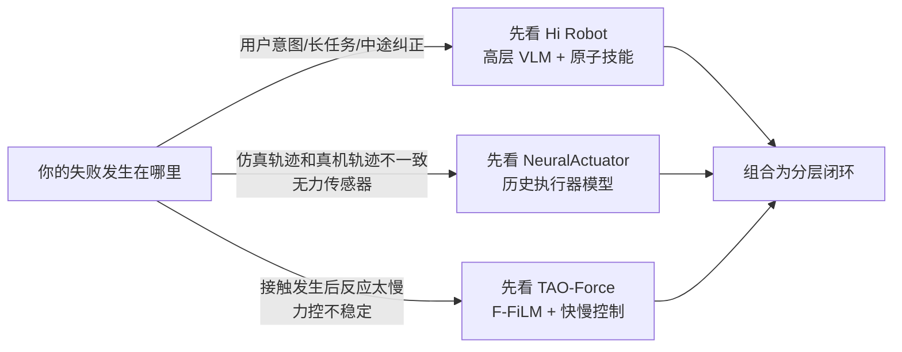

# 机器人闭环智能深度解析：从语言任务到执行器与力感知

> 机器人要在真实世界工作，必须同时回答三个问题：用户到底想让它做什么，执行器实际上会怎样响应，以及接触环境时应该怎样柔顺地调整动作。本系列用三篇论文把这条闭环拆开，再重新接起来。

## 系列核心矛盾

现有机器人系统往往把能力切成互相脱节的模块：高层模型擅长理解复杂指令，却只输出文字或粗粒度技能；低层策略能执行原子动作，却不理解中途反馈；仿真器能传播刚体状态，却把低成本舵机简化成固定的电流—力矩比例；VLA 能生成动作块，却可能看不见接触发生，也无法用低频推理直接处理快速接触动力学。

三篇论文分别修复一段断链：

> 读图时关注两条反馈：用户反馈回到高层 VLM，物理接触反馈回到策略和高频控制器。只有两条反馈都闭合，机器人才能既听懂“只收拾黄色物品”，又能在按压、剥皮或切割时控制接触力。

## 章节目录

| 章节 | 论文与标题 | 本章解决的问题 |
|---|---|---|
| 01 | [Hi Robot：层级 VLA 与开放式指令跟随](./01_Hi_Robot_层级VLA与开放式指令跟随) | 为什么一个端到端策略难以处理长任务、约束和实时纠正；高层 VLM 如何选择下一项原子技能 |
| 02 | [NeuralActuator：神经执行器与无传感器力感知](./02_NeuralActuator_神经执行器与无传感器力感知) | 为什么固定电流—力矩模型在低成本舵机上失效；怎样用可微仿真和历史序列学习等效驱动力与外力 |
| 03 | [TAO-Force：力感知 VLA 与快慢控制](./03_TAO_Force_力感知VLA与快慢控制) | 如何让冻结 VLA 真正使用力反馈，并把低频动作块接到高频接触调节 |

## 阅读前置知识

- [行为克隆与 RL 微调范式](/前置知识/000d_前置知识_行为克隆与RL微调范式)——理解示教数据、低层策略和策略微调
- [Flow Matching 与连续归一化流](/前置知识/000g_前置知识_Flow_Matching与连续归一化流)——理解 Hi Robot 和 TAO-Force 的连续动作块生成
- [雅可比矩阵与微分运动学](/前置知识/003b_前置知识_雅可比矩阵与微分运动学)——理解末端速度到关节命令的转换
- [机器人静力学、虚功与雅可比转置](/前置知识/008f_前置知识_机器人静力学虚功与雅可比转置)——理解外力如何作用到关节侧
- [导纳控制与接触柔顺](/前置知识/016a_前置知识_导纳控制与接触柔顺)——理解 TAO-Force 的高频接触控制接口
- [机器人系统辨识深度解析](/系列/system_identification_deep_dive/index)——理解几何、动力学和执行器参数如何对齐仿真
- [触觉仿真深度解析](/系列/tactile_simulation_deep_dive/index)——理解接触力、传感器观测和策略输入的边界

## 三篇论文的横向地图

| 维度 | Hi Robot | NeuralActuator | TAO-Force |
|---|---|---|---|
| 主要矛盾 | 复杂语言和反馈无法直接进入低层策略 | 仿真中的理想执行器不等于低成本真机 | 视觉策略看不见接触，低频动作无法快速调节 |
| 新增信息 | 用户指令、图像上下文、历史原子技能 | 命令、关节状态、电流/电压/温度历史 | 当前力、力历史和本体状态 |
| 主要输出 | 下一项原子语言命令与低层动作 | 执行器等效广义力、外力、接触门控、状态分数 | 动作块、目标力块、接触概率 |
| 主要时间尺度 | 高层约每秒重规划，低层持续执行 | 控制周期内用九帧历史实时推断 | VLA 5 Hz、参考 267 Hz、导纳 1000 Hz |
| 训练监督 | 示教切段 + VLM 合成互动 | 位姿轨迹、力标签、状态标签 | 动作/力流匹配、接触标签 |
| 主要收益 | 可组合、可纠正的开放式任务执行 | 仿真对齐、无传感器力感知 | 接触任务中的力条件生成与柔顺执行 |
| 主要边界 | 高层缺乏长上下文记忆，低层错误会累积 | 依赖实时执行器遥测，不能直接做未来命令反事实 rollout | 需要合适的力传感器、接触标签和导纳参数 |

## 贯穿案例

全文使用“机器人整理一张凌乱餐桌并处理用户临时要求”作为语义案例，使用“机械臂按压、剥皮和切割”作为接触案例。这样可以把两个看似分离的系统放进同一条闭环：高层决定“做哪一个原子技能”，低层执行技能，执行器模型解释“命令为何没有产生理想运动”，力感知控制器在接触变化时修正动作。

## 选型结论

这个选型不是三选一：Hi Robot 解决任务级“做什么”，NeuralActuator 提供硬件级“实际发生了什么”，TAO-Force 解决接触级“现在该怎样调节”。真实系统通常需要把三者按接口组合，而不是用一个更大的模型吞掉所有问题。

## 系列边界

本系列重点是论文中的机制、训练信号、控制接口和可迁移工程经验，不把论文实验结果当作普遍保证。特别是无传感器力感知仍依赖力标签训练，快慢控制仍依赖正确的坐标、阈值、延迟和安全限幅；部署前应参考[系统辨识系列](/系列/system_identification_deep_dive/index)和[触觉仿真系列](/系列/tactile_simulation_deep_dive/index)完成独立验证。

## 论文原文

- [NeuralActuator，arXiv:2607.11734](https://arxiv.org/abs/2607.11734)
- [TAO-Force，arXiv:2609.18497](https://arxiv.org/abs/2609.18497)
- [Hi Robot，arXiv:2502.19417](https://arxiv.org/abs/2502.19417)
