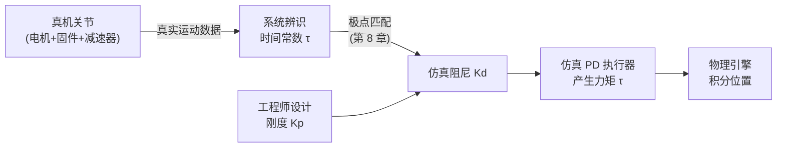

# 第 7 章：PD 执行器：虚拟弹簧阻尼与隐式积分

> **本章目标**：理解仿真里关节力矩从哪里来——PD 执行器是一个虚拟弹簧阻尼器，不是对真机的拟合，也不是物理引擎的一部分。

**上一章**：[第 6 章：正/逆动力学](./06_正动力学逆动力学与RNEA算法) — 给了我们"力矩 → 加速度"的物理规律；本章回答"力矩从哪里来"。
**下一章**：[第 8 章：系统辨识与极点匹配](./08_系统辨识与极点匹配让仿真和真机对齐) — 怎么从真机数据定出 Kd。

---

## 1. 仿真里关节力矩的来源

仿真主循环（第 6 章伪代码）里有一步：

```python
tau = controller.compute(q, q_dot)
```

这一步是**执行器层**：它把"当前状态"和"目标状态"转化为施加给关节的力矩。

真实机器人里，这件事由电机+驱动器固件完成（内置电流环、速度环，见 [H02](/硬件基础/H02_电机驱动与控制)）。仿真里没有电机，这整条硬件链路被一个**PD 执行器（PD actuator）**替代：

$$
\tau = K_p (q^* - q) + K_d (\dot{q}^* - \dot{q})
$$

**用人话读**：
- P 项（$K_p$ 乘位置误差）：像弹簧一样把关节拉向目标，误差越大拉力越大
- D 项（$K_d$ 乘速度误差）：像阻尼器一样抑制振荡，速度越大制动力越大

两项加在一起就是关节的力矩命令，送给物理引擎做积分。

---

## 2. PD 执行器不是真机行为的拟合

这是最常见的误解，必须澄清。

**真机的响应**来自电机驱动器内部的一整套控制环路，从外部看表现为"给命令角度，关节以某个时间常数逼近"——这可以用一阶响应模型（$\alpha$、时间常数 $\tau$）来描述和辨识（第 8 章的主题）。

**仿真里的 PD 执行器**不是在"模拟电机驱动器"，而是在"给仿真关节一个能让它运动的力矩来源"。它的参数（$K_p, K_d$）是：

- $K_p$（刚度）：人为设计值，决定关节追目标有多"硬"
- $K_d$（阻尼）：从真机辨识结果反推，让仿真响应速度和真机匹配

设计关系图：



---

## 3. 二阶系统参数

PD 执行器 + 关节惯量 $I$ 构成一个二阶系统：

$$
I\ddot{q} + K_d\dot{q} + K_p(q - q^*) = 0
$$

两个关键参数：

$$
\omega_n = \sqrt{\frac{K_p}{I}}, \qquad \zeta = \frac{K_d}{2\sqrt{K_p I}}
$$

- **自然频率 $\omega_n$**（由 $K_p$ 控制）：关节追目标有多快
- **阻尼比 $\zeta$**（由 $K_d$ 控制）：是否振荡

工程目标是**临界阻尼** $\zeta = 1$：最快到位且不超调。详细分析见 [018d PD 基础](/前置知识/018d_前置知识_比例微分控制PD基础)。

---

## 4. 为什么用隐式 PD

显式 PD 在每步直接施加力矩：$\tau = K_p(q^* - q_k) + K_d(\dot q^* - \dot q_k)$。$K_p$ 过大时，一步内弹簧力能把关节推得很远，积分器数值爆炸。这限制了 $K_p$ 的可用范围。

**隐式 PD** 把阻尼项改成用**下一时刻的速度**来计算（隐式 Euler），等价于让弹簧/阻尼"提前感知"下一步的状态：

$$
\tau_{\text{implicit}} = K_p(q^* - q_k) + K_d(\dot{q}^* - \dot{q}_{k+1})
$$

这使得大 $K_p$ 下依然数值稳定——代价是需要求解一个关于 $\dot{q}_{k+1}$ 的方程（IsaacLab 内部处理，用户不需要手动操作）。

IsaacLab 默认执行器类型就是隐式 PD（`ImplicitActuatorCfg`），对应 `ArticulationCfg` 里的 `stiffness` 和 `damping` 字段：

```python
from isaaclab.actuators import ImplicitActuatorCfg

actuator_cfg = ImplicitActuatorCfg(
    stiffness=200.0,   # Kp：N·m/rad
    damping=10.0,      # Kd：N·m·s/rad（通常由极点匹配算出）
)
```

---

## 5. Kp 和 Kd 的数量级参考

对一个典型桌面机械臂（连杆 0.3-0.5 kg，有效惯量约 0.01 kg·m²）：

| 参数 | 典型范围 | 对应响应 |
|------|----------|---------|
| $K_p$ | 50–2000 N·m/rad | $\omega_n \approx 7$–14 rad/s，0.1–0.5 s 到位 |
| $K_d$（临界阻尼） | $2\sqrt{K_p I}$，约 1–9 N·m·s/rad | $\zeta = 1$，无超调 |

$K_p$ 越大，关节越硬、追目标越快；但太大会让整个系统变得"颤抖"（高频振荡），仿真步长也限制了上限（见 [018d](/前置知识/018d_前置知识_比例微分控制PD基础) 第 7 节）。

---

## 6. 本章小结

- PD 执行器是仿真里"替代电机驱动器"的虚拟弹簧阻尼器：$\tau = K_p(q^*-q) + K_d(\dot{q}^*-\dot{q})$。
- $K_p$ 是人为设计值（刚度），$K_d$ 由真机辨识数据通过极点匹配（第 8 章）反推。
- 两者合力形成二阶系统，临界阻尼（$\zeta=1$）是工程目标。
- 隐式 PD 把阻尼项改成下一时刻速度，允许大刚度下数值稳定。
- IsaacLab 里对应 `ImplicitActuatorCfg` 的 `stiffness` 和 `damping` 字段。

---

**延伸阅读**：
- [比例微分控制 PD 基础](/前置知识/018d_前置知识_比例微分控制PD基础) — PD 控制律的完整推导、阻尼比分析、数值稳定性上限
- [隐式 PD 与极点匹配](/前置知识/017f_前置知识_隐式PD与极点匹配) — 隐式 Euler 稳定性分析与极点匹配公式推导

[→ 第 8 章：系统辨识与极点匹配](./08_系统辨识与极点匹配让仿真和真机对齐)
