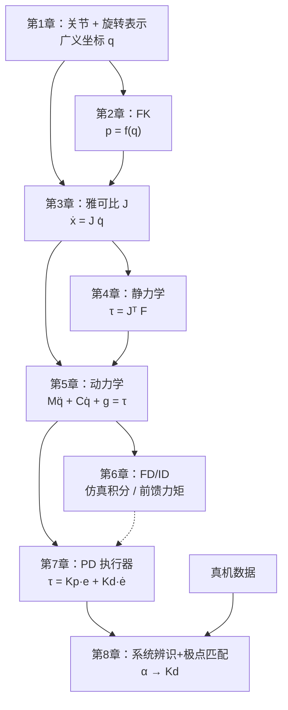

# 第 8 章：系统辨识与极点匹配：让仿真和真机对齐

> **本章目标**：把真机的实际响应速度"搬进"仿真——用数据辨识真机时间常数，再用极点匹配公式把它转换成仿真里的阻尼 $K_d$。这是系列的终点：把前 7 章的所有知识拼成一条完整的 Real2Sim 对齐流水线。

**上一章**：[第 7 章：PD 执行器](./07_PD执行器虚拟弹簧阻尼与隐式积分) — 确立了"$K_d$ 由真机数据反推"的设计目标。
**这是系列的最后一章。**

---

## 1. 问题：仿真关节为什么会比真机快

新建一个 IsaacLab 仿真，随意填 $K_p = 200$、$K_d = 5$，跑起来发现：关节响应比真机快很多、或者来回振荡。

根本原因是：**仿真里的关节没有真机固有的"慢"**。真机的驱动器固件有内部滤波、电流环响应、减速器摩擦等，让关节不能瞬间到达目标；仿真的 PD 执行器只有你填进去的 $K_d$ 来提供阻尼，如果 $K_d$ 不够，关节当然更快、更容易超调。

解法是两步：
1. 从真机数据**辨识**出它的有效时间常数 $\tau$（一阶响应模型）
2. 用极点匹配公式把 $\tau$ **换算**成仿真阻尼 $K_d$

---

## 2. 真机响应的一阶模型

真机的关节从外部看的行为：给一个命令角度 $u[k]$，关节以指数形式逼近它：

$$
q[k+1] = \alpha\, q[k] + (1-\alpha)\, u[k]
$$

这里 $\alpha \in (0, 1)$ 是**记忆系数**，越接近 1 越"拖沓"。对应的物理时间常数是：

$$
\tau = -\frac{\Delta t}{\ln \alpha}
$$

**数值感**：若控制频率 30 Hz（$\Delta t = 0.033$ s），$\alpha = 0.594$，则 $\tau \approx 64$ ms——命令发出后约 64 ms 到达 63.2% 的目标角度。

---

## 3. 怎么从真机数据估出 α

收集一段真机空载运动数据（命令角度 $u[k]$ 和实际角度 $q[k]$），让模型**自由推进**（不用真实值重置，只用命令），对以下目标做最小二乘：

$$
\hat{\alpha} = \arg\min_\alpha \sum_k \left(q[k+1] - \alpha q[k] - (1-\alpha)u[k]\right)^2
$$

实际还要同时估延迟帧数、增益、偏置、饱和上下限——但核心是这个 $\alpha$。

关键要求：
- 必须用**自由推进**（不能每帧重置），否则误差不会累积、参数就算错了也没影响
- 必须在独立**验证段**（不参与拟合的数据）上检查误差，确保不是过拟合
- 对比简单基线（"下一帧等于当前命令"），确认辨识真的改善了预测

详细流程见 [017e](/前置知识/017e_前置知识_一阶响应模型与命令反馈系统辨识)。

---

## 4. 极点匹配：从 α 算出 Kd

辨识得到的是一阶离散模型的 $\alpha$；仿真里能调的是二阶 PD 的 $K_d$。两者形式不同，需要**极点匹配**桥接。

**思路**：在"忽略关节惯量"的近似下，用隐式 Euler 积分 PD 方程，让积分一步后位置的变化比例等于辨识出的 $\alpha$——即让两个系统的离散极点相同。

推导结果是（见 [017f](/前置知识/017f_前置知识_隐式PD与极点匹配) 第 4 节）：

$$
K_d = \frac{K_p \cdot h}{\alpha_{\text{step}}^{-1} - 1}, \qquad \alpha_{\text{step}} = \alpha_{\text{ctrl}}^{1/\text{decimation}}
$$

| 符号 | 含义 |
|------|------|
| $K_p$ | 已选定的刚度（设计值） |
| $h$ | 物理仿真步长（如 1/120 s） |
| $\alpha_{\text{ctrl}}$ | 辨识出的每控制步记忆系数 |
| decimation | 每控制步包含的物理步数（如控制 30 Hz、物理 120 Hz，则为 4） |
| $\alpha_{\text{step}}$ | 换算到单个物理步的记忆系数 |

**$\alpha$ 必须换算到物理步**，不能直接用控制步的 $\alpha$——否则阻尼只有正确值的约 1/decimation，仿真关节会比真机快很多。

---

## 5. 完整数值算例

**已知条件**：
- 控制频率 30 Hz，物理频率 120 Hz，decimation = 4
- 辨识出某关节 $\alpha_{\text{ctrl}} = 0.594$
- 选定刚度 $K_p = 1000$ N·m/rad
- 物理步长 $h = 1/120$ s

**第一步**：换算到物理步

$$
\alpha_{\text{step}} = 0.594^{1/4} = e^{\ln(0.594)/4} = e^{-0.13025} \approx 0.8779
$$

**第二步**：极点匹配求阻尼

$$
K_d = \frac{1000 \times (1/120)}{0.8779^{-1} - 1} = \frac{8.333}{0.1391} \approx 59.9 \; \text{N·m·s/rad}
$$

**错误对比**（不换算 decimation，直接用 $\alpha_{\text{ctrl}}$）：

$$
K_d^{\text{wrong}} = \frac{8.333}{0.594^{-1} - 1} = \frac{8.333}{0.684} \approx 12.2 \; \text{N·m·s/rad}
$$

用错误值时，$K_d$ 只有正确值的约 1/5，仿真关节比真机快约 5 倍。

---

## 6. 验证：怎么知道匹配成功

匹配完不能假设就对了。验收标准是**在真实物理仿真里跑轨迹，检查推进误差**：

1. 在训练段数据上跑连续仿真，看关节角误差分布
2. 在独立验证轨迹上重复，误差应和训练段相近（否则过拟合）
3. 对比"默认 PD 参数"：匹配后误差应明显下降
4. 分开统计运动段（关节在动）和静止段，避免静止误差掩盖运动误差

还有两个常见陷阱：
- **不要再叠一层一阶滤波**：如果目标已经经过一阶平滑再送给 PD，等于把"慢"叠了两次，关节会比真机慢很多。
- **极点匹配忽略了惯量**：真实仿真保留了质量、重力、摩擦，匹配只是起点，误差不达标时需要迭代调整 $K_p$（从而 $K_d$ 同步变化）。

---

## 7. 系列全景回顾

这是整个系列的知识链路，从底层几何到上层控制的完整流：

- 第 1-3 章（**几何层**）：关节运动的描述语言——坐标、FK、速度
- 第 4-6 章（**力学层**）：力和运动的关系——静力学、完整动力学、递归算法
- 第 7-8 章（**仿真对齐层**）：把物理搬进仿真，让两者行为一致

---

## 8. 本章小结

- 真机关节从外部看可以用一阶响应建模，核心参数是记忆系数 $\alpha$（或时间常数 $\tau$）。
- 从真机运动数据最小化自由推进误差可以估出 $\alpha$。
- 极点匹配把 $\alpha$ 换算成仿真阻尼：$K_d = K_p h / (\alpha_{\text{step}}^{-1} - 1)$；$\alpha$ 必须先换算到物理步（开 decimation 次方根）。
- 匹配后必须在真实仿真里跑轨迹验证，误差达标才算对齐成功。
- $K_p$ 是自由设计值，$K_d$ 被真机数据约束——但 $K_p$ 改变时 $K_d$ 也需同步重算。

---

**延伸阅读**：
- [一阶响应模型与命令-反馈系统辨识](/前置知识/017e_前置知识_一阶响应模型与命令反馈系统辨识) — 辨识的完整流程和验证方法
- [隐式 PD 与极点匹配](/前置知识/017f_前置知识_隐式PD与极点匹配) — 极点匹配的完整推导和 decimation 换算
- [Isaac Lab 仿真对齐与参数调优](/工程实践/IsaacLab仿真对齐与参数调优) — 从相机内参到 PD 增益的完整 Real2Sim 对齐工程流程

[← 返回系列首页](./index)
