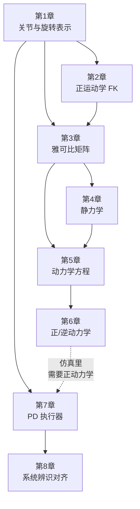

# 机器人学基础串联：从关节到控制的完整知识图谱

> 机器人学的知识碎片散落各处——旋转矩阵在这里，雅可比在那里，PD 控制在另一个角落，系统辨识又是一个单独的话题。这个系列把它们串成一条线：从"一个关节能做什么"出发，一路走到"怎么让仿真关节和真机的响应对齐"，每一步都有清晰的动机和前后衔接。

## 系列简介

学机器人学有一个典型困境：每个概念单独看都能理解，但放在一起就不知道它们怎么连起来。正运动学给了你末端位置，但怎么和控制器对接？雅可比告诉你速度关系，但它和动力学方程有什么关系？PD 控制器参数从哪里来，为什么仿真里用的和真机不一样？

这个系列的目标是给出一条**从硬件到控制、从原理到仿真**的完整纵向链路：

1. 关节是什么、有哪些自由度、怎么表示它的运动
2. 多个关节串联起来，末端在哪里（正运动学）
3. 末端要动，各个关节怎么联动（速度运动学 / 雅可比）
4. 不只是运动，还要施力——关节力矩怎么产生末端力（静力学）
5. 加速度、惯量、重力都进来了——完整动力学方程
6. 给关节装上虚拟弹簧阻尼——PD 执行器模型
7. 真机和仿真不一样——系统辨识 + 极点匹配
8. 把所有东西拼进仿真循环：从 URDF 到实际运行的 IsaacLab 机器人

每章都会显式标出"上一章给了我什么、本章要解决什么新问题、下一章要用我的什么结论"，保证任何一章都能独立读懂，读完整个系列也能形成完整的图谱。

**适合读者**：理解过 RL 策略或 VLA 模型、想搞懂"机器人这端发生了什么"的读者；或者在调 IsaacLab/MuJoCo 参数时被 Kp/Kd/惯量/雅可比弄晕的读者。

**你将获得**：

- 能把正运动学、雅可比、动力学方程连成一张图，理解各自的输入输出和适用场景
- 理解仿真里 PD 执行器的本质：它是虚拟弹簧阻尼，不是对真机行为的拟合
- 知道 Kp 是设计值、Kd 是由真机数据反推的值，会用极点匹配公式换算
- 能读懂 IsaacLab 里 `ArticulationCfg`、`PDActuator`、`sensor` 相关配置，不再靠猜

## 章节目录

| 章节 | 标题 | 简介 |
|------|------|------|
| **第一部分：几何与运动** | | |
| 01 | [关节、自由度与三维旋转表示](./01_关节自由度与三维旋转表示) | 关节类型、广义坐标、旋转矩阵/四元数/轴角的关系与选用 |
| 02 | [正运动学：从关节角到末端位姿](./02_正运动学从关节角到末端位姿) | DH 参数、变换链、FK 的输入输出与实际用途 |
| 03 | [速度运动学：雅可比矩阵与奇异性](./03_速度运动学雅可比矩阵与奇异性) | 雅可比的几何含义、奇异位形、可操作度与速度椭球 |
| **第二部分：力与动力学** | | |
| 04 | [机器人静力学：末端力与关节力矩](./04_机器人静力学末端力与关节力矩) | 雅可比转置把末端力映射到关节力矩，虚功原理 |
| 05 | [机械臂动力学方程：M、C、g 三项的来源](./05_机械臂动力学方程MCg三项的来源) | 拉格朗日推导、惯量矩阵、科氏力、重力向量的物理含义 |
| 06 | [正动力学与逆动力学：RNEA 算法](./06_正动力学逆动力学与RNEA算法) | 给力矩求加速度（仿真用）vs 给轨迹求力矩（控制用），递归算法结构 |
| **第三部分：执行器与仿真对齐** | | |
| 07 | [PD 执行器：虚拟弹簧阻尼与隐式积分](./07_PD执行器虚拟弹簧阻尼与隐式积分) | PD 控制律作为仿真执行器、二阶系统参数、隐式 PD 的稳定性 |
| 08 | [系统辨识与极点匹配：让仿真和真机对齐](./08_系统辨识与极点匹配让仿真和真机对齐) | 一阶响应辨识、α → Kd 换算、验证方法与常见陷阱 |

## 知识依赖图

> 实线是强依赖（需要前一章的概念），虚线是软依赖（有上下文更容易理解）。可以直接跳到第 7-8 章读执行器内容，但如果对动力学方程陌生，建议先浏览第 5 章。

## 前置知识要求

系列中遇到时会链接到对应文章；不需要提前全部读完：

- [三维旋转表示：旋转矩阵、四元数与角速度](/前置知识/006a_前置知识_三维旋转表示_旋转矩阵四元数与角速度)
- [刚体动力学：牛顿-欧拉方程与惯性张量](/前置知识/006b_前置知识_刚体动力学_牛顿欧拉方程与惯性张量)
- [物理仿真数值积分：辛积分与能量稳定性](/前置知识/006c_前置知识_物理仿真数值积分_辛积分与能量稳定性)
- [比例微分控制 PD 基础](/前置知识/018d_前置知识_比例微分控制PD基础)
- [隐式 PD 与极点匹配](/前置知识/017f_前置知识_隐式PD与极点匹配)
- [一阶响应模型与命令-反馈系统辨识](/前置知识/017e_前置知识_一阶响应模型与命令反馈系统辨识)
