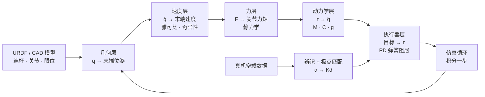

# 机器人学基础串联：把一台真机械臂搬进仿真

> 这个系列只做一件事：把一台真实的六轴机械臂放进物理仿真里，让它"知道自己长什么样、抬得起多重的物体、被推一下会怎么动、关节能追多快"。运动学、雅可比、静力学、动力学、PD 执行器、系统辨识，都是这件事做到一半时冒出来的具体障碍。

## 这台臂要经过的五个关卡

设想的对象是一台桌面级六轴协作臂：六个转动关节、带平行夹爪、装在台面上。把它搬进 Isaac Sim 或 MuJoCo 的过程，会依次撞上五个问题，每个问题都不是"该学一个公式了"，而是"仿真里的行为和真机对不上"。

1. **它不知道自己长什么样。** URDF 加载成功，但画面里的手臂朝向不对、某个关节往反方向转、夹爪合拢时穿模。这要先说清楚连杆、关节、关节轴、限位和坐标系，仿真器才能把数字变成一台机器。
2. **它不知道手在哪里。** 策略网络输出的是六个关节角，我们却要判断夹爪有没有对准杯子。从关节角算出夹爪位姿，是后面所有控制的坐标系原点。
3. **它不知道手能怎么动。** 让夹爪沿桌面直线推一个方块，六个关节各自要转多快？某些姿态下无论怎么转都推不直——这是速度和奇异性的问题。
4. **它不知道自己有多大劲。** 夹爪压住桌面时，关节力矩是多少？反过来，给定关节力矩，末端能施加多大的力？这是静力学，也是力控和抓取的基础。
5. **它不知道自己有多重、多快、多软。** 松手时手臂会往下坠多少，快速摆动时会不会甩过头，发一条阶跃指令后关节要多久到位——动力学、执行器模型和真机辨识负责这三件事。

## 这条链在仿真里怎么走

> 上半圈是仿真器每一帧都在跑的闭环：几何、速度、力、动力学、执行器、积分，再回到几何。下半圈是离线做一次的对齐工作：用真机数据把执行器层的阻尼定下来。本系列八章正好沿着这个环走一圈。

## 八章各自解决哪个问题

| 章节 | 卡住的地方 | 这一章给出的东西 |
|------|-----------|-----------------|
| [01 关节、自由度与旋转表示](./01_关节自由度与三维旋转表示) | 模型加载后朝向和关节方向不对 | 连杆与关节如何组成机器；四种旋转表示怎么选；位姿怎么用齐次矩阵打包 |
| [02 正运动学](./02_正运动学从关节角到末端位姿) | 不知道该把夹爪送到哪 | 从关节角算出末端位姿的变换链；工作空间长什么样 |
| [03 雅可比与奇异性](./03_速度运动学雅可比矩阵与奇异性) | 直线推物时关节速度算不出来、某些姿态推不动 | 关节速度到末端速度的换算表；奇异位形为什么会出现 |
| [04 静力学](./04_机器人静力学末端力与关节力矩) | 压桌面、提重物时该给多少力矩 | 末端力到关节力矩的换算；为什么用转置而不是逆 |
| [05 动力学方程](./05_机械臂动力学方程MCg三项的来源) | 松手会坠、快速摆动会甩过头 | 力矩被惯性、科氏力、重力三家分掉的账本 |
| [06 正逆动力学](./06_正动力学逆动力学与RNEA算法) | 仿真每帧到底算了什么 | 给力矩求加速度 vs 给轨迹求力矩；递归算法为什么是线性的 |
| [07 PD 执行器](./07_PD执行器虚拟弹簧阻尼与隐式积分) | 关节不是理想力矩源，而是被驱动器拖着走 | 虚拟弹簧阻尼模型；刚度与阻尼如何决定响应快慢和超调 |
| [08 辨识与极点匹配](./08_系统辨识与极点匹配让仿真和真机对齐) | 仿真的关节 20 ms 到位，真机要 100 ms | 从真机数据辨识时间常数，并换算成仿真阻尼 |

## 读这套文章需要的前提

正文会把每个新概念就地解释清楚，不需要提前读完任何东西。下面这些是遇到时更方便深入的下游文章，按需点开：

- [三维旋转表示：旋转矩阵、四元数与角速度](/前置知识/006a_前置知识_三维旋转表示_旋转矩阵四元数与角速度)
- [刚体动力学：牛顿-欧拉方程与惯性张量](/前置知识/006b_前置知识_刚体动力学_牛顿欧拉方程与惯性张量)
- [物理仿真数值积分：辛积分与能量稳定性](/前置知识/006c_前置知识_物理仿真数值积分_辛积分与能量稳定性)
- [比例微分控制 PD 基础](/前置知识/018d_前置知识_比例微分控制PD基础)
- [隐式 PD 与极点匹配](/前置知识/017f_前置知识_隐式PD与极点匹配)
- [一阶响应模型与命令-反馈系统辨识](/前置知识/017e_前置知识_一阶响应模型与命令反馈系统辨识)

## 用到的算例

整个系列只用一台平面二连杆臂做数值算例，两根连杆长度分别是 $L_1 = 1.0\ \text{m}$、$L_2 = 0.7\ \text{m}$，两个关节都绕垂直于桌面的轴转动。

> 选它是因为几何足够简单，所有结论都能手算并在图上量出来；同时它保留了真实机械臂的全部结构性难点：非线性、多解、奇异、惯量随构型变化。第六章之后换回六轴臂时，量的种类不变，只是从二维扩到六维。

同一组关节角会反复出现在各章里，前后对照时数字能直接对得上。
