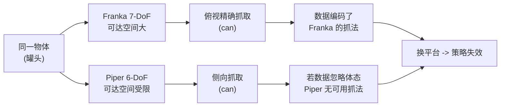

# 第一章：双臂操作数据的三大缺口

本章不涉及具体算法，只回答一个问题：为什么"用仿真造双臂操作数据"这件事，现有的做法都做得不够好？把缺口讲清楚，后面三章的设计才有落点。

---

**知识链接**

- [RoboTwin：双臂机器人操作的数字孪生仿真平台](/前置知识/015b_前置知识_RoboTwin双臂机器人仿真平台) — 1.0 的基础设定
- [数字表亲与 Real2Sim 数据增广](/前置知识/010b_前置知识_数字表亲与Real2Sim数据增广) — 为什么多样性比单场景真实更关键
- [Sim-to-Real 迁移综述](/论文综述/S04_Sim_to_Real迁移综述) — 域随机化的背景

---

## 一 双臂操作为什么难拿数据

双臂协作操作是实现复杂现实任务的关键：协同装配、使用工具、物体交接，都需要两只手配合。要训练能泛化的双臂策略——尤其是 VLA 基础模型——需要同时满足三个条件的数据：**高质量、多样、大规模**。

三个条件都很难满足。真实世界里采集演示数据成本高昂：需要硬件、操作员、场地、以及反复的复位，规模一大就不可承受。于是大家把目光转向仿真，因为仿真能大规模合成多模态数据，并且已被证明有助于 sim-to-real 迁移。

问题在于，现有仿真管线在三个关键方面欠账。下面逐一分析，并说清每个欠账会怎样传导到下游策略。

## 二 缺口一：缺乏自动化质量把关

一个人工智能体或脚本在仿真里"完成任务"，不保证轨迹是专家级的。生成的大批轨迹里会混入执行失败（物体掉了、没抓稳）和次优抓取（勉强成功但不干净）。没有专家级的验证闭环，这些低质量数据会直接喂给下游策略，拖累学习。

一个直观的类比：你请一大批实习生录操作示范，却不检查录像。最终你得到的"数据集"里一半是失败的，策略学到的是"如何失败"。

这个缺口的本质是**缺少一个能自动判定"这条轨迹算不算专家级"的闭环**，以及一个能自动修正错误代码/错误的机制。

## 三 缺口二：域随机化过于表面

即便数据和任务都对，场景若过于干净同质，策略会过拟合到狭窄分布，换个背景、换种光照、多点杂物就崩。

真实世界的关键变量在多数仿真数据集里缺席或过于简单：

- **杂物（clutter）**：桌面上真实存在大量与任务无关的干扰物体，它们会遮挡视线、影响抓取。
- **光照变化**：色温、光源类型、强度、位置都在变，物体外观随之改变。
- **背景纹理**：桌面与背景的材质极其多样。
- **语言歧义**：同一条指令可以有多种说法，描述粒度也不一。
- **台面高度**：不同工作台的台面高度不同，改变视角与运动学关系。

缺失这些变化，仿真数据就"太干净"——模型在仿真里表现很好，一到复杂真实场景就失效。这个缺口的本质是**随机化维度不足、且没有被结构化地组织起来**。

## 四 缺口三：忽视跨体态差异

这是最容易被忽略、但对"通用性"影响最大的一条。不同的双臂平台运动学能力差异巨大：

- 低自由度平台（如 6-DoF 的 Piper）可达空间受限，常依赖**侧向抓取**。
- 高自由度机械臂（如 7-DoF 的 Franka）能从**俯视方向**做精确抓取。

同一句"抓起罐头"的指令，在 Franka 上俯视抓取就能完成，到了 Piper 上可能必须换成侧向抓取。但现有合成数据极少编码这种**体态相关的可操作性（affordance）或任务约束**，于是数据只对特定平台有效，换平台就失效。

> 读图重点：同一个物体在不同机械臂上的最优抓取姿态完全不同。如果数据集只记录了某一种抓法、又不标注可操作方向，换到另一种机械臂时策略就无解。这正是"体态感知"要解决的核心问题。

## 五 RoboTwin 2.0 的回应

针对三个缺口，RoboTwin 2.0 提出三大组件，并交付三样新资源。

三大组件：

1. **自动化专家数据生成管线**：用多模态大语言模型（MLLM）结合仿真在环反馈，迭代验证并精修任务执行代码。
2. **系统化域随机化**：沿杂物、光照、背景、台面高度、语言指令五个维度做结构化随机化，弥合 sim-to-real 差距、增强策略泛化。
3. **体态感知适配**：标注物体可操作性、生成机器人特定的动作候选，应对异构双臂运动学。

三样资源：

| 资源 | 内容 |
|------|------|
| RoboTwin-OD 资产库 | 731 个带标注物体实例、147 个类别 |
| 数据生成管线 + 大规模轨迹 | 域随机化，覆盖 50 个任务、5 种双臂平台上 10 万+ 专家轨迹 |
| 评测基准 | 评估策略在杂物场景与开放语言目标下的泛化能力 |

这四章随后逐层拆解：第 2 章讲 MLLM 代码生成闭环，第 3 章讲五轴域随机化与体态感知抓取，第 4 章用实验量化每一项的贡献。

## 本章小结

- 双臂 VLA 需要高质量、多样、大规模的数据，真实采集太贵，仿真合成是必然选择。
- 现有仿真管线有三个缺口：缺自动化质量把关、域随机化太表面、忽视跨体态差异。
- 每个缺口都会系统性传导到下游：低质量数据污染策略、干净场景导致过拟合、忽略体态导致换平台失效。
- RoboTwin 2.0 用 MLLM 代码生成闭环、五轴域随机化、体态感知适配三件武器分别回应，并交付物体库、大规模轨迹和评测基准。

下一章进入第一个组件：MLLM 代码生成如何与仿真反馈组成闭环。
