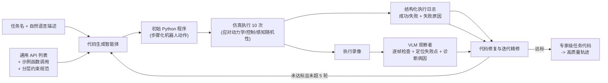

# 第二章：MLLM 专家代码生成闭环

前情提要：第一章点出了三个缺口，第一个是"缺乏自动化质量把关"。本章看 RoboTwin 2.0 如何让两个 AI 智能体互相配合——一个写代码，一个看仿真录像——形成一个能自我纠错的专家数据生成闭环。

---

**知识链接**

- [RoboTwin：双臂机器人操作的数字孪生仿真平台](/前置知识/015b_前置知识_RoboTwin双臂机器人仿真平台) — 前置的技能 API 与任务库
- [LLM 智能体的执行循环与记忆机制](/前置知识/004a_前置知识_LLM智能体的执行循环与记忆机制) — 代码生成智能体的通用骨架
- [数字表亲与 Real2Sim 数据增广](/前置知识/010b_前置知识_数字表亲与Real2Sim数据增广) — 为什么需要自动化生成任务

---

## 一 两条既有路线的问题

用大模型生成机器人任务代码并不是新想法。已有工作（如 GenSim2、RoboGen）能生成操作程序，但它们有共同短板：要么依赖大量人工先验，要么在程序合成过程中**没有闭环反馈**——代码写出来就直接用，执行失败也没人发现并修正。

RoboTwin 2.0 的关键改动是引入**仿真在环的闭环**：代码不是一次性产物，而是"生成—执行—观察—诊断—修复"若干轮的进化结果。它还宣称支持**零样本生成**超越原始抓放的复杂双臂行为，这是对前作的重要扩展。

## 二 双智能体闭环架构

闭环里有两个角色：

- **代码生成智能体（code agent）**：根据指令合成任务程序。
- **视觉语言模型观察者（VLM observer）**：盯着仿真执行，检测失败、定位出错位置、给出修正建议。

两者通过一个迭代循环协作，让代码智能体在极少人工监督下自动精修程序。

> 读图重点：注意每条反馈信号都有两个来源——定量的执行日志（成功/失败、失败类别）和定性的 VLM 诊断（哪一步坏了、为什么坏）。两者一起喂回代码智能体，而不是只看日志。

### 互动演示

下面的组件可以模拟这个闭环的迭代过程，成功率会随迭代逐步上升：

<RoboTwin2Playground />

## 三 输入规范

每个任务由任务名（如 Handover Block）和一段自然语言目标描述定义。代码生成智能体在生成时被三类输入约束：

1. **通用 API 列表**：可调用的技能库（抓、放、推、开等原语）。
2. **示例函数调用**：few-shot 示范，把抽象 API 落到具体用法。
3. **分层约束规范**：把任务分解成有层级的约束，引导生成的结构。

此外每个任务还可以附带任务特定的函数调用示例，进一步把代码生成锚定在具体上下文里。

## 四 初始代码生成

代码智能体把程序合成建模成一个**在可用 API 调用空间上的结构化预测问题**：利用自然语言理解与任务特定的 few-shot 提示，产出一个逐步的机器人动作序列。

这一步得到的代码通常能跑，但不一定成功——它只保证语法上像、语义上大致对，具体的抓取姿态、顺序、参数往往需要执行反馈来打磨。

## 五 仿真执行与日志

生成的程序在仿真环境里**每个迭代执行 10 次**。为什么要 10 次？因为仿真的动力学、控制器、传感器都存在随机性，单次执行的结果不具代表性，多次执行才能估计一个程序的真实成功率。

每次执行批次之后，系统生成一份**结构化执行日志**，记录：

- 每次试验的成功或失败；
- 失败试验对应的原因，例如代码不可执行、左/右臂抓取失败、物体放置错误。

这份日志是定量的、离散的、机器可读的反馈信号。

## 六 多模态观察与错误定位

与执行并行，VLM 观察者在全部 10 次试验的录像上做**逐帧检查**，评估每个程序步骤是否成功，并在出错时**定位失败点**。

比定位更进一步的是**诊断失败模式**：VLM 要判断根因是逻辑有缺陷（比如顺序错了）、API 使用错误（比如参数类型不对），还是其他系统性问题。诊断根因让系统能对症下药，而不是只对表面报错做修补。

这一层的价值在于"定性反馈"补足了日志的盲区。日志能告诉你"第 7 帧失败"，但说不清"为什么失败"；VLM 能从画面里看出"左臂在交接时撞到了右臂"这类日志捕捉不到的原因。

## 七 代码修复与迭代终止条件

代码智能体接收两路互补反馈——(i) 定量执行日志、(ii) VLM 的定性定位诊断——据此修改或替换被判定为易错的指令，然后进入下一轮评估。

迭代的终止条件有两条：

- **达成目标**：程序在一个迭代批次（10 次运行）里达到设定的成功率；或
- **达到上限**：连续 5 轮精修仍无法达标，则停止，避免无限循环。

这个设计同时防止了"过早停止"（一次成功不代表稳定）和"无限空转"（有些任务确实超出当前能力）。

## 八 评价指标

论文用四个指标衡量代码生成质量，其中核心的平均成功率定义为：

$$
\mathrm{ASR} = \frac{1}{N}\sum_{i=1}^{N}\left(\frac{1}{T}\sum_{j=1}^{T}\mathbb{1}\big[\text{程序}_i\text{ 第 }j\text{ 次执行成功}\big]\right)
$$

**这个公式在做什么**：对每个任务 $i$ 先算它多次执行的内部成功率，再对所有任务取平均，得到一个"程序在随机性下稳定成功的整体水平"。

::: details 📐 公式详解（点击展开）

| 子表达式 | 它是谁 | 它在干嘛 |
|---------|--------|---------|
| $N$ | **任务数** | 参与评估的任务总数 |
| $T$ | **每个任务的执行次数** | 用来平均掉仿真的随机性（如 10 次） |
| $\mathbb{1}[\cdot]$ | **成功指示函数** | 该次执行成功取 1，失败取 0 |
| 内层平均 | **单任务成功率** | 一个程序在它自己多次执行上的稳定度 |
| 外层平均 | **整体 ASR** | 所有任务成功率的均值，衡量方法总体水平 |

**用人话读**："每个任务的程序反复跑很多次，算它的平均成功概率；再对所有任务取平均，就是整体成功率。"

**为什么先内层再外层**：外层直接对所有次试验整体平均会被任务数多的任务主导；先算单任务再平均能保证每个任务权重相同。
:::

另外三个指标分别是：Top5-ASR（每个任务取前 5 个候选程序里的最优成功率，衡量"多生成几份挑最好的"能到多少）、CR-Iter（终止前平均精修轮数，衡量收敛效率）、Token（生成策略代码的平均 token 数，衡量简洁度）。

## 九 这套闭环换来了什么

论文的实验（详见第 4 章）显示：多模态反馈带来的增益是一致的。RoboTwin 1.0 的 ASR 从 one-shot 的 47.4% 提升到多模态反馈的 63.9%；RoboTwin 2.0 从 62.1% 提升到 71.3%。三个结论值得记住：

1. 视觉-语言反馈不仅能**检测**失败，还能**指导精确修复**；
2. 架构改进让收敛更快、token 更省（2.0 的初始代码 token 数约 569，远低于 1.0 的约 1237）；
3. 把符号化执行日志与感知诊断结合，能产出更可靠、语义更对齐的专家数据。

## 本章小结

- RoboTwin 2.0 用"代码生成智能体 + VLM 观察者"组成的仿真在环闭环，自动精修任务代码。
- 反馈有两个来源：定量执行日志与定性 VLM 诊断，二者互补。
- 每个迭代执行 10 次以平均仿真随机性；终止条件是达标或连续 5 轮未达标。
- 多模态反馈一致提升 ASR 与 Top5-ASR，并让 2.0 收敛更快、代码更短。

下一章进入第二个组件：五轴域随机化与体态感知抓取适配。
