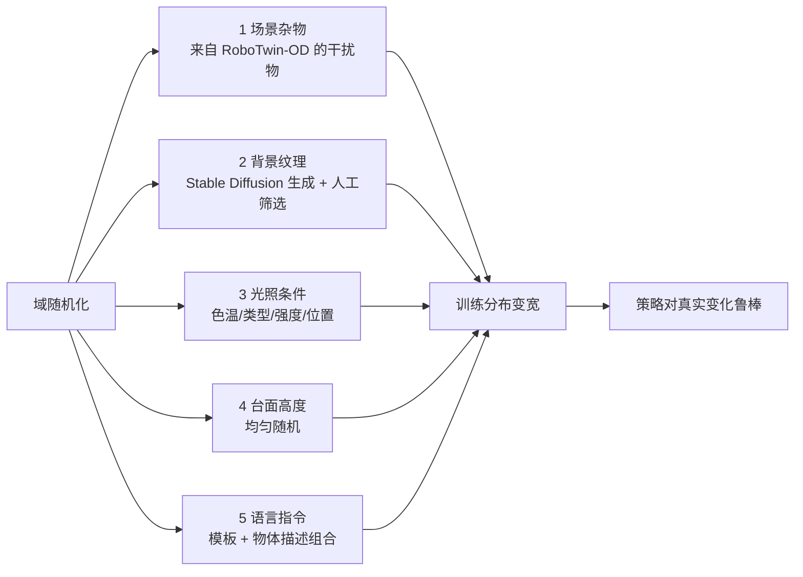
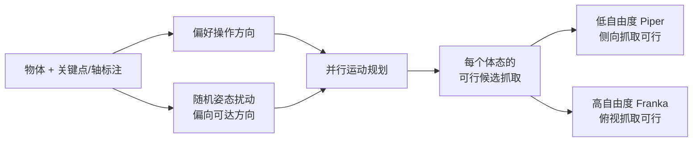

# 第三章：五轴域随机化与体态感知抓取

前情提要：第二章讲完了数据工厂的"质量"环节——用 MLLM 闭环生成专家代码。本章讲"多样性"环节：沿五个维度做结构化域随机化，以及如何让同一批数据适配不同运动学能力的机械臂。

---

**知识链接**

- [RoboTwin：双臂机器人操作的数字孪生仿真平台](/前置知识/015b_前置知识_RoboTwin双臂机器人仿真平台) — 前置的仿真与任务结构
- [SAPIEN 交互式仿真平台](/前置知识/015c_前置知识_SAPIEN交互式仿真平台) — RoboTwin-OD 里关节物体的来源
- [数字表亲与 Real2Sim 数据增广](/前置知识/010b_前置知识_数字表亲与Real2Sim数据增广) — 多样性为何重要
- [Sim-to-Real 迁移综述](/论文综述/S04_Sim_to_Real迁移综述) — 域随机化的系统性背景

---

## 一 为什么要"结构化"地随机化

域随机化（domain randomization）的思路很直接：把训练场景的分布铺开，让策略见过足够多的变化，从而对真实世界的变化鲁棒。但"随便加点变化"效果有限——随机化的**维度选错了或太浅**，策略照样过拟合。

RoboTwin 2.0 的改进是**结构化**：明确列出五个与真实世界差异最相关的维度，每个维度用有针对性的方法来生成变化范围。

> 读图重点：五个维度分别对应视觉、空间、语言三类变化。前四个改的是"世界长什么样"，第五个改的是"任务怎么说"。

## 二 第一轴：场景杂物

为增强对环境的鲁棒性，RoboTwin 2.0 在桌面场景里加入与任务无关的干扰物，全部从 RoboTwin-OD 里抽取。为了让添加干扰物这件事既通用又物理可信，设计了三个约束：

- **物理合理性**：每个物体带放置标注，用碰撞感知的放置方式和预计算体积来保证不会穿模。
- **语义排除**：在采样时**排除**与任务相关物体在视觉或语义上相似的干扰物，避免策略被混淆（比如任务物体是红球，就不放另一个红球）。
- **通用接口**：用一套通用的 API 做语义有效的插入。

结果是得到"多样但不含糊"的杂乱场景——既增加了视觉与空间变化，又不至于让任务变得无从判定。

## 三 第二轴：多样背景纹理

桌面与背景纹理用一个专门构建的纹理库来随机化。构建流程结合了生成式 AI 和人工筛选：

| 步骤 | 做法 | 产出 |
|------|------|------|
| 1 收集描述 | LLM 提示 + 网页爬取 | 1000 条多样表面描述 |
| 2 生成纹理 | 每条描述用 Stable Diffusion v2 生成 20 个样本 | 20000 张 |
| 3 人工筛选 | 人类在环过滤 | 11000 张高质量纹理 |

这个库在仿真里使用，用于丰富视觉多样性、防止模型过拟合到"干净的合成环境"。

## 四 第三轴：光照变化

真实环境里的照明条件极其多样：色温、光源类型、数量、位置都在变，这些因素改变物体的外观与反光，对基于视觉的操作构成挑战。

RoboTwin 2.0 在物理合理的范围内随机化**光的颜色、类型、强度、位置**。论文特别指出色温的影响显著——同一个物体在暖光与冷光下的外观可能截然不同。在这种随机条件下训练，能提升策略对真实光照变化的鲁棒性。

## 五 第四轴：台面高度

实际工作台的台面高度各不相同，这会影响机器人的感知、运动学与交互。为提升泛化，RoboTwin 2.0 在合理范围内**均匀随机化台面高度**，从而在视角和机器人与物体的空间关系上引入变化。

这一轴看似简单，但它改变的是相机相对场景的几何关系——而几何关系恰恰是视觉策略最容易死记硬背、也最需要泛化的部分。

## 六 第五轴：轨迹级多样语言指令

前四轴改变"世界"，第五轴改变"任务怎么说"。RoboTwin 2.0 用多模态 LLM 生成**任务模板**和**多样物体描述**。每个物体的描述覆盖几何、外观、部件级属性，平均每个物体有 15 条标注，在形状、纹理、功能、部件结构、粒度上各不相同。

每条轨迹采样时，从这些池子里组合出一条指令。以 Move Can Pot 为例，模板"用 [臂] 把 A 放到 B 的左边"可以派生出：

- "Use left arm to place sauce can to the left of gray kitchenpot"
- "Use left arm to place white plastic lid sauce can to the left of kitchenpot for boiling and cooking"

这种组合式增广产生大量语言上多样的指令，显著提升对未见语言与场景配置的泛化。RoboTwin-OD 的物体标注正是这套语言变化的数据基础。

## 七 RoboTwin-OD：物体库

上面所有的随机化都依赖一个丰富、带标注的物体库。RoboTwin-OD 包含 **731 个物体、147 个类别**，来源有三：

| 来源 | 规模 | 说明 |
|------|------|------|
| 自建 | 534 实例 / 111 类 | 用 Rodin 从 RGB 做 3D 重建，再凸分解 + 网格合并，保证碰撞模型物理正确 |
| Objaverse | 153 物体 / 27 类 | 主要用于构造杂物场景、增加视觉与语义多样性 |
| SAPIEN PartNet-Mobility | 44 关节物体 / 9 类 | 提供可动关节物体 |

为了让操作能用，每个物体还标注了**关键点–轴信息**：放置点、功能点、抓取点、抓取轴——这些显式编码了物体的可操作性（affordance），是"体态感知抓取"能自动化的前提。

## 八 体态感知抓取适配

这是回应第一章第三个缺口的部件。因为自由度与运动学结构不同，机械臂的可达工作空间和偏好策略不同：抓一个罐头，Franka 倾向俯视，低自由度的 Piper 更适合侧向。**用俯视成功完成任务的方案，换到 Piper 上可能必须改成侧向**。

RoboTwin 2.0 的做法分三步：

1. **标注候选操作姿态**：给每个物体标注一组丰富的候选操作姿态，覆盖多个抓取轴与接近方向，同时捕捉操作多样性和机器人偏好。
2. **角度扰动偏向可达方向**：施加角度扰动时，**偏向可达性更高的方向**，扩大可行空间。
3. **并行运动规划尝试**：把偏好操作方向、随机姿态扰动、并行化运动规划三者结合，为每个物体生成候选抓取。

这样，同一批任务数据能为不同体态生成各自可行的抓取，而不是只记录某一种机械臂的抓法。

> 读图重点：候选抓取不是为某一种机械臂定制的，而是先生成一个覆盖多方向的候选集合，再让每种体态各自挑出可行的那些。这样低自由度平台不会因为"没有侧向候选"而失败。

本章的两个主题——五轴域随机化与体态感知抓取——在系列概览页与第二章的互动组件里都能亲手操作：勾选/取消五个随机化维度看场景如何变化，切换 Franka / Piper 看抓取方式与成功率差异。

## 本章小结

- 域随机化沿五轴结构化：杂物、背景纹理、光照、台面高度、语言指令。
- 前三轴改变视觉外观，第四轴改变几何关系，第五轴改变任务表述；纹理库由生成式 AI + 人工筛选构建（20000 → 11000）。
- RoboTwin-OD 提供 731 个带关键点–轴标注的物体，是随机化与抓取适配的数据基础。
- 体态感知抓取通过"候选姿态 + 偏向可达的扰动 + 并行规划"三步，让同一批数据适配不同运动学能力的机械臂。

下一章用实验量化每一部分的贡献：代码生成提升多少、抓取适配对低自由度平台帮助多大、以及合成数据在仿真与真机上的迁移效果。
