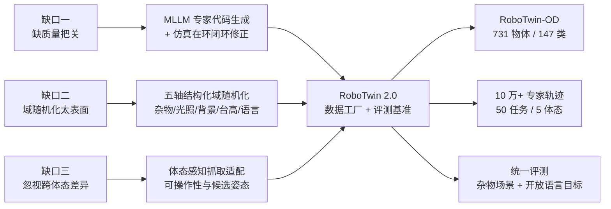

# RoboTwin 2.0 深度解析：可扩展双臂操作数据生成与评测基准

> 双臂操作缺数据，但真实演示太贵、仿真数据又太干净。RoboTwin 2.0 让多模态大模型自动写任务代码、让仿真在闭环里自我纠错、再沿五个维度做结构化域随机化——把一个可扩展的数据工厂和一个统一评测基准合二为一。

## 系列定位

这个系列逐层拆解 RoboTwin 2.0（*RoboTwin 2.0: A Scalable Data Generator and Benchmark with Strong Domain Randomization for Robust Bimanual Robotic Manipulation*，arXiv:2506.18088）。它是 RoboTwin 1.0 的升级版，也是 [real2sim-eval](/系列/real2sim_eval_deep_dive/) 之外另一条解决"仿真数据不够用"的路径：不追求单场景的照片级真实，而是追求任务数量、场景多样性、机器人构型的**规模与覆盖**。

两者的定位不同：real2sim-eval 从真实视频重建单场景、追求仿真与真机评估的高相关；RoboTwin 2.0 则是**纯仿真数据合成**，靠域随机化弥合 sim-to-real 差距。两者互补，相关系列会互相链接。

## 核心矛盾

要训练通用的双臂 VLA（Vision-Language-Action，视觉-语言-动作）基础模型，需要同时满足"高质量、多样、大规模"的数据。但现有仿真数据管线在三个方面系统性欠账：

**第一，缺自动化的质量把关。** 没有专家级的验证闭环，生成的大量轨迹里混着执行失败和次优抓取，直接拖累下游策略学习。

**第二，域随机化太表面。** 场景过干净、过于同质，缺失真实世界里的杂物堆叠、光照变化、语言歧义等关键因素，导致 sim-to-real 迁移困难。

**第三，忽视跨体态差异。** 不同双臂平台的运动学能力差别巨大——低自由度平台（如 Piper）常靠侧向抓取，高自由度机械臂（如 Franka）能俯视精确抓取。现有数据很少编码这种体态相关的可操作性与任务约束，限制了通用性。

RoboTwin 2.0 的三大组件各自回应一个缺口：

> 读图重点：左边三个缺口与右边三个组件一一对应，最终产出三样东西——物体库、大规模轨迹、以及覆盖杂物与开放语言的评测基准。

## 互动架构总览

下面这个组件用三个标签页把 RoboTwin 2.0 讲成一座"会自我纠错的数据工厂"：模拟"写代码 → 仿真跑 → VLM 看 → 修代码"的迭代、开关五轴域随机化、切换 Franka / Piper 看抓取方式与成功率差异。

<RoboTwin2Playground />

## 章节目录

| 章节 | 标题 | 解决的问题 |
|------|------|------------|
| 01 | [双臂操作数据的三大缺口](./01_双臂操作数据的三大缺口) | 为什么现有仿真数据集撑不起通用双臂策略 |
| 02 | [MLLM 专家代码生成闭环](./02_MLLM专家代码生成闭环) | 怎样让代码生成智能体和视觉观察智能体互相纠错 |
| 03 | [五轴域随机化与体态感知抓取](./03_五轴域随机化与体态感知抓取) | 结构化随机化如何弥合 sim-to-real，抓取如何适配不同机械臂 |
| 04 | [实验结果与评测基准](./04_实验结果与评测基准) | 代码生成、策略鲁棒性、真机迁移各提升了多少 |

## 阅读前提

- 线性代数、概率与神经网络训练常识。
- [RoboTwin：双臂机器人操作的数字孪生仿真平台](/前置知识/015b_前置知识_RoboTwin双臂机器人仿真平台)——1.0 的基础设定，理解本系列的前置。
- [数字表亲与 Real2Sim 数据增广](/前置知识/010b_前置知识_数字表亲与Real2Sim数据增广)——理解为什么"多样性"比"单场景真实"更重要。
- [Sim-to-Real 迁移综述](/论文综述/S04_Sim_to_Real迁移综述)——域随机化的历史背景。

## 贯穿例子

全文使用 **Handover Block（交接积木）** 这个双臂任务：一只手臂抓起积木，在空中交给另一只手臂，再由后者放到目标位置。它同时涉及双手协调、空中交接的精度、以及不同机械臂可达性的差异，是检验"体态感知抓取"和"域随机化"效果的最好载体。

## 延伸阅读

- [real2sim-eval 深度解析](/系列/real2sim_eval_deep_dive/)——从真实视频重建单场景、追求评估高相关的互补路线。
- [Sim-and-Real 混训实证分析综述](/论文综述/S33_Sim_and_Real混训实证分析综述)——合成数据与真实数据混训的实证规律。
- [DreamGen 视频世界模型生成机器人训练数据](/论文综述/131_DreamGen_视频世界模型生成机器人训练数据)——另一种合成数据的生成方式。
- [ACT / ALOHA 深度解析](/系列/act_aloha_deep_dive/)——RoboTwin 2.0 作为基线对比的经典方法。
