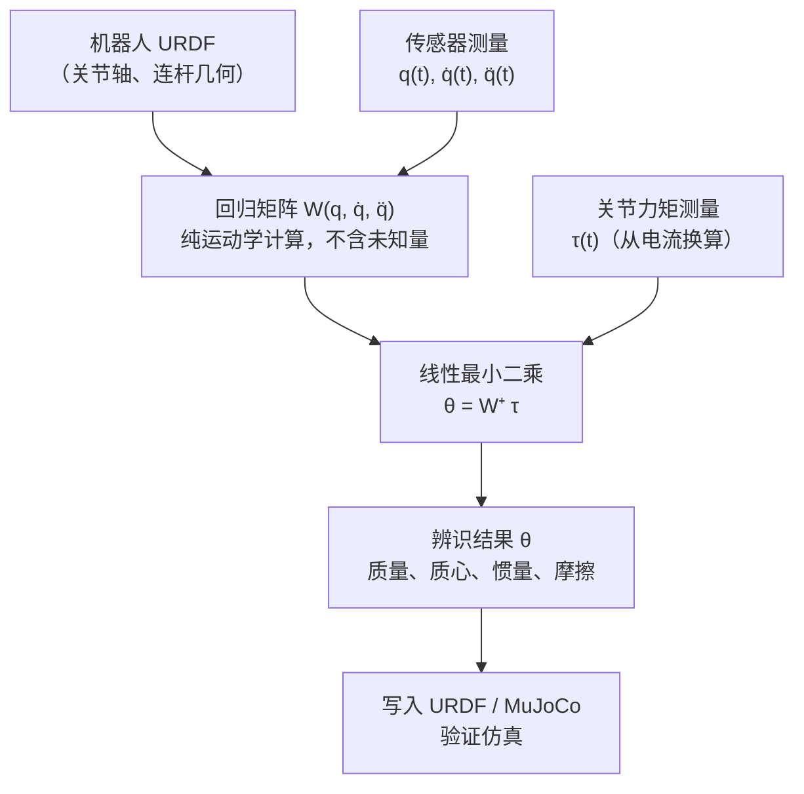

# 第九章：机械臂末端负载自动惯性参数辨识

把一个物体夹到机械臂末端，让机械臂执行一组专门设计的轨迹，同时记录关节角度和电机力矩，然后解一个线性方程组——质量、质心、惯性张量、摩擦参数，全部一次性出来。这套流程的核心魔法在于：刚体动力学方程可以被改写成"参数线性"的形式，未知的物理量变成线性回归的系数，可观测的运动学量构成回归矩阵，剩下的就是线性代数。

**知识链接**：
- [刚体动力学：牛顿-欧拉方程与惯性张量](/前置知识/006b_前置知识_刚体动力学_牛顿欧拉方程与惯性张量)（本章参数向量 θ 里的量，在这里有物理定义）
- [机械臂动力学方程：M、C、g 与关节力矩](/前置知识/008d_前置知识_机械臂动力学方程M_C_g与关节力矩)（本章把那个方程"拆开"改写成回归形式）
- [正动力学、逆动力学与递归刚体算法](/前置知识/008e_前置知识_正动力学逆动力学与递归刚体算法)（Pinocchio 就是高效实现这些递归算法的库）
- [第五章：刚体动力学与接触参数](./05_刚体动力学与接触参数)（本章专注于末端负载；整臂多连杆辨识见第五章）

---

## 9.1 问题是什么：为什么需要"自动辨识"

给仿真或控制器填写末端执行器或负载的物理参数，有三条路：

**CAD 建模**：如果负载的 3D 模型精确，导出质量和惯量矩阵就够了。但夹具上螺钉多了几颗、线缆绕了一圈，CAD 值就不准了。更根本的问题是：很多工业场合的负载在任务期间会变（换个工件、换个工具），每次都重新建模不现实。

**手工称重 + 估算**：台秤称质量，手工量尺寸再查材料密度估算惯量。对于规则形状还能凑合，对于形状复杂的末端执行器误差会很大，而且完全无法测量摩擦参数。

**机械臂自动辨识**：把负载装到末端，让机械臂在安全范围内运动，测量关节力矩。只要轨迹设计得充分，所有惯性参数可以同时从数据中估计出来，不需要拆卸负载，可以在线执行，精度高于手工测量。

这一章详细讲第三条路。

---

## 9.2 贯穿全章的例子

7 自由度机械臂，腕部安装了一个夹爪和工件，总质量约 1.2 kg。我们不知道这个负载的精确质心位置和惯量，但我们有：关节编码器（位置精度 0.01°）、电机电流传感器（通过 Kt 换算力矩）、机械臂的 URDF 文件。目标：在 3 分钟的实验数据内，把负载的 10 个惯性参数和 2 个关节 7 的摩擦参数全部辨识出来。

---

## 9.3 从动力学方程到线性回归

### 9.3.1 关键洞察：参数线性性

[机械臂标准动力学方程](/前置知识/008d_前置知识_机械臂动力学方程M_C_g与关节力矩)是：

$$M(\mathbf{q})\ddot{\mathbf{q}} + C(\mathbf{q},\dot{\mathbf{q}})\dot{\mathbf{q}} + \mathbf{g}(\mathbf{q}) + \boldsymbol{\tau}_f = \boldsymbol{\tau}$$

这个方程对关节位形 q、速度 q̇、加速度 q̈ 是非线性的，但对**惯性参数**却是线性的。

为什么？用一个单连杆的例子来建立直觉：一根长度为 L、末端集中质量 m 的连杆，绕关节轴转动，所需力矩是：

$$\tau = mL^2 \ddot{q} + mgL\cos(q)$$

注意：q、q̈ 是已知的（测量值），未知的只有 m 和 mL（质量和质量×质心距）。把 q、q̈、g 都当作已知系数，这个方程对"m 和 mL"来说是线性的。对每个时刻 t_k 写一个方程，N 个时刻就有 N 个方程，两个未知数，直接最小二乘解。

推广到多连杆机械臂：同样的线性性质成立。每个连杆的贡献可以分离成"运动相关系数 × 惯性参数"的形式，整个机械臂的关节力矩向量变成：

$$\boldsymbol{\tau} = W(\mathbf{q}, \dot{\mathbf{q}}, \ddot{\mathbf{q}}) \cdot \boldsymbol{\theta}$$

**这个公式在做什么**：把动力学方程的非线性部分（W，可以从运动数据直接计算）和未知物理参数（θ）分开，凑成线性方程组，就能用最小二乘一次解出所有参数。

::: details 📐 公式详解（点击展开）

| 子表达式 | 它是谁 | 它在干嘛 |
|---------|--------|---------|
| $\boldsymbol{\tau}$ | **测量值** | 关节力矩的向量（n 个关节，n 维），由电机电流 × Kt 换算，或直接用力矩传感器测量 |
| $W(\mathbf{q}, \dot{\mathbf{q}}, \ddot{\mathbf{q}})$ | **回归矩阵** | n 行 × p 列的矩阵，完全由测量到的运动轨迹和机器人的 URDF 几何结构计算得到，**不含任何未知参数** |
| $\boldsymbol{\theta}$ | **待辨识参数向量** | p 维，包含每个连杆的惯性参数（质量、质心、惯量）和关节摩擦参数，**是我们要求的东西** |

**用人话读**："在某一时刻，关节力矩 = 一个可以算出来的矩阵 × 一个未知的参数向量。收集足够多时刻的数据，把方程堆叠起来解线性方程组。"

**为什么参数线性性成立**：机械臂动力学的每一项（惯性项 Mq̈、科里奥利项 Cq̇、重力项 g）都是惯性参数的线性函数。这是拉格朗日力学的基本性质：动能是速度的二次型，系数是惯性参数的线性组合；势能对关节角的导数也是惯性参数的线性组合。

:::



> 整个流程的信息流：URDF 提供几何结构，传感器提供运动轨迹，两者合起来构建 W；关节力矩提供右端项；最小二乘求出 θ。W 是不含未知量的，这是方法能工作的根本原因。

### 9.3.2 参数向量 θ 里有什么

对每个刚体（连杆或末端负载），最完整的描述是 10 个惯性参数，称为"标准惯性参数"：

| 参数 | 符号 | 物理含义 | 单位 |
|------|------|---------|------|
| 质量 | $m$ | 刚体总质量 | kg |
| 一阶矩 | $m c_x,\ m c_y,\ m c_z$ | 质量 × 质心坐标，3 个分量 | kg·m |
| 惯量张量 | $I_{xx}, I_{xy}, I_{xz}, I_{yy}, I_{yz}, I_{zz}$ | 关于连杆坐标原点的惯量（对称 3×3 矩阵的 6 个独立元素） | kg·m² |

**注意：这里用的是"质量×质心"（一阶矩），而不是直接用质心坐标**。这是一个设计选择：把 m 和 c 分开用时，方程对 m 和 c 是双线性的（不是线性的），而把 $mc_x$ 当成一个整体参数，方程就保持线性。质心坐标 $c = (mc_x/m,\ mc_y/m,\ mc_z/m)$ 在估计完之后可以从一阶矩和质量推算。

对每个关节还有摩擦参数：
- **黏性摩擦系数** $b_i$：力矩 = b × 速度，随速度线性增长
- **库仑摩擦** $f_i$：力矩 = f × sign(速度)，方向与速度相反、大小恒定

一台 n 关节机械臂（末端接一个负载）的参数总数：$10(n+1) + 2n$ 个。对 7 关节臂加末端负载：$10 \times 8 + 2 \times 7 = 94$ 个参数。

### 9.3.3 哪些参数真的可以辨识：基参数

听起来需要辨识 94 个参数，但实际上不是所有参数都对关节力矩有独立的影响。串联机械臂存在**参数冗余**：某些参数的组合，在任何运动中对力矩的贡献完全相同，从力矩数据永远无法区分它们。

一个具体例子：关节 1（固定基座，绕 z 轴转动）所需的力矩，依赖连杆 1 绕 z 轴的惯量 $I_{1,zz}$，以及连杆 2 绕 z 轴的等效惯量（通过 Steiner 定理换算到关节 1）。两者的"和"对力矩有贡献，但如果连杆 1 的质量分布固定不变，把"I₁_zz 少 10%"和"连杆 2 等效 I 多 10%"产生完全相同的力矩读数。从数据里永远无法把这两个参数分开。

处理方法是找到"基参数"（base parameters），即所有能独立影响关节力矩的最小参数集合。通常通过对回归矩阵 W 做 QR 分解或 SVD，找出线性无关的列，对线性相关的列合并成新参数。串联机械臂每个连杆一般能辨识 4–6 个基参数，而不是 10 个。

**实践要点**：如果你用Pinocchio 计算 W，调用 `pin.computeMinimalParameters()` 会自动返回当前机器人结构的基参数集合，以及从标准参数到基参数的线性映射矩阵。辨识完基参数后，可以把它"展开"回标准参数空间，但展开后会有一个自由度（欠定），需要额外约束（比如某个连杆质量已知）来固定。

---

## 9.4 需要准备什么数据

### 9.4.1 硬件测量信号

| 信号 | 如何获取 | 质量要求 |
|------|--------|---------|
| 关节位置 q(t) | 编码器，大多数工业臂直接读取 | 精度 ≥ 0.01°，分辨率 ≥ 14 bit |
| 关节速度 q̇(t) | 位置差分 + 低通滤波，或内部测速 | 差分后必须过截止频率约 30-60 Hz 的零相位滤波器（如 Savitzky-Golay 或 Butterworth） |
| 关节加速度 q̈(t) | 速度再次差分 + 更强的滤波 | 噪声最大的一步，截止频率约 15-30 Hz；如果机械臂有内置加速度估计优先用 |
| 关节力矩 τ(t) | 电机电流 × 力矩常数 Kt，或力矩传感器 | 电流→力矩需要精确的 Kt 和减速比；关节力矩传感器（如 ATI）精度更高但更贵 |

**采样频率**：至少 500 Hz，推荐 1 kHz。低于 200 Hz 的数据在差分求加速度时噪声会严重放大。

**时间同步**：位置和电流信号必须对齐到同一时间轴，1 毫秒以内的偏差对力矩预测误差影响显著。如果两路信号走不同总线，需要用触发信号或共同时间戳对齐。

**热机状态**：摩擦参数强烈依赖温度。实验前机械臂需要热身运动 5-10 分钟，让关节温度稳定，否则辨识的摩擦系数只在实验当时准确。

### 9.4.2 机器人模型文件

需要机械臂的 URDF 文件，其中：
- **正确的关节轴方向**（DH 参数或 MDH），用于计算回归矩阵 W
- **各关节的齿轮减速比**，用于把电机电流换算到关节力矩
- **各关节零位定义**，确保编码器读数 q 和 URDF 里的 q 含义相同

URDF 里的连杆质量和惯量**不需要精确**（辨识结果会覆盖它们），但关节轴方向必须正确——这是几何参数，应该在第三章的运动学辨识阶段已经确认过。

### 9.4.3 激励轨迹设计

这是整个流程里最容易被忽视的一步。"让机械臂随便动动"是不够的——如果只做水平平移，重力项没有变化，重力相关参数无法辨识；如果只慢速移动，加速度接近零，惯量参数对力矩的贡献也接近零。

**充分激励的直觉**：每个待辨识参数都需要在数据集中"被激励到"，即该参数的变化要导致关节力矩的可观测变化。数学上等价于：堆叠所有时刻的 W 矩阵后，列向量组要线性无关，且最小奇异值不能太小。

**标准做法——有限傅里叶级数参数化**：

把每个关节的轨迹写成：

$$q_j(t) = q_{j,0} + \sum_{k=1}^{K} \left[ a_{jk} \sin(k\omega_f t) + b_{jk} \cos(k\omega_f t) \right]$$

其中 $\omega_f$ 是基频（通常 0.1-0.2 Hz，对应 5-10 秒一个周期），K 取 5-7 阶，然后对系数 $\{a_{jk}, b_{jk}\}$ 做优化。

**优化目标**：最小化 $W^TW$ 的条件数（$\sigma_{\max}/\sigma_{\min}$），条件数越小，参数估计对测量噪声越不敏感。

**约束**：关节角度在安全范围内、速度和加速度不超限、全程无碰撞（通过离散检查）。

优化是一个非线性规划问题，通常用 SLSQP 或遗传算法，在 Matlab 或 Python 中 10-30 分钟可以求解完成，之后可以反复复用同一套轨迹。

**实践上的简化**：如果没有时间做完整优化，让机械臂在全关节空间范围内、以中等速度做几条随机且充分变化的轨迹（总时长 2-5 分钟），通常也能达到 70-80% 的辨识精度。商业臂（UR、Franka）的官方辨识向导里内置了预设激励轨迹，直接使用即可。

---

## 9.5 建立方程组并求解

### 9.5.1 堆叠数据点

在采集轨迹时，每个采样时刻 $t_k$ 都给出一个方程 $\boldsymbol{\tau}(t_k) = W(\mathbf{q}(t_k), \dot{\mathbf{q}}(t_k), \ddot{\mathbf{q}}(t_k)) \cdot \boldsymbol{\theta}$。把 N 个时刻的方程垂直堆叠：

$$\underbrace{\begin{bmatrix} \boldsymbol{\tau}(t_1) \\ \boldsymbol{\tau}(t_2) \\ \vdots \\ \boldsymbol{\tau}(t_N) \end{bmatrix}}_{\mathbf{T} \in \mathbb{R}^{Nn}} = \underbrace{\begin{bmatrix} W(t_1) \\ W(t_2) \\ \vdots \\ W(t_N) \end{bmatrix}}_{W_{\text{full}} \in \mathbb{R}^{Nn \times p}} \cdot \boldsymbol{\theta}$$

**这个公式在做什么**：把"N 个时刻、n 个关节"的所有力矩方程叠成一个大线性方程组。Nn 个方程，p 个未知数，当 Nn >> p 时是过定方程组，用最小二乘求最优解。

::: details 📐 方程组结构详解（点击展开）

| 量 | 维度 | 内容 |
|----|------|------|
| $\mathbf{T}$ | $Nn \times 1$ | 所有时刻所有关节的测量力矩，摞成一列 |
| $W_{\text{full}}$ | $Nn \times p$ | 所有时刻的回归矩阵，垂直堆叠 |
| $\boldsymbol{\theta}$ | $p \times 1$ | 基参数向量，全局只有一个，是我们要解的 |

典型规模：N = 3000 个采样点，n = 7 个关节，p = 60 个基参数 → $W_{\text{full}}$ 是 21000×60 的矩阵。明显过定，最小二乘精度高。

**实际时间采样：不是每个点都用**。相邻采样点高度相关（运动连续），通常每隔 5-10 个点取一个用于辨识（降频），既减小计算量，又降低相关性。
:::

### 9.5.2 标准最小二乘

$$\hat{\boldsymbol{\theta}} = \left(W_{\text{full}}^T W_{\text{full}}\right)^{-1} W_{\text{full}}^T \mathbf{T} = W_{\text{full}}^+ \mathbf{T}$$

**这个公式在做什么**：用伪逆求最小化 $\|W_{\text{full}} \boldsymbol{\theta} - \mathbf{T}\|^2$ 的参数向量。这是标准的线性最小二乘，有解析解，计算快（即使矩阵很大，稀疏结构也能加速）。

::: details 📐 伪逆解详解（点击展开）

| 子表达式 | 它是谁 | 它在干嘛 |
|---------|--------|---------|
| $W_{\text{full}}^T W_{\text{full}}$ | **法方程矩阵**（Gram matrix）| p×p 的方阵，行列式越大说明 W 的列越正交，越易于求逆 |
| $(W_{\text{full}}^T W_{\text{full}})^{-1}$ | **逆** | 如果法方程矩阵病态（奇异值差距大），求逆会把测量噪声放大——这正是轨迹优化要避免的 |
| $W_{\text{full}}^T \mathbf{T}$ | **关联向量** | 把测量力矩"投影"到各参数方向 |

**用人话读**："收集的运动和力矩数据越多、激励越充分，$W^T W$ 越接近'等比例缩放的单位矩阵'，求逆越稳定，参数估计越精确。"

**正则化**：如果条件数仍然很大（>1000），可以加 Tikhonov 正则化：$\hat{\boldsymbol{\theta}} = (W^TW + \lambda I)^{-1} W^T \mathbf{T}$，以轻微的偏差换取大幅降低方差。λ 通常取 $10^{-3}$ 到 $10^{-2}$ 倍的最大奇异值。
:::

### 9.5.3 物理一致性约束

直接求伪逆得到的解有时会给出物理上不可能的参数值，比如负质量或非正定惯量张量。这是因为最小二乘不知道任何物理约束。

解决方法是把辨识问题改写成**约束优化**：

最小化 $\|W_{\text{full}} \boldsymbol{\theta} - \mathbf{T}\|^2$，满足：
- $m_i > 0$（正质量）
- 惯量张量 $I_i \succ 0$（正定，等价于三个主惯量都大于零且满足三角不等式 $I_{xx} + I_{yy} \geq I_{zz}$ 等）
- $\|c_i\| \leq r_i$（质心在连杆几何范围内，$r_i$ 是连杆的外接球半径）

将惯量正定约束写成线性矩阵不等式（LMI），这个问题变成一个**半正定规划（SDP）**，可以用 cvxpy 或 scipy 的 SDP 求解器在几秒内求解。

实际中，如果连杆质量不太极端（不是近零），标准最小二乘结果通常已经物理可行。只有在测量噪声很大或激励不足时才会出现违反约束的情况。

---

## 9.6 验证辨识结果

辨识完成后，**绝对不能只看训练误差**（用来辨识的那段轨迹上的力矩残差）——它几乎一定很小，但说明不了参数的泛化能力。

**标准验证流程**：

1. **保留验证轨迹**：在辨识实验之外，额外采集 1-2 段不同的运动轨迹（不同速度、不同关节范围），专门用于验证。

2. **计算力矩预测误差**：用辨识后的 θ 和验证轨迹的运动数据，通过逆动力学预测关节力矩，和实测力矩比较。目标：各关节 RMSE < 实测力矩峰值的 5%。

3. **分项检查残差**：
   - 残差随姿态周期变化（非随机）→ 重力项参数（质心）偏差
   - 残差幅度随加速度线性增大 → 惯量参数偏差
   - 残差在速度方向改变时突变 → 库仑摩擦偏差

4. **物理合理性检查**：辨识出的质量可以用台秤验证；如果有 CAD 模型，对比质心位置（差异通常 < 5 mm 为正常）；用 F = ma 做量纲一致性检查。

5. **仿真对比**：把辨识参数写入 URDF，在 MuJoCo 或 Isaac 里播放同样的轨迹，对比仿真力矩和真机力矩，误差应与步骤 2 相近。

---

## 9.7 工具链实战

### 9.7.1 Pinocchio：核心计算库

Pinocchio 是最常用的开源刚体动力学库，原生支持从 URDF 加载机器人并计算辨识所需的所有量：

```python
import pinocchio as pin
import numpy as np

# 加载机器人模型
model, geom_model, visual_model = pin.buildModelsFromUrdf("robot.urdf")
data = model.createData()

# 在一个时刻 (q, v, a) 处计算回归矩阵 W
# q: 关节位置 (n,), v: 关节速度 (n,), a: 关节加速度 (n,)
# 返回 W: (n x p_std) 矩阵，p_std 是标准参数数（10 × n_bodies）
W = pin.computeJointTorqueRegressor(model, data, q, v, a)

# 获取当前机器人的基参数（最小可辨识参数集）
# params_standard: 当前 URDF 的标准参数值
# P: 从标准参数到基参数的投影矩阵
params_standard = pin.inertiaParameters(model)
# 通常需要对 W 做 QR 分解来找基参数，可用 robot_identification 库封装
```

Pinocchio 的 `computeJointTorqueRegressor` 使用 Christoph Gorja 的高效递归算法，比手写循环快 10 倍以上，支持符号微分（用于轨迹优化）。

### 9.7.2 robot_identification：完整流水线

`robot_identification`（GitHub: `stack-of-tasks/robot-description`，与 Pinocchio 配套）把从轨迹优化到基参数辨识的完整流程封装好了：

```python
from robot_identification import RobotIdentification

ri = RobotIdentification("robot.urdf")

# 用采集到的数据辨识（q, dq, ddq, tau 都是 (N, n_joints) 的 numpy 数组）
# 内部自动处理：计算 W → 找基参数 → 最小二乘（带可选约束）
result = ri.identify(q_data, dq_data, ddq_data, tau_data,
                     with_friction=True, 
                     physical_consistency=True)

# 结果直接可以写回 URDF
ri.update_urdf("robot_identified.urdf", result)
```

### 9.7.3 工业机械臂的内置向导

如果用的是工业臂，制造商通常提供更简便的入口：

**Universal Robots**（UR3/UR5/UR10/UR16）：
- PolyScope 界面 → 设置 → 负载辨识
- 点击"开始"，机械臂自动执行内置激励轨迹（约 2 分钟），自动计算质量和质心，写入有效负载配置
- 只辨识质量和质心（共 4 参数），不包括惯量张量

**KUKA LBR iiwa / iiQKA**：
- MLOAD 功能，工作原理与 UR 相同，同样只输出质量和质心
- 通过 KUKA WorkVisual 或脚本调用 `setLoad()`

**Franka Research 3 / Franka Emika**：
- 提供最完整的 API，支持全 10 参数辨识
- Python SDK 示例：
  ```python
  import franka
  robot = franka.Robot("192.168.1.1")
  # 执行内置负载辨识轨迹，返回 LoadModel 对象
  load = robot.identifyLoad()
  print(load.mass)       # kg
  print(load.x_center_load)  # 质心 x
  robot.setLoad(load.mass, [load.x_center_load, ...], load.inertia)
  ```

**适用场景比较**：

| 场景 | 推荐方案 |
|------|--------|
| 标准工业负载，只需质量和质心 | 厂商内置向导，1 分钟搞定 |
| 需要惯量张量（高动态应用、仿真对齐） | Pinocchio + robot_identification |
| 整臂多连杆辨识（研究用） | robot_identification，配合自定义激励轨迹 |
| Franka 研究用途 | Franka Python API（最完整） |

---

## 9.8 常见问题

**问：辨识出的质量明显不对，比真实值差 50%？**
可能原因：电机力矩常数 Kt 不准，或减速比用错了。先用已知质量的标准负载（如 1 kg 砝码）验证力矩换算，确认 Kt × 减速比 × 编码器到关节角的换算系数全链路正确。

**问：摩擦参数辨识完全不稳定，每次结果差异很大？**
摩擦参数在低速段激励，而典型激励轨迹速度较高、惯性项主导，摩擦项被"淹没"。解决：在激励轨迹里加入专门的低速慢速段（0.02-0.1 rad/s），或者先单独做低速摩擦辨识（第四章方法），固定摩擦参数再辨识惯性参数。

**问：辨识后仿真力矩误差还是很大（>20%）？**
按残差类型定位：重力误差检查质心辨识；加速度相关误差检查惯量；低速摩擦跳变检查库仑摩擦。如果所有项都偏大，检查数据质量：加速度滤波是否过度（截止频率太低会削掉真实的加速度变化），或者位置和力矩是否有系统性时间偏移（0.5 ms 的偏移在高加速段会引入显著误差）。
