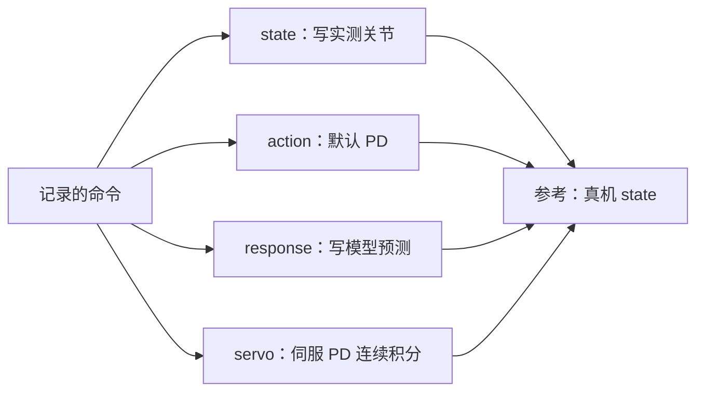
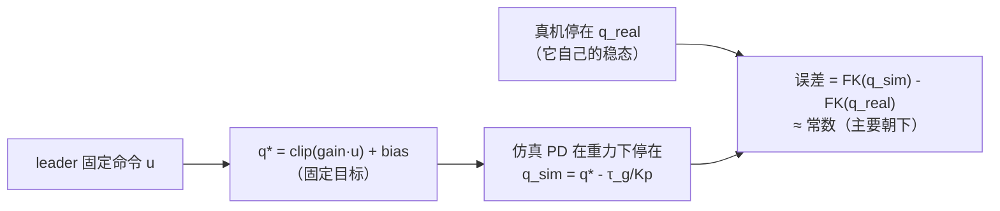

# 第十章：空载响应辨识到仿真对齐——一次真实标定的复盘

前九章把辨识拆成了参数地图、实验设计、运动学、执行器、动力学、可辨识性、写回和验证八个环节，但它们大多是分头讲的。本章用一次真实的**空载标定**（数据集 2871）把这些环节按实际执行顺序走一遍：从命令-反馈响应拟合，到把结果写回 Isaac Lab，再到读一个末端误差数字、判断它到底来自拟合还是来自别的因素。

**知识链接**：
- [一阶响应模型与命令-反馈系统辨识](/前置知识/017e_前置知识_一阶响应模型与命令反馈系统辨识)（本章第 10.3 节用的模型与拟合方法在这里有完整推导）
- [隐式 PD 与极点匹配](/前置知识/017f_前置知识_隐式PD与极点匹配)（本章第 10.5 节的 Kd 换算）
- [Real2Sim 评估的证据边界](/前置知识/017g_前置知识_Real2Sim评估的证据边界)（本章第 10.9 节判断"能声称什么"的依据）
- [Isaac Lab real2sim 回放的四种驱动模式](/工程实践/IsaacLab回放四种驱动模式_state_action_response_servo)（本章第 10.4 节的工程实现细节）
- [第四章：执行器与关节局部模型](./04_执行器与关节局部模型)、[第七章：写回仿真与本体对齐](./07_写回仿真与本体对齐)、[第八章：验证闭环与故障定位](./08_验证闭环与故障定位)（本章是这三章的合练）

---

## 10.1 为什么需要一次完整复盘

单看任意一章都不难，难的是把误差的**来源**分开。一个常见的错误是：仿真末端误差 6 mm，于是去调拟合参数。但 6 mm 可能是四种东西的和：


> 图里要看的重点：误差在 `H` 才第一次出现，但它上方的每一条支路——响应辨识、物理积分、外参——都会贡献一部分。想改进，先要知道每一段各占多少。

本章的结论是：**在这批数据上，拟合不但没做错，反而是把误差从 35 mm 压到 6 mm 的那一步；剩下的 6 mm 里，很大一部分是重力下垂和一个常数偏置，不是拟合残差。**

---

## 10.2 数据：一次双臂空载标定

数据来自官方采集目录 `Aloha_test_Kinematic-calibration_2871`，是**双臂 Aloha（Piper 前臂）的空载运动**记录，全部 30 Hz。它由五个 episode 组成，用途划分如下：

| ID | 帧数 | 内容 | 用途 |
| --- | ---: | --- | --- |
| 835327 | 3195 | 左臂大范围运动，右臂基本静止 | 取前 80%（帧 `[0,2556)`）拟合左臂 |
| 835328 | 5093 | 右臂大范围运动，左臂基本静止 | 取前 80%（帧 `[0,4074)`）拟合右臂 |
| 835329 | 1281 | 双夹爪开合，臂基本静止 | 取前 80% 拟合夹爪 |
| 835330 | 578 | 右臂独立短轨迹 | 整条独立验证，不参与拟合 |
| 835331 | 706 | 左臂独立短轨迹 | 整条独立验证，不参与拟合 |

几个刻意的设计选择，对应第二章"实验设计"和第六章"可辨识性"：

- **每条臂只在自己真正运动的那条记录上拟合。** 835327 的右臂几乎不动（关节变化接近零），用它去拟合右臂什么都识别不出来；这正是可辨识性要求"激励充分"的直接体现。
- **前 80% 拟合、后 20% 保留。** 保留段和两条独立短轨迹都不参与任何参数选择。
- **只用空载数据。** 含物体接触或抓持负载的 food-serve 轨迹被排除在标定验证之外——仿真根本没有还原接触和负载，那段误差无法单独归因于控制参数（第 10.9 节展开）。

数据本身有两个已知缺陷，它们会直接影响误差：

- 835328 的右关节 6 有部分 action 值超出官方限位，最大 **0.6613 rad**；835329 的左关节 6 **全部 1281 帧**低于官方下限，最大 **0.1033 rad**。本轮坚持使用官方限位、如实报告残差，没有为了压低误差去放宽限位。
- 夹爪命令在约 **0.70 原始单位**处饱和，而记录 action 约 1.04–1.05。这只是"约 0.70 处饱和"，不能当成零偏。

---

## 10.3 第一步：命令到反馈的响应辨识

### 10.3.1 模型：每条通道一个因果一阶响应

要回答的问题很具体：**给定记录下来的 leader 命令序列，能不能预测 follower 的关节反馈？** 这里不辨识质量、惯量、摩擦、电机增益，只辨识一条"命令进去、反馈出来"的一阶响应。每条通道（14 条：左右各 6 个臂关节 + 1 个夹爪）各自用一个递推式：

$$
\hat q[k+1]=\alpha\,\hat q[k]+(1-\alpha)\Big(\mathrm{clip}\big(\mathrm{gain}\cdot u[\max(0,k-d)],\ \ell,\ h\big)+\mathrm{bias}\Big)
$$

**这个公式在做什么**：每一帧先算出"这一帧想去的关节位置"（命令经缩放、限幅、加偏置），再让预测值只朝这个目标走一部分（比例由 α 决定）——α 越接近 1，走得越慢。

::: details 📐 公式详解（点击展开）

| 子表达式 | 它是谁 | 它在干嘛 |
|---------|--------|---------|
| $u[k-d]$ | **延迟后的命令** | leader 在第 $k-d$ 帧发出的目标；$d$ 是附加整数延迟 |
| $\mathrm{clip}(\mathrm{gain}\cdot u,\ \ell,\ h)+\mathrm{bias}$ | **当帧目标** | 命令缩放、卡进机械限位、再补一个恒定偏置，得到"命令想去的关节角" |
| $\hat q[k]$ | **上一帧预测** | 系统自己的状态，喂回来决定这一帧从哪出发 |
| $\alpha$ | **记忆系数** | 保留上一帧多少。$\alpha=0$ 表示瞬间到位，$\alpha\to1$ 表示几乎不动 |
| $1-\alpha$ | **追赶速度** | 每帧向目标靠拢的比例；和 $\alpha$ 一起决定时间常数 $\tau=-1/(f_s\ln\alpha)$ |

**用人话读**："先算出这一帧命令希望关节到哪，然后让预测值朝那里挪一小步，挪的快慢由 α 定。"

**为什么是这个形式**：一阶递推只用**一个**参数 $\alpha$ 就表达了"带宽有限"这件事，而且它是因果的——只用到过去和当前命令，可以前向推演。限幅写成 $[\ell,h]$ 是为了把机械限位放进模型结构，而不是让拟合去解释越界值。

:::

各参数的角色：**臂关节的 gain 固定为 1**（leader 和 follower 同为弧度，不需要缩放），只拟合 $\alpha$ 和 bias，限位直接用官方 URDF 值；**夹爪**额外放开 gain 和上限（下饱和固定为 0），因为它记录的是未标定的原始单位。delay 是一个整数帧数，在 0–5 帧之间**枚举**，每个候选各拟一次、取训练误差最小的。

### 10.3.2 拟合方法：用"自由推演"而不是"一步预测"

关键在损失函数的形状。拟合不是"用上一帧的真实反馈去预测下一帧"（一步预测），而是**从首帧出发，用模型自己滚动整段轨迹，再和真实反馈逐帧比较**：

```python
# response.py: 拟合第 j 条通道
least_squares(
    lambda v: predict_channel(action, state[0], unpack(v))[1:] - state[1:],
    initial, bounds=(lower, upper),
)
```

这里 `predict_channel` 内部就是上面那条递推，从 `state[0]` 出发一路外推。**为什么要这样**：一步预测误差对 $\alpha$ 几乎不敏感（用真实反馈纠偏，滞后永远被"喂"回来），只有让模型自由滚动，优化器才会为了让整段轨迹贴合而去调 $\alpha$。代价是误差会沿时间累积，但对一阶系统这正是我们想要的——它直接对应"回放时模型能跟多久"。

拟合出的时间常数 $\tau$（约 57–94 ms，夹爪约 37–41 ms，见下表）。全部通道选出的附加 delay 都是 0，但**不能解释成硬件零延迟**：模型本身已经是 `action[k]` 预测 `state[k+1]`，且带一阶滞后，采样又只有 33 ms，硬件、通信、控制滤波和打包延迟无法从这批数据分离开。

| 通道 | 右臂 τ [ms] | 左臂 τ [ms] |
| --- | ---: | ---: |
| joint1 | 62.9 | 66.6 |
| joint2 | 64.0 | 69.6 |
| joint3 | 56.6 | 63.4 |
| joint4 | 73.5 | 93.5 |
| joint5 | 87.8 | 86.9 |
| joint6 | 77.7 | 86.8 |
| gripper | 40.6 | 37.0 |

对照基线是"因果限幅命令"：$\alpha=0$、delay$=0$、gain$=1$、bias$=0$，也就是 $\hat q[k+1]=\mathrm{clip}(u[k])$——直接把命令当反馈。所有改善都相对这个基线衡量。

---

## 10.4 第二步：把辨识结果写回仿真

拟合得到的是"命令→反馈"的数学关系；要进入 Isaac Lab，还要决定**用什么去驱动仿真里的关节**。同一份辨识结果可以配四种不同的驱动方式，它们的区别只有一句话：**谁在决定每一帧的关节值**。

| 模式 | 关节怎么动 | 重力 | 真实 state 用在哪 | 能否作为控制验证 |
| --- | --- | --- | --- | --- |
| `state` | 每帧直接写**实测**关节 | 关 | 逐帧回放 | 否，等于抄答案 |
| `action` | 仿真自带的默认 PD 直接执行 leader 目标 | 开 | 仅初始化 | 能，但增益不是辨识出来的 |
| `response` | 每帧写**模型预测**的关节 | 关 | 仅初始化 | 否，没跑物理 |
| `servo` | 只喂命令，仿真伺服 PD 连续积分 | 开 | 仅初始化 | 是 |



> 图里要看的重点：四种模式吃的是同一条命令，区别在于中间那段由谁填充。`state` 和 `response` 都是"把答案直接写进关节"，前者抄真值、后者抄模型；只有 `action` 和 `servo` 让物理引擎自己算，其中 `action` 用的是没有辨识过的默认增益。

`action` 和 `servo` 都开重力、都连续积分、都不逐帧写状态，唯一的区别是 PD 增益：`action` 用仿真默认的 Kp=100/Kd=5，`servo` 用从辨识结果换算来的增益。所以**两者的差距，就是"增益有没有对齐"的差距**；而 `response` 与 `servo` 的差距，是"跑不跑物理"的差距。

---

## 10.5 servo 的核心：用极点匹配把滞后交给物理

`servo` 这个名字指的就是真机上"电机 + 驱动器 + 位置环"那条**伺服环节**。在仿真里它是一个隐式 PD：给定目标 $q^*$，按 $K_p$、$K_d$ 闭环驱动关节。

这里有一个关键设计选择：辨识出来的是一阶滞后 $\alpha$，那这个滞后由谁产生？两种做法：

- 用上面那条递推式把滞后**算出来**，再把结果写进关节（这是 `response`）。
- 只发**当帧的限幅目标**，让 PD + 惯量在物理积分中**自然产生**滞后（这是 `servo`）。

第二种更接近真机，但要求仿真产生的滞后快慢和真机一致。办法是把 $\alpha$ 换算成仿真阻尼系数 $K_d$（$h=1/120$ s 是物理步长，decimation$=4$ 表示每个控制周期跑 4 个物理子步）：

$$
K_d=\frac{K_p\,h}{\alpha^{-1/\mathrm{decimation}}-1}
$$

**这个公式在做什么**：把"真机这条关节闭环的时间常数"翻译成仿真里的阻尼大小，使仿真 PD 的闭环极点在每个控制周期上正好等于拟合出来的 $\alpha$。

::: details 📐 公式详解（点击展开）

| 子表达式 | 它是谁 | 它在干嘛 |
|---------|--------|---------|
| $K_p$ | **刚度（设计旋钮）** | 人为选的 1000 N·m/rad，越大越硬、静态下垂越小 |
| $h$ | **物理子步** | 1/120 s，物理积分的最小时间单位 |
| $\mathrm{decimation}$ | **子步数** | 每个控制周期跑 4 个物理子步，即控制频率 30 Hz |
| $\alpha^{-1/\mathrm{decimation}}-1$ | **每子步的追赶比例** | 由控制周期的极点 $\alpha$ 反推每个子步该追多少 |
| $K_d$ | **阻尼（派生量）** | 由 $K_p$ 和 $\alpha$ 共同决定，不是独立拟合的 |

**用人话读**："先定一个刚度，再根据真机关节该多快回到目标，算出仿真里需要配多大的阻尼。"

**为什么是这个形式**：质量忽略时关节近似一阶系统 $K_d\dot q=K_p(q^*-q)$。对它在每个子步用隐式欧拉迭代，一个控制周期（4 个子步）后的有效极点等于 $(1/(1+r))^{4}$，其中 $r=hK_p/K_d$。令这个极点等于拟合的 $\alpha$，就解出上式。

:::

配套的两个决定：

- **`servo` 里把 $\alpha$ 强制设为 0。** 因为滞后已经交给物理产生了，如果目标又用递推平滑一遍，同一个滞后会被算两次。所以目标是当帧的 $\mathrm{clip}(\mathrm{gain}\cdot u)+\mathrm{bias}$，不再额外做一阶滤波。
- **$K_p=1000$ 是显式的仿真设计值，不是辨识出的电机刚度。** 拟合只给出了 $\alpha$（决定 $K_p/K_d$ 的比例），无法唯一确定 $K_p$ 本身。这一点在第 10.8 节会造成一个具体的、可观测的后果。

---

## 10.6 第三步：验证指标在量什么

回放结束后，脚本给出一个末端误差。它的定义是：**世界坐标系下，仿真中 link6（腕部末端连杆）位置与真机记录末端位置的三维欧氏距离的均方根**：

$$
\mathrm{RMSE}=\sqrt{\frac{1}{N}\sum_{k=1}^{N}\big\lVert \mathbf{p}^{\mathrm{sim}}_k-\mathbf{p}^{\mathrm{real}}_k\big\rVert_2^2}\quad[\mathrm{mm}]
$$

**这个公式在做什么**：先算每一帧仿真末端偏离真机末端多少（一个三维距离），再把整段轨迹的这些距离取均方意义，得到一个有单位的单一数字。

::: details 📐 公式详解（点击展开）

| 子表达式 | 它是谁 | 它在干嘛 |
|---------|--------|---------|
| $\mathbf{p}^{\mathrm{sim}}_k$ | **仿真末端位置** | 第 $k$ 帧从仿真读出的 link6 世界坐标 |
| $\mathbf{p}^{\mathrm{real}}_k$ | **真机末端位置** | 第 $k$ 帧记录 `end_pose` 经基座外参变换到世界坐标 |
| $\lVert\cdot\rVert_2$ | **三维距离** | 一条误差向量的长度，而不是分轴的差 |
| $\sqrt{\frac1N\sum(\cdot)^2}$ | **均方根** | 先平方、跨帧平均、再开方，对大误差更敏感 |

**用人话读**："每一帧量一下仿真末端离真机末端差了多远，再把整段时间的差距汇总成一个数。"

**为什么先平方再开方**：它给出的是误差的 RMS 口径，和"平均距离"不同，会让少数大误差帧占更大权重；同时它保持长度单位，可以直接和阈值比较。注意这里**不是**把 x/y/z 三个分量的误差分开平均再合成，而是先合成距离。

:::

三个容易读错的点：

- 它只量**位置**，不含姿态角误差。回放报告里有单独的关节角 RMSE（单位 rad），但那是另一个数字。
- 它只统计该条轨迹里**运动侧**那条臂。静止侧会单独报告，不能被忽略。
- 它是**开环喂命令**的结果：整个回放只用首帧真实状态初始化一次，之后不再写入任何真值。这正是它比 `state`/`response` 更有说服力的原因。

---

## 10.7 结果：从 35 mm 到 6 mm，以及 6 mm 里有什么

同一批独立空载轨迹，`action`（默认 PD）和 `servo`（辨识增益）的对比：

| 独立评估 | 完成步数 | 默认 PD link6 RMSE [mm] | servo link6 RMSE [mm] | servo 关节 RMSE [rad] |
| --- | ---: | ---: | ---: | ---: |
| 835330，运动右臂 | 577 | 35.354 | **5.999** | 0.00819 |
| 835331，运动左臂 | 705 | 30.790 | **5.153** | 0.00881 |

增益对齐把末端误差压低了 **5–6 倍**。参考：这两条轨迹的末端各自走了约 **604 mm** 和 **534 mm**，所以 6 mm 大约是行程的 **1%**。作为纯运动学对照（关重力、逐帧写模型预测关节，即 `response`），同一侧的误差是 **3.607 / 3.515 mm**——`servo` 比它多出的那部分，正是重力、惯量和 PD 的代价。

但 6 mm 不是"跟踪误差"。把逐帧误差向量拆成**恒定偏置**（整段误差向量的均值）和**动态分量**（误差围绕均值的起伏）两部分，后者才是时序跟踪的好坏：

| 轨迹 | 运动侧 | servo RMSE | 恒定偏置 | 动态分量 | 同条轨迹**静止臂**的 servo RMSE |
| --- | --- | ---: | ---: | ---: | ---: |
| 835327 尾段 | 左 | 5.159 | 4.143 | 3.075 | 右 1.759 |
| 835328 尾段 | 右 | 6.016 | 4.784 | 3.648 | 左 3.186 |
| 835330 整条 | 右 | 5.999 | 3.661 | 4.753 | 左 **6.319** |
| 835331 整条 | 左 | 5.153 | 3.692 | 3.594 | 右 3.613 |


> 左图是四条轨迹的误差分解，三个柱子分别对应恒定偏置、动态分量和总 RMSE；三者满足"总 RMSE 的平方 = 偏置平方 + 动态平方"，比如 835330 右臂是 $3.66^2+4.75^2\to6.00$。右图是**静止臂**在关重力（`response`）和开重力（`servo`）下的对比。最该注意的不是运动侧那 6 mm，而是右图左半：835330 的左臂在整条轨迹里**关节变化为 0**，末端位移 **0 mm**，误差却从 1.70 mm 涨到 6.32 mm——一个完全静止的臂，任何时序参数都碰不到它。

---

## 10.8 静止臂为什么也有误差：稳态层面的三个来源

先明确一件事：**静止不等于"目标等于真值"**。静止臂确实一直发固定命令，但"固定命令"只保证仿真的目标 $q^*$ 固定，不保证仿真停到和真机一样的地方。误差链是：



> 图里要看的重点：输入固定，输出也固定，但**仿真的固定稳态和真机的固定稳态不是同一个值**。因为差值是常数，在 RMSE 里就等价于一个纯偏置。

具体有三个来源：

**来源一：命令不等于真实静止位置。** 记录里的 `action` 是 **leader 侧读数**，`state` 是 **follower 实际反馈**，静止时两者本就可能差一个常数。拟合的 bias 去补这个差，但它是在**另一条 episode**（该臂运动的那条）上拟出的一个常数，搬到独立轨迹上未必刚好。

**来源二：重力下垂——仿真 PD 顶不住。** 这是最大的一块。$K_p=1000$ 是有限值，PD 在重力下只能达到 $K_p(q_{\mathrm{sim}}-q^*)=\tau_g$，也就是永远会垂下去 $\tau_g/K_p$。$\tau_g$ 是当前姿态下整条臂的重力矩，除以 1000 就落在几个 mrad 的量级，正好对应测到的静态关节残差。用同一段静止动作只改一个重力开关来验证：835330 左臂从 `response`（关重力）的 **1.70 mm** 涨到 `servo`（开重力）的 **6.32 mm**（见上图右半）。方向也吻合——**所有静止臂的恒定误差向量 z 分量都是负的**（-1.25、-2.69、-6.26、-3.07 mm 等），即仿真臂比真机垂得更低。真机自身的关节反馈通常已有重力补偿或更高刚度，所以仿真的"有限刚度"差异就暴露出来了。

**来源三：基座/几何外参。** 本轮复用了此前的安装假设（`alignment` 状态为"未独立标定"），没有用新数据重新配准。它对应"关重力也还剩"的那 1.70 mm 几何底噪。

一个自然的问题：那动态部分是不是"少拟合了一个延迟"？不是。对运动侧做沿速度方向投影，等效滞后只有 **1–6 ms**，且投影净值为零（正负交替）——滞后已经被 $\alpha$ 吸收掉了，剩下的动态残差是零均值的未建模抖动（摩擦、柔性、振动、配准残差），不是"再加一帧 delay"能消掉的。

---

## 10.9 边界：这个结果能证明什么，不能证明什么

按 [Real2Sim 评估的证据边界](/前置知识/017g_前置知识_Real2Sim评估的证据边界) 的模板，逐条写清：

| 结论 | 支撑证据 | 不能声称什么 |
| --- | --- | --- |
| 响应模型改善预测 | 独立空载轨迹上优于默认 PD（35→6 mm） | 只覆盖空载、本采样率、本链路 |
| 关节响应已对齐 | 运动侧关节 RMSE 约 0.008–0.009 rad | 不是真实电机参数；$K_p$ 是设计值 |
| 末端跟踪约 1% 行程 | 6.00 / 5.15 mm vs 604 / 534 mm | 含数毫米恒定偏置，不等于纯跟踪精度 |
| 静止臂误差主要是稳态 | 零运动下仍有 6.32 mm，且关重力降到 1.70 mm | 不能把这几毫米归因于拟合 |

还必须保留的"不通过"记录：835328 右关节 6 的 action 超官方限位最多 0.6613 rad、835329 左关节 6 全部帧越下限——这部分残差是**保留官方限位**造成的，不是拟合失败，也不能靠调参消除；夹爪宽度换算仍沿用临时的 `0.1 m/原始单位`，**不能**把夹爪误差当成已验证的物理开口精度；这批数据没有电流、力矩、实测速度字段，也没有独立的发送/接收时钟，因此只能辨识"有效响应"，不能声称真实电机物理参数。

一句话：**这批数据支持"空载响应匹配改善"，不外推到物体接触、抓持负载或真实电机参数的唯一辨识。**

---

## 10.10 本章小结

- 辨识的第一步是**定义指标和边界**：哪条数据拟合、哪条验证、什么条件不匹配就退回诊断。
- 响应辨识用"每条通道一个一阶模型 + 自由推演最小二乘"，臂关节只拟合 $\alpha$ 和 bias，夹爪多拟合 gain 和饱和。
- 写回仿真要选驱动方式：`servo` 是唯一同时"不碰真值"和"真跑物理"的模式，它用 $K_d$ 把拟合出的极点搬进仿真 PD。
- 验证数字要先拆开再解读：`servo` 末端 RMSE 的平方 ≈ 恒定偏置平方 + 动态分量平方。静止臂在零运动下仍有误差，说明很大一部分是稳态偏置（重力下垂 + 外参 + 命令偏差），不是拟合残差。
- 提高仿真的下一步，按性价比排序：先扫 $K_p$ 验证重力下垂（不用重采数据）、再做独立外参标定消掉几何底噪、最后才考虑补力矩/电流数据来升级动力学模型。

复现命令（本项目与 Isaac Lab 工程共用同一批日志）：

```bash
# 重新拟合并导出离线结果
uv run --no-sync python scripts/real2sim/aloha_food_serve/calibrate_response.py \
  --dataset /home/flageval/data/data/data/data/collect/Aloha_test_Kinematic-calibration_2871

# 独立空载右臂的连续物理积分验证（左臂用 835331）
uv run --no-sync python scripts/real2sim/aloha_food_serve/replay.py --mode servo --servo_stiffness 1000
```

---

## 延伸阅读

- [第四章：执行器与关节局部模型](./04_执行器与关节局部模型) — 摩擦、回差、时延的分开辨识
- [第七章：写回仿真与本体对齐](./07_写回仿真与本体对齐) — 参数真源、坐标与接口对齐
- [第八章：验证闭环与故障定位](./08_验证闭环与故障定位) — 残差形状与放行规则
- [一阶响应模型与命令-反馈系统辨识](/前置知识/017e_前置知识_一阶响应模型与命令反馈系统辨识) — 本章 $\alpha$、$\tau$ 的完整推导
- [隐式 PD 与极点匹配](/前置知识/017f_前置知识_隐式PD与极点匹配) — 本章 $K_d$ 换算的完整推导
- [Real2Sim 评估的证据边界](/前置知识/017g_前置知识_Real2Sim评估的证据边界) — 验收与诊断的划界
- [Isaac Lab real2sim 回放的四种驱动模式](/工程实践/IsaacLab回放四种驱动模式_state_action_response_servo) — 工程实现细节
