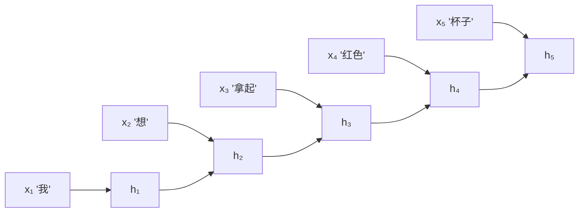
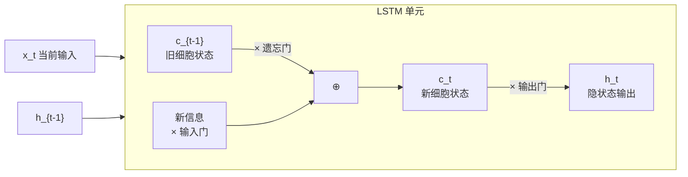
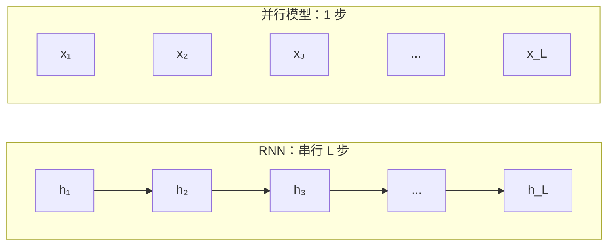
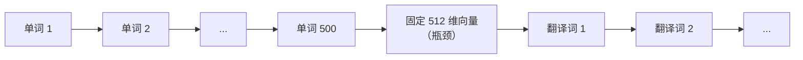
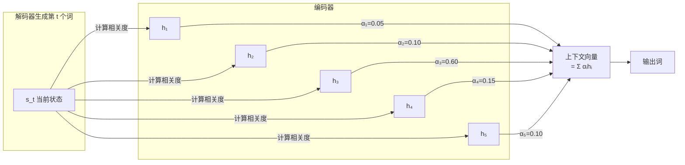
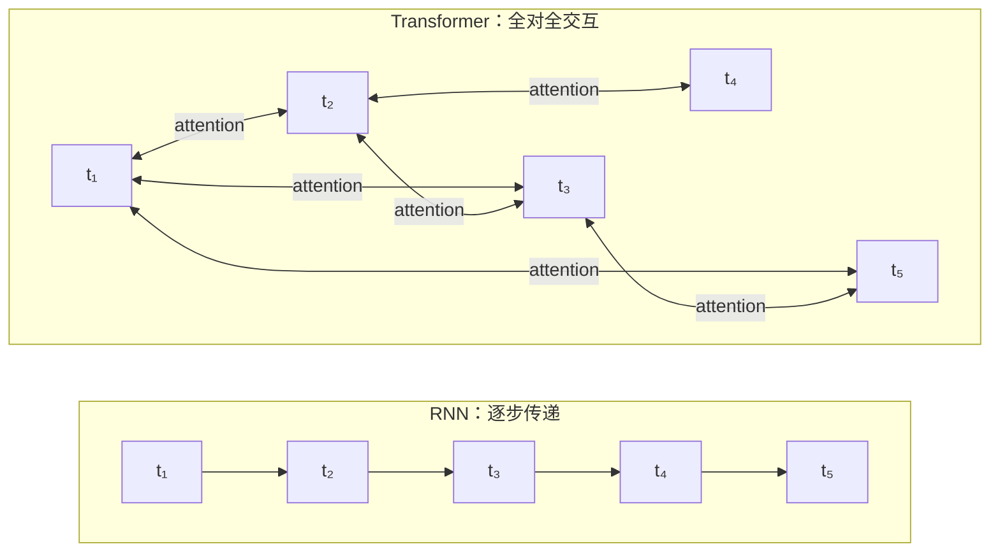

# 第 1 章：为什么需要 Attention——从 RNN 瓶颈到 Transformer 的赌注

> **本章目标**：理解 Transformer 不是凭空出现的。它是为了绕开 RNN 在序列建模中的三个结构性缺陷而提出的。本章讲清楚这三个缺陷是什么、Seq2Seq + Attention 怎样做了第一次修补、以及"Attention Is All You Need"为什么敢完全扔掉递归。

**上一章**：无（系列起点）
**下一章**：[第 2 章：Self-Attention 从零手算](./02_SelfAttention从零手算) — 用具体数字走一遍 Q、K、V 的完整计算。

---

**知识链接**：

- [序列建模架构全景综述：从 RNN 到 Transformer 到 Mamba 与 RWKV](/论文综述/S27_序列建模架构全景综述) — RNN、LSTM、Transformer、SSM、Mamba 的完整对比，本章只讲 RNN→Transformer 这一段
- [交叉熵损失与 Softmax](/前置知识/003f_前置知识_交叉熵损失与Softmax) — Softmax 函数的定义和性质

---

## 1. 序列无处不在，但处理序列很难

先明确"序列"这个词在这里的含义：**一组有先后顺序的数据，后面的内容可能依赖前面的内容。**

| 领域 | 序列长什么样 | 依赖关系举例 |
|------|------------|-------------|
| 自然语言 | "我想拿起那个红色的杯子" | "那个"指代前面提到过的物体 |
| 机器翻译 | 中文句子 → 英文句子 | 英文词序取决于中文句子的结构 |
| 语音识别 | 音频帧序列 → 文字序列 | 一个音节的含义取决于上下文 |
| 机器人控制 | 观测序列 → 动作序列 | 当前动作取决于过去看到了什么 |
| 时间序列 | 股价、传感器读数 | 未来的值取决于过去的走势 |

处理序列的核心困难是：**模型必须在某一时刻"记住"之前的信息，才能做出正确的当前判断。** "记住"的方式，直接决定了模型的能力上限和计算代价。

---

## 2. RNN 的方案：把历史压缩进一个向量

循环神经网络（Recurrent Neural Network，RNN）的思路非常直觉：每读入一个新 token，就把它和之前的"记忆"混在一起，生成一个新的记忆向量，然后继续往前走。



> 读者重点看这张图的箭头方向：每个隐状态 $h_t$ 只接收前一个隐状态 $h_{t-1}$ 和当前输入 $x_t$。信息只能沿着这条单行道从左往右流。

用一行伪代码概括 RNN 的全部逻辑：

```
h_t = f(W_h · h_{t-1} + W_x · x_t + b)
```

其中 $h_t$ 是时刻 $t$ 的隐状态向量（"记忆"），$x_t$ 是当前输入，$f$ 是激活函数（如 tanh），$W_h$ 和 $W_x$ 是权重矩阵。整个历史信息被压缩进一个固定维度（通常 256～1024 维）的向量 $h_t$ 里。

这个方案简洁，但有三个结构性缺陷。

---

## 3. 缺陷一：梯度消失——长距离依赖学不动

### 问题是什么

考虑一个简单的翻译任务：

> "The cat, which was sitting on the mat in the corner of the room that had been recently renovated, **was** sleeping."

动词"was"的单复数取决于主语"cat"，但两者之间隔了 20 多个词。RNN 在训练时需要把"cat 决定了 was 的形式"这个信号从"was"所在的时刻反向传播回"cat"所在的时刻。

反向传播时，梯度要经过每一个时间步的 $W_h$ 矩阵相乘。假设梯度在每一步都乘以一个小于 1 的因子（这在 tanh 激活下几乎不可避免），经过 20 步之后：

$0.9^{20} \approx 0.12$ — 信号衰减到原来的 12%。

$0.7^{20} \approx 0.0008$ — 信号几乎消失。

这就是梯度消失（vanishing gradient）：**距离越远的依赖关系，梯度信号越弱，模型越难学会它。**

### LSTM 的修补

长短期记忆网络（Long Short-Term Memory，LSTM）用"门控"机制做了一次修补：在 RNN 的隐状态之外，额外维护一条"细胞状态" $c_t$，信息在这条通路上可以几乎无损地流过很多步（因为细胞状态的更新是加法而不是乘法）。三个门（遗忘门、输入门、输出门）控制信息的写入、保持和读取。



> LSTM 的关键改进：细胞状态 $c_t$ 通过加法更新（而非纯乘法），梯度沿这条通路不容易消失。但这只是缓解，不是根治——当序列超过几百步时，遗忘门的累积效应仍然会逐渐丢失早期信息。

LSTM 把实际可用的依赖距离从 RNN 的几十步提升到了几百步，但原理上的瓶颈没有消除：**信息仍然必须逐步传递，距离越远，保留越困难。**

---

## 4. 缺陷二：无法并行——训练速度被序列长度锁死

RNN 的计算有一个硬约束：**$h_t$ 依赖 $h_{t-1}$，$h_{t-1}$ 依赖 $h_{t-2}$，以此类推。** 这意味着一个长度为 $L$ 的序列，必须严格按顺序计算 $L$ 步，无法利用 GPU 的并行能力。

对比一下全连接网络或卷积网络：输入数据的各个部分可以同时计算，GPU 的数千个核心可以同时工作。而 RNN 的 $L$ 步计算是串行的——即使 GPU 有 10000 个核心，一个长度 1000 的序列仍然需要 1000 个串行步骤。



> RNN 处理一个长度为 L 的序列需要 L 个串行步骤；能并行处理所有位置的模型只需要常数步。在 GPU 上，这意味着 RNN 的训练速度被序列长度线性拖慢。

这个问题在训练大规模数据时尤其致命。2017 年前后，NLP 领域开始使用越来越大的数据集（数十亿 token），而 RNN 的串行瓶颈使得训练速度无法跟上数据规模的增长。

---

## 5. 缺陷三：固定维度瓶颈——历史信息被强制压缩

回到 RNN 的核心等式 $h_t = f(W_h \cdot h_{t-1} + W_x \cdot x_t)$。无论序列有多长，所有历史信息都被压缩进同一个固定维度的向量 $h_t$。

用一个具体场景来说明这有多不合理：

> 一个翻译模型在读完一整篇 500 词的英文段落后，要把所有信息塞进一个 512 维的向量里，然后仅凭这个向量生成完整的中文翻译。

这就像让一个翻译员读完一整页英文后，只能在一张便利贴上记笔记，然后把英文原稿收走，让他只看便利贴来翻译。便利贴的大小是固定的（512 维），不管原文是 10 个词还是 500 个词。



> 这就是 Seq2Seq 模型的"信息瓶颈"：500 个词的全部信息被压缩到一个 512 维向量里，解码器只能从这个向量里恢复所需的一切。

这个瓶颈在实验中的表现非常明显：当源语言句子超过 20-30 个词时，翻译质量急剧下降。

---

## 6. 第一次修补：给 Seq2Seq 加 Attention

2014-2015 年，Bahdanau 等人提出了一个直觉上很自然的修补方案：**既然一个固定向量装不下所有信息，那就别只看最后一个隐状态——让解码器在生成每个词的时候，回头去看编码器的所有隐状态，按需取用。**

### 具体做法

编码器照常运行，但不再只保留最后一个隐状态 $h_L$，而是保留所有时刻的隐状态序列 $[h_1, h_2, \ldots, h_L]$。

解码器在生成第 $t$ 个输出时：

1. 用当前解码状态 $s_t$ 和每个编码隐状态 $h_i$ 计算一个"相关程度"分数
2. 把分数用 [Softmax](/前置知识/003f_前置知识_交叉熵损失与Softmax) 归一化，得到注意力权重
3. 用权重对所有编码隐状态做加权平均，得到"上下文向量"
4. 用上下文向量辅助生成当前输出



> 注意力权重 $\alpha_i$ 表示"生成当前词时，源语言的第 $i$ 个词有多重要"。$\alpha_3 = 0.60$ 意味着当前翻译主要依赖源语言第 3 个词的信息。权重随着每一步解码动态变化——翻译不同的词会"看"不同的位置。

### 这个修补解决了什么

- **信息瓶颈被打破**：解码器不再只看一个固定向量，而是可以直接访问编码器的每个位置。长句翻译质量显著提升。
- **对齐关系自动学会**：注意力权重可视化后，经常能看到源语言和目标语言之间清晰的词对齐关系。

### 这个修补没有解决什么

- **编码器本身仍然是 RNN**：梯度消失和串行计算的问题仍然存在。Attention 只是让解码器能更好地读取编码器的输出，但编码器生成隐状态的过程没有改变。
- **Attention 只用在编码器和解码器之间**：同一个序列内部的 token 之间仍然只能通过 RNN 的逐步传递来交换信息。

---

## 7. 激进的一步："只用 Attention 够不够"

2017 年，Vaswani 等人在论文"Attention Is All You Need"中提出了一个激进的假设：

> **完全扔掉 RNN，让序列中的每个 token 直接和所有其他 token 计算注意力。**

这个想法的核心观察是：Seq2Seq + Attention 中，最有用的部分恰恰是 Attention 本身，而不是 RNN。RNN 的逐步传递是一个不得不要的中间步骤，但它带来的串行计算和梯度消失问题完全是负资产。

如果让每个 token 直接和所有 token 交互——不通过 RNN 的逐步传递——那么：

| RNN 的缺陷 | "只用 Attention"是否解决 |
|-----------|----------------------|
| 梯度消失：信号要穿过 L 步 | 解决：任意两个 token 之间只隔一步 attention 计算，梯度直接传过去 |
| 无法并行：$h_t$ 依赖 $h_{t-1}$ | 解决：所有 token 对之间的 attention 可以同时算（矩阵乘法） |
| 固定维度瓶颈 | 解决：不存在"压缩到一个向量"的步骤，每个 token 保留自己的表示 |



> 左边 RNN：信息从 t₁ 传到 t₅ 必须经过 4 个中间步骤。右边 Transformer：t₁ 和 t₅ 直接交互，不需要中间传递。

### 代价是什么

天下没有免费的午餐。"每个 token 和所有 token 交互"意味着：

- **计算量**：$L$ 个 token 中每一对都要算一次 attention，总计 $L^2$ 次，计算复杂度是 $O(L^2)$。RNN 只需要 $O(L)$。
- **显存**：要存储 $L \times L$ 的 attention 矩阵。序列长度 4096 时，attention 矩阵有 1600 万个元素。

这个代价在 2017 年被认为是可以接受的，因为：

1. $O(L^2)$ 的计算全部是矩阵乘法，GPU 极其擅长并行执行矩阵乘法
2. 当时主流的序列长度（几百到几千 token）下，$L^2$ 的开销低于 RNN 串行 $L$ 步的实际耗时
3. Transformer 可以通过堆叠层数来增加模型容量，每一层的计算都是可并行的

但当序列长度增长到几万甚至几十万 token 时，$L^2$ 的代价变得不可忽视——这催生了后续的 Flash Attention、稀疏注意力、以及 Mamba 等线性复杂度架构（详见[序列建模架构全景综述](/论文综述/S27_序列建模架构全景综述)）。本系列[第 8 章](./08_推理加速)和[第 9 章](./09_现代架构演进)会详细讨论这些改进。

---

## 8. Transformer 赌对了什么

回头看，"Attention Is All You Need"的成功不只是因为 Attention 机制本身好用。它赌对了三件事：

**第一，GPU 并行化比序列信息传递更重要。**

2017 年之后，GPU 算力以每两年翻倍的速度增长。一个完全由矩阵乘法构成的模型（Transformer），比一个依赖串行计算的模型（RNN），从硬件进步中获益更多。RNN 的训练速度受序列长度限制，而 Transformer 的训练速度主要受 GPU 核心数限制——后者一直在快速增长。

**第二，直接连接比逐步传递更有效。**

在 RNN 中，两个相距 100 步的 token 之间的信息传递路径长度是 100。在 Transformer 中，任意两个 token 之间的路径长度是 1（一步 attention）。更短的路径意味着更强的梯度信号和更快的学习。

**第三，规模效应（scaling）会放大架构优势。**

后来的 GPT-2/3/4、LLaMA 等模型证明，Transformer 的性能随着参数量、数据量和计算量的增加而持续提升，没有明显的天花板。RNN 由于串行瓶颈，很难利用同等规模的计算资源。

---

## 9. 从"Attention 机制"到"Transformer 架构"

"只用 Attention"说起来简单，但要真的替代 RNN，光有 Attention 还不够。Transformer 论文实际上定义了一套完整的架构：

| 组件 | 解决什么问题 | 本系列哪一章讲 |
|------|-----------|--------------|
| Self-Attention | 让每个 token 直接读取其他 token 的信息 | [第 2 章](./02_SelfAttention从零手算) |
| Multi-Head Attention | 让模型同时关注多种类型的关系 | [第 3 章](./03_MultiHead_Attention多个子空间同时看) |
| 位置编码 | 补回被 Attention 丢掉的顺序信息 | [第 6 章](./06_位置编码) |
| 前馈网络 FFN | 给每个 token 独立的非线性变换能力 | [第 4 章](./04_TransformerBlock全拆解) |
| 残差连接 + LayerNorm | 让模型可以堆到很深 | [第 4 章](./04_TransformerBlock全拆解) |
| Encoder-Decoder 结构 | 处理输入序列到输出序列的映射 | [第 5 章](./05_Encoder_Decoder与三种架构范式) |

下一章从最核心的 Self-Attention 开始：给你 3 个 token、3 个向量，手算出 Q、K、V，算出注意力权重，算出最终输出——把"Attention 到底在做什么"这件事从直觉变成可验证的计算。

---

## 10. 本章小结

| 方案 | 信息传递方式 | 长距离依赖 | 训练并行性 | 信息容量 |
|------|-----------|----------|----------|---------|
| RNN | 逐步传递 $h_t = f(h_{t-1}, x_t)$ | 梯度消失，几十步 | 完全串行 | 固定维度瓶颈 |
| LSTM | 逐步传递 + 门控细胞状态 | 缓解，几百步 | 完全串行 | 固定维度瓶颈 |
| Seq2Seq + Attention | 编码 RNN + 解码时回看 | 解码侧改善 | 编码仍串行 | 打破解码瓶颈 |
| Transformer | 全对全直接交互 | 一步到达，无衰减 | 完全并行 | 每个 token 独立表示 |

Transformer 用 $O(L^2)$ 的计算代价，换来了并行化、长程依赖和信息容量三个维度上的全面改进。在 GPU 算力快速增长的时代，这个交易值得。

---

**下一章**：[第 2 章：Self-Attention 从零手算](./02_SelfAttention从零手算) — 用 3 个 token 的完整数值例子，把 Self-Attention 从"直觉"变成"可以验证的计算"。
