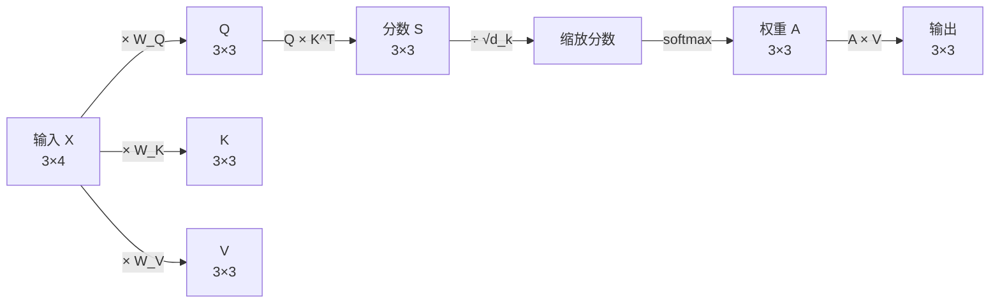
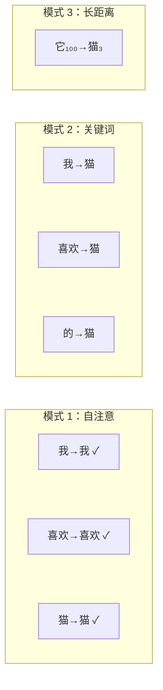

# 第 2 章：Self-Attention 从零手算——Q、K、V 的几何直觉

> **本章目标**：用一个 3 个 token 的数值例子，完整走一遍 Self-Attention 的每一步计算。读完后，读者应该能在纸上手算出注意力权重和输出向量，并且理解"Query 查询、Key 被查、Value 被取"的检索直觉。

**上一章**：[第 1 章：为什么需要 Attention](./01_为什么需要Attention) — RNN 的三大缺陷和 Transformer 的诞生动机。
**下一章**：[第 3 章：Multi-Head Attention](./03_MultiHead_Attention多个子空间同时看) — 为什么一个 attention 不够，需要多个 head 同时看。

---

**知识链接**：

- [交叉熵损失与 Softmax](/前置知识/003f_前置知识_交叉熵损失与Softmax) — Softmax 函数的定义
- [Cross-Attention 与交替注意力机制](/前置知识/001e_前置知识_Cross_Attention与交替注意力机制) — Self-Attention 与 Cross-Attention 的区别

---

## 1. 用数据库检索理解 Attention

在进入数学之前，先建立一个直觉。Self-Attention 做的事情，可以类比为一次数据库查询：

> 你走进图书馆，手里拿着一个**问题**（Query）。书架上每本书的**书脊标题**（Key）告诉你这本书大致讲什么。你把问题和每个标题做对比，找出最相关的几本书，然后翻开它们的**正文内容**（Value）来回答你的问题。

在 Self-Attention 中：

| 类比 | 对应的张量 | 来源 |
|------|----------|------|
| 你手里的问题 | Query（Q） | 当前 token 的向量经过线性变换 |
| 每本书的标题 | Key（K） | 每个 token 的向量经过另一个线性变换 |
| 每本书的正文 | Value（V） | 每个 token 的向量经过第三个线性变换 |

关键点：**Q、K、V 三个向量都是从同一组输入 token 变换出来的**（所以叫 "Self" Attention——自己和自己算注意力）。每个 token 既是"提问者"（产生 Q），也是"被查询的书"（产生 K 和 V）。

---

## 2. 完整的计算流程

Self-Attention 的计算分五步。下面用一个最小的例子来走完全程。

### 2.1 设定：3 个 token，每个 4 维

假设输入序列有 3 个 token，每个 token 已经被嵌入为一个 4 维向量：

| token | 嵌入向量 $x$ |
|-------|-------------|
| "我" | $[1, 0, 1, 0]$ |
| "喜欢" | $[0, 1, 0, 1]$ |
| "猫" | $[1, 1, 0, 0]$ |

把它们排成矩阵 $X$（每行是一个 token）：

$$
X = \begin{bmatrix} 1 & 0 & 1 & 0 \\ 0 & 1 & 0 & 1 \\ 1 & 1 & 0 & 0 \end{bmatrix}
$$

**这个公式在做什么**：把 3 个 token 的嵌入向量排成一个 $3 \times 4$ 的矩阵，方便后续用矩阵乘法一次性处理所有 token。

::: details 📐 公式详解（点击展开）

| 子表达式 | 它是谁 | 它在干嘛 |
|---------|--------|---------|
| 每一行 $x_i$ | 一个 token 的"身份证" | 用 4 个数字描述这个 token 在嵌入空间中的位置 |
| 矩阵 $X$ | 整个序列的"花名册" | 把所有 token 的身份信息排成表格，这样一次矩阵乘法就能同时处理所有 token |

**用人话读**："把 3 个 token 各自的 4 维向量竖着摞在一起，形成一张表。"

**为什么是矩阵形式**：GPU 的核心能力是并行做矩阵乘法。把 token 排成矩阵，后面的 Q、K、V 投影和注意力计算都可以用一次矩阵乘完成，不需要逐 token 循环。
:::

### 2.2 第一步：线性投影，生成 Q、K、V

用三个不同的权重矩阵 $W_Q$、$W_K$、$W_V$（大小都是 $4 \times 3$，把 4 维输入投影到 3 维）把输入变换成 Q、K、V：

$$
Q = X W_Q, \quad K = X W_K, \quad V = X W_V
$$

**这个公式在做什么**：同一组 token，经过三个不同的"镜头"看，分别产生用于"提问"（Q）、"被查"（K）和"被取"（V）的向量。

::: details 📐 公式详解（点击展开）

| 子表达式 | 它是谁 | 它在干嘛 |
|---------|--------|---------|
| $W_Q$ | "提问镜头" | 决定每个 token 在"提问"时关注自身的哪些特征 |
| $W_K$ | "标签镜头" | 决定每个 token 作为"被查对象"时暴露哪些特征 |
| $W_V$ | "内容镜头" | 决定每个 token 被选中后实际贡献哪些信息 |

**用人话读**："每个 token 的原始向量，分别通过三个不同的线性变换，变成三种不同用途的向量。"

**为什么要三个不同的矩阵**：如果 Q 和 K 用同一个变换，那"我想问什么"和"我能被问什么"就被绑死了——一个 token 没法在需要不同信息的时候灵活调整提问方式。三个独立的矩阵让模型有更大的自由度来学习什么该问、什么该答。
:::

用具体数字来算。假设权重矩阵 $W_Q, W_K, W_V$ 各是一个 $4 \times 3$ 的矩阵（具体数值见下方计算）。

计算 $Q = XW_Q$：

$$
Q = \begin{bmatrix} 1 & 0 & 1 & 0 \\ 0 & 1 & 0 & 1 \\ 1 & 1 & 0 & 0 \end{bmatrix} \begin{bmatrix} 1 & 0 & 1 \\ 0 & 1 & 0 \\ 1 & 0 & 0 \\ 0 & 1 & 1 \end{bmatrix} = \begin{bmatrix} 2 & 0 & 1 \\ 0 & 2 & 1 \\ 1 & 1 & 1 \end{bmatrix}
$$

**这个公式在做什么**：把 3 个 token 各自的 4 维嵌入映射到 3 维的 Query 空间。第一行 $[2, 0, 1]$ 就是"我"这个 token 的提问向量。

::: details 📐 公式详解（点击展开）

| 子表达式 | 它是谁 | 它在干嘛 |
|---------|--------|---------|
| $Q$ 的第 $i$ 行 | 第 $i$ 个 token 的"提问向量" | 编码了"我要查找什么样的信息" |
| $X$ 的第 $i$ 行与 $W_Q$ 的矩阵乘 | 一次线性投影 | 把 token 原始特征的某种组合提取出来作为查询 |

**用人话读**："每个 token 通过 $W_Q$ 这面镜子，从自己的 4 个特征中提炼出 3 个数字，作为自己的提问向量。"

**为什么维度从 4 变成 3**：这里纯粹是为了让手算简单。实际中 Q 的维度等于 $d_k$（head 维度），通常是 64 或 128。
:::

同理算出 K 和 V：$K = XW_K = \begin{bmatrix} 0 & 1 & 2 \\ 2 & 1 & 0 \\ 1 & 1 & 1 \end{bmatrix}$，$V = XW_V = \begin{bmatrix} 1 & 2 & 1 \\ 1 & 0 & 1 \\ 1 & 1 & 1 \end{bmatrix}$。现在每个 token 都有了自己的 Q、K、V 三个 3 维向量。

### 2.3 第二步：计算注意力分数

"我"在决定该关注谁时，用自己的 Query 向量去和每个 token 的 Key 向量做**点积**。点积衡量两个向量的"方向一致性"——方向越接近，点积越大，说明越相关。

注意力分数矩阵 $S = QK^T$：

$$
S = QK^T = \begin{bmatrix} 2 & 0 & 1 \\ 0 & 2 & 1 \\ 1 & 1 & 1 \end{bmatrix} \begin{bmatrix} 0 & 2 & 1 \\ 1 & 1 & 1 \\ 2 & 0 & 1 \end{bmatrix} = \begin{bmatrix} 2 & 4 & 3 \\ 4 & 2 & 3 \\ 3 & 3 & 3 \end{bmatrix}
$$

**这个公式在做什么**：计算每个 token 的"提问"和每个 token 的"标签"之间的匹配程度。$S_{ij}$ 表示第 $i$ 个 token 对第 $j$ 个 token 的关注程度（未归一化）。

::: details 📐 公式详解（点击展开）

| 子表达式 | 它是谁 | 它在干嘛 |
|---------|--------|---------|
| $Q$ 的第 $i$ 行 | 第 $i$ 个 token 的提问向量 | "我在找什么样的信息？" |
| $K^T$ 的第 $j$ 列 | 第 $j$ 个 token 的标签向量 | "我能提供什么样的信息？" |
| $S_{ij} = Q_i \cdot K_j$ | 匹配分数 | 点积越大，方向越一致，说明 $j$ 和 $i$ 的需求越匹配 |

**用人话读**："让每个 token 的提问和所有 token 的标签逐一比对，算出一张'谁对谁感兴趣'的分数表。"

**为什么用点积**：点积 = 两个向量长度之积 × cos(夹角)。方向一致则大，正交则零，相反则负。它是衡量"两个向量是否在说同一件事"最自然的度量。
:::

矩阵 $S$ 的含义：$S_{00} = 2$ 表示"我"对自己的关注度是 2；$S_{01} = 4$ 表示"我"对"喜欢"的关注度是 4（最高）。

### 2.4 第三步：缩放 + Softmax

直接对原始分数做 Softmax 有个问题：当 Q、K 的维度 $d_k$ 较大时，点积的数值也会很大，Softmax 会被推向极端（接近 one-hot），梯度几乎为零。

解决方法：先除以 $\sqrt{d_k}$，再做 Softmax。

$$
\text{Attention}(Q, K, V) = \text{softmax}\!\left(\frac{QK^T}{\sqrt{d_k}}\right) V
$$

**这个公式在做什么**：这就是 Scaled Dot-Product Attention 的完整公式——"查匹配分数、缩放、归一化、加权取值"四步合一。

::: details 📐 公式详解（点击展开）

| 子表达式 | 它是谁 | 它在干嘛 |
|---------|--------|---------|
| $QK^T$ | 原始匹配分数 | 每个 token 对每个 token 的"感兴趣程度"（未归一化） |
| $\frac{1}{\sqrt{d_k}}$ | 温度控制旋钮 | 防止分数过大导致 softmax 饱和 |
| $\text{softmax}(\cdot)$ | 归一化 | 把分数转成概率分布，所有权重加起来等于 1 |
| $\cdot V$ | 加权取值 | 按权重混合所有 token 的 Value，得到最终输出 |

**用人话读**："算出匹配分数后先缩小（防止数值过大），转成概率，再按概率加权混合所有 token 的内容，得到每个 token 的新表示。"

**为什么除以 $\sqrt{d_k}$ 而不是 $d_k$**：假设 Q 和 K 的每个分量独立、均值 0、方差 1，点积的期望是 0，方差是 $d_k$。除以 $\sqrt{d_k}$ 让方差恢复为 1，保持 Softmax 在敏感区间内工作。
:::

本例中 $d_k = 3$，$\sqrt{d_k} \approx 1.73$。缩放后的分数 $S / \sqrt{3} \approx \begin{bmatrix} 1.15 & 2.31 & 1.73 \\ 2.31 & 1.15 & 1.73 \\ 1.73 & 1.73 & 1.73 \end{bmatrix}$。

对每一行做 Softmax（每行加起来等于 1），得到注意力权重矩阵 $A \approx \begin{bmatrix} 0.18 & 0.57 & 0.32 \\ 0.57 & 0.18 & 0.32 \\ 0.33 & 0.33 & 0.33 \end{bmatrix}$。

读第一行：**"我"把 57% 的注意力放在"喜欢"上，32% 放在"猫"上，18% 放在自己身上。**

### 2.5 第四步：加权求和，得到输出

用注意力权重对 Value 矩阵做加权平均：

$$
\text{Output} = A \cdot V = \begin{bmatrix} 0.18 & 0.57 & 0.32 \\ 0.57 & 0.18 & 0.32 \\ 0.33 & 0.33 & 0.33 \end{bmatrix} \begin{bmatrix} 1 & 2 & 1 \\ 1 & 0 & 1 \\ 1 & 1 & 1 \end{bmatrix} = \begin{bmatrix} 1.07 & 0.68 & 1.07 \\ 1.07 & 1.46 & 1.07 \\ 1.00 & 1.00 & 1.00 \end{bmatrix}
$$

**这个公式在做什么**：每个 token 的输出是所有 token 的 Value 向量按注意力权重的加权平均。"我"的新表示主要由"喜欢"的 Value 贡献（因为权重 0.57 最大）。

::: details 📐 公式详解（点击展开）

| 子表达式 | 它是谁 | 它在干嘛 |
|---------|--------|---------|
| $A$ 的第 $i$ 行 | 第 $i$ 个 token 的注意力分配 | "我该从每个 token 那里拿多少信息" |
| $V$ 的第 $j$ 行 | 第 $j$ 个 token 的内容向量 | "我被选中后能提供什么" |
| Output 的第 $i$ 行 | 第 $i$ 个 token 的新表示 | 融合了所有相关 token 信息后的"升级版"向量 |

**用人话读**："每个 token 把自己感兴趣的那些 token 的内容按比例混合起来，得到一个融合了上下文信息的新向量。"

**为什么是加权平均**：加权平均是最简单的"按重要程度混合多个来源"的方式。权重由 Q-K 匹配度决定，内容由 V 提供——分工明确。
:::

---

## 3. 完整流程总览

> 完整的 Scaled Dot-Product Attention：输入经过三条平行的线性投影变成 Q/K/V，Q 和 K 算匹配分数并缩放归一化，再用权重加权 V 得到输出。全程都是矩阵乘法，GPU 可以完全并行。

---

## 4. 为什么除以 $\sqrt{d_k}$：一个数值实验

这个缩放看起来是个小细节，但直接影响训练能否收敛。

假设 $d_k = 64$（实际常用值），Q 和 K 的每个分量服从标准正态分布 $N(0, 1)$。点积 $Q_i \cdot K_j = \sum_{m=1}^{64} q_m k_m$，是 64 个独立随机变量的和，方差为 64，标准差为 8。

这意味着未缩放的分数 $S_{ij}$ 的典型值在 $[-16, +16]$ 范围内。把 $[-16, +16]$ 的值丢进 Softmax：

| 输入 | Softmax 输出 |
|------|-------------|
| $[16, 0, -16]$ | $[0.9999998, 0.0000002, 0]$ |
| $[2, 0, -2]$ | $[0.84, 0.11, 0.05]$ |

第一行几乎是 one-hot——Softmax 完全饱和，梯度接近 0，训练停滞。

除以 $\sqrt{64} = 8$ 后，分数回到 $[-2, +2]$，Softmax 输出如第二行，梯度正常流动。

---

## 5. Attention 矩阵在看什么

注意力权重矩阵 $A$ 是一张 $L \times L$ 的"谁在看谁"的热力图。每一行是一个 token 的注意力分布，行内所有值加起来等于 1。

在实际训练好的模型中，Attention 矩阵会呈现出有意义的模式：

| 模式 | 含义 | 例子 |
|------|------|------|
| 对角线高亮 | 每个 token 关注自己 | 当 token 需要保留自身信息时 |
| 某一列高亮 | 所有 token 都在看同一个位置 | 句首的 [CLS] token 或关键动词 |
| 带状结构 | 每个 token 关注附近的 token | 局部语法关系 |
| 远程连接 | 某个 token 关注远处的特定 token | 代词指代、长距离依赖 |

> 不同的 attention 模式对应不同的语言现象。单个 attention head 通常只学到一种模式——这就是为什么需要 Multi-Head Attention，下一章会详细讲。

---

## 6. Self-Attention vs Cross-Attention

本章讲的是 **Self-Attention**："自己和自己算注意力"，Q、K、V 全部来自同一个序列。

还有一种 **Cross-Attention**：Q 来自一个序列（如解码器），K 和 V 来自另一个序列（如编码器）。这就是[第 1 章](./01_为什么需要Attention)中 Seq2Seq + Attention 里的那个"回头看编码器"的机制。详细的对比参见 [Cross-Attention 与交替注意力机制](/前置知识/001e_前置知识_Cross_Attention与交替注意力机制)，本系列[第 5 章](./05_Encoder_Decoder与三种架构范式)会在 Encoder-Decoder 架构中再次详细讲解。

| | Self-Attention | Cross-Attention |
|---|---|---|
| Q 来自 | 当前序列 | 序列 A（如解码器） |
| K, V 来自 | 当前序列 | 序列 B（如编码器） |
| 用途 | 序列内部的 token 互相交换信息 | 两个序列之间传递信息 |

---

## 7. 本章小结

Self-Attention 的全部计算可以用四句话概括：

1. **投影**：每个 token 通过三个线性变换，产生 Query（我想问什么）、Key（我的标签是什么）、Value（我的内容是什么）。
2. **匹配**：每个 Query 和所有 Key 做点积，得到匹配分数。
3. **归一化**：分数除以 $\sqrt{d_k}$ 防止 Softmax 饱和，然后用 Softmax 转成概率权重。
4. **聚合**：用权重对所有 Value 做加权平均，得到融合了上下文信息的新表示。

全程都是矩阵乘法——这意味着 GPU 可以一步并行处理所有 token 的所有 attention 计算，这正是 Transformer 能彻底替代 RNN 串行计算的根本原因。

---

**下一章**：[第 3 章：Multi-Head Attention](./03_MultiHead_Attention多个子空间同时看) — 一个 attention head 只能学到一种关注模式。Multi-Head 让模型同时捕捉多种不同类型的关系。
