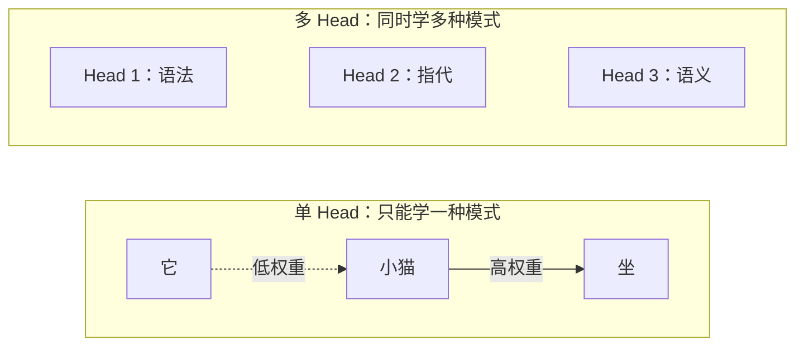
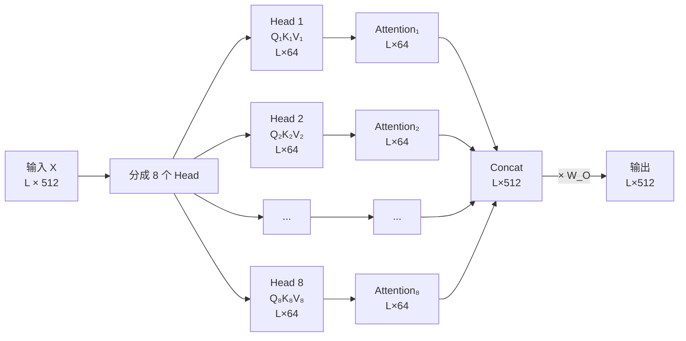
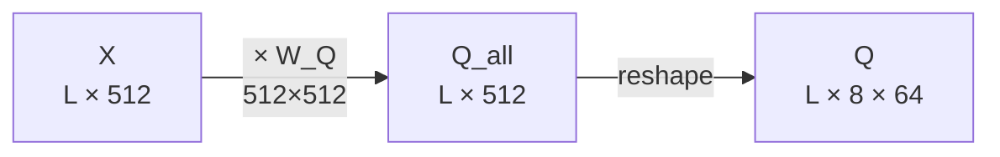

# 第 3 章：Multi-Head Attention——多个子空间同时看

> **本章目标**：理解为什么一个 attention head 不够用，Multi-Head Attention 如何让模型同时捕捉多种不同类型的关系，以及投影矩阵、head 并行和 concat 的具体机制。

**上一章**：[第 2 章：Self-Attention 从零手算](./02_SelfAttention从零手算) — Q、K、V 的完整计算和缩放点积 attention 的数值例子。
**下一章**：[第 4 章：Transformer Block 全拆解](./04_TransformerBlock全拆解) — 把 Attention 和其他部件组装成一个完整的 Transformer Block。

---

**知识链接**：

- [Cross-Attention 与交替注意力机制](/前置知识/001e_前置知识_Cross_Attention与交替注意力机制) — Cross-Attention 也使用 Multi-Head 机制
- [FFN 前馈网络与 Transformer 的两阶段设计](/前置知识/005m_前置知识_FFN前馈网络与Transformer的两阶段设计) — Attention 负责"看谁"，FFN 负责"怎么想"

---

## 1. 一个 Head 的局限

上一章的 Self-Attention 用一组 $W_Q, W_K, W_V$ 把每个 token 投影到同一个子空间中，然后在这个子空间里计算匹配度。问题在于：**语言中的关系不止一种。**

看这个句子：

> "**小猫**坐在**垫子**上，**它**正在睡觉。"

理解这个句子需要同时捕捉至少三种不同的关系：

| 关系类型 | 具体例子 | 需要关注什么 |
|---------|---------|------------|
| 语法结构 | "小猫"是"坐"的主语 | 相邻的主谓关系 |
| 指代关系 | "它"指代"小猫" | 远距离的代词回指 |
| 语义关联 | "垫子"和"坐"的搭配 | 词义层面的合理性 |

一组 Q/K/V 投影把所有 token 映射到同一个 3 维（或 64 维）子空间中。在这个子空间中，"语法距离近"和"指代关系"是两种完全不同的相似性——很难用同一个空间中的点积同时捕捉。

> 单个 head 被迫在多种关系之间做取舍。Multi-Head 让不同的 head 在不同的子空间中各自专注一种关系。

---

## 2. Multi-Head 的具体机制

Multi-Head Attention（MHA）的做法非常直接：**把 $d_{model}$ 维的向量拆成 $h$ 份，每份独立做一次完整的 Scaled Dot-Product Attention，最后把结果拼起来。**

### 2.1 完整计算流程

假设模型维度 $d_{model} = 512$，head 数 $h = 8$，那么每个 head 的维度 $d_k = d_v = d_{model} / h = 64$。

> 完整流程：输入分到 8 个 head，每个 head 独立做 attention，结果拼起来再通过一个输出投影 $W_O$ 混合。

每个 head $i$ 有自己独立的投影矩阵，$\text{head}_i = \text{Attention}(XW_Q^i, XW_K^i, XW_V^i)$，最终输出为：

$$
\text{MultiHead}(X) = \text{Concat}(\text{head}_1, \ldots, \text{head}_h) \cdot W_O
$$

**这个公式在做什么**：每个 head 用自己的 $W_Q^i, W_K^i, W_V^i$ 在一个 64 维子空间中独立计算 attention；$h$ 个 head 的输出拼成 512 维；最后通过 $W_O$ 做一次混合，让不同 head 学到的信息可以交互。

::: details 📐 公式详解（点击展开）

| 子表达式 | 它是谁 | 它在干嘛 |
|---------|--------|---------|
| $W_Q^i \in \mathbb{R}^{512 \times 64}$ | 第 $i$ 个 head 的"提问镜头" | 把 512 维输入投影到第 $i$ 个 64 维子空间 |
| $\text{head}_i \in \mathbb{R}^{L \times 64}$ | 第 $i$ 个 head 的 attention 输出 | 在自己的子空间中独立计算得到的上下文表示 |
| $\text{Concat}(\cdot)$ | 拼接 | 把 8 个 64 维结果首尾相连，恢复成 512 维 |
| $W_O \in \mathbb{R}^{512 \times 512}$ | 输出投影 | 混合不同 head 的信息，让它们可以交互 |

**用人话读**："8 个小组各自看同一段文字，每组关注不同的关系，然后把各组的发现汇总在一起，再通过一个混合层整合。"

**为什么需要 $W_O$**：Concat 只是机械拼接，$W_O$ 让不同 head 发现的特征可以互相组合——比如 head 1 发现了"主语是猫"，head 2 发现了"代词'它'出现了"，$W_O$ 可以把两者组合成"'它'指代'猫'"。
:::

### 2.2 投影矩阵：拆分 vs 大矩阵

实际实现中，不会真的分别定义 8 个小的 $W_Q^i$。而是定义一个大的 $W_Q \in \mathbb{R}^{512 \times 512}$，一次矩阵乘法算出所有 head 的 Q，再把结果的 512 维沿最后一维 reshape 成 $(8, 64)$。

> 一次大矩阵乘法等价于 8 次小矩阵乘法，但 GPU 执行大矩阵乘法的效率更高。

---

## 3. 不同 Head 学到了什么

在训练好的 Transformer 中，不同 head 确实会自发地学到不同类型的注意力模式。研究者通过可视化注意力权重发现了这些规律：

| Head 类型 | 注意力模式 | 学到的关系 |
|----------|----------|----------|
| 位置 head | 主要关注相邻的几个 token | 局部语法、词组边界 |
| 语法 head | 关注句法上相关的 token（不一定相邻） | 主谓一致、修饰关系 |
| 指代 head | 关注被指代的名词 | 代词消解 |
| 分隔符 head | 主要关注标点和特殊 token | 句子边界、段落结构 |
| 稀疏 head | 只关注 1-2 个 token | 关键词提取 |

这种分工不是人为设计的——没有人告诉 head 1 应该学语法、head 2 应该学指代。**分工完全来自训练中的梯度信号**：如果某个 head 恰好在某种子空间中捕捉到了某种有用的模式，它的梯度就会把这个 head 的投影矩阵推向更好地捕捉这种模式的方向，形成隐式的专业化。

---

## 4. 参数量计算

理解参数量有助于判断模型大小和计算成本。

对于一个 Multi-Head Attention 层，$d_{model} = 512$，$h = 8$，$d_k = d_v = 64$：

| 参数矩阵 | 形状 | 参数量 |
|---------|------|-------|
| $W_Q$ | $512 \times 512$ | 262,144 |
| $W_K$ | $512 \times 512$ | 262,144 |
| $W_V$ | $512 \times 512$ | 262,144 |
| $W_O$ | $512 \times 512$ | 262,144 |
| **总计** | | **1,048,576 ≈ 1M** |

一个关键观察：**增加 head 数量不会增加参数量。** 从 8 个 head 变成 16 个 head，每个 head 的 $d_k$ 从 64 变成 32，但总的 $W_Q$ 矩阵大小不变（仍然是 $512 \times 512$）。head 数量改变的是**注意力的细粒度**——更多 head 意味着更多独立的注意力模式，但每个模式的子空间更小。

---

## 5. Head 数量的权衡

| head 数 | head 维度（$d_{model}=512$） | 优势 | 劣势 |
|--------|--------------------------|------|------|
| 1 | 512 | 每个 head 有完整的表示能力 | 只能学一种注意力模式 |
| 4 | 128 | 多模式 + 较大的子空间 | — |
| 8 | 64 | 原版 Transformer 的选择 | — |
| 16 | 32 | 更多模式 | 每个 head 的子空间较小 |
| 64 | 8 | 极细粒度 | 子空间太小，表达能力受限 |

原版 Transformer 论文实验了 $h = 1, 4, 8, 16, 32$，发现 $h = 8$ 在翻译任务上效果最好。但这不是一个通用的最优值——不同任务、不同模型大小的最优 head 数可能不同。

现代大型模型（Llama 70B、GPT-4 等级别）通常使用 $d_{model} = 8192$，$h = 64$，$d_k = 128$。这些模型还引入了 GQA（Grouped-Query Attention），让多个 Query head 共享同一组 Key/Value head 来节省显存——这个改进在本系列[第 9 章](./09_现代架构演进)详细讲解。

---

## 6. 为什么不给每个 Head 用完整的 $d_{model}$ 维

一个自然的问题：为什么不让每个 head 都在完整的 512 维空间中计算 attention？这样每个 head 的表达能力更强。

答案是**计算成本**。如果 8 个 head 各自用 $512 \times 512$ 的投影矩阵，参数量翻 8 倍，计算量也翻 8 倍。把 512 维拆成 $8 \times 64$ 的方案，让 Multi-Head 的总参数量和计算量与单 head 的 512 维 attention 完全相同，但获得了 8 种不同的注意力模式。

这是一个经典的"宽度 vs 数量"权衡：一个 512 维的 head vs 八个 64 维的 head，总参数量相同。实验证明后者更好——多样性比单个 head 的容量更有价值。

---

## 7. 本章小结

| 问题 | 答案 |
|------|------|
| 为什么需要多个 head | 一个 head 只能在一个子空间中学一种注意力模式，而语言需要同时捕捉多种关系 |
| 多个 head 怎么分工 | 每个 head 有自己的 $W_Q^i, W_K^i, W_V^i$，在独立的子空间中计算 attention |
| 结果怎么合并 | Concat 拼接后通过 $W_O$ 混合 |
| 参数量会增加吗 | 不会——把 $d_{model}$ 拆成 $h \times d_k$，总参数量不变 |
| 分工是人为指定的吗 | 不是——完全由训练中的梯度信号自发形成 |

现在有了 Multi-Head Attention，但它只是 Transformer Block 的一个部件。下一章把 Attention 和 Embedding、位置编码、FFN、残差连接、LayerNorm 组装成一个完整的 Block，看清从输入到输出的全部信息流。

---

**下一章**：[第 4 章：Transformer Block 全拆解](./04_TransformerBlock全拆解) — Attention 只负责"看谁"，FFN 负责"怎么想"，残差连接负责"别忘了自己"——把所有部件组装成完整的一层。
