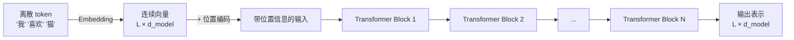
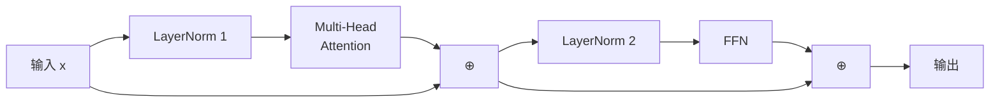

# 第 4 章：Transformer Block 全拆解——从输入到输出的信息流

> **本章目标**：把 Attention 和其他部件组装成一个完整的 Transformer Block。读完后，读者应该能画出一个 Block 从输入 token 到输出向量的完整数据流图，并说出每个部件的作用。

**上一章**：[第 3 章：Multi-Head Attention](./03_MultiHead_Attention多个子空间同时看) — 多个 head 在不同子空间中捕捉不同关系。
**下一章**：[第 5 章：Encoder、Decoder 与三种架构范式](./05_Encoder_Decoder与三种架构范式) — 用 Block 搭出三种不同功能的模型。

---

**知识链接**：

- [FFN 前馈网络与 Transformer 的两阶段设计](/前置知识/005m_前置知识_FFN前馈网络与Transformer的两阶段设计) — FFN 的完整讲解
- [AdaLayerNorm 条件化归一化](/前置知识/001f_前置知识_AdaLayerNorm条件化归一化) — LayerNorm 的条件化变体，在 DiT 中使用
- [激活函数全景综述](/论文综述/S26_激活函数全景综述) — ReLU、GELU、SwiGLU 的对比
- [权重初始化方法全景综述](/论文综述/S28_权重初始化方法全景综述) — 残差连接与初始化的关系

---

## 1. 五个部件，一个 Block

一个 Transformer Block（也叫 Transformer Layer）由五种部件组成。它们的分工如下：

| 部件 | 作用 | 类比 |
|------|------|------|
| Token Embedding | 把离散 token 变成连续向量 | 给每个词发一张身份证（向量） |
| 位置编码 | 补回被 Attention 丢掉的顺序信息 | 在身份证上标注"你是第几个" |
| Multi-Head Attention | 让 token 之间互相交换信息 | 开一场会，每个人从其他人那里收集需要的信息 |
| 前馈网络 FFN | 给每个 token 独立做非线性变换 | 会开完了，每个人独自思考、整理笔记 |
| 残差连接 + LayerNorm | 稳定训练，防止信息丢失 | 整理笔记时别忘了自己原来的想法 |

Embedding 和位置编码只在第一层之前做一次。之后的每一层都是重复的"Attention + FFN"结构（带残差和 LayerNorm）。



> 整个 Transformer 就是 Embedding + 位置编码 + N 个相同结构的 Block 堆叠。N 在原版论文中是 6，在现代 LLM 中可以到 80 甚至更多。

---

## 2. Token Embedding：从离散到连续

模型的输入是一串 token ID（整数），比如 `[2451, 893, 15627]` 对应 `["我", "喜欢", "猫"]`。Embedding 层是一个 $V \times d_{model}$ 的查找表（$V$ 是词表大小），每个 token ID 对应一行，取出来就是该 token 的 $d_{model}$ 维向量。

| 操作 | 数学表达 | 张量形状变化 |
|------|---------|------------|
| 输入 token ID | 整数序列 | $(L,)$ |
| Embedding 查表 | $E[\text{token\_id}]$ | $(L,) \to (L, d_{model})$ |

Embedding 权重是可训练参数——训练过程中，语义相近的词的向量会逐渐靠近。

---

## 3. 位置编码：为什么需要，怎么加上去

Self-Attention 的计算（上一章的 $QK^T$）只涉及 token 之间的点积——这些点积与 token 在序列中的位置无关。如果把"我喜欢猫"的 token 顺序打乱成"猫喜欢我"，Attention 输出不会变（因为点积不关心谁在前谁在后）。

但语言是有语序的——"我喜欢猫"和"猫喜欢我"意思不同。所以必须把位置信息注入模型。

最简单的方式：在 Embedding 输出上**加**一个位置编码向量。

$$
\text{input}_i = \text{Embedding}(x_i) + \text{PE}(i)
$$

**这个公式在做什么**：把 token 的"语义身份"（Embedding）和"位置身份"（PE）合并到同一个向量中。

::: details 📐 公式详解（点击展开）

| 子表达式 | 它是谁 | 它在干嘛 |
|---------|--------|---------|
| $\text{Embedding}(x_i)$ | 第 $i$ 个 token 的语义向量 | "我是什么词" |
| $\text{PE}(i)$ | 第 $i$ 个位置的编码向量 | "我在序列中的位置" |
| 加法 | 信息融合 | 让同一个向量同时携带"是什么"和"在哪里"两种信息 |

**用人话读**："每个 token 的输入 = 它是什么词 + 它在第几个位置。"

**为什么用加法而不是拼接**：拼接会把维度翻倍。加法保持维度不变，而且实验表明加法的效果和拼接一样好——两种信息可以在同一个向量空间中共存。
:::

位置编码有多种设计方案（正弦、可学习、RoPE 等），详见本系列[第 6 章](./06_位置编码)。

---

## 4. 一个 Block 的内部结构

Embedding 和位置编码完成后，数据进入第一个 Transformer Block。每个 Block 的内部结构是：



> 这是 Pre-Norm 结构（现代 LLM 的主流选择）。⊕ 表示残差连接（直接相加）。注意两条"跳过"的箭头——它们就是残差连接，保证原始信息不会被 Attention 或 FFN 完全覆盖。

用伪代码写出来：

```python
# Pre-Norm Transformer Block
h = x + MultiHeadAttention(LayerNorm(x))   # 第一个子层
h = h + FFN(LayerNorm(h))                   # 第二个子层
```

---

## 5. 残差连接：为什么 Transformer 能堆到很深

残差连接（Residual Connection）的做法极其简单：把子层的输入直接加到子层的输出上。

$$
\text{output} = x + \text{SubLayer}(x)
$$

**这个公式在做什么**：子层只需要学习"输入和输出之间的差值"（残差），而不是从零开始学习完整的输出。

::: details 📐 公式详解（点击展开）

| 子表达式 | 它是谁 | 它在干嘛 |
|---------|--------|---------|
| $x$ | 跳过通路 | 原封不动地传递输入，"别忘了自己原来是什么" |
| $\text{SubLayer}(x)$ | 变换通路 | Attention 或 FFN 的输出，"在原来基础上应该做什么修正" |
| 加法 | 残差融合 | 新表示 = 原始信息 + 修正量 |

**用人话读**："子层不需要重新造一个完整的表示，只需要算出'应该在原来基础上加什么修正'就行。"

**为什么残差连接让网络能堆深**：没有残差时，信息经过每一层都要穿过矩阵乘法和非线性函数，梯度容易消失或爆炸。有了残差，梯度可以沿着跳过通路直接传回，即使子层的梯度很小，总梯度也不会消失——因为跳过通路的梯度恒为 1。
:::

直觉理解：假设一个 Transformer 有 24 层。没有残差连接时，第 1 层的信息要经过 24 次变换才能到达输出层——每次变换都可能丢失或扭曲信息。有了残差连接，第 1 层的原始信息可以通过跳过通路直达输出层，中间每一层只是在上面叠加修正。

---

## 6. LayerNorm：稳定每一层的数值范围

层归一化（Layer Normalization，LN）对每个 token 的向量独立做归一化：把向量的每个维度减去均值、除以标准差，再用可学习的缩放因子 $\gamma$ 和偏移 $\beta$ 调整。

$$
\text{LN}(x) = \gamma \cdot \frac{x - \mu}{\sigma + \epsilon} + \beta
$$

**这个公式在做什么**：把每个 token 的向量标准化到均值 0、方差 1 附近，然后用可学习参数重新缩放——防止数值在层间累积变得过大或过小。

::: details 📐 公式详解（点击展开）

| 子表达式 | 它是谁 | 它在干嘛 |
|---------|--------|---------|
| $\mu, \sigma$ | 该 token 向量的均值和标准差 | 衡量当前数值分布的中心和宽度 |
| $(x - \mu) / (\sigma + \epsilon)$ | 标准化 | 把数值拉回标准范围，$\epsilon$ 防止除零 |
| $\gamma, \beta$ | 可学习的缩放和偏移 | 让模型自己决定标准化后的最优范围 |

**用人话读**："先把每个 token 的向量调成标准分布，再让模型自己学一个合适的缩放——确保数值既不爆炸也不消失。"

**为什么不用 BatchNorm**：BatchNorm 是对一个 batch 内所有样本的同一维度做归一化，在 NLP 中 batch 内不同句子长度不同、内容差异大，统计量不稳定。LayerNorm 对单个 token 独立归一化，不受 batch 影响。
:::

### Pre-Norm vs Post-Norm

原版 Transformer 论文用的是 Post-Norm：先做子层运算，再做 LayerNorm——$\text{LN}(x + \text{SubLayer}(x))$。

现代 LLM（GPT-2 之后）几乎全部改用 Pre-Norm：先做 LayerNorm，再做子层运算——$x + \text{SubLayer}(\text{LN}(x))$。

| | Post-Norm | Pre-Norm |
|---|---|---|
| LayerNorm 位置 | 子层之后 | 子层之前 |
| 训练稳定性 | 需要精细的 warmup | 更稳定 |
| 最终性能 | 调好了略优 | 调参更宽容 |
| 实际使用 | 原版论文、BERT | GPT-2/3/4、Llama、Qwen |

Pre-Norm 更稳定的原因：残差通路上的信号不经过 LayerNorm，梯度可以无损通过；子层的输入经过 LN 后数值范围可控，不容易产生极端值。

---

## 7. FFN：每个 Token 的独立思考

Attention 让 token 之间交换了信息，但 Attention 本身是线性操作（矩阵乘法 + softmax 加权平均）。非线性变换的能力由 FFN（前馈网络，Feed-Forward Network）提供。

FFN 对每个 token **独立**地做一次"升维 → 非线性 → 降维"的变换：

$$
\text{FFN}(x) = W_2 \cdot \text{act}(W_1 x + b_1) + b_2
$$

**这个公式在做什么**：先把 $d_{model}$ 维向量升到 $d_{ff}$（通常是 $4 \times d_{model}$）维，过一个激活函数，再降回 $d_{model}$ 维。

::: details 📐 公式详解（点击展开）

| 子表达式 | 它是谁 | 它在干嘛 |
|---------|--------|---------|
| $W_1 \in \mathbb{R}^{d_{model} \times d_{ff}}$ | 升维投影 | 把 512 维映射到 2048 维，展开特征空间 |
| $\text{act}(\cdot)$ | 激活函数（ReLU / GELU / SwiGLU） | 引入非线性，让网络能学习复杂的特征变换 |
| $W_2 \in \mathbb{R}^{d_{ff} \times d_{model}}$ | 降维投影 | 把 2048 维压回 512 维，恢复原始维度 |

**用人话读**："每个 token 独自把向量展开到更大的空间中做一次非线性变换，再压回原来的大小——像是'打开思路想了想，再把结论压缩回一句话'。"

**为什么要升维**：高维空间中，线性不可分的特征可以变得线性可分。升维给激活函数更大的空间来做非线性筛选——过一个 ReLU 就相当于"把一半的维度关掉，只保留有用的特征"。
:::

关于 FFN 的完整讲解，参见 [FFN 前馈网络与 Transformer 的两阶段设计](/前置知识/005m_前置知识_FFN前馈网络与Transformer的两阶段设计)。

### Attention vs FFN 的分工

一种理解方式：

- **Attention = 通信**：token 之间交换信息，"你那边有什么我需要的？"
- **FFN = 计算**：每个 token 独立处理收到的信息，"基于我收集到的信息，我的结论是什么？"

这种"先通信再计算"的两阶段设计是 Transformer 的核心模式，每一层都重复一次。

---

## 8. 多层堆叠：逐层精炼

一个 Transformer 模型通常堆叠 $N$ 个相同结构的 Block。随着层数加深，表示逐渐从低级特征变为高级特征：

| 层级 | 学到的特征类型 | 类比 |
|------|-------------|------|
| 浅层（1-4 层） | 词义、局部语法、词组边界 | 认识每个词和近邻关系 |
| 中层（5-16 层） | 句法结构、指代关系、语义角色 | 理解句子的结构和含义 |
| 深层（17-24+ 层） | 抽象推理、任务特定的决策 | 形成最终判断 |

---

## 9. 完整的参数量统计

一个 Transformer Block 的参数量（以 $d_{model} = 512$，$d_{ff} = 2048$ 为例）：

| 组件 | 参数量 | 占比 |
|------|-------|------|
| Multi-Head Attention（$W_Q, W_K, W_V, W_O$） | $4 \times 512^2 \approx$ 1.05M | 33% |
| FFN（$W_1, W_2$） | $2 \times 512 \times 2048 \approx$ 2.10M | 67% |
| LayerNorm（两个，各 $2 \times 512$） | 2K | <1% |
| **单层总计** | **约 3.15M** | 100% |

一个观察：**FFN 的参数量是 Attention 的两倍。** 在现代 LLM 中（$d_{ff} = 8/3 \times d_{model}$ 配 SwiGLU），FFN 的参数量更是占到单层的 2/3 以上。Transformer 的"大部分参数"实际上在 FFN 里，不在 Attention 里。

---

## 10. 本章小结

一个 Transformer Block 从输入到输出的完整信息流：

1. **Embedding**（仅第一层前）：离散 token → 连续向量
2. **位置编码**（仅第一层前）：加上位置信息
3. **LayerNorm → Multi-Head Attention → 残差连接**：token 之间交换信息
4. **LayerNorm → FFN → 残差连接**：每个 token 独立做非线性变换
5. 重复 3-4 共 $N$ 次

每个部件的设计都有明确的理由：Attention 负责通信，FFN 负责计算，残差连接保证信息不丢失，LayerNorm 稳定数值范围。它们的组合产生了一种简单但强大的模式——"通信 + 计算"交替执行，逐层精炼。

---

**下一章**：[第 5 章：Encoder、Decoder 与三种架构范式](./05_Encoder_Decoder与三种架构范式) — 用 Block 搭出三种不同功能的模型：BERT 式的编码器、GPT 式的解码器、T5 式的编码器-解码器。
