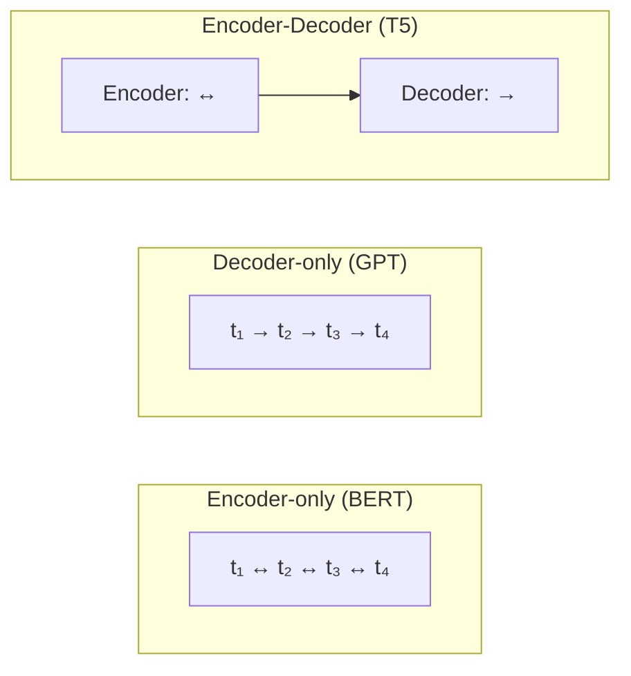
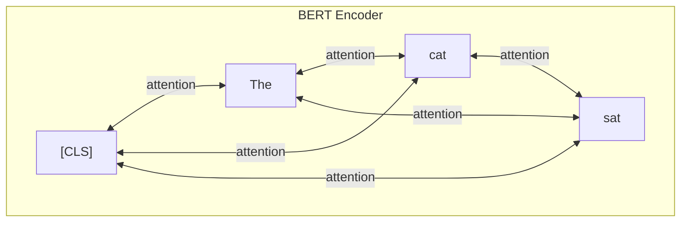
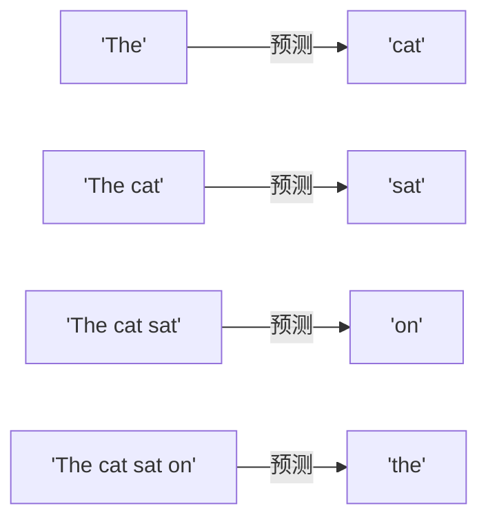
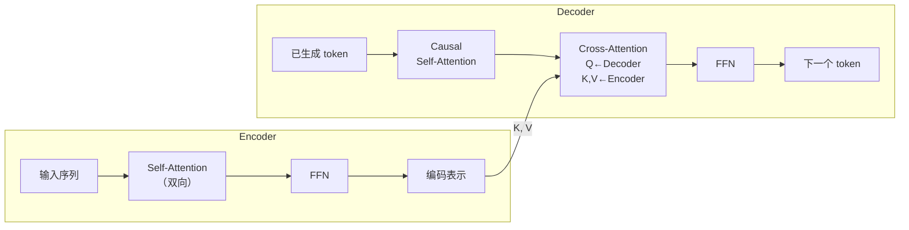
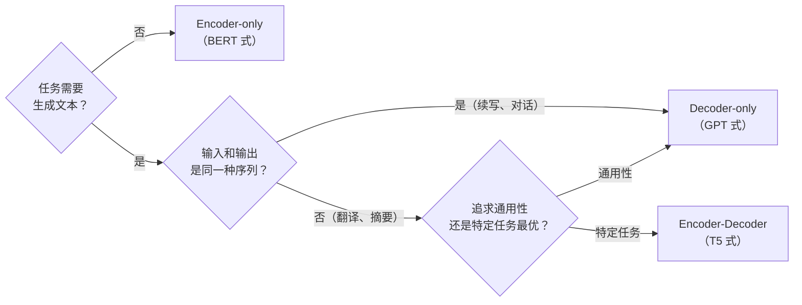

# 第 5 章：Encoder、Decoder 与三种架构范式

> **本章目标**：同样的 Transformer Block 可以搭出三种功能完全不同的模型。读完后，读者应该能说出 Encoder-only、Decoder-only 和 Encoder-Decoder 各自适合什么任务，以及 Cross-Attention 和 Causal Mask 分别在哪里起作用。

**上一章**：[第 4 章：Transformer Block 全拆解](./04_TransformerBlock全拆解) — 单个 Block 的内部结构和信息流。
**下一章**：[第 6 章：位置编码](./06_位置编码) — 正弦编码、RoPE、ALiBi 等方案的设计和取舍。

---

**知识链接**：

- [Causal Attention 因果注意力掩码](/前置知识/001g_前置知识_Causal_Attention因果注意力掩码) — Decoder 中 Causal Mask 的完整讲解
- [Cross-Attention 与交替注意力机制](/前置知识/001e_前置知识_Cross_Attention与交替注意力机制) — Encoder-Decoder 结构中 Cross-Attention 的机制
- [动作 Token 化与自回归策略](/前置知识/000l_前置知识_动作Token化与自回归策略) — Decoder-only 在机器人动作预测中的应用

---

## 1. 同一种积木，三种搭法

Transformer Block 是一块标准积木。但用这块积木搭模型时，有三种截然不同的搭法，对应三种不同的任务需求：

| 架构 | 代表模型 | 核心特点 | 适合的任务 |
|------|---------|---------|----------|
| Encoder-only | BERT | 每个 token 看到全部上下文 | 理解、分类、匹配 |
| Decoder-only | GPT | 每个 token 只看到前面的 token | 生成、补全、对话 |
| Encoder-Decoder | T5、原版 Transformer | 先理解输入，再生成输出 | 翻译、摘要、问答 |

> 三种架构的核心区别在于**信息流的方向**：Encoder 是双向的（每个 token 看全部），Decoder 是单向的（只看前面），Encoder-Decoder 是先双向理解再单向生成。

---

## 2. Encoder-only：BERT 式双向理解

### 结构

Encoder-only 就是直接堆叠 N 个标准 Transformer Block，不加任何 mask。每个 token 在 Self-Attention 中可以看到序列中的**所有**其他 token——包括前面和后面的。

> 每个 token 和所有 token 双向交互。"sat"可以同时看到前面的"cat"和后面可能出现的信息。

### 训练方式

BERT 用的训练任务是**掩码语言模型（Masked Language Model，MLM）**：随机把 15% 的 token 替换为 `[MASK]`，让模型预测被遮住的词。

> 输入："The [MASK] sat on the mat"
> 目标：预测 [MASK] = "cat"

要预测"cat"，模型需要同时看到左边的"The"和右边的"sat on the mat"——这就是为什么 BERT 需要双向 attention。

### 适合什么任务

- **文本分类**：用 [CLS] token 的输出向量接一个分类头
- **命名实体识别**：每个 token 的输出向量预测自己的标签
- **句子匹配**：把两个句子拼在一起输入，用 [CLS] 输出判断关系
- **问答抽取**：在段落中标记答案的起止位置

### 不适合什么任务

**文本生成。** BERT 在训练时每个 token 都能看到未来——这让它在推理时无法逐词生成（因为生成第 3 个词时，后面的词还不存在，但 BERT 的 attention 结构假设它们存在）。

---

## 3. Decoder-only：GPT 式自回归生成

### 结构

Decoder-only 也是堆叠 N 个 Transformer Block，但在 Self-Attention 中加上了 **Causal Mask（因果掩码）**：第 $t$ 个 token 只能 attend 到第 $1, 2, \ldots, t$ 个 token，看不到后面的任何 token。

Causal Mask 是一个下三角矩阵，把注意力分数矩阵中未来位置的值设为 $-\infty$，Softmax 后这些位置的权重就变成 0：

$$
\text{Mask} = \begin{bmatrix} 0 & -\infty & -\infty & -\infty \\ 0 & 0 & -\infty & -\infty \\ 0 & 0 & 0 & -\infty \\ 0 & 0 & 0 & 0 \end{bmatrix}
$$

**这个公式在做什么**：0 表示"允许看"，$-\infty$ 表示"禁止看"。加到注意力分数上后，被禁止的位置在 Softmax 后权重变成 0。

::: details 📐 公式详解（点击展开）

| 子表达式 | 它是谁 | 它在干嘛 |
|---------|--------|---------|
| 下三角的 0 | 允许区域 | 当前 token 可以看到自己和前面所有 token |
| 上三角的 $-\infty$ | 禁止区域 | 当前 token 看不到后面的 token |
| $\text{softmax}(S + \text{Mask})$ | 被约束的注意力 | $-\infty$ 经过 Softmax 变成 0，等于"不存在" |

**用人话读**："第 3 个 token 只能看到第 1、2、3 个 token，第 4 个 token 不存在于它的视野中。"

**为什么用 $-\infty$ 而不是直接删除**：矩阵运算需要形状固定。用 $-\infty$ mask 可以保持矩阵形状不变，同时通过 Softmax 的数学性质精确地把被遮位置的权重压到 0。
:::

关于 Causal Mask 的详细讲解，参见 [Causal Attention 因果注意力掩码](/前置知识/001g_前置知识_Causal_Attention因果注意力掩码)。

### 训练方式

GPT 用的训练任务是**下一个 token 预测（Next Token Prediction）**：给定前 $t$ 个 token，预测第 $t+1$ 个 token。

> 输入："The cat sat on the"
> 目标：每个位置预测下一个词——"cat", "sat", "on", "the", "mat"

Causal Mask 确保了在预测第 $t+1$ 个 token 时，模型只用了前 $t$ 个 token 的信息——和推理时的情况完全一致。

### 推理过程

Decoder-only 的推理是**自回归**的：每次生成一个 token，把它追加到序列末尾，再用整个序列预测下一个 token。

> 每生成一个 token，就把它接到输入后面，重新跑一遍模型来预测下一个。这个过程可以用 KV Cache 加速——详见[第 8 章](./08_推理加速)。

### 为什么 Decoder-only 成了主流

2020 年之后，Decoder-only 架构（GPT-2/3/4、Llama、Qwen、Claude）成为大语言模型的主流选择。原因：

1. **训练效率**：一次前向传播可以同时训练序列中所有位置的预测（通过 Causal Mask 实现），每个 token 都是一个训练样本。
2. **统一性**：理解和生成用同一个模型完成——只要把问题格式化为"给定前文 → 预测后文"，分类、翻译、问答等任务都可以变成生成任务。
3. **规模效应**：实验表明 Decoder-only 的 scaling law 最好——模型越大、数据越多、训练越久，性能持续提升。

---

## 4. Encoder-Decoder：先理解再生成

### 结构

Encoder-Decoder 是原版"Attention Is All You Need"论文的结构。它由两部分组成：

- **Encoder**：N 个标准 Transformer Block（双向 Self-Attention），处理输入序列
- **Decoder**：N 个修改过的 Block，每个 Block 有三个子层：
  1. Causal Self-Attention（只看已生成的 token）
  2. **Cross-Attention**（Query 来自 Decoder，Key/Value 来自 Encoder）
  3. FFN

> Cross-Attention 是 Encoder-Decoder 架构的关键：Decoder 用自己的状态作为 Query，去 Encoder 的输出中查找需要的信息。这就是[第 1 章](./01_为什么需要Attention)中 Seq2Seq + Attention 的思路，只不过底层从 RNN 换成了 Transformer。

### Cross-Attention 的具体工作方式

在 Cross-Attention 中：

- **Q** 来自 Decoder 当前层的输出（经过 Causal Self-Attention 之后）
- **K 和 V** 来自 Encoder 最顶层的输出

这意味着 Decoder 在生成每个词时，可以动态地"查阅"输入序列的不同位置——翻译"cat"时重点看源语言中对应的词，翻译"sat"时注意力转移到动词对应的位置。

详细的 Cross-Attention 机制参见 [Cross-Attention 与交替注意力机制](/前置知识/001e_前置知识_Cross_Attention与交替注意力机制)。

### 适合什么任务

- **机器翻译**：输入一种语言，输出另一种语言
- **文本摘要**：输入长文，输出摘要
- **语音识别**：输入音频特征序列，输出文字序列

共同特点：**输入和输出是两个不同的序列**，输出的每个 token 需要参考输入的信息。

---

## 5. 三种架构的对比总结

| 维度 | Encoder-only | Decoder-only | Encoder-Decoder |
|------|-------------|-------------|-----------------|
| 代表模型 | BERT, RoBERTa | GPT-2/3/4, Llama, Qwen | T5, BART, 原版 Transformer |
| Attention 方向 | 双向 | 单向（causal） | Encoder 双向 + Decoder 单向 + Cross |
| 训练任务 | MLM（完形填空） | 下一 token 预测 | Seq2Seq（输入→输出） |
| 生成能力 | 不适合 | 强 | 强 |
| 理解能力 | 强 | 通过 in-context learning 实现 | 强 |
| 当前主流用途 | Embedding、检索 | 通用 LLM、对话、代码 | 翻译、语音 |
| 在机器人领域 | 视觉特征提取（ViT） | VLA 策略输出 | ACT（编码器-解码器结构） |

### 机器人领域的三种架构

在本项目覆盖的机器人策略模型中，三种架构都有应用：

- **Encoder-only**：[ViT](/前置知识/003g_前置知识_Vision_Transformer图像分块与位置编码) 用 Encoder 提取图像特征
- **Decoder-only**：RT-2、OpenVLA 用大语言模型式的 Decoder-only 结构，把动作作为 token 自回归生成（参见[动作 Token 化与自回归策略](/前置知识/000l_前置知识_动作Token化与自回归策略)）
- **Encoder-Decoder**：ACT 用 Encoder 编码观测，Decoder 用动作查询 token 解码出一段动作序列

本系列[第 10 章](./10_视觉与机器人策略)会详细讲解这些应用。

---

## 6. 架构选型的决策逻辑

> 现代趋势：Decoder-only 由于规模效应好、训练简单、一个架构覆盖多种任务，正在成为"默认选择"。Encoder-Decoder 在特定 Seq2Seq 任务（翻译、语音）上仍有优势。Encoder-only 主要用于 embedding 和检索场景。

---

## 7. 本章小结

三种架构的核心区别在于 **attention 的可见范围**：

- **Encoder-only**：全部可见 → 最强的上下文理解
- **Decoder-only**：只看过去 → 最适合自回归生成
- **Encoder-Decoder**：分两步走 → 先理解输入（双向），再生成输出（单向 + 查询输入）

Causal Mask 和 Cross-Attention 是把标准 Transformer Block 变成 Decoder 和 Encoder-Decoder 的两个关键修改。理解了这两个机制，就理解了三种架构之间的全部差异。

---

**下一章**：[第 6 章：位置编码](./06_位置编码) — Self-Attention 丢失了顺序信息，位置编码补回来。正弦编码、可学习编码、RoPE、ALiBi 各自怎么做，哪个更好。
