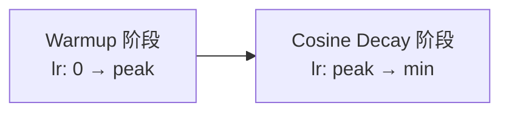

# 第 7 章：训练 Transformer 的工程实践

> **本章目标**：架构设计完毕后，从输入预处理（Tokenizer）到优化器（AdamW）、学习率调度（Warmup + Cosine Decay）、混合精度训练、常见训练问题排查，覆盖把 Transformer 训起来需要的全部工程知识。

**上一章**：[第 6 章：位置编码](./06_位置编码) — 正弦编码、RoPE、ALiBi 的方案与取舍。
**下一章**：[第 8 章：推理加速](./08_推理加速) — 训练好的模型怎么快速推理：KV Cache、Flash Attention、量化。

---

**知识链接**：

- [交叉熵损失与 Softmax](/前置知识/003f_前置知识_交叉熵损失与Softmax) — 分类损失函数的详细讲解
- [激活函数全景综述](/论文综述/S26_激活函数全景综述) — GELU、SwiGLU 等激活函数
- [权重初始化方法全景综述](/论文综述/S28_权重初始化方法全景综述) — Xavier/Kaiming/Fixup 初始化
- [数据并行与 AllReduce 基础](/前置知识/001h_前置知识_数据并行与AllReduce基础) — 分布式训练基础
- [FSDP 全分片数据并行](/前置知识/001i_前置知识_FSDP全分片数据并行) — 大模型分布式训练

---

## 1. 输入预处理：Tokenizer

模型不能直接吃文字——必须先把文字切成 token，每个 token 对应一个整数 ID。

### BPE：字节对编码

BPE（Byte Pair Encoding，字节对编码）是当前最主流的分词算法。它的核心思路：

1. 从字符级别开始（每个字符是一个 token）
2. 统计语料中所有相邻 token 对出现的频率
3. 把出现最频繁的一对合并成一个新 token
4. 重复步骤 2-3，直到词表达到目标大小

| 阶段 | 词表内容 | "unhappiness" 的分词 |
|------|---------|---------------------|
| 字符级 | a, b, c, ..., z | u, n, h, a, p, p, i, n, e, s, s |
| 合并 "ss" | ..., ss | u, n, h, a, p, p, i, n, e, ss |
| 合并 "pp" | ..., pp | u, n, h, a, pp, i, n, e, ss |
| 合并 "un" | ..., un | un, h, a, pp, i, n, e, ss |
| 合并 "ness" | ..., ness | un, h, a, pp, i, ness |
| 合并 "happi" | ..., happi | un, happi, ness |
| ... | ... | unhappiness（如果词频够高） |

BPE 的优势：

- **开放词表**：任何新词都可以分成已有 subword 的组合，不存在 OOV（Out of Vocabulary）问题
- **可控大小**：词表大小由合并次数决定，通常 32K～128K
- **语素对齐**：高频的词素（如 "un-"、"-ness"、"-ing"）会自动成为独立 token

GPT-2/3/4 使用 BPE，Llama 使用 SentencePiece（类似 BPE 但直接在字节级别操作）。

---

## 2. 损失函数：交叉熵与 Label Smoothing

### 标准交叉熵

对于 Decoder-only 模型（下一 token 预测任务），损失函数是**交叉熵**：

$$
\mathcal{L} = -\frac{1}{T}\sum_{t=1}^{T} \log p_\theta(x_{t+1} \mid x_1, \ldots, x_t)
$$

**这个公式在做什么**：对序列中每个位置，计算模型预测正确 token 的对数概率，取负均值——预测越准，loss 越低。

::: details 📐 公式详解（点击展开）

| 子表达式 | 它是谁 | 它在干嘛 |
|---------|--------|---------|
| $p_\theta(x_{t+1} \mid x_1, \ldots, x_t)$ | 模型的预测概率 | 给定前 $t$ 个 token，模型认为下一个是 $x_{t+1}$ 的概率 |
| $\log p$ | 对数概率 | 概率接近 1 时 log 接近 0，概率接近 0 时 log 趋向 $-\infty$ |
| $-\frac{1}{T}\sum$ | 平均负对数概率 | 对整个序列取平均，让 loss 不随序列长度变化 |

**用人话读**："模型对每个位置的正确答案打了多高的概率？对数加起来取负——猜得越准，loss 越小。"

**训练中怎么近似**：直接用 mini-batch 内所有 token 的交叉熵取平均。一个 batch size=32、序列长度 2048 的 batch 中有约 65,000 个训练样本。
:::

交叉熵的详细讲解参见 [交叉熵损失与 Softmax](/前置知识/003f_前置知识_交叉熵损失与Softmax)。

### Label Smoothing

Label Smoothing 是一个简单但有效的正则化技巧：不用 one-hot 标签（正确类 = 1，其余 = 0），而是把正确类的概率从 1 降到 $1 - \epsilon$（通常 $\epsilon = 0.1$），其余 $\epsilon$ 均匀分给所有其他类。

效果：防止模型对自己的预测过度自信（Softmax 输出趋向极端），提高泛化能力。

---

## 3. 优化器：从 SGD 到 AdamW

### 为什么不用 SGD

SGD（Stochastic Gradient Descent，随机梯度下降）对所有参数用同一个学习率。但 Transformer 中不同参数的梯度量级差异很大——Embedding 层的梯度通常比深层 Attention 大得多。SGD 的固定学习率很难同时照顾所有参数。

### Adam 做了什么

Adam（Adaptive Moment Estimation，自适应矩估计）为每个参数维护两个统计量：

- **一阶矩** $m$：梯度的指数移动平均（方向）
- **二阶矩** $v$：梯度平方的指数移动平均（大小）

更新时用 $m / \sqrt{v}$ 来调整步长——梯度一直很大的参数步子小，梯度一直很小的参数步子大。

### AdamW：修正的权重衰减

原始 Adam 的权重衰减实现有问题（和自适应学习率耦合了）。AdamW 把权重衰减从梯度更新中分离出来，直接在参数上乘一个衰减因子。

| 优化器 | 自适应学习率 | 权重衰减 | Transformer 训练表现 |
|--------|-----------|---------|-------------------|
| SGD | 否 | L2 正则 | 很难收敛 |
| Adam | 是 | L2 正则（有问题） | 能用但不最优 |
| AdamW | 是 | 解耦权重衰减 | 现代 LLM 的标准选择 |

### 典型超参数

| 超参数 | 典型值 | 含义 |
|--------|-------|------|
| 学习率 lr | 1e-4 ~ 3e-4 | 大模型偏小，小模型偏大 |
| $\beta_1$ | 0.9 | 一阶矩衰减率 |
| $\beta_2$ | 0.95 ~ 0.999 | 二阶矩衰减率 |
| weight_decay | 0.01 ~ 0.1 | 权重衰减强度 |
| $\epsilon$ | 1e-8 | 防止除零 |

---

## 4. 学习率调度：Warmup + Cosine Decay

Transformer 训练对学习率调度非常敏感。现代标准做法是 **线性 Warmup + Cosine Decay**：



### Warmup

训练开始时学习率从 0（或很小的值）线性增长到峰值。通常持续总步数的 1%-5%。

**为什么需要 Warmup**：训练初期，Adam 的二阶矩估计不准确（样本太少），学习率可能过大导致参数剧烈震荡。Warmup 让初期步子小，等 Adam 的统计量稳定后再加速。

### Cosine Decay

Warmup 结束后，学习率沿余弦曲线平滑下降到一个最小值（通常是峰值的 1/10 或 1/100）。

**为什么用 Cosine 而不是线性衰减**：Cosine 在前期衰减慢（保持较高学习率帮助探索），后期衰减快（快速收敛到低 loss），效果经验上优于线性衰减。

---

## 5. 混合精度训练：fp16/bf16

### 为什么不全用 fp32

fp32（32 位浮点数）精度高但：
- 显存占用大：一个 7B 参数模型光参数就占 28GB
- 计算慢：fp32 矩阵乘法的吞吐量只有 fp16 的 1/2

### 混合精度的做法

混合精度训练（Mixed Precision Training）：

1. **权重主副本**用 fp32 存储（保证精度）
2. **前向和反向传播**用 fp16 或 bf16 计算（快、省显存）
3. **梯度**计算完后转回 fp32 更新权重主副本

| 精度 | 指数位 | 尾数位 | 范围 | 精度 | 用途 |
|------|-------|-------|------|------|------|
| fp32 | 8 | 23 | ±3.4e38 | 高 | 权重主副本 |
| fp16 | 5 | 10 | ±65504 | 中 | 老GPU前向/反向 |
| bf16 | 8 | 7 | ±3.4e38 | 低精度但范围大 | 现代GPU首选 |

### bf16 vs fp16

**bf16** 的范围和 fp32 一样（指数位数相同），但精度低（尾数只有 7 位）。对于 Transformer 训练来说，**范围比精度更重要**——因为梯度和激活值的数值范围很大，fp16 容易溢出（上溢或下溢），bf16 则不会。

现代 GPU（A100、H100、H200）都原生支持 bf16。如果硬件支持，**优先选 bf16**。

---

## 6. 梯度裁剪

Transformer 训练中偶尔会出现梯度突然变得极大的情况（gradient spike），导致参数更新过猛，loss 飙升。

**梯度裁剪**：计算所有参数梯度的总范数（L2 norm），如果超过阈值（通常 1.0），就把所有梯度等比例缩小到阈值以内。

```python
torch.nn.utils.clip_grad_norm_(model.parameters(), max_norm=1.0)
```

这不改变梯度的方向（每个参数按同一比例缩放），只限制梯度的整体大小——相当于"把油门限制在安全范围内"。

---

## 7. Dropout

Dropout 在训练时随机把一部分神经元的输出置零（通常 10%），推理时关闭。

Transformer 中 Dropout 通常出现在三个位置：

| 位置 | 作用 |
|------|------|
| Attention 权重 | 防止模型过度依赖某些固定的注意力模式 |
| FFN 的中间层 | 防止 FFN 过拟合 |
| 残差连接之前 | 子层输出加到残差通路之前随机丢弃一些维度 |

现代大模型（Llama、Qwen 等）通常**不用 Dropout**——因为训练数据量足够大（几万亿 token），过拟合不再是主要问题。Dropout 在小模型或小数据集上仍然有用。

---

## 8. 常见训练问题排查

| 现象 | 可能原因 | 排查方法 |
|------|---------|---------|
| Loss 开始下降后突然飙升（loss spike） | 梯度爆炸、学习率过大、数据中的异常样本 | 加梯度裁剪、降低学习率、检查数据质量 |
| Loss 一直不下降 | 学习率太小、模型太小、数据加载错误 | 检查 lr、检查 data loader、打印模型输出 |
| Loss 下降后在高位震荡 | 学习率太大、batch size 太小 | 降 lr、增大 batch size |
| 训练和验证 loss 差距大 | 过拟合 | 加 dropout、增加数据、减小模型 |
| Loss 出现 NaN | 数值溢出（fp16 常见） | 换 bf16、加 loss scaling、检查数据中的异常值 |
| 训练极慢 | GPU 利用率低 | 检查数据加载瓶颈、增大 batch size、开混合精度 |

### Loss Spike 的处理

Loss spike 是 Transformer 训练中最常见的"意外"。应对策略：

1. **预防**：使用梯度裁剪（max_norm=1.0）+ Warmup + 合理的学习率
2. **检测**：监控训练 loss 的 moving average，偏差超过阈值时报警
3. **恢复**：从 spike 之前的 checkpoint 恢复，跳过造成 spike 的数据 batch

---

## 9. 训练一个模型需要多少资源

以下是一些数量级的估算（帮助建立直觉）：

| 模型大小 | 训练 token 数 | GPU 类型 | 大约训练时间 |
|---------|-------------|---------|------------|
| 125M（GPT-2 Small） | 10B | 1×A100 | 数小时 |
| 1.5B（GPT-2 XL） | 30B | 8×A100 | 数天 |
| 7B（Llama 2） | 2T | 256×A100 | 数周 |
| 70B（Llama 2） | 2T | 2048×A100 | 数周 |

**Scaling Law 的经验规则**：训练 token 数应该大约是模型参数量的 20 倍（Chinchilla 法则）。一个 7B 模型理想的训练 token 数约 140B，实际常用 1-2T 以获得更好的效果。

关于分布式训练的详细讲解，参见 [数据并行与 AllReduce 基础](/前置知识/001h_前置知识_数据并行与AllReduce基础) 和 [FSDP 全分片数据并行](/前置知识/001i_前置知识_FSDP全分片数据并行)。

---

## 10. 本章小结

| 环节 | 标准做法 |
|------|---------|
| 分词 | BPE / SentencePiece，词表 32K-128K |
| 损失函数 | 交叉熵 + 可选 Label Smoothing |
| 优化器 | AdamW（$\beta_1=0.9, \beta_2=0.95$） |
| 学习率 | 线性 Warmup（1-5%步数）+ Cosine Decay |
| 精度 | bf16 混合精度（首选）或 fp16 + loss scaling |
| 梯度 | 梯度裁剪 max_norm=1.0 |
| 正则 | 权重衰减 0.01-0.1；大模型通常不用 Dropout |

---

**下一章**：[第 8 章：推理加速](./08_推理加速) — 训练好的模型在推理时面临的瓶颈：KV Cache、Flash Attention、量化。
