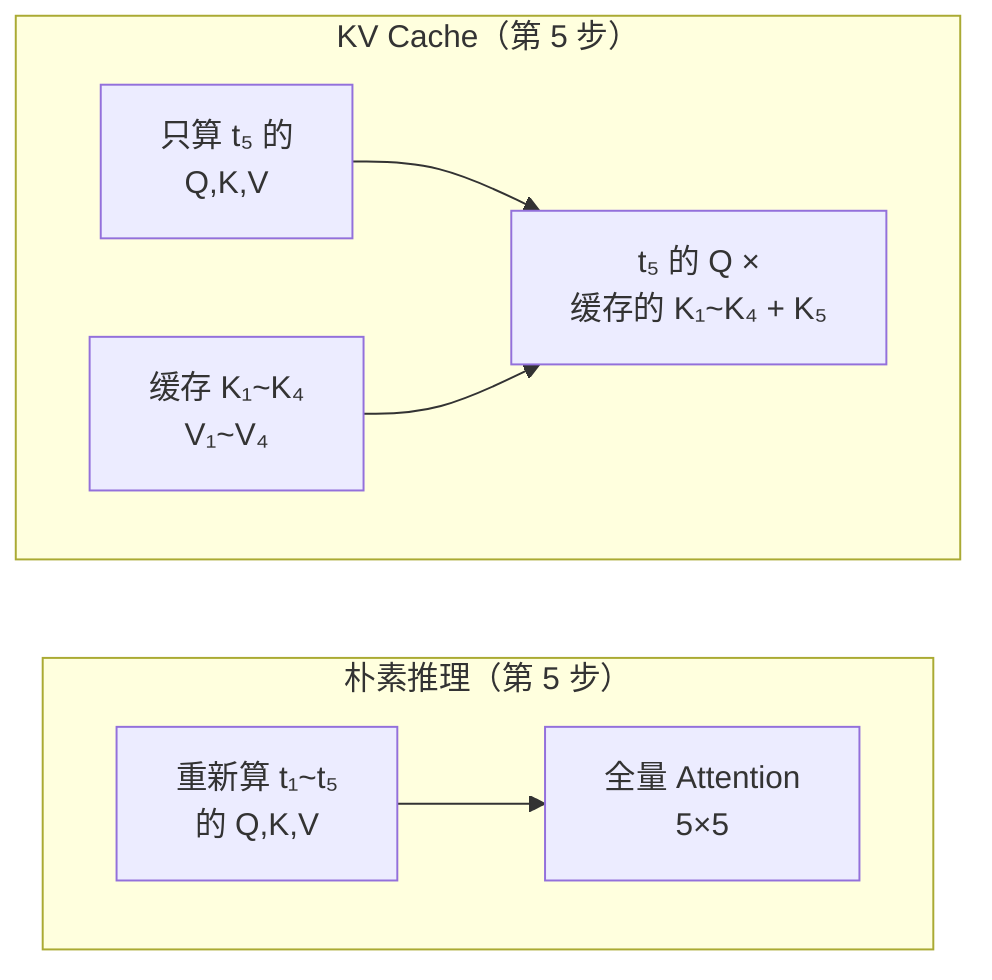
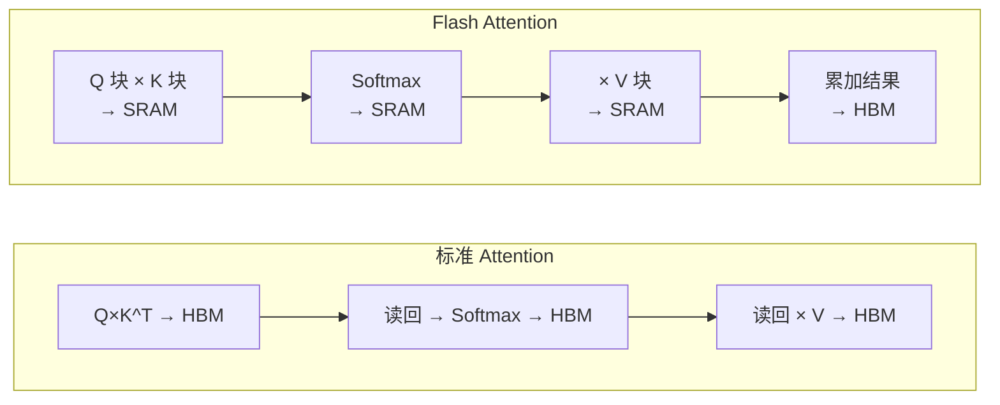
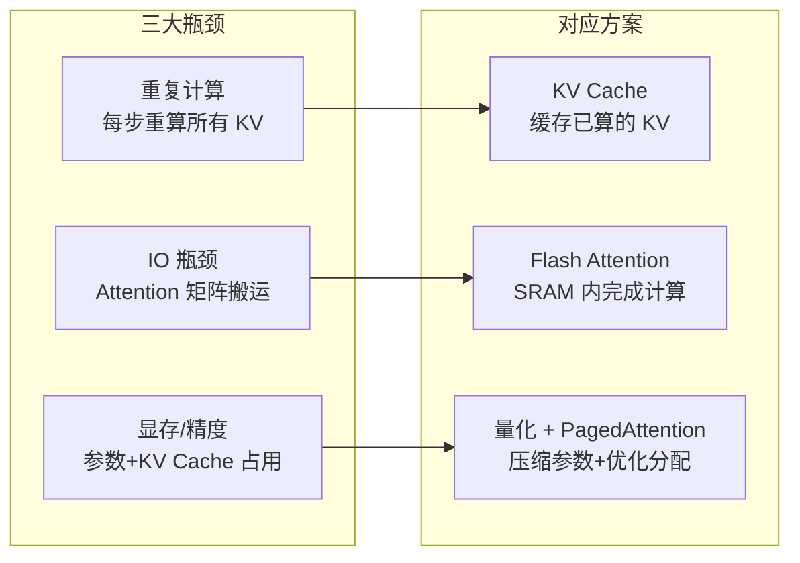

# 第 8 章：推理加速——KV Cache、Flash Attention 与量化

> **本章目标**：训练好的 Transformer 在推理时面临的三个核心瓶颈——重复计算、显存墙和精度开销——以及对应的三大加速技术。读完后，读者应该能解释 KV Cache 省了什么计算、Flash Attention 解决了什么 IO 问题、INT4 量化怎样用精度换速度。

**上一章**：[第 7 章：训练 Transformer 的工程实践](./07_训练Transformer的工程实践) — 训练阶段的全部工程知识。
**下一章**：[第 9 章：现代架构演进](./09_现代架构演进) — GQA、SwiGLU、RMSNorm、MoE 等现代改进。

---

**知识链接**：

- [KV Cache 与自回归解码](/前置知识/002m_前置知识_KV_Cache与自回归解码) — KV Cache 的完整原理
- [序列建模架构全景综述](/论文综述/S27_序列建模架构全景综述) — Transformer 的 $O(L^2)$ 复杂度在长序列上的挑战

---

## 1. 自回归推理的瓶颈

Decoder-only 模型（GPT、Llama 等）生成文本时是逐 token 的：生成第 $t+1$ 个 token 需要先有前 $t$ 个 token。

朴素做法：每生成一个新 token，就把整个序列（包括所有已生成的 token）重新走一遍完整的前向传播。

如果序列已经有 1000 个 token，生成第 1001 个 token 时需要对全部 1001 个 token 重新计算 Q、K、V、Attention——但前 1000 个 token 的 K 和 V 在上一步已经算过了，完全相同。

**浪费程度**：生成 $L$ 个 token 的总计算量是 $O(L^3)$——每一步重新算整个序列。

---

## 2. KV Cache：记住已经算过的 K 和 V

### 核心思想

KV Cache 的思路非常直接：**把每一步算过的 K 和 V 存起来，下一步直接复用，只给新 token 算 Q/K/V。**

> 朴素方式每步都重算所有 token 的 K/V；KV Cache 只算新 token 的 K/V，旧的直接从缓存里取。

### 具体流程

生成第 $t+1$ 个 token 时：

1. 只对新 token $x_{t+1}$ 计算 $Q_{t+1}, K_{t+1}, V_{t+1}$
2. 把 $K_{t+1}$ 追加到缓存的 $[K_1, \ldots, K_t]$ 末尾
3. 把 $V_{t+1}$ 追加到缓存的 $[V_1, \ldots, V_t]$ 末尾
4. 用 $Q_{t+1}$ 和完整的 $[K_1, \ldots, K_{t+1}]$ 计算 Attention
5. 加权聚合 $[V_1, \ldots, V_{t+1}]$ 得到输出

### 计算量对比

| | 朴素 | KV Cache |
|---|---|---|
| 每步 QKV 计算 | 所有 token | 只新 token |
| 每步 Attention | $L \times L$ | $1 \times L$ |
| 生成 $L$ 个 token 的总量 | $O(L^3)$ | $O(L^2)$ |

### 显存代价

KV Cache 需要在 GPU 显存中存储所有层、所有 head 的 K 和 V。对于一个 7B 参数的模型（32 层、32 个 head、维度 128、bf16），每 token 的 KV Cache 显存 $= 2 \times 32 \times 32 \times 128 \times 2\text{B} \approx 0.5\text{MB}$。

序列长度 4096 时，KV Cache 占 $4096 \times 0.5 \approx 2\text{GB}$。对 70B 模型，这个数字变成约 20GB——KV Cache 可能比模型参数本身还占显存。

关于 KV Cache 的完整讲解，参见 [KV Cache 与自回归解码](/前置知识/002m_前置知识_KV_Cache与自回归解码)。

---

## 3. Flash Attention：让 Attention 不再被显存带宽卡住

### 问题：计算快但搬数据慢

标准 Attention 的计算流程：

1. 算 $S = QK^T$，把 $L \times L$ 的矩阵写到 GPU 的 HBM（高带宽显存）
2. 从 HBM 读回 $S$，做 Softmax，把结果写回 HBM
3. 从 HBM 读回 Softmax 结果，和 $V$ 做矩阵乘法

**三次读写 HBM**，每次搬运 $O(L^2)$ 的数据。GPU 的 HBM 带宽虽然高（A100 约 2TB/s），但对比 GPU 计算核心的算力（A100 约 312 TFLOPS fp16），**搬数据的速度远远跟不上算数据的速度。**

### Flash Attention 的解法

Flash Attention 不是改变 Attention 的数学——计算结果完全精确。它改变的是**计算的顺序和数据搬运方式**：

1. 把 Q、K、V 分成小块（tile）
2. 每个小块在 GPU 的 SRAM（片上高速缓存，约 20MB，带宽 19TB/s）中完成 QK、Softmax、加权求和
3. 中间的 $L \times L$ Attention 矩阵**永远不写回 HBM**

> 标准 Attention 在 HBM 之间来回搬运 $L \times L$ 矩阵三次。Flash Attention 在 SRAM 中完成所有中间计算，只把最终结果写回 HBM——IO 减少了一个数量级。

### 效果

| | 标准 Attention | Flash Attention |
|---|---|---|
| HBM IO | $O(L^2)$ | $O(L^2 / \text{tile\_size})$ |
| 峰值显存 | $O(L^2)$（存 Attention 矩阵） | $O(L)$（不存完整矩阵） |
| 实际加速 | 基线 | 训练 2-4x，推理 1.5-3x |
| 数学精度 | 精确 | 精确（不是近似！） |

Flash Attention 在 PyTorch 2.0+ 中已经内置（`torch.nn.functional.scaled_dot_product_attention` 会自动调用），用户通常不需要手动集成。

---

## 4. 模型量化：用精度换速度和显存

### 核心思想

量化把模型参数从高精度浮点数（fp16/bf16，16 bit）压缩到低精度整数（INT8，8 bit 或 INT4，4 bit）。参数量不变，但每个参数占用的位数减半或更少。

| 精度 | 每参数位数 | 7B 模型大小 | 相对速度 |
|------|----------|-----------|---------|
| fp16 | 16 bit | 14 GB | 1x |
| INT8 | 8 bit | 7 GB | ~1.5x |
| INT4 | 4 bit | 3.5 GB | ~2x |

### 量化怎么做

最简单的量化方式（absmax 量化）：找到一组权重的最大绝对值，把所有值线性映射到 INT8 的 $[-127, 127]$ 范围内。

推理时，INT8 的权重和 INT8 的激活值做整数矩阵乘法（比浮点快得多），结果再转回浮点。

### 量化的精度损失

| 量化级别 | 精度损失 | 使用场景 |
|---------|---------|---------|
| INT8 | 几乎无损 | 生产部署的标准选择 |
| INT4（GPTQ/AWQ） | 轻微，大模型上几乎不可察觉 | 显存受限场景 |
| INT4（小模型） | 明显 | 不推荐 |
| INT2/INT3 | 较大 | 研究前沿，实用性有限 |

经验规则：**模型越大，量化的精度损失越小。** 70B 模型用 INT4 量化后的效果可能优于 7B 模型用 fp16。

---

## 5. PagedAttention：解决 KV Cache 的显存碎片

### 问题

KV Cache 的大小取决于序列长度，而不同请求的序列长度不同。在服务多个并发请求时，KV Cache 的显存分配和回收导致严重的内存碎片——可能只有 30-50% 的显存被有效利用。

### PagedAttention 的解法

借鉴操作系统的虚拟内存分页机制：把 KV Cache 切成固定大小的"页"（page），不连续地分配在显存中。一个请求的 KV Cache 可以散布在多个不相邻的页上，通过页表索引。

效果：KV Cache 的显存利用率从 30-50% 提升到接近 100%，同一 GPU 可以同时服务更多的并发请求。

vLLM（一个高性能 LLM 推理引擎）是 PagedAttention 的代表实现。

---

## 6. 推理优化技术总结

| 技术 | 解决什么 | 是否改变结果 | 实现难度 |
|------|---------|------------|---------|
| KV Cache | 消除重复 KV 计算 | 不改变 | 简单，框架已内置 |
| Flash Attention | 减少 HBM IO | 不改变（精确） | 中等，PyTorch 2.0 内置 |
| INT8 量化 | 减半显存和计算 | 几乎不变 | 简单，一行代码 |
| INT4 量化 | 1/4 显存 | 轻微损失 | 需要校准数据 |
| PagedAttention | 提高显存利用率 | 不改变 | 使用 vLLM 等框架 |

---

## 7. 本章小结

Transformer 推理的核心矛盾是 **自回归生成的逐步性**：每次只生成一个 token，但每次都需要访问所有历史信息。三大技术从不同角度缓解这个矛盾：

- **KV Cache**：把问题从"重复计算"变成"缓存查找"，总计算量从 $O(L^3)$ 降到 $O(L^2)$
- **Flash Attention**：不改变计算量，但通过优化数据搬运让实际速度提升 2-4 倍
- **量化**：用可接受的精度损失换取显存和速度的大幅改善

这些技术可以叠加使用——一个典型的生产部署会同时开启 KV Cache + Flash Attention + INT8/INT4 量化 + PagedAttention。

---

**下一章**：[第 9 章：现代架构演进](./09_现代架构演进) — vanilla Transformer 到今天的 LLM 改了什么：GQA 减少 KV head、SwiGLU 替代 ReLU、RMSNorm 简化归一化、MoE 用稀疏激活扩容。
