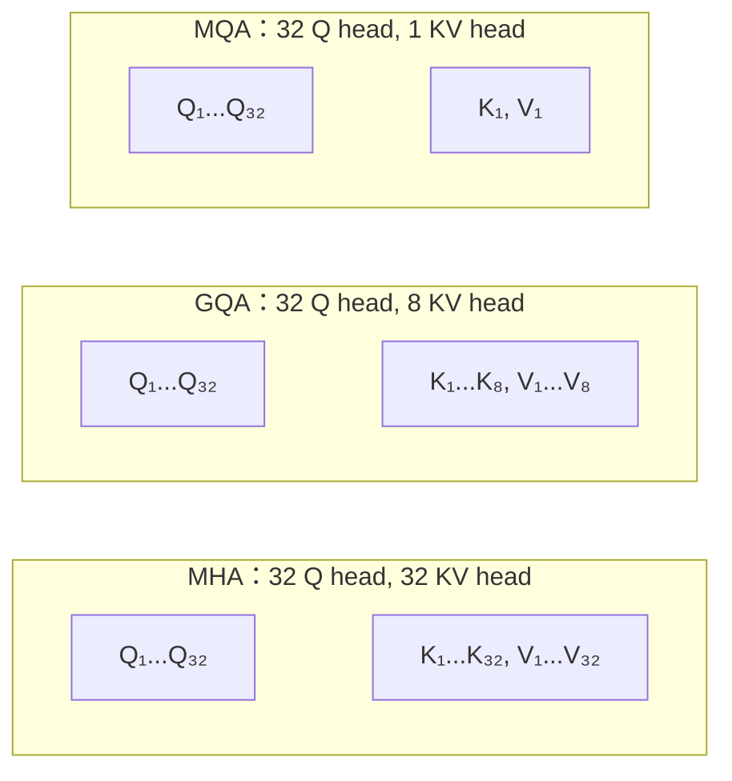
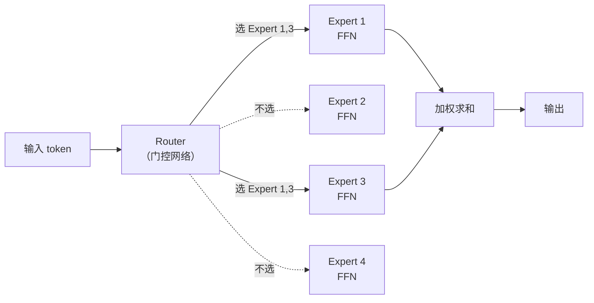

# 第 9 章：现代架构演进——GQA、SwiGLU、RMSNorm 与 MoE

> **本章目标**：原版 2017 年 Transformer 到今天的 LLM，架构上做了哪些修改、每个修改解决什么问题。读完后，读者看到一个模型的 config.json 时应该能对号入座——"GQA 是省 KV Cache 的""SwiGLU 是替代 ReLU 的""MoE 是稀疏扩容的"。

**上一章**：[第 8 章：推理加速](./08_推理加速) — KV Cache、Flash Attention、量化。
**下一章**：[第 10 章：Transformer 在视觉与机器人策略中的展开](./10_视觉与机器人策略) — ViT、DiT、ACT、VLA。

---

**知识链接**：

- [MoE 稀疏专家混合](/前置知识/005n_前置知识_MoE稀疏专家混合) — MoE 的完整原理
- [FFN 前馈网络与 Transformer 的两阶段设计](/前置知识/005m_前置知识_FFN前馈网络与Transformer的两阶段设计) — SwiGLU 替代 ReLU FFN 的背景
- [激活函数全景综述](/论文综述/S26_激活函数全景综述) — SiLU/Swish、GELU 等激活函数
- [KV Cache 与自回归解码](/前置知识/002m_前置知识_KV_Cache与自回归解码) — GQA 减少 KV Cache 的前置知识

---

## 1. 从 vanilla 到 modern：一张改动地图

2017 年原版 Transformer 和 2024 年主流 LLM（Llama 3、Qwen 2.5、Mistral）之间的差异，可以概括为六项改动：

| 组件 | 原版 Transformer（2017） | 现代 LLM（2024） | 改了什么 |
|------|------------------------|-----------------|---------|
| Attention | Multi-Head（MHA） | Grouped-Query（GQA） | 减少 KV head 数 |
| FFN | ReLU + 两层线性 | SwiGLU + 三层线性 | 更好的激活函数 |
| 归一化 | Post-LayerNorm | Pre-RMSNorm | 简化 + 更稳定 |
| 位置编码 | 正弦 | RoPE | 相对位置编码 |
| Dropout | 0.1 | 0（不用） | 数据量足够大 |
| 架构 | Encoder-Decoder | Decoder-only | 统一生成范式 |

下面逐一讲解前三项改动（位置编码已在[第 6 章](./06_位置编码)讲过，Decoder-only 在[第 5 章](./05_Encoder_Decoder与三种架构范式)讲过）。

---

## 2. GQA：减少 KV Head，省显存

### 问题回顾

[第 8 章](./08_推理加速)讲了 KV Cache 的显存代价：每个 token 需要存储所有层、**所有 head** 的 K 和 V。head 数越多，KV Cache 越大。

标准 MHA 中，Q、K、V 各有 $h$ 个 head（如 $h = 32$）。但 KV Cache 的瓶颈完全来自 K 和 V，不来自 Q（Q 不需要缓存，每步只用一次）。

**关键观察**：K 和 V 真的需要和 Q 一样多的 head 吗？

### 三种方案

| 方案 | Q head 数 | KV head 数 | KV Cache 大小 | 性能 |
|------|----------|-----------|-------------|------|
| MHA | 32 | 32 | 基线 | 最高 |
| GQA（Grouped-Query） | 32 | 8 | 基线的 1/4 | 接近 MHA |
| MQA（Multi-Query） | 32 | 1 | 基线的 1/32 | 略有下降 |

GQA 的做法：每 4 个 Q head 共享一组 KV head。32 个 Q head 分成 8 组，每组内的 4 个 Q head 使用同一对 K、V。

### 为什么 GQA 几乎不损失性能

直觉上：不同 Q head 确实需要关注不同的关系（需要不同的 Q 投影），但它们"被查的对象"（K/V）不需要那么多样——一个序列中每个 token 的"标签"和"内容"表示不需要 32 种不同的视角，8 种就够了。

Llama 2 70B、Llama 3、Mistral 7B 全部使用 GQA。

---

## 3. SwiGLU：更好的 FFN 激活

### 原版 FFN

原版 Transformer 的 FFN 用 ReLU 激活：$\text{FFN}(x) = W_2 \cdot \text{ReLU}(W_1 x)$，只有两个权重矩阵。

### SwiGLU FFN

SwiGLU 用一个门控机制替代 ReLU：

$$
\text{FFN}(x) = W_2 \cdot (\text{SiLU}(W_{\text{gate}} x) \odot W_{\text{up}} x)
$$

**这个公式在做什么**：用两条并行的线性变换——一条过 SiLU 激活作为"门"（决定哪些特征通过），另一条直接提供信息——两者逐元素相乘后再降维。

::: details 📐 公式详解（点击展开）

| 子表达式 | 它是谁 | 它在干嘛 |
|---------|--------|---------|
| $W_{\text{gate}} x$ | 门控信号（过 SiLU 前） | 决定哪些维度该被激活 |
| $\text{SiLU}(\cdot)$ | 平滑激活函数 | $\text{SiLU}(x) = x \cdot \sigma(x)$，比 ReLU 更平滑，梯度更好 |
| $W_{\text{up}} x$ | 信息通路 | 直接提供信息，不经过激活 |
| $\odot$ | 逐元素相乘 | 门控信号决定信息通路的哪些维度被保留 |
| $W_2$ | 降维投影 | 把筛选后的信息压回 $d_{model}$ 维 |

**用人话读**："一条路生成'哪些特征重要'的门，另一条路生成特征本身，两者相乘后只保留被门打开的部分。"

**为什么比 ReLU 好**：ReLU 直接把负值砍为零（"硬门控"），SwiGLU 是平滑的"软门控"——梯度更平滑，信息保留更好。
:::

### 参数量变化

SwiGLU 有三个权重矩阵（$W_{\text{gate}}, W_{\text{up}}, W_2$），而原版 FFN 只有两个（$W_1, W_2$）。为了保持总参数量不变，SwiGLU 的隐藏维度从 $4d_{model}$ 降到 $\frac{8}{3}d_{model}$。

---

## 4. RMSNorm：更简单的归一化

### LayerNorm 的"多余"部分

[第 4 章](./04_TransformerBlock全拆解)讲的 LayerNorm 做两件事：(1) 减均值，(2) 除标准差。

RMSNorm（Root Mean Square Normalization）只做第二件事——用均方根（RMS）替代标准差，**不减均值**：

$$
\text{RMSNorm}(x) = \gamma \cdot \frac{x}{\text{RMS}(x) + \epsilon}, \quad \text{RMS}(x) = \sqrt{\frac{1}{d}\sum_{i=1}^{d} x_i^2}
$$

**这个公式在做什么**：只做尺度归一化（除以 RMS），不做平移（不减均值）。

::: details 📐 公式详解（点击展开）

| 子表达式 | 它是谁 | 它在干嘛 |
|---------|--------|---------|
| $\text{RMS}(x)$ | 向量的"平均幅度" | 衡量向量整体有多大 |
| $x / \text{RMS}(x)$ | 尺度归一化 | 让向量的幅度标准化，但保留方向和偏移 |
| $\gamma$ | 可学习缩放 | 让模型自己决定归一化后的最优尺度 |

**用人话读**："只控制向量的大小，不改变它的中心位置——比 LayerNorm 少做一步，但效果一样好。"

**为什么少减均值也行**：实验表明，LayerNorm 的主要贡献来自尺度归一化，减均值的贡献可以忽略。少一步计算让 RMSNorm 更快（约 10-15%），且梯度更简单。
:::

Llama、Qwen、Mistral 全部使用 RMSNorm。

---

## 5. MoE：用稀疏激活扩大容量

### 问题

增大模型容量（参数量）可以提升性能，但也线性增加计算量。一个 70B 模型的每次前向传播都要跑过全部 70B 个参数——能不能让参数量很大，但每次只用一小部分？

### MoE 的做法

MoE（Mixture of Experts，混合专家）把 FFN 替换成多个"专家"FFN，每个 token 只激活其中 Top-K 个：

> Router 为每个 token 打分，选出 Top-K 个专家（通常 K=2），只激活这 K 个专家的 FFN，其余不计算。

| 参数 | 说明 | Mixtral 8x7B |
|------|------|-------------|
| 专家数 $N$ | FFN 的副本数 | 8 |
| 激活数 $K$ | 每个 token 用几个专家 | 2 |
| 总参数量 | 约 $N \times \text{FFN 参数}$ + 共享部分 | 46.7B |
| 每 token 计算量 | 约 $K \times \text{FFN 参数}$ + 共享部分 | 约等于 12.9B 密集模型 |

**关键**：Mixtral 8x7B 有 47B 参数，但每个 token 只激活 13B——推理速度接近 13B 密集模型，但性能接近 47B 密集模型。

MoE 的完整原理参见 [MoE 稀疏专家混合](/前置知识/005n_前置知识_MoE稀疏专家混合)。

---

## 6. 长上下文技术

现代应用（长文档、代码仓库、多轮对话）需要处理几万到几十万 token 的上下文。原版 Transformer 的 $O(L^2)$ Attention 在这个长度下非常昂贵。

### Sliding Window Attention

Mistral 等模型使用滑动窗口注意力：每个 token 只 attend 到最近 $W$ 个 token（如 $W = 4096$），而不是全部。

| 方案 | 注意力范围 | 复杂度 | 长距离信息 |
|------|----------|--------|----------|
| 全局 Attention | 所有 token | $O(L^2)$ | 完整 |
| Sliding Window | 最近 $W$ 个 | $O(L \times W)$ | 通过多层间接传递 |

虽然单层只能看到 $W$ 个 token，但经过 $N$ 层之后，信息的"有效接收域"扩展到 $N \times W$。32 层 + 窗口 4096 = 有效接收域 131K token。

### 其他长上下文技术

- **RoPE 外推**（NTK-aware scaling、YaRN）：修改 RoPE 的频率参数，让模型在推理时支持比训练更长的上下文
- **Ring Attention**：在多 GPU 上分布式计算长序列的 Attention，每个 GPU 只负责序列的一段
- **稀疏注意力**：只计算"重要"的 token 对之间的注意力（局部 + 全局锚点 token）

---

## 7. 一个具体模型：Llama 3 8B 的架构拆解

把本章和之前所有章节的知识串起来，看看一个真实的现代 LLM 长什么样：

| 组件 | Llama 3 8B 的选择 | 对应本系列的章节 |
|------|-----------------|---------------|
| 架构 | Decoder-only | [第 5 章](./05_Encoder_Decoder与三种架构范式) |
| 层数 | 32 | [第 4 章](./04_TransformerBlock全拆解) |
| $d_{model}$ | 4096 | [第 4 章](./04_TransformerBlock全拆解) |
| Attention | GQA（32 Q head，8 KV head，$d_k=128$） | 本章第 2 节 |
| FFN | SwiGLU（$d_{ff}=14336$） | 本章第 3 节 |
| 归一化 | Pre-RMSNorm | 本章第 4 节 |
| 位置编码 | RoPE（$\theta=500000$） | [第 6 章](./06_位置编码) |
| 词表 | 128K（BPE） | [第 7 章](./07_训练Transformer的工程实践) |
| Dropout | 0（不用） | [第 7 章](./07_训练Transformer的工程实践) |
| 总参数量 | 8.03B | — |

这张表里没有任何一项是"原版 Transformer 的默认值"——每一项都被替换成了更好的方案。但整体结构仍然是"Attention + FFN，残差连接 + 归一化，堆叠 N 层"——Transformer 的核心范式没变，变的是每个部件的最优实现。

---

## 8. 本章小结

| 改动 | 解决什么问题 | 核心做法 |
|------|-----------|---------|
| GQA | KV Cache 太大 | 多个 Q head 共享一组 KV head |
| SwiGLU | ReLU FFN 性能不够好 | 门控激活 + 三层线性 |
| RMSNorm | LayerNorm 多余且偏慢 | 只做尺度归一化，不减均值 |
| MoE | 增大容量但不增加推理计算 | 多个专家 FFN，每 token 只激活 Top-K |
| Sliding Window | 长序列的 $O(L^2)$ 太贵 | 每层只看最近 $W$ 个 token |

从原版 Transformer 到现代 LLM，架构的"骨架"（Attention + FFN + 残差）没有变，变的是每个关节处的最优零件。理解了这些零件的取舍，就能读懂任何现代模型的 config。

---

**下一章**：[第 10 章：Transformer 在视觉与机器人策略中的展开](./10_视觉与机器人策略) — Transformer 如何从 NLP 走进视觉（ViT）、扩散模型（DiT）和机器人（ACT、VLA）。
