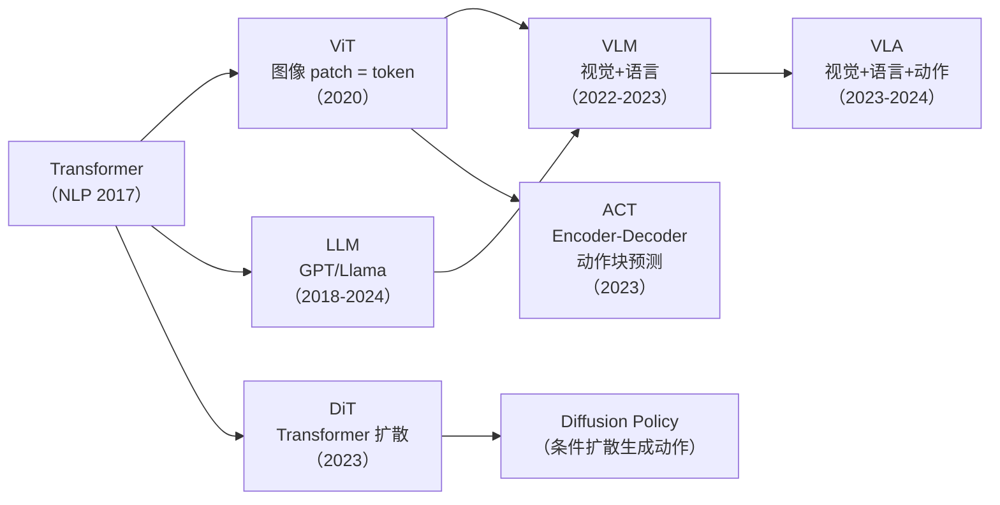
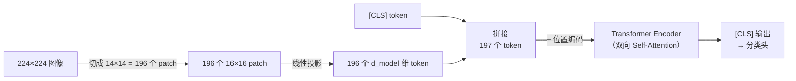
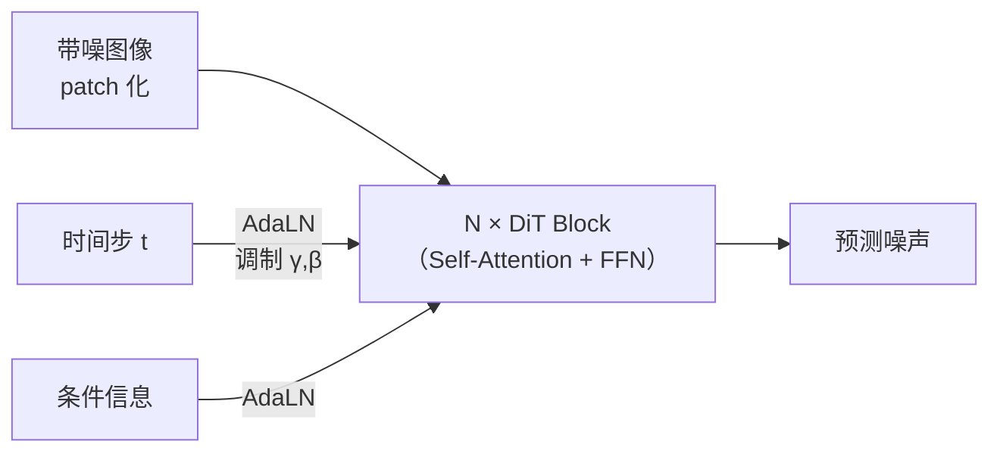
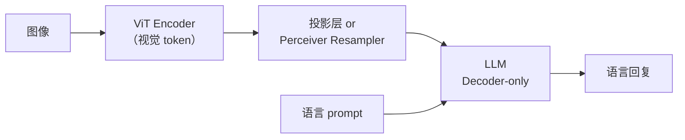
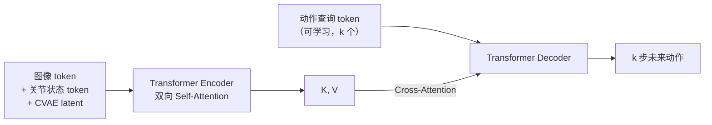
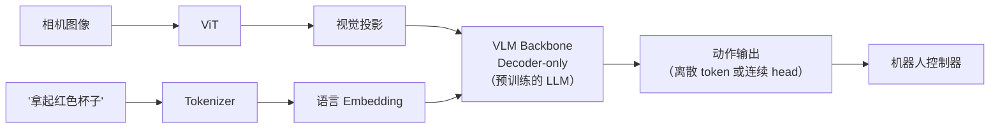

# 第 10 章：Transformer 在视觉与机器人策略中的展开

> **本章目标**：把前 9 章的 Transformer 知识接入项目的主线——视觉和机器人策略。读完后，读者应该能看到任何 VLA/ACT 论文中的架构图时，指出"这里用的是 Encoder-only ViT""这里用的是 Decoder-only 自回归""这里用的是 Cross-Attention 做视觉-语言融合"。

**上一章**：[第 9 章：现代架构演进](./09_现代架构演进) — GQA、SwiGLU、RMSNorm、MoE。

---

**知识链接**：

- [Vision Transformer 图像分块与位置编码](/前置知识/003g_前置知识_Vision_Transformer图像分块与位置编码) — ViT 的完整原理
- [DiT Diffusion Transformer 架构](/前置知识/002x_前置知识_DiT_Diffusion_Transformer架构) — Transformer 做扩散模型 backbone
- [动作 Token 化与自回归策略](/前置知识/000l_前置知识_动作Token化与自回归策略) — VLA 中动作的 token 化方案
- [Perceiver Resampler 跨模态 Token 压缩](/前置知识/002o_前置知识_Perceiver_Resampler跨模态Token压缩) — 视觉 token 的压缩
- [Cross-Attention 与交替注意力机制](/前置知识/001e_前置知识_Cross_Attention与交替注意力机制) — 多模态融合中的 Cross-Attention
- [视觉-语言-动作模型 VLA 综述](/论文综述/S03_视觉语言动作模型VLA综述) — VLA 的全景对比
- [AdaLayerNorm 条件化归一化](/前置知识/001f_前置知识_AdaLayerNorm条件化归一化) — DiT 中条件信息的注入方式

---

## 1. 总览：Transformer 的三条分支

Transformer 从 NLP 出发，沿三条路线走进了视觉和机器人：

> Transformer 从 NLP 走到视觉（ViT）→ 多模态（VLM）→ 机器人（VLA），同时另一条路通过 DiT 走进了扩散模型。ACT 直接复用了 Encoder-Decoder 架构做动作预测。

---

## 2. ViT：图像 patch 就是 token

### 核心思想

Vision Transformer（ViT，2020）的想法极其简单：**把图像切成 16×16 的小方块（patch），每个 patch 展平后当作一个 token，直接送进标准 Transformer Encoder。**

> 把图像变成 token 序列后，直接复用 NLP 中的 Transformer Encoder，不需要任何卷积操作。

| 参数 | 典型值（ViT-B/16） |
|------|-------------------|
| 图像大小 | 224 × 224 |
| Patch 大小 | 16 × 16 |
| Token 数量 | $(224/16)^2 = 196$ |
| $d_{model}$ | 768 |
| 层数 | 12 |
| Head 数 | 12 |

### ViT 用了哪种 Transformer

ViT 用的是**Encoder-only**（[第 5 章](./05_Encoder_Decoder与三种架构范式)）：每个 patch token 都能看到所有其他 patch token（双向 Self-Attention），没有 Causal Mask。

位置编码用的是**可学习编码**（[第 6 章](./06_位置编码)）：每个位置一个可训练向量。

ViT 的完整讲解参见 [Vision Transformer 图像分块与位置编码](/前置知识/003g_前置知识_Vision_Transformer图像分块与位置编码)。

---

## 3. DiT：Transformer 做扩散模型的 backbone

### 扩散模型需要什么样的 backbone

扩散模型（[DDPM](/前置知识/000b_前置知识_扩散模型DDPM)）需要一个网络来预测噪声——输入带噪声的数据和时间步 $t$，输出预测的噪声或去噪方向。传统用 U-Net 做 backbone。

DiT（Diffusion Transformer，2023）用 Transformer 替代 U-Net，做法是：

1. 把带噪图像切成 patch token（和 ViT 一样）
2. 通过 Transformer Block 处理所有 token
3. 把时间步 $t$ 和类别信息通过 [AdaLayerNorm](/前置知识/001f_前置知识_AdaLayerNorm条件化归一化) 注入每一层

> DiT 和 ViT 共享 patch 化的思路，但 DiT 是生成模型（去噪），ViT 是判别模型（分类）。DiT 通过 AdaLayerNorm 把时间步和条件信息"调制"进 LayerNorm 的 $\gamma, \beta$ 参数中。

DiT 的完整讲解参见 [DiT Diffusion Transformer 架构](/前置知识/002x_前置知识_DiT_Diffusion_Transformer架构)。

### DiT 与 Diffusion Policy

在机器人领域，[Diffusion Policy](/前置知识/000c_前置知识_Diffusion_Policy) 用扩散模型生成动作序列。早期的 Diffusion Policy 用 U-Net 作为 backbone，但后续的很多工作已经切换到 DiT 风格的 Transformer backbone（更好的 scaling）。

---

## 4. VLM：视觉-语言多模态 Transformer

### 从 ViT + LLM 到 VLM

VLM（Vision-Language Model，视觉-语言模型）把 ViT 提取的视觉 token 和语言 token 放进同一个 Transformer 中处理：

> VLM 的典型架构：ViT 提取视觉特征 → 投影/压缩成 LLM 能理解的 token → 和语言 token 一起送进 LLM。

### 视觉 token 的接入方式

| 方式 | 做法 | 代表 |
|------|------|------|
| 线性投影 | 视觉 token 过一个线性层对齐到 LLM 维度 | LLaVA |
| Perceiver Resampler | 用 Cross-Attention 把 256 个视觉 token 压缩到 64 个 | Flamingo |
| Cross-Attention 交替层 | 在 LLM 的某些层中插入 Cross-Attention 读取视觉 | Flamingo, GR00T |

视觉 token 压缩的详细讲解参见 [Perceiver Resampler 跨模态 Token 压缩](/前置知识/002o_前置知识_Perceiver_Resampler跨模态Token压缩)。

---

## 5. ACT：Encoder-Decoder 做动作预测

### ACT 的问题

ACT（Action Chunking Transformer）要解决的问题：从当前观测（图像 + 关节状态）预测未来一段时间的动作序列（"动作块"，action chunk）。

### ACT 用了哪种 Transformer

ACT 用的是**Encoder-Decoder**结构（[第 5 章](./05_Encoder_Decoder与三种架构范式)）：

- **Encoder**：处理当前观测——图像特征 token + 关节状态 token + CVAE latent token，通过双向 Self-Attention 融合
- **Decoder**：一组可学习的"动作查询 token"（类似 DETR 的 object queries），通过 Cross-Attention 从 Encoder 输出中"查询"出未来的动作

> ACT 的 Decoder 不是自回归的——它一次性用 $k$ 个查询 token 解码出 $k$ 步动作（并行），而不是逐步生成。这和 NLP 中的 Decoder 不同。

### ACT 中 Transformer 部件的对应关系

| ACT 组件 | 本系列的对应知识 |
|---------|---------------|
| Encoder 中的 Self-Attention | [第 2-3 章](./02_SelfAttention从零手算)：观测 token 之间互相交换信息 |
| Decoder 中的 Cross-Attention | [第 5 章](./05_Encoder_Decoder与三种架构范式)：动作查询从编码后的观测中提取信息 |
| 动作查询 token | 可学习的 Embedding，每个对应一个未来时间步 |
| CVAE latent token | 处理示范中的多模态性（同一个任务可能有多种执行方式） |

---

## 6. VLA：视觉-语言-动作统一模型

### 从 VLM 到 VLA

VLA（Vision-Language-Action）在 VLM 的基础上，把**动作**也作为 token 接入。模型的输入变成 $[\text{视觉 token}] + [\text{语言 token}] + [\text{动作 token}]$——看到图像和语言指令后，自回归地生成动作 token。

### VLA 的两种动作输出方式

| 方式 | 做法 | 代表 |
|------|------|------|
| 离散动作 token | 把连续动作量化成离散 token，用 LLM 的词表预测 | RT-2, OpenVLA |
| 连续动作 head | LLM 输出特征后接一个回归头直接预测连续值 | Octo, GR00T |

离散方式的详细讲解参见 [动作 Token 化与自回归策略](/前置知识/000l_前置知识_动作Token化与自回归策略)。

### 典型 VLA 架构

> VLA 的核心思路：把预训练 VLM 的知识迁移到机器人控制——VLM 理解"红色杯子"是什么，VLA 在此基础上学会"伸手去拿"。

### VLA 方法对比

| 模型 | 架构 | 动作输出 | 预训练基础 |
|------|------|---------|----------|
| RT-1 | Encoder + 分类头 | 离散 token | 从头训练 |
| RT-2 | Decoder-only（VLM） | 离散 token | PaLI-X VLM |
| OpenVLA | Decoder-only（VLM） | 离散 token | Llama 2 VLM |
| Octo | Encoder-Decoder | 连续（Diffusion head） | 从头训练 |
| GR00T | Decoder-only + 动作专家 | 连续（Flow/Diffusion head） | VLM backbone |

VLA 的完整对比参见 [视觉-语言-动作模型 VLA 综述](/论文综述/S03_视觉语言动作模型VLA综述)。

---

## 7. Transformer 部件在机器人模型中的速查表

| 部件 | NLP 中的用途 | 机器人/视觉中的用途 |
|------|-----------|-------------------|
| Self-Attention | token 之间交换上下文信息 | 观测 token 之间交换信息、图像 patch 之间的关系 |
| Cross-Attention | Decoder 查询 Encoder | 动作 Decoder 查询观测 Encoder（ACT）；LLM 读取视觉特征（VLM） |
| Causal Mask | 自回归生成文本 | 自回归生成动作 token（RT-2、OpenVLA） |
| 位置编码（RoPE） | 序列中 token 的顺序 | 动作序列的时间顺序；图像 patch 的空间位置 |
| FFN | 每个 token 的独立变换 | 同上——不区分模态 |
| KV Cache | 加速文本生成 | 加速动作 token 生成 |
| ViT Encoder | — | 图像特征提取 |
| AdaLayerNorm | — | DiT 中注入时间步和条件信息 |

---

## 8. 阅读路径：从这里出发

学完本系列 10 章后，读者对 Transformer 的理解已经足够支撑项目中任何涉及 Transformer 的文章。以下是推荐的进阶阅读路径：

| 兴趣方向 | 推荐阅读 |
|---------|---------|
| 想深入 VLA 各路线 | [VLA 综述](/论文综述/S03_视觉语言动作模型VLA综述) → 各论文精读 |
| 想理解 ACT 的工程实现 | [ACT 系列相关工程实践](/工程实践/条件约束的ACT模型) |
| 想了解 GR00T 的架构 | [GR00T N1.7 深度解析](/系列/groot_n1d7_deep_dive/) |
| 想理解扩散策略 | [Diffusion Policy](/前置知识/000c_前置知识_Diffusion_Policy) → [Flow Matching](/前置知识/000g_前置知识_Flow_Matching与连续归一化流) |
| 想了解长序列/状态空间模型 | [序列建模架构全景综述](/论文综述/S27_序列建模架构全景综述) |
| 想动手实现 | [transformer_vla_tutorial/](/transformer_vla_tutorial/) 中的代码实验 |
| 想了解分布式训练 | [数据并行](/前置知识/001h_前置知识_数据并行与AllReduce基础) → [FSDP](/前置知识/001i_前置知识_FSDP全分片数据并行) → [张量并行](/前置知识/001j_前置知识_张量并行与流水线并行_Megatron核心思想) |

---

## 9. 全系列总结

十章内容覆盖了 Transformer 从诞生到在机器人领域应用的完整链路：

| 章节 | 一句话总结 |
|------|----------|
| 01 为什么需要 Attention | RNN 的三个缺陷逼出了"只用 Attention"的方案 |
| 02 Self-Attention 手算 | Q 查、K 被查、V 被取——一次数据库检索 |
| 03 Multi-Head Attention | 多个 head 在不同子空间中捕捉不同关系 |
| 04 Transformer Block | Attention 负责通信，FFN 负责计算，残差保证不丢信息 |
| 05 三种架构范式 | Encoder（理解）、Decoder（生成）、Encoder-Decoder（先理解再生成） |
| 06 位置编码 | RoPE 旋转编码是现代主流——相对位置、可外推、无额外参数 |
| 07 训练工程 | AdamW + Warmup + Cosine Decay + bf16 是标准组合 |
| 08 推理加速 | KV Cache 省计算、Flash Attention 省 IO、量化省显存 |
| 09 现代演进 | GQA 省 KV、SwiGLU 替 ReLU、RMSNorm 替 LN、MoE 稀疏扩容 |
| 10 视觉与机器人 | ViT 处理图像、VLM 融合视觉语言、VLA 加上动作 |

Transformer 的核心范式——**"把一切变成 token，让 token 互相交换信息，逐层精炼"**——从 2017 年到今天没有变过。变的是每个部件的最优实现，以及 token 的来源从文字扩展到了图像、语音、机器人状态和动作。理解了这个范式和它的部件，就有了阅读当前任何 Transformer 变体论文的基础。
