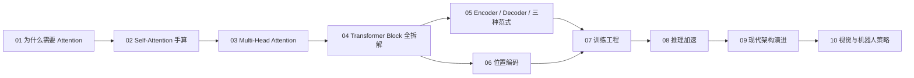

# Transformer 深度解析：从 Attention 直觉到现代 LLM 架构

> 这个系列只做一件事：让读者彻底理解 Transformer——不是"听说过 Attention"，而是能回答"为什么 QKV 要分别投影""残差连接到底在保护什么""RoPE 比正弦编码好在哪里""KV Cache 省了哪些重复计算"这类结构性问题。从原版 2017 年论文的每个部件，一路讲到今天 LLM 和机器人策略模型里的实际架构选择。

## 为什么需要这个系列

Transformer 是当前几乎所有大语言模型（LLM）、视觉模型（ViT）、以及机器人视觉-语言-动作模型（VLA）的共同骨架。项目中已有十几篇前置知识分别覆盖了 Cross-Attention、RoPE、KV Cache、FFN、MoE、ViT 等单点概念，但缺一条从头到尾的主线把它们串起来。

这个系列就是那条主线。读完之后，再去看项目里任何用到 Transformer 的文章——无论是 ACT、GR00T、OpenVLA 还是 Diffusion Transformer——都能立刻定位"它改了原版架构的哪个部件、为什么要改"。

## 这条线怎么走

Transformer 从"序列建模"这个问题出发。RNN 时代的三个瓶颈（梯度消失、无法并行、长程遗忘）逼出了一个激进的假设：**完全扔掉递归，只用注意力机制处理序列。** 这个假设成功了，但成功之后又引出了新问题——位置信息怎么补、推理速度怎么加快、模型怎么扩到千亿参数。十章内容就是沿着这条"解决一个问题、引出下一个问题"的链路展开的。

## 章节目录

| 章节 | 标题 | 核心问题 |
|------|------|---------|
| 01 | [为什么需要 Attention：从 RNN 瓶颈到 Transformer 的赌注](./01_为什么需要Attention) | RNN 的三大瓶颈如何逼出了"只用 Attention"的方案 |
| 02 | [Self-Attention 从零手算](./02_SelfAttention从零手算) | Q、K、V 到底在做什么，3 个 token 的完整计算 |
| 03 | [Multi-Head Attention：多个子空间同时看](./03_MultiHead_Attention多个子空间同时看) | 为什么一个 head 不够，投影矩阵如何拆分子空间 |
| 04 | [Transformer Block 全拆解](./04_TransformerBlock全拆解) | 从输入 token 到输出向量的完整信息流 |
| 05 | [Encoder、Decoder 与三种架构范式](./05_Encoder_Decoder与三种架构范式) | BERT / GPT / T5 分别选了哪种结构、为什么 |
| 06 | [位置编码：让 Transformer 知道顺序](./06_位置编码) | 正弦、可学习、RoPE、ALiBi 各自的取舍 |
| 07 | [训练 Transformer 的工程实践](./07_训练Transformer的工程实践) | Tokenizer、AdamW、Warmup、混合精度、常见 loss spike |
| 08 | [推理加速：KV Cache、Flash Attention 与量化](./08_推理加速) | 自回归瓶颈、KV Cache、Flash Attention、INT4/INT8 量化 |
| 09 | [现代架构演进：GQA、SwiGLU、RMSNorm 与 MoE](./09_现代架构演进) | 从 vanilla Transformer 到 Llama/Qwen 改了什么 |
| 10 | [Transformer 在视觉与机器人策略中的展开](./10_视觉与机器人策略) | ViT、DiT、ACT、VLA——Transformer 怎样走进机器人 |

## 阅读建议

**完整路径**（推荐）：按 01→10 顺序读。每章开头有前情提要，结尾有下章预告。

**快速路径**（已有深度学习基础）：跳过 01，从 02 开始；如果对 Encoder/Decoder 已经熟悉，可以跳过 05，直接从 06 开始看现代改进。

**查阅路径**：每章独立可读。遇到项目其他文章里提到的 Transformer 组件（比如"Cross-Attention""RoPE""KV Cache"），直接跳到对应章节即可。

## 前置知识

阅读本系列前建议了解：
- 线性代数基础：矩阵乘法、向量点积、转置
- 概率基础：softmax、概率分布
- [交叉熵损失与 Softmax](/前置知识/003f_前置知识_交叉熵损失与Softmax)

## 相关前置知识文章

本系列会在各章节中链接到以下已有的前置知识，读者也可以直接跳读：

- [Cross-Attention 与交替注意力机制](/前置知识/001e_前置知识_Cross_Attention与交替注意力机制)
- [Causal Attention 因果注意力掩码](/前置知识/001g_前置知识_Causal_Attention因果注意力掩码)
- [AdaLayerNorm 条件化归一化](/前置知识/001f_前置知识_AdaLayerNorm条件化归一化)
- [FFN 前馈网络与 Transformer 的两阶段设计](/前置知识/005m_前置知识_FFN前馈网络与Transformer的两阶段设计)
- [RoPE 旋转位置编码](/前置知识/002k_前置知识_RoPE旋转位置编码)
- [KV Cache 与自回归解码](/前置知识/002m_前置知识_KV_Cache与自回归解码)
- [Vision Transformer 图像分块与位置编码](/前置知识/003g_前置知识_Vision_Transformer图像分块与位置编码)
- [DiT Diffusion Transformer 架构](/前置知识/002x_前置知识_DiT_Diffusion_Transformer架构)
- [MoE 稀疏专家混合](/前置知识/005n_前置知识_MoE稀疏专家混合)
- [动作 Token 化与自回归策略](/前置知识/000l_前置知识_动作Token化与自回归策略)
