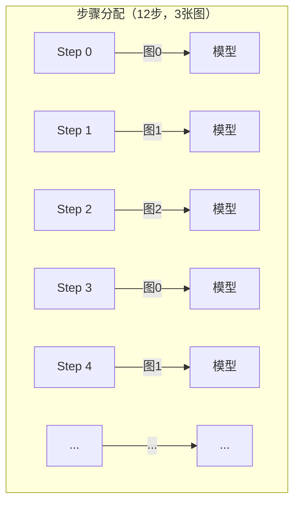
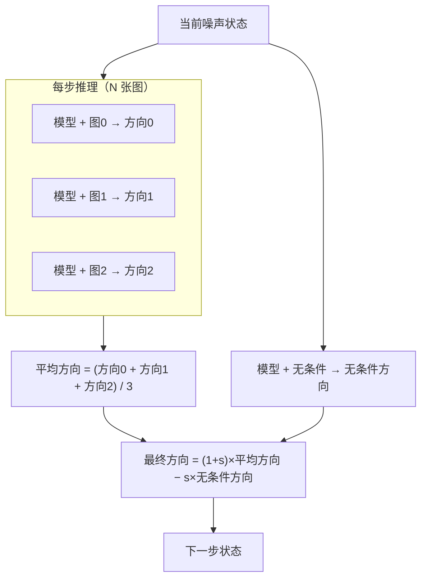

# 多图像条件：stochastic 与 multidiffusion 采样策略

TRELLIS 的任务是把照片变成三维模型。给它一张或几张物体的照片，它输出一套可以直接导出的三维数据。本章讲的是多图模式：同时传入好几张不同角度的照片时，内部如何处理这些图像、如何在生成过程中把它们用起来。

## 这个模块在整个流程中的位置

TRELLIS 的生成过程分两大阶段，串行执行：

1. **确定三维骨架**：先在三维空间里划定哪些位置有物体、哪些位置是空的，输出一个稀疏的体素结构（可以理解为一堆三维空间中的小方块，标出物体的轮廓和体积）。
2. **填充外观**：对每个小方块填入外观信息（颜色、材质、细节），输出一套叫 SLAT 的特征数据，最终可以导出为网格模型或高斯点云。

多图模式的作用就是：在这两个阶段里，把多张照片的信息都用上，而不是只依赖一张图。

- **输入**：N 张去背景的物体照片，建议覆盖正面、侧面、背面等不同角度
- **输出**：三维体素结构 + 每个体素的外观特征，可导出为 `.glb` 网格或高斯点云

本章接下来解释：这 N 张图的特征如何存储、如何在逐步生成过程中分配给两个阶段，以及两种不同的分配策略各自的逻辑和代价。

## 单图的盲区问题

单张图像只能呈现物体的一个视角。第一阶段（稀疏占据结构）需要确定三维体素的分布，第二阶段（SLAT 特征）需要为每个体素填充外观——这两件事对背面区域完全依赖模型的"经验猜测"，图像本身没有提供任何约束。

加入多视角图像后，正面图像约束正面体素，背面图像约束背面体素，侧面图像约束侧面轮廓。每张图都在它能"看到"的区域提供条件信息，盲区大幅缩小。

## 多张图的特征如何组织：各自独立，而非合并

一个常见的直觉是：多图就是把所有图拼在一起，丢给模型处理。实际上不是这样。

[DINOv2](/前置知识/013b_前置知识_DINOv2视觉特征提取器)（Meta 用自监督方法训练的 Vision Transformer，把图像切成小块后对每块输出一个描述局部结构的向量）会把每张图切成若干小块，每块提取一个特征向量。一张图切出 1369 个小块，每个特征向量有 1024 个维度。多图模式下，每张图都独立走一遍这个流程，结果是 N 张图各自拥有 1369 个特征向量，互不干扰——而不是把 N 张图的特征全部首尾相接成一条长链。

```python
# trellis_image_to_3d.py:129-143
def encode_image(self, image):
    image = torch.stack(image).to(self.device)   # (N, 3, 518, 518)
    image = self.image_cond_model_transform(image)
    features = self.models['image_cond_model'](image, is_training=True)['x_prenorm']
    patchtokens = F.layer_norm(features, features.shape[-1:])
    return patchtokens                            # (N, 1369, 1024)
```

为什么不直接拼接？拼接后模型需要在一条更长的特征序列上做注意力计算，计算量随图片数线性增长。更重要的是，每张图的特征向量里编码了小块在图像内部的位置信息，拼接后无法区分哪些特征属于哪张图，会破坏这层位置信息。保持各图独立，让后续策略自己决定如何使用这 N 份特征，才是合理的组织方式。

## 采样器注入机制

生成过程分两大阶段，每个阶段都要跑很多步。每走一步，程序都会做同一件事：查一次输入条件，判断"现在应该往哪个方向调整"。这个"查条件、判方向"的动作是整个步进流程的核心。

单图模式下，这个动作只参考一张图的信息，实现很直接。多图模式需要同时参考好几张图，但步进框架本身没有为此设计，也不打算改动它。

于是采用了"临时换零件"的做法：每个阶段开始前，把"查条件、判方向"这个动作悄悄换成一个能处理多张图的新版本；阶段跑完后，自动恢复原来的版本。整个替换和恢复用一对"进入时换上、退出时还原"的语句包裹，不需要手动管理。

两个阶段各做一次这种替换：

```python
# trellis_image_to_3d.py:369-374
with self.inject_sampler_multi_image('sparse_structure_sampler', len(images), ss_steps, mode=mode):
    coords = self.sample_sparse_structure(cond, ...)
with self.inject_sampler_multi_image('slat_sampler', len(images), slat_steps, mode=mode):
    slat = self.sample_slat(cond, ...)
```

stochastic 和 multidiffusion 两种策略，各自提供一个不同的"多图版"实现，但共用同一个步进框架。要切换策略，只换注入进去的那个实现，框架代码完全不动。

## stochastic 策略：轮流使用各张图

这种策略的思路很直接：整个生成过程有很多步，就让每一步轮流只参考一张图。三张图、12 步的情况下，第 0 步看第一张，第 1 步看第二张，第 2 步看第三张，第 3 步又回到第一张，如此循环。



> 每张图平均分配到总步数除以图片数的步骤。图片数多于步数时会打印警告，因为有些图会在整个过程中完全缺席。

代码层面，先把每一步要用哪张图的编号算好，之后每步执行时直接取出对应图的特征：

```python
# trellis_image_to_3d.py:309-313
cond_indices = (np.arange(num_steps) % num_images).tolist()

def _new_inference_model(self, model, x_t, t, cond, **kwargs):
    cond_idx = cond_indices.pop(0)          # 取出这一步分配到的图编号
    cond_i = cond[cond_idx:cond_idx+1]      # 取该图的特征，保持维度
    return self._old_inference_model(model, x_t, t, cond=cond_i, **kwargs)
```

每一步只用一张图的特征做一次模型推理，速度和单图模式完全一样，总步数不变。

生成引导需要一个"无条件参考"——即完全不给任何图像信息时模型会往哪走。这个参考每步只需要一份，单图特征的维度和它一致，引导计算照常进行。

## multidiffusion 策略：每步都融合所有图

这种策略来自 MultiDiffusion（Bar-Tal 等，2023）的思路：不再轮流使用各张图，而是每一步都让所有图同时参与，再把各自给出的方向信号取平均，用这个平均方向推进。

每走一步，流程是这样的：用第一张图跑一次模型，得到一个方向信号；用第二张图再跑一次，再得到一个；……所有方向信号加起来除以图片数，得到平均方向。然后额外跑一次"不给任何图像信息"的模型，得到无条件参考方向。最后用平均方向减去无条件参考方向，得到一个放大后的最终方向——图像条件与无条件之间的差距越大，放大效果越强，生成结果越贴近输入图像。



> 放大强度 s 就是调用时设置的 `cfg_strength`。s 越大，结果越贴图，但也越容易过饱和。

代码实现：

```python
# trellis_image_to_3d.py:316-328
def _new_inference_model(self, model, x_t, t, cond, neg_cond, cfg_strength, cfg_interval, **kwargs):
    if cfg_interval[0] <= t <= cfg_interval[1]:
        preds = []
        for i in range(len(cond)):
            preds.append(FlowEulerSampler._inference_model(
                self, model, x_t, t, cond[i:i+1], **kwargs
            ))
        pred = sum(preds) / len(preds)              # 各视角方向信号的算术平均
        neg_pred = FlowEulerSampler._inference_model(
            self, model, x_t, t, neg_cond, **kwargs
        )
        return (1 + cfg_strength) * pred - cfg_strength * neg_pred
    else:
        preds = [FlowEulerSampler._inference_model(self, model, x_t, t, cond[i:i+1], **kwargs)
                 for i in range(len(cond))]
        return sum(preds) / len(preds)
```

每步要跑 N+1 次模型（N 张图各一次，加一次无条件参考），总计算量是单图的 N+1 倍。图片数为 3 时，推理时间约为单图的 4 倍。

## 无条件参考只保留一份

生成引导需要两类输入：有图像条件的预测，和完全不给任何图像信息时的"无条件"预测。两者之差决定了引导方向和强度。

多图模式下，有条件的那一侧有 N 份（每张图各一份），而无条件的那一侧实际上 N 份完全相同——都是全零的特征向量，代表"什么图都不看"。既然内容完全一样，程序在进入采样前直接裁掉多余的副本，只保留一份：

```python
# trellis_image_to_3d.py:367
cond['neg_cond'] = cond['neg_cond'][:1]
```

这样做不损失任何信息，但节省了 N-1 倍的显存占用。两种策略里，无条件推理都只跑这一份，和有条件那侧的平均结果做对比。

## 两种策略的对比

| 维度 | stochastic（轮流使用） | multidiffusion（每步融合） |
|------|-----------|----------------|
| 每步模型推理次数 | 1 | 图片数 + 1 |
| 推理速度 | 与单图相同 | 慢约图片数倍 |
| 多视角融合方式 | 各视角在不同步骤分别施加影响 | 各视角在同一步骤显式平均 |
| 多视角一致性 | 隐式积累 | 每步强制平均 |
| 图片数较多（4 张以上）时 | 仍然快 | 成本很高 |
| 图片数很少（2—3 张）时 | 可用 | 融合更彻底 |

没有绝对的优劣，取决于场景。图片多、步数有限时用 stochastic；图片少、追求各视角均衡融合时用 multidiffusion。

## 完整调用示例

准备好去背景的多视角照片，传给多图生成接口：

```python
from PIL import Image
from trellis.pipelines import TrellisImageTo3DPipeline
from trellis.utils import postprocessing_utils

pipeline = TrellisImageTo3DPipeline.from_pretrained("JeffreyXiang/TRELLIS-image-large")
pipeline.cuda()

# 三张去背景的视角图（正面、侧面、背面）
images = [
    Image.open("front.png"),
    Image.open("side.png"),
    Image.open("back.png"),
]

# 轮流策略：速度和单图一样，适合图片多时
outputs = pipeline.run_multi_image(
    images,
    seed=42,
    sparse_structure_sampler_params={"steps": 12, "cfg_strength": 7.5},
    slat_sampler_params={"steps": 12, "cfg_strength": 3.0},
    mode='stochastic',          # 默认值
)

# 每步融合策略：推理慢 N 倍，融合更彻底
outputs = pipeline.run_multi_image(
    images,
    seed=42,
    sparse_structure_sampler_params={"steps": 12, "cfg_strength": 7.5},
    slat_sampler_params={"steps": 12, "cfg_strength": 3.0},
    mode='multidiffusion',
)

glb = postprocessing_utils.to_glb(
    outputs['gaussian'][0],
    outputs['mesh'][0],
    simplify=0.95,
    texture_size=1024,
)
glb.export("output_multi.glb")
```

图像预处理的注意事项：默认会对每张图独立做去背景和裁剪。如果已经准备好带透明通道（即背景已经扣掉）的图片，程序会跳过去背景步骤，直接做裁剪和缩放。多图时，建议各视角图里物体的大小比例相近，避免某张图里物体太小、特征提取模型拿到的细节不够。
