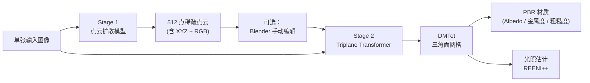
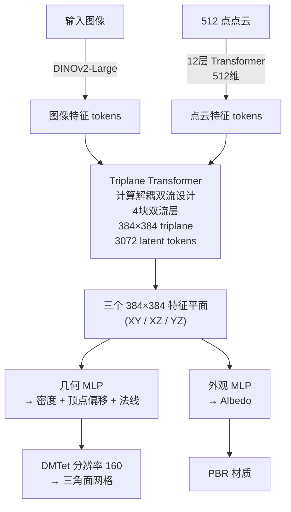

# SPAR3D 深度精读：两阶段设计，用点云扩散补全背面几何，用 DMTet 快速生成带材质网格

> **论文标题**：SPAR3D: Stable Point-Aware Reconstruction of 3D Objects from Single Images
> **作者**：Stability AI
> **时间**：2025 年 1 月
> **arXiv**：2501.04689
> **代码**：[github.com/Stability-AI/stable-point-aware-3d](https://github.com/Stability-AI/stable-point-aware-3d)

**知识链接**：
- [3D Gaussian Splatting：用一堆椭球把真实场景搬进电脑](/前置知识/007a_前置知识_3D_Gaussian_Splatting三维场景重建) — 了解 3DGS 基础表示有助于对比 SPAR3D 为何选择输出 mesh
- [DDPM：去噪扩散概率模型](/前置知识/000b_前置知识_扩散模型DDPM) — Stage 1 的点云扩散基于 DDPM 框架
- [RecGen 精读](/论文综述/162_RecGen_生成式联合形状位姿重建) — 同样是"两阶段单图重建"，但额外联合生成 6DoF 位姿，面向 Real2Sim

---

> **一句话**：先用点云扩散模型生成一个稀疏的"骨架点云"（概率的，背面合理补全），再把点云和原图一起喂给回归模型快速出 mesh + PBR 材质——中间那 512 个点还能在 Blender 里手动拖动、删减、重新着色，改完只需 0.3 秒重新出 mesh，整个流程 0.7 秒完成。
>
> **为什么要读**：SPAR3D 解决了单图重建的经典矛盾——回归方法快但背面糊，生成方法背面好但慢且不一致。两阶段设计把这两件事分开做：第一阶段用扩散解决"背面是什么"的不确定性，第二阶段用回归解决"可见面要精确"的保真度需求。更独特的是中间点云可以交互编辑，这在实际工作流里价值极高。

---

## 贯穿全文的例子

> 一把木椅，从正面拍了一张照片。前腿、座面、靠背前侧都可见；后腿、靠背背面完全没有拍到。目标：生成一个带 PBR 材质的完整三角面网格，能导进 Blender 直接用。

---

## 一、回归 vs 生成：各自的缺陷

**纯回归方法**（如 TripoSR、SF3D）：输入图像直接映射到 3D 参数，速度极快（0.3 秒），可见面质量好。问题在于背面——从一张正面图到背面外观是一对多映射，回归只能输出"所有可能背面的加权平均"，结果是糊的、几何软的背面。

**纯生成方法**（如 DFM、Zero123）：先用多视角扩散生成背面视图，再重建。背面更合理，但速度慢（几十秒到几分钟），且生成的多视角视图和原图有一致性问题——前后视角的细节对不上。

SPAR3D 的解法：**把两件事拆开**。Stage 1 只做一件事：用扩散生成一个 512 点的稀疏点云，解决"背面大概是什么形状"的不确定性。Stage 2 做另一件事：拿着这个点云加上原图，用回归快速出精确的 mesh 和材质，可见面保真度由原图直接保证，背面几何由 Stage 1 的点云锚定。

> 两阶段流水线：Stage 1 用扩散解决背面不确定性，Stage 2 用回归精确可见面。中间点云可手动编辑，编辑后只重跑 Stage 2。

---

## 二、Stage 1：点云扩散

### 2.1 为什么选稀疏点云而不是完整 3D 表示

512 个点足以表达物体的全局形状（椅子的四条腿在哪、靠背多高多宽），而不需要精细纹理。这个规模的点云有几个优点：

- 扩散模型建模 512 个点的分布比建模百万级 Gaussian 参数容易得多
- 推理时间短（DDIM 快速采样）
- 点云可以在 Blender 里直接编辑（删点、移点、改颜色），操作直观

### 2.2 扩散器架构

去噪网络是一个 Transformer，参考 Point-E 的设计：

- 16 个 Transformer 块，每块 1024 维特征，16 个注意力头
- 条件：用 **DINOv2** 编码输入图像，得到图像 token；将图像 token 与带噪点云 token 拼接，一起输入 Transformer
- 扩散框架：DDPM + sigmoid 噪声调度，推理时用 DDIM 加速 + classifier-free guidance

### 2.3 为什么预测"白光点云"而不是真实颜色

点云每个点有 6 个通道：XYZ 坐标 + RGB 颜色。但直接预测真实 albedo 颜色有一个问题：物体表面的颜色受光照影响，而扩散模型很难同时学会"物体本身是什么颜色"和"当前光照是什么"，两者纠缠在一起导致学习不稳定。

解法是预测**白光点云（white-lit point cloud）**——假设光照是均匀白光下的"伪 albedo"。这是一个代理颜色，用来引导 Stage 2 的材质估计，而不是最终输出颜色。

### 2.4 Stage 1 的关键作用：为背面建立几何约束

椅子后腿的位置不是从输入图像"看到的"，而是扩散模型从训练数据里"学到的"——见过足够多的椅子之后，模型知道"如果正面有这样的前腿，那背面的后腿大概在这里"。这个先验知识被编码进点云的分布里，通过 DDIM 采样具体化为一组位置。

---

## 三、中间点云的可编辑性

这是 SPAR3D 区别于其他方法的工程亮点。

传统 3D 重建的结果是一个黑盒：mesh 或 3DGS 的参数维度极高（几十万个数），用户没有直观的方式修改。SPAR3D 的中间表示是 512 个带 RGB 的 3D 点，在 Blender 里每个点都可以：

- **删除**：去掉明显错误的漂浮点
- **复制/拉伸**：调整后腿高度或靠背宽度
- **重新着色**：改变某个区域的材质提示颜色

编辑完成后，只需重新运行 Stage 2（不跑 Stage 1），0.3 秒出新的 mesh。整个"生成 → 编辑 → 重新出 mesh"的循环在实际工作中极为实用，因为用户可以用简单操作修正明显的几何错误，而不必重新采样整个生成过程。

---

## 四、Stage 2：Triplane + DMTet 出 Mesh

Stage 2 的输入是两样东西：Stage 1 生成的 512 个点（或用户编辑后的点云）+ 原始输入图像。输出是一个带 PBR 材质的三角面网格。

### 4.1 Triplane Transformer

> Triplane 把两路特征（图像 + 点云）融合进三个正交特征平面，几何和外观从同一个 triplane 中分别解码。

**计算解耦双流（computationally-detached two-stream design）**：图像特征流和点云特征流在 Triplane Transformer 内部分别计算，只在关键的 cross-attention 层交换信息，避免两路特征相互干扰导致训练不稳定。

### 4.2 可微 Marching Tetrahedra（DMTet）

几何从 triplane 特征解码出来的不是直接的三角面，而是一个密度场（每个空间位置的"实度"）。DMTet 把这个密度场转换成显式三角面网格：

- 在分辨率 160 的四面体网格上，预测每个顶点的密度值和偏移量
- 通过等值面提取算法（类似 Marching Cubes，但可微）生成三角面
- 法线从 triplane 直接预测，而不是从 mesh 几何计算——保证了更平滑的法线场

整个过程可微，法线预测和顶点位置的梯度可以直接传回 triplane。

### 4.3 PBR 材质估计

一个完整的 PBR（Physically Based Rendering，基于物理的渲染）材质包含三个通道：

- **Albedo（固有色）**：物体本身是什么颜色，不受光照影响。从 triplane 特征解码。
- **Metallic（金属度）**：物体有多"金属"。从图像特征解码，结合 Beta 分布先验（用于处理金属度的双峰分布——要么金属要么非金属）。
- **Roughness（粗糙度）**：表面有多粗糙。同上。

**为什么用 AlphaCLIP 而不是 CLIP**：金属度和粗糙度的估计需要从图像特征里提取视角相关的信息。SF3D（SPAR3D 的前身）用 CLIP 作为图像编码器，但 CLIP 在物体大小变化时特征不稳定（大物体和小物体的特征差异过大）。AlphaCLIP 对物体尺寸更鲁棒，改用它后材质估计质量明显提升。

**光照估计**：用 RENI++（旋转等变 HDR 光照先验）恢复环境贴图——把 triplane 特征编码进 RENI++ 的 latent 空间，解码出一张 HDR 环境贴图，用于最终的 PBR 渲染。

### 4.4 训练损失

训练 Stage 2 用的是可微渲染器，采用 Disney BRDF 模型和 Monte Carlo 积分（多重重要性采样）。

训练损失：

$$\mathcal{L} = \mathcal{L}_{L2} + \lambda_{lp} \mathcal{L}_{LPIPS} + \lambda_{mask} \mathcal{L}_{mask} + \mathcal{L}_{smooth} + \mathcal{L}_{inv}$$

同时要求渲染颜色准确（L2 + LPIPS）、前景轮廓准确（mask）、网格表面平滑（smooth），并通过逆渲染正则化保证材质和光照的物理合理性。

::: details 📐 各项说明

| 项 | 角色 | 监督什么 |
|---|---|---|
| $\mathcal{L}_{L2}$ | **像素颜色误差** | 渲染出的颜色 vs 真实图像 |
| $\mathcal{L}_{LPIPS}$ | **感知质量** | 高频纹理和结构的感知相似度 |
| $\mathcal{L}_{mask}$ | **前景轮廓** | 预测的不透明度 vs 前景掩码 |
| $\mathcal{L}_{smooth}$ | **网格平滑度** | 防止出现尖刺和噪声三角面 |
| $\mathcal{L}_{inv}$ | **材质-光照解耦** | 逆渲染正则化，防止材质和光照相互污染 |

:::

---

## 五、训练细节

Stage 1 和 Stage 2 分开独立训练。训练数据沿用 TripoSR 的数据筛选流程（Objaverse 子集）。Stage 2 分阶段训练：先用低分辨率大批次训练几何，再用高分辨率小批次精细化材质和纹理。

推理时：Stage 1 约 0.4 秒（DDIM 快速采样），Stage 2 约 0.3 秒，合计约 **0.7 秒**。如果用户手动编辑点云，只重跑 Stage 2，额外 **0.3 秒**。

---

## 六、实验结果

### 6.1 主要基准（GSO，250 个物体）

| 方法 | CD↓（几何） | FS@0.1↑（几何） | LPIPS↓（外观） | 推理时间 |
|------|------------|----------------|--------------|---------|
| SF3D | 0.137 | 0.540 | 0.145 | 0.3s |
| InstantMesh | 0.135 | 0.545 | 0.146 | 36s |
| **SPAR3D** | **0.120** | **0.584** | **0.139** | **0.7s** |

Chamfer Distance 降低 12%，F-Score@0.1 提升 8%，在比 SF3D 慢不到 2.5 倍的前提下完成。和 InstantMesh 相比，质量更好的同时速度快 50 倍。

### 6.2 Stage 1 必要性的消融（GSO）

| 设置 | CD↓ | FS@0.1↑ | PSNR（外观） |
|------|-----|---------|------------|
| 完整 SPAR3D | **0.120** | **0.584** | ~26 |
| 去掉点云阶段（w/o Point） | 0.136 | 0.506 | ~26 |

去掉 Stage 1，CD 上升 13%，FS@0.1 下降 15%，而 PSNR 几乎不变。**几何质量的提升完全来自 Stage 1 的点云先验，与纹理质量无关**。

---

## 七、适用场景与局限

**适用**：单物体快速重建（工业、电商、游戏素材），需要带 PBR 材质的可编辑 mesh，对背面几何有要求但不需要完美的场景。

**局限**：
- 512 个点的骨架粒度，极细小的几何特征（薄片、细丝）点云无法表达
- Monte Carlo 渲染引入随机噪声，SSIM 指标较弱
- Stage 1 的点云质量依赖训练数据分布，对极特殊形状泛化有限
- 输出是 mesh，不是 3DGS——可编辑性强，但实时渲染速度稍慢
