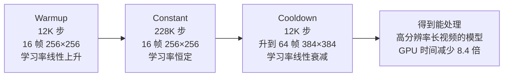
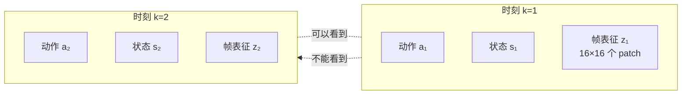
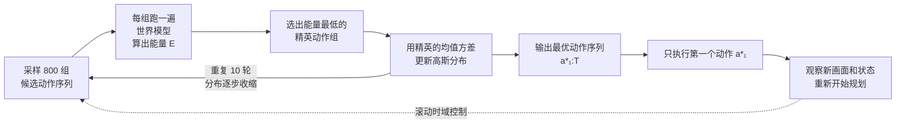

# V-JEPA 2 深度精读：从 100 万小时视频到机器人零样本抓取

> **论文标题**：V-JEPA 2: Self-Supervised Video Models Enable Understanding, Prediction and Planning
> **作者**：Mido Assran, Adrien Bardes, David Fan, Quentin Garrido, Russell Howes, Yann LeCun, Nicolas Ballas 等（27 位作者，Meta FAIR + Mila + 多所大学）
> **机构**：Meta FAIR，Mila - Québec AI Institute，Université de Montréal 等
> **发表**：arXiv 预印本，2025 年 6 月
> **arXiv**：[2506.09985](https://arxiv.org/abs/2506.09985)

**知识链接**：
- [JEPA：联合嵌入预测架构](/前置知识/013g_前置知识_JEPA联合嵌入预测架构) — V-JEPA 2 的核心架构，必须先理解"在表征空间预测"是什么意思
- [世界模型基础（World Model）](/前置知识/000t_前置知识_世界模型基础) — 理解世界模型要解决什么问题、有哪些形式
- [交叉熵方法（CEM）](/前置知识/013h_前置知识_交叉熵方法CEM) — V-JEPA 2 用它求解规划问题
- [RoPE 旋转位置编码](/前置知识/002k_前置知识_RoPE旋转位置编码) — V-JEPA 2 用 3D-RoPE 编码视频的时空位置

---

## 一、这篇论文要解决什么问题

### 1.1 机器人学习的核心瓶颈：动作数据太贵

训练一个能操作的机器人策略，主流做法是**行为克隆**（Behavior Cloning, BC）——让人遥操作机器人做几千次演示，然后训练一个网络模仿这些动作。这条路线有两个硬约束：

1. **数据必须带动作标签**。你不能只录一段视频就拿来训练，因为视频里没有"机器人当时该输出什么动作"这个信息。而采集带动作的遥操作数据，需要人、需要机器人、需要时间。
2. **只学得会见过的行为**。行为克隆本质是在拟合"看到什么状态 → 输出什么动作"的映射。如果训练数据里没有"把杯子放进抽屉"这种演示，模型不会自己发明这个行为——它没有关于"世界如何运转"的显式模型，也就无法推理"如果我先抬起夹爪会怎样"。

论文引言里把这个对比说得很清楚：行为克隆方法缺少一个显式的、关于世界的预测模型，也不利用推理时的计算来做规划，因此很难产生训练数据里没演示过的行为。而它们依赖的大规模遥操作数据既昂贵又只能利用成功轨迹——失败演示里的信息全浪费了。

### 1.2 论文的主张：先从视频里学"世界怎么运转"

V-JEPA 2 的核心主张是：**用海量无标注视频学一个关于物理世界的预测模型，只需要极少量的机器人交互数据就能把它变成规划器。**

这条路线的可行性依赖一个观察：互联网上有超过 100 万小时的视频，它们记录了海量的物理世界规律——物体怎么下落、怎么堆叠、怎么被抓起来、被人移动时怎么变化。这些视频**没有动作标签**（你不知道拍摄者做了什么动作），但它们**有状态序列**（你能看到世界如何从一个状态变到下一个状态）。状态序列本身就蕴含了物理规律。

论文的做法分三步：

> **看图重点**：注意数据量的悬殊对比——阶段一用了 100 万小时互联网视频，阶段二只用了 62 小时机器人数据（不到前者的万分之一）。这条路线成立的关键在于：物理直觉从廉价的大规模视频里学，而"动作如何改变世界"这个映射只需要少量数据来对齐。

三个阶段分别对应论文的三个技术贡献，本文按这个顺序展开。

### 1.3 贯穿全文的例子

后面每一节都用同一个场景来解释：**一个新实验室里的 Franka Panda 机械臂，桌面上放着一个红色纸杯，任务是把它抓起来放到旁边的架子上。**

这个例子的价值在于它贯穿了三个阶段：

- **阶段一**：模型要能从视频里学到"杯子被夹爪握住时会跟着移动""杯子放上架子后会停住"这类物理规律——但这些视频可以是任何人在任何厨房里拍的。
- **阶段二**：模型要学会"如果夹爪往前伸 3 厘米，画面里的杯子会怎么变化"——这一步需要动作标签，所以要用机器人数据。
- **阶段三**：给模型一张"杯子已经在架子上"的照片，让它自己倒推出该执行什么动作序列。

关键点：**这个实验室从没出现在训练数据里**，机器人也没在训练时见过这个杯子。论文在两个月球不同的实验室各部署了一台 Franka，用的权重和推理代码完全相同，且没有采集任何这两个环境的演示数据。

---

## 二、阶段一：在表征空间做掩码去噪

### 2.1 训练任务：遮住一块视频，猜它"应该是什么样"

预训练的任务是**掩码去噪**（mask denoising）：把一段视频切成小块，随机丢掉一部分，让模型预测被丢掉部分的**表征**——注意，不是像素。

为什么是表征而不是像素，这是 V-JEPA 2 与 VideoMAE 这类方法的根本分野。用我们的例子说明：假设被遮住的那块区域是"红色杯子正在被举起"。如果要求预测像素，模型必须输出杯子上高光的具体位置、桌面木纹的走向——这些细节在给定上下文后**仍然是不确定的**，因为它们是数据里的随机事实。强迫模型拟合这些，等于让它把容量花在记忆不可预测的噪声上，而不是学习"物体如何运动"这个真正可迁移的规律。

预测表征则不同：表征是经过压缩的语义向量，它记录"这里有个圆柱形物体正在被握住"，丢掉高光和木纹的细节。于是模型被引导去学习可预测的结构，忽略不可预测的细节。这个设计理念的完整讨论见 [JEPA 前置知识](/前置知识/013g_前置知识_JEPA联合嵌入预测架构)。

### 2.2 目标函数

$$
\min_{\theta,\phi,\Delta_y}\ \big\lVert P_\phi\big(\Delta_y,\ E_\theta(x)\big) - \mathrm{sg}\big(E_{\overline{\theta}}(y)\big) \big\rVert_1
$$

**这个公式在做什么**：让预测器看着"没被遮住的视频"和"被遮位置在哪"，猜出被遮部分的表征，与"标准答案的表征"比对，误差越小越好。损失只算在被遮住的位置上。

::: details 📐 公式详解（点击展开）

| 子表达式 | 它是谁 | 它在干嘛 |
|---------|--------|---------|
| $E_\theta(x)$ | **主编码器** | 把可见的视频块压成一组向量。$x$ 是没被遮的输入，$\theta$ 是它的可训练权重 |
| $\Delta_y$ | **空位标记** | 一组可学习的掩码 token，标明"要补的是哪些位置"。预测器看不到被遮内容，只能靠这些位置信息定位 |
| $P_\phi(\Delta_y, E_\theta(x))$ | **预测器** | 结合可见信息和空位坐标，输出对空位的猜测。$\phi$ 是它的权重 |
| $E_{\overline{\theta}}(y)$ | **目标编码器** | 把真实被遮内容 $y$ 也压成向量，作为比对基准。注意它的权重是 $\overline{\theta}$ 而非 $\theta$ |
| $\mathrm{sg}(\cdot)$ | **停止梯度** | stop-gradient：切断梯度，目标编码器不通过反向传播更新 |
| $\lVert\cdot\rVert_1$ | **L1 距离** | 各维度差的绝对值之和。相比 L2 的平方惩罚，对少数异常样本不那么敏感 |

**用人话读**："给模型看一段被挖了洞的视频，让它猜洞里是什么，但不用猜出像素——只要猜出的语义向量和真实内容的向量足够接近就行。"

**为什么 $E_{\overline{\theta}}$ 的权重是带上划线的 $\overline{\theta}$**：$\overline{\theta}$ 表示主编码器权重的**指数移动平均**（Exponential Moving Average, EMA）。它不是通过梯度学出来的，而是每次主编码器更新后，按 $\overline{\theta} \leftarrow m\overline{\theta} + (1-m)\theta$ 缓慢跟随。这样"标准答案"变化很慢，主编码器无法通过瞬间改变答案来作弊（把一切映射到同一个点，让损失归零）。这是防止**表示坍塌**（representation collapse）的关键机制，README 里那张架构图的两条虚线正是在画这个。

**为什么要 stop-gradient**：如果梯度能回到目标编码器，两条路径就可以"合谋"——同时朝坍塌方向移动，损失降到 0 但表征全废。停止梯度保证了只有一条路径被优化，目标始终是一个移动的、不由梯度控制的参照物。

**只在被遮位置算损失**：可见位置的答案就在眼前，预测它等于白送。只有被遮住的部分才需要真正的推理，所以损失只加在那里。
:::

### 2.3 架构细节

编码器和预测器都是视觉 Transformer（Vision Transformer, ViT）。三个值得注意的设计：

**Tubelet 切分**：视频被切成尺寸为 $2\times16\times16$ 的 tubelet——时间方向 2 帧、空间方向 $16\times16$ 像素为一个 token。这是"3D patch"的意思：图像 patch 是二维的，视频 patch 多了时间维。用 $2$ 帧而非 $1$ 帧作为时间步长，是为了让每个 token 自带"局部运动"信息，而不是让模型自己去相邻帧里推。

**多块掩码**（multiblock masking）：不是随机遮单个小块，而是采样若干大块整体遮掉。目的是让预测任务足够难——如果遮得太碎，模型可以靠相邻 token 插值蒙混过关；遮成大块，模型必须真正理解"这段时空里发生了什么"才能补出表征。要预测一个包含多个物体的时空块，模型必须知道物体怎么运动、动作如何在时间上延续，这正是世界模型需要的能力。

**3D-RoPE 位置编码**：早期 V-JEPA 用绝对位置编码（sincos），V-JEPA 2 换成了三维旋转位置编码（Rotary Position Embedding, RoPE）。做法是把特征维度切成约三等份，分别对应时间、高度、宽度三个轴，各自施加一维旋转。这样做的关键好处是**长度外推**：绝对位置编码在输入帧数或分辨率变化时失效，而 V-JEPA 2 需要在训练和评测时使用不同的分辨率和帧数（阶段二的 cooldown 就是在更高分辨率上做的）。论文提到，3D-RoPE 相比绝对编码能显著稳定最大模型的训练。RoPE 的原理见 [RoPE 旋转位置编码](/前置知识/002k_前置知识_RoPE旋转位置编码)。

### 2.4 四味"扩容配方"

把 V-JEPA 从 3 亿参数的实验模型推成 10 亿参数、见过 100 万小时视频的 V-JEPA 2，靠的是四项改动。论文用 6 个分类任务的平均准确率量化了每一项的贡献：

> **看图重点**：基线是 ViT-L/16 在 200 万视频（VM2M）上训练的结果，平均 84.2。四项改动依次累加：数据 200 万→2200 万（+1.0）、模型 3 亿→10 亿参数（+1.5）、训练 9 万→25.2 万步（+0.8）、分辨率 256→384 且帧数 16→64（+0.7），最终达到 88.2，累计 +4.0 分。关键观察是**没有一项是负收益**——这确认了视频自监督学习确实遵循规模化规律。

四项改动各自的机制：

| 配方 | 具体做法 | 增益 | 为什么有效 |
|------|---------|------|-----------|
| **数据扩容** | 从 200 万扩到 2200 万视频（VM22M），混合 SSv2、Kinetics、HowTo100M、YT-Temporal-1B 和 ImageNet | +1.0 | 更多视觉覆盖，外观类任务（Kinetics、COIN、ImageNet）受益最明显 |
| **数据清洗** | 对 YT1B 做基于检索的筛选：提取场景嵌入，按目标分布（Kinetics + SSv2 + COIN + EpicKitchen）做聚类检索，过滤卡通/剪贴画等噪声内容 | +1.4（单独对比） | 无标注的 YouTube 视频质量参差，噪声会拖累表征质量 |
| **模型扩容** | ViT-L（3 亿）→ ViT-g（10 亿），编码器用同一个 ViT-small 规模的预测器 | +1.5 | 运动理解（SSv2 +1.6）和外观理解（Kinetics +1.5）同时受益 |
| **训练延长** | 9 万步 → 25.2 万步，改用 warmup-constant-decay 学习率调度 | +0.8 | 更多数据需要更多步数才能被充分利用；warmup-constant-decay 让长训练的调参更省事 |
| **渐进分辨率** | warmup + constant 阶段用 16 帧 256×256，只在最后的 cooldown 阶段升到 64 帧 384×384 | +0.7 | 见下 |

**渐进分辨率训练为什么重要**，值得单独说。直接从头训练一个能吃 $64\times384\times384$ 输入的 ViT-g，需要大约 **60 GPU 年**。原因是计算量随帧数和分辨率是超线性增长的（注意力对 token 数是平方复杂度，而 token 数正比于帧数×分辨率²）。论文的做法是把训练分成三段：

> **看图重点**：昂贵的高分辨率训练只占最后 12K 步（总步数的 4.8%），却让模型获得了处理长视频高分辨率输入的能力。这就是 8.4 倍加速的来源。论文还验证了这种"先便宜后贵"的顺序不会损失性能——cooldown 阶段升分辨率的效果和全程高分辨率训练相当。

一个有趣的负面结果：论文尝试把视频延长到 128 帧和 256 帧，**没有观察到进一步收益**，64 帧是这组理解任务上的拐点。

---

## 三、阶段二：把预测变成"动作条件"的

### 3.1 阶段一缺了什么

阶段一的模型能预测"被遮住的视频段应该是什么表征"，但它**不知道动作的作用**。给定当前画面，它能告诉你"接下来最可能发生什么"，但不能回答"如果我往左移动夹爪，接下来会发生什么"。

差别在于因果方向。阶段一学的是 $P(\text{未来} \mid \text{过去})$——被动地预测世界自然演化。规划需要的是 $P(\text{未来} \mid \text{过去}, \text{动作})$——主动地预测"我的干预会造成什么后果"。没有这一项，模型只能预测，不能规划。

阶段二就是补上这个条件项：**冻结阶段一学好的编码器，在上面训练一个新的、以动作为条件的预测器**。注意"冻结"二字——编码器不动，只训练预测器。这让阶段二的数据需求极小（62 小时），因为要学的不是"世界长什么样"（这已经在阶段一学好了），只是"动作如何影响世界的表征"。

### 3.2 数据与输入

训练数据来自 **Droid 数据集**——一个用遥操作采集的桌面 Franka Panda 机械臂数据集。论文只用其中的原始视频和末端执行器状态，**不用任何任务标签、奖励、或成败标记**。这一点很重要：它意味着失败的演示同样有价值，因为模型学的不是"如何完成任务"，而是"动作会产生什么后果"。

具体的数据组织：

| 项目 | 设置 | 说明 |
|------|------|------|
| 数据量 | 62 小时（约 2.3 万条轨迹） | 只保留长度 ≥ 4 秒的视频 |
| 片段长度 | 4 秒 | 随机采样 |
| 帧率 | 4 fps | 降采样，得到 16 帧 |
| 分辨率 | $256\times256$ | 与编码器预训练一致 |
| 末端状态 $s_k$ | 7 维 | 3 维笛卡尔位置 + 3 维欧拉角取向 + 1 维夹爪开合 |
| 动作 $a_k$ | 7 维 | 相邻两帧末端状态的**变化量** |

这里有一个值得展开的设计：**动作为什么定义成"变化量"而不是绝对位置**。动作 $a_k = s_{k+1} - s_k$ 表示"从第 $k$ 帧到第 $k+1$ 帧，末端移动了多少、夹爪开合变了多少"。用增量而非绝对值的理由有两点：其一，模型学的是"状态转移"而非"目标位置"，这与世界模型的本质一致；其二，增量形式的动作在物理上更接近机器人底层控制器的接口（速度指令），部署时不需要额外的坐标变换。

末端状态和动作都是 7 维，且有明确的维度含义——这个设计让模型可以直接在笛卡尔空间里规划，不需要逆运动学。

### 3.3 两个损失函数：教师强制与滚动展开

阶段二的核心是训练一个自回归预测器。这里有个经典问题：训练时如果总是喂真实历史，模型在推理时的误差会累积——因为它从没练习过在自己犯错后继续预测。V-JEPA 2 用两个损失共同解决这个问题。

**教师强制损失（teacher forcing）**：每一步都喂**真实的**历史，让模型预测下一步。

$$
\mathcal{L}_{\text{teacher-forcing}}(\phi)\coloneqq\frac{1}{T}\sum^{T}_{k=1}\Big\lVert P_\phi\big((a_t,s_t,E(x_t))_{t\leq k}\big)-E(x_{k+1})\Big\rVert_1
$$

**这个公式在做什么**：把第 1 到第 $k$ 步的真实动作、真实末端状态、真实帧编码串起来喂给预测器，让它预测第 $k+1$ 帧的表征，对全部 15 个时间步求平均 L1 误差。

::: details 📐 公式详解（点击展开）

| 子表达式 | 它是谁 | 它在干嘛 |
|---------|--------|---------|
| $E(x_t)$ | **冻死的编码器** | V-JEPA 2 编码器逐帧编码，权重固定不动，只提供"世界现在长什么样"的表征 $z_t$ |
| $s_t$ | **本体感知** | 第 $t$ 步的末端状态（位置+取向+夹爪），告诉模型"我的手在哪" |
| $a_t$ | **动作** | 第 $t$ 步的动作增量，告诉模型"我做了什么" |
| $(a_t,s_t,E(x_t))_{t\leq k}$ | **完整历史** | 把动作、状态、画面表征按时间交错排成一个序列 |
| $P_\phi(\cdot)$ | **预测器** | 约 3 亿参数的 Transformer，输出对下一帧表征的猜测 $\hat{z}_{k+1}$ |
| $E(x_{k+1})$ | **真实答案** | 下一帧真实的编码，注意这里**没有** stop-gradient 也没有 EMA——因为编码器已经冻结，不存在坍塌风险 |
| $T=15$ | **序列长度** | 16 帧视频产生 15 个转移，所以 $T=15$ |

**用人话读**："把前 $k$ 步真实发生的一切（画面、手的位置、动作）喂给预测器，让它猜下一步画面会变成什么样，和真实答案比差距。"

**为什么这里不需要 EMA 和 stop-gradient**：阶段一的坍塌风险来自"主编码器和目标编码器可能合谋"。阶段二里编码器是冻结的、外部给定的，标准答案是固定的（$E(x_{k+1})$ 不随预测器变化），预测器不可能通过改变答案来作弊。所以这里只用朴素的重建损失。
:::

**滚动展开损失（rollout loss）**：把预测器自己的输出**反馈回去当作输入**，让它连续预测多步。

$$
\mathcal{L}_{\text{rollout}}(\phi)\coloneqq\big\lVert P_\phi(a_{1:T},s_1,z_1)-z_{T+1}\big\rVert_1
$$

**这个公式在做什么**：从起点出发，让模型自己滚 $T$ 步——每一步的输入都包含它上一步的猜测——最后和第 $T+1$ 步的真实表征比对，惩罚长程漂移。

::: details 📐 公式详解（点击展开）

| 子表达式 | 它是谁 | 它在干嘛 |
|---------|--------|---------|
| $P_\phi(a_{1:T},s_1,z_1)$ | **闭卷考试** | 只给起点和整段动作序列，中间不许看答案，让模型自己一路推下去 |
| $z_1$ | **起点** | 第 1 帧的真实编码——这是唯一被允许看到的真实信息 |
| $z_{T+1}$ | **终点答案** | 第 $T+1$ 帧的真实编码 |
| $T=2$ | **展开步数** | 实际只滚 2 步，即只让梯度穿过 1 次循环 |

**用人话读**："不给中间答案，让模型自己滚两步，看它滚到的地方和真实情况差多远。"

**为什么需要这个损失**：教师强制损失有个盲区——它每一步都喂真实历史，模型从没经历过"我的输入里含有我自己的误差"这种情况。但推理时（规划）必须自回归展开，误差会累积。加上滚动损失，模型被迫学会在自身预测有偏差的情况下仍然保持方向，本质上是把"长程漂移"也纳入优化目标。论文里这个损失是提升自回归展开质量的关键。

**为什么 $T=2$ 而不是更大**：为简化实现，只在 1 次循环上求梯度。步数越多，计算图和显存开销增长越快，而 2 步已经足以让模型感受到"误差累积"这个问题。这是一个工程上的折中。
:::

**总损失**就是把两者相加：$L(\phi) = \mathcal{L}_{\text{teacher-forcing}}(\phi) + \mathcal{L}_{\text{rollout}}(\phi)$，只对预测器权重 $\phi$ 求最小值（编码器已冻结）。两项各司其职——教师强制保证单步精度，滚动展开抑制长程漂移。

### 3.4 预测器架构：块因果注意力

预测器是一个约 3 亿参数的 Transformer（24 层、16 头、隐藏维度 1024、GELU 激活）。输入的动作、末端状态和展平后的特征图各自经过一个可学习的仿射变换映射到隐藏维度；输出再经过一个仿射变换映射回编码器的嵌入维度。

关键在于**块因果注意力**（block-causal attention）：同一时刻的所有 token 可以互相看见，但只能看见**当前和过去**时刻的 token，看不到未来。

> **看图重点**：块因果意味着信息只能从左往右流。时刻 2 的每个 token 都能注意到时刻 1 的动作、状态、画面，以及时刻 2 自己的同伴；但时刻 1 看不到时刻 2 的任何东西。这既符合因果物理（未来不能影响过去），也让训练可以并行——整段序列一次前向就能算出所有时刻的预测。这与标准 GPT 的因果掩码是同一个思想，区别在于"块"的粒度：掩码在时间块层面而非单个 token 层面。

位置编码上，视频 patch 用完整的 3D-RoPE（时间+高+宽），而动作和姿态 token 只施加**时间维度的旋转**——因为它们没有空间结构。

---

## 四、阶段三：把世界模型变成规划器

### 4.1 核心思路：把"达到目标"变成"最小化距离"

模型训练好了，但它只是一个预测器。怎么用它控制机器人？V-JEPA 2 用的是**模型预测控制**（Model Predictive Control, MPC）——不训练策略网络，而是在推理时用世界模型搜索动作。

思路很直接：给一张目标状态的照片（比如"杯子已经在架子上"），把它和当前画面都用编码器编成表征。然后问：**执行哪一串动作，能让世界模型想象出的未来表征，最接近目标的那个表征？**

这个"接近程度"就是能量函数：

$$
\mathcal{E}(\hat{a}_{1:T};\ z_k,s_k,z_g)\coloneqq\big\lVert P(\hat{a}_{1:T};s_k,z_k)-z_g\big\rVert_1
$$

**这个公式在做什么**：度量"从当前状态出发、执行动作序列 $\hat{a}_{1:T}$ 之后，世界模型想象出的未来画面，与目标画面在语义上差多远"。

::: details 📐 公式详解（点击展开）

| 子表达式 | 它是谁 | 它在干嘛 |
|---------|--------|---------|
| $z_k = E(x_k)$ | **现在** | 当前帧的编码，当前世界状态 |
| $s_k$ | **我的手** | 当前末端状态，作为滚动展开的起点 |
| $z_g = E(x_g)$ | **目标** | 目标图像的编码。注意它是**图像**而非坐标——任务通过"看图"指定 |
| $\hat{a}_{1:T}$ | **候选动作** | 待优化的动作序列，规划视界为 $T$。带上标 $\hat{}$ 表示这是搜索变量 |
| $P(\hat{a}_{1:T};s_k,z_k)$ | **想象** | 世界模型在这串动作下自回归推演，输出 $T$ 步之后的预测表征 |
| $\lVert\cdot\rVert_1$ | **语义距离** | L1 距离。注意是在**表征空间**比较，不是在像素空间 |
| $a^\star\coloneqq\arg\min \mathcal{E}$ | **答案** | 使能量最小的那串动作 |

**用人话读**："让世界模型想象一下'照这串动作做下去，最后会变成什么样'，算想象的结果离目标图片的语义有多远，距离越小说明这串动作越好。"

**为什么在表征空间算距离而不是像素空间**：像素比较会被无关细节干扰——目标照片的光照和当前画面的光照可能不同，桌面上可能多了别的杂物。表征空间里这些都被压缩掉了，留下的主要是"物体在哪、姿态如何"这类语义信息。这与阶段一"预测表征而非像素"是同一个设计哲学的延续。

**为什么目标用图像而不是坐标**：图像目标允许指定任何可以通过视觉描述的配置——"杯子在架子上"这种关系，用笛卡尔坐标很难写出来（涉及物体识别和空间关系）。用图像则天然表达关系型目标。代价是模型必须能从单目 RGB 图像里推断出这些语义，这正是阶段一学到的能力。
:::

### 4.2 用 CEM 求解

能量函数写出来了，但它对动作的梯度不好求（内部有 Transformer 的注意力、自回归展开、掩码处理）。所以 V-JEPA 2 用**交叉熵方法**（Cross-Entropy Method, CEM）——一种无梯度的采样优化算法。

在每一步规划中，CEM 的循环是：从高斯分布里采一批候选动作序列 → 每组都跑一遍世界模型算能量 → 挑出能量最低的若干组 → 用这些"精英"的均值和方差替换分布参数 → 重复若干轮 → 输出最终分布的均值。

> **看图重点**：两个要点。第一，搜索是在**潜空间**里做的——世界模型只预测表征，不算像素，所以每次评估很便宜。第二，规划出 $T$ 步动作但**只执行第一步**，然后重新规划——这就是滚动时域控制（receding horizon control），它让系统能闭环纠错，即使模型有误差也能在下一步修正。

CEM 的完整原理和数值例子见 [交叉熵方法前置知识](/前置知识/013h_前置知识_交叉熵方法CEM)。

### 4.3 能量景观长什么样

论文对训练好的世界模型做了一个很有说服力的检验：固定当前画面和目标画面，把候选动作限制在二维平面（$\Delta x$ 和 $\Delta y$，$\Delta z = 0$）上扫一遍，画出能量曲面。

> **看图重点**：图中星号是能量的最小值位置，叉号是真实的"从起始帧到目标帧"的动作。两者很接近（能量最小值在 $(\Delta x,\Delta y)\approx(0,-0.05)$，真实动作在 $(0,-0.10)$），说明模型学到的表征空间确实把"动作效果"编码进去了。**注意**：这张图是按论文描述重建的示意图，不是论文原始数据。论文强调的是两点：能量最小点靠近真实动作（说明模型理解了动作的因果效果），以及曲面光滑且局部凸（说明 CEM 这样基于采样的优化容易找到最优解，不会陷入无数局部极小）。

第二点尤其重要。如果能量景观充满尖锐的局部极小值，CEM 需要极多的采样点才能找到全局最优；而光滑局部凸的景观意味着"沿着下坡方向撒点就能收敛"，这对采样优化极其友好。这是"在表征空间预测"带来的一个额外红利——表征空间本身是平滑的（因为它是连续向量空间，且被 L1 损失训练过），不像像素空间那样充满高频噪声。

---

## 五、实验结果

### 5.1 零样本真机操作

这是论文最有分量的结果：V-JEPA 2-AC 在两个不同的实验室、两台从未出现在训练数据里的 Franka 上，**零样本**完成抓取和放置任务。没有采集任何这两个环境的演示数据，没有任务特定的训练，没有奖励信号。

对比的基线有两个：Octo（一个在 Open-X Embodiment 的 100 万条轨迹上预训练、再用 Droid 微调的视觉-语言-动作模型）和 Cosmos（NVIDIA 的视频生成世界模型，论文用官方代码在 Droid 上微调了动作条件版本）。

> **看图重点**：左图是 Lab 2 上的成功率对比（V-JEPA 2-AC 对比 Cosmos）。两者在 Reach 上都不错，但一旦涉及物体交互，差距就拉开了——Grasp 任务上 V-JEPA 2-AC 是 60% vs 20%，Pick-and-Place 是 80%/50% vs 0%。右图是对数坐标下的规划耗时：Cosmos 每个动作要 4 分钟，V-JEPA 2-AC 只要 16 秒，快了 15 倍，而且是**在采样数多 10 倍的情况下**（800 vs 80）实现的。

**为什么 V-JEPA 2-AC 快这么多**：Cosmos 是像素空间的扩散模型，每评估一组候选动作就要生成一整段视频（去噪几百步），而且规划视界每增加一步，生成的视频就多一帧。V-JEPA 2-AC 只在表征空间预测，一次前向就是几个 Transformer 层，而且特征图比像素图小得多（$16\times16$ 个 token vs $256\times256$ 个像素）。这个效率差距是"表征空间"相对"像素空间"的直接体现。

**和 Octo 的对比**更说明问题。论文 Table 2 的完整数据：

| 方法 | Reach | Grasp 杯 | Grasp 盒 | 持物移动 杯 | 持物移动 盒 | 抓放 杯 | 抓放 盒 |
|------|-------|---------|---------|------------|------------|--------|--------|
| Octo（行为克隆） | 100% | 15% | 0% | 15% | 70% | 15% | 10% |
| **V-JEPA 2-AC** | **100%** | **65%** | **25%** | **75%** | **75%** | **80%** | **65%** |

（数字为两个实验室的平均值，每项 10 次试验）

Octo 在"移动到目标位置"这类任务上表现完美（100%），但在任何需要精确物体交互的任务上崩溃（抓取纸杯 15%，抓取盒子 0%）。这个对比恰好体现了论文引言里的批评：**行为克隆学到的是"看到这个场景就输出这个动作"的映射，它没有关于"我的动作会如何改变世界"的模型**。当部署环境与训练环境有差异时（不同实验室、不同光照、不同物体），映射失效了。

而 V-JEPA 2-AC 每一项都显著更高。特别是抓放任务——它用了三个子目标图像（抓住、移到附近、放下），模型依次优化，成功率 80%/65%。论文指出，Octo 在 Lab 1 和 Lab 2 的表现几乎一样（说明它没有适应新环境的能力，只是记忆了某种通用模式），而 V-JEPA 2-AC 在物体交互任务上明显更好。

一个值得注意的细节：任务成败和物体类型强相关。纸杯（杯）比盒子（盒）更容易抓，因为杯子可以"一根手指伸进去、绕着杯沿夹住"；盒子则需要更精确的夹爪开合控制。论文坦诚地指出所有模型都受这个影响，但 V-JEPA 2-AC 在所有任务上都是最高的。

### 5.2 理解能力：探针分类

一个自然的问题是：既然阶段一用 100 万小时视频学到了表征，这个表征质量到底如何？论文用**冻结编码器 + 训练一个轻量探针**（attentive probe，4 层 Transformer，最后用可学习查询做交叉注意力）的方式来评测。

评测任务分成两类：**运动理解**（需要看多帧才能分类，如 SSv2、Diving-48、Jester）和**外观理解**（单帧就能分类，如 Kinetics-400、COIN、ImageNet）。

V-JEPA 2 ViT-g 在运动理解上大幅领先，在外观理解上有竞争力：

| 模型 | 参数量 | SSv2 | ImageNet | 6 任务平均 |
|------|--------|------|----------|-----------|
| VideoMAEv2 | 1B | 56.1 | 71.4 | – |
| InternVideo2-1B | 1B | 67.3 | – | – |
| VideoPrism | 1B | 68.5 | – | – |
| **V-JEPA 2 ViT-g** | **1B** | **75.3** | **84.6** | **87.5** |
| **V-JEPA 2 ViT-g 384** | **1B** | – | – | **88.2** |

SSv2 上 75.3 vs InternVideo2 的 67.3、VideoPrism 的 68.5——差距明显。ImageNet 上 84.6 比 V-JEPA 1 的 80.0 高出 4.6 分。论文的结论是：V-JEPA 2 在需要**运动理解**的任务上显著优于所有对比的视觉编码器，在**外观理解**任务上保持竞争力，综合平均分最高（87.5，384 版本 88.2）。

这个结果的意义在于：V-JEPA 2 的目标是理解物理世界的动态，而不是单纯做图像分类。它在运动理解上的优势正是"预测表征"这个设计目标的直接体现——要预测被遮时空块的表征，模型必须理解物体如何运动。而外观理解任务不需要这个能力，所以优势不明显。

### 5.3 预测能力：人类动作预期

**动作预期**（action anticipation）是比"理解当前动作"更难的任务：给一段视频上下文，预测**1 秒之后**会发生什么动作。评测用 Epic-Kitchens-100（EK100）——100 小时的第一视角厨房视频，45 个厨房，3568 个动作标签。

这里评测的不是分类，而是用编码器加预测器一起预测未来，再用探针分类。V-JEPA 2 的结果：

> **看图重点**：左三组是专门为这个任务设计的基线（包括 80 亿参数、用大语言模型的 PlausiVL），右四组是 V-JEPA 2 不同规模。注意两件事：一，V-JEPA 2 的 3 亿参数版本（32.7）就已经超过 80 亿参数的 PlausiVL（27.6）；二，V-JEPA 2 的性能随模型规模**线性增长**（32.7 → 36.5 → 38.0 → 39.7），这是自监督学习"规模带来收益"的又一个证据。

论文强调这里只用了一个轻量探针（冻结编码器），没有针对这个任务做任何专门设计，却超过了所有专门为此任务设计的模型。相对之前最好成绩提升了 44%（39.7 vs 27.6）。

论文还展示了成功和失败的例子。成功的例子中，模型不仅给出正确的 top-1 预测，top-2 到 top-5 也都是合理的——比如正确动作是"洗水槽"，模型还给出了"打开水龙头""擦墙"（看到水龙头和墙，这些确实是合理的后续动作）。失败例子中，模型给出了"关门""放下调料包"等合理动作，但错在物体的具体类别（真实是"茶包"）。这说明模型理解的是**场景语义**，失败主要来自细粒度物体识别而非动作逻辑错误。

### 5.4 与语言对齐：视频问答

最后一块是**视频问答**（Video Question Answering, VidQA）。做法是把 V-JEPA 2 作为视觉编码器，接一个语言模型（Llama 3.1 8B），用 8850 万图文/视频-文本对做对齐训练。

这里最有意思的发现是：**一个完全没有语言监督训练的视觉编码器，可以超过用语言监督训练的编码器**。这违反了当时的常规认知——主流做法是先用 CLIP 这样的图文对比学习编码器（因为它的表征空间天生和语言对齐），再接语言模型。V-JEPA 2 从来没接触过文本，却在对齐后表现更好。

在受控对比中（同一个语言模型、同一批数据，只换编码器），V-JEPA 2 在 MVP、TemporalBench、TVBench 这些**需要时序理解**的基准上都优于 DINOv2、SigLIP-2 和 Perception Encoder。唯一略输的是 PerceptionTest。论文的解释是：视频编码器天然理解时空关系，而图像编码器逐帧处理视频时丢掉了时序信息。

规模化后（8850 万对齐数据），V-JEPA 2 在 80 亿参数级别达到多个基准的最优：

| 基准 | 考察能力 | V-JEPA 2 | 前 SOTA（PLM 8B） |
|------|---------|----------|------------------|
| PerceptionTest | 记忆、抽象、物理、语义 | **84.0** | 82.7 |
| MVP | 物理世界理解 | **44.5** | 39.7 |
| TempCompass | 时序理解 | **76.9** | 72.7 |
| TemporalBench | 时序推理 | **36.7** | 28.3 |
| TOMATO | 记忆能力 | **40.3** | 33.2 |

TemporalBench 上 +8.4、TOMATO 上 +7.1、MVP 上 +4.8——这些恰好都是**时序相关**的能力，与"视频编码器比图像编码器更懂时间"的直觉一致。论文也承认在 TVBench 和 MVBench 上没有超过前 SOTA，这两个基准更偏重单帧外观特征。

---

## 六、局限与边界

论文自己列了三条局限，每一条都指向后续研究的空间：

**相机位置敏感**。模型预测时没有相机标定，必须从单目 RGB 图像里**隐式推断动作坐标系**——也就是说，它要学会"画面里往右移动 3 像素，对应机器人坐标系里的哪个方向"。这在机器人基座可见时是可行的，但如果基座在画面外，这个推断就是病态问题（ill-posed），会导致预测错误。论文坦诚地说：实际部署时他们**手工尝试了多个相机位置**才找到一个在所有实验中都能用的。这是一个很实际的工程约束——模型需要相机基座可见。

**长时程规划受限**。两个原因：一是自回归预测的误差累积——滚得越长，表征预测越不准；二是搜索空间随视界指数增长。这导致论文的抓放任务必须拆成三个子目标图像（抓住、移到附近、放下），依次优化。论文明确指出，"没有子目标的抓放"这类**非贪心任务**（需要先做看似"远离目标"的动作）还需要更长的视界，是未来工作。

**目标必须是图像**。当前形式假设我们知道目标状态的视觉描述。这限制了很多应用场景——很多任务的目标用语言描述更自然（"把杯子放到架子上"比给一张照片更方便）。论文指出，把世界模型与语言模型对齐，让目标可以用自然语言指定，是重要的未来方向，而第 5.4 节的 VQA 工作可以作为起点。

此外，论文提到当前模型聚焦于**约 16 秒以内**的预测，这对抓取、持物移动这类简单操作够用，但更复杂的任务需要能在多个时间尺度上做抽象的分层模型。

---

## 七、总结

### 7.1 核心贡献回顾

V-JEPA 2 用一条"三阶段"路线回答了论文开头提出的问题：能否主要靠观察来学习理解世界并学会行动？

| 阶段 | 输入数据 | 产出 | 关键设计 |
|------|---------|------|---------|
| **一：自监督预训练** | 100 万+ 小时视频 + 100 万图像 | 通用视觉编码器 | 在表征空间做掩码去噪 + EMA 目标编码器防坍塌 |
| **二：动作条件化** | 62 小时机器人数据 | 动作条件世界模型 V-JEPA 2-AC | 冻结编码器，训练自回归预测器；教师强制 + 滚动展开双损失 |
| **三：规划** | 目标图像 | 动作序列 | CEM 在潜空间最小化能量 + MPC 闭环 |

### 7.2 与相关工作的对比

| 维度 | 行为克隆（Octo 等） | 像素空间世界模型（Cosmos 等） | **V-JEPA 2-AC** |
|------|-------------------|---------------------------|----------------|
| 学习目标 | 状态 → 动作的映射 | 生成未来像素 | 预测未来**表征** |
| 需要的数据 | 大量带动作的专家演示 | 大量视频 + 交互数据 | 大量无标签视频 + 62 小时交互数据 |
| 能否利用失败数据 | 不能（只学成功轨迹） | 能 | 能（只学动作效果，不学任务成败） |
| 规划代价 | 无规划（直接前馈） | 每步 4 分钟 | 每步 16 秒 |
| 零样本泛化到新环境 | 差 | 中等 | 好 |
| 能否产生未见过的行为 | 不能 | 理论可以 | 可以（在潜空间搜索） |

**最核心的一句话**：V-JEPA 2 证明了"在表征空间预测"这个看似微小的设计选择，在大规模下会带来三重重大的连锁收益——更高效的训练（预测表征比生成像素便宜）、更语义化的表征（自然过滤不可预测的细节）、以及更快的规划（潜空间搜索比像素空间搜索快 15 倍）。

### 7.3 对机器人学习实践的启示

从工程角度，这篇论文给出了几条可以直接借鉴的经验：

1. **无标签视频是巨大的资产**。互联网视频虽然没有动作标签，但它蕴含的物理规律足以支撑一个可用的世界模型。62 小时机器人数据能对齐上 100 万小时视频学到的表征，这个杠杆比例非常可观。
2. **失败演示也有价值**。世界模型学的是"动作会产生什么后果"，而不是"如何完成任务"，所以失败轨迹和成功轨迹一样有用。这打破了行为克隆"只能用成功数据"的限制。
3. **推理时的计算是可以利用的资源**。与其训练一个庞大的策略网络，不如让一个较小的世界模型在推理时搜索。论文指出的方向——用前馈策略初始化规划问题、或用梯度法替代 CEM——说明这个搜索还可以做得更快。
4. **表征空间的选择决定一切**。V-JEPA 2 的全部优势（效率、泛化、语义性）都来自"预测表征而非像素"这一个决定。选择什么样的表征空间，就是选择模型会把容量花在什么地方。

**延伸阅读**：
- [JEPA：联合嵌入预测架构](/前置知识/013g_前置知识_JEPA联合嵌入预测架构) — 本文架构的通用原理
- [交叉熵方法（CEM）](/前置知识/013h_前置知识_交叉熵方法CEM) — 规划器的求解算法详解
- [世界模型基础（World Model）](/前置知识/000t_前置知识_世界模型基础) — 世界模型在 RL 与 VLA 中的整体图景
- [世界模型强化学习综述：从 Dreamer 到 DIAMOND](/论文综述/S10_世界模型强化学习综述) — 世界模型用于策略学习的另一条路线
- [SRPO：自参考策略优化](/论文综述/011_SRPO_自参考策略优化) — V-JEPA 2 的潜空间表征被用作轨迹相似度度量的下游工作
