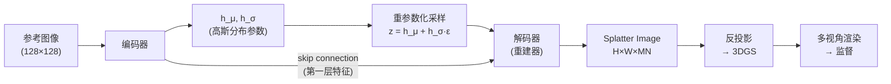
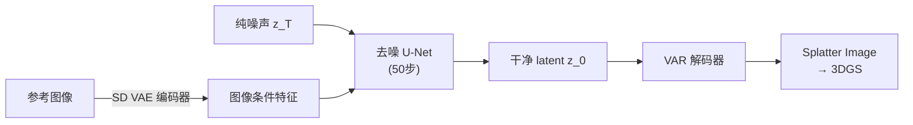

# CompleteGS 深度精读：单图生成完整 360° 高斯泼溅，用扩散模型补全不可见区域

> **论文标题**：Complete Gaussian Splats from a Single Image with Denoising Diffusion Models
> **时间**：2025 年 8 月
> **arXiv**：2508.21542

**知识链接**：
- [3D Gaussian Splatting：用一堆椭球把真实场景搬进电脑](/前置知识/007a_前置知识_3D_Gaussian_Splatting三维场景重建) — 本文的输出表示，需要先理解 3DGS 是什么
- [DDPM：去噪扩散概率模型](/前置知识/000b_前置知识_扩散模型DDPM) — 本文潜在扩散阶段的基础，理解前向加噪与反向去噪

---

> **一句话**：不用任何 3D 标注数据，只用多视角图像自监督地训练一个"变分自动重建器"，再在它学到的 latent 空间上跑扩散模型——输入一张正面照，生成一个支持完整 360° 渲染的 3DGS，背面由扩散模型合理补全而不是模糊平均。
>
> **为什么要读**：单图 3D 重建最棘手的问题不是可见面，而是背面——回归方法天生会把所有可能的背面平均成一坨糊，而本文用一个轻量的两阶段架构（VAR + LDM）优雅地绕开了这个陷阱，还做到了单张 A100 可训、推理只需 3 秒。

---

## 贯穿全文的例子

> 一个白瓷咖啡杯，只拍了正面：杯身有一行英文字，杯耳在右侧可见，但背面完全未知——可能有图案，可能纯白，可能有凹槽。本文要从这一张照片出发，生成一个可以从任意角度渲染的完整 3DGS。

---

## 一、回归方法的背面为什么一定糊

这是整篇文章出发点。

回归方法是这样工作的：把输入图像喂进网络，网络直接输出一组 3DGS 参数，然后用渲染损失监督。它有一个深层的信息论问题：**从一张正面图到背面外观，是一对多映射**——背面有无数种合理可能，但网络只能输出一个确定的答案。

训练时，数据集里同一类咖啡杯的背面各不相同，网络看到的监督信号互相矛盾。梯度下降在多个矛盾的目标之间找最小二乘解，结果就是把所有可能的背面"平均"在一起，得到一个颜色灰蒙蒙、几何软塌塌的背面。这不是参数量或训练时间的问题，而是回归目标函数的结构性缺陷。

解法只有一个：把问题从"预测一个值"改成"从一个分布中采样"。扩散模型就是做这件事的——它不输出一个固定答案，而是从一个合理可能的背面分布里采样一个具体的、自洽的背面。

---

## 二、VAR：在 3DGS 的 latent 空间上建一个可压缩、可采样的表示

在 latent 扩散模型之前，需要先有一个"latent 空间"——一个把 3DGS 压缩成向量、又能从向量还原回 3DGS 的编解码器。

### 2.1 为什么不用现成的 3DGS VAE

现成的 3DGS VAE 需要 ground-truth 3D 数据训练（标注好的点云或 mesh）。但 3D 标注数据稀少且昂贵，而 2D 多视角图像随手可得。本文的关键观察是：**如果能用多视角渲染作为监督，就不需要 3D 标注**。

### 2.2 VAR 的整体结构

> 编码器把图像压缩成一个高斯分布，解码器从采样的 latent 还原 Splatter Image，再反投影得到 3DGS。监督信号来自多视角渲染，全程不需要 3D 标注。

### 2.3 Splatter Image：一种紧凑的 3DGS 表示

Splatter Image 是 VAR 输出的中间格式：一个 H×W 的图像，每个像素位置存放 M=2 个高斯的参数，每个高斯有 N=15 个通道：

- **opacity**（不透明度）
- **depth**（深度，用于从像素坐标反投影到 3D 位置）
- **3D offset**（对反投影位置的偏移，3 维）
- **scale**（椭球的三轴尺度，3 维）
- **rotation quaternion**（旋转，4 维）
- **color DC coefficients**（球谐函数的直流分量，3 维）

每个像素对应图像中一个局部区域，通过 depth 和相机参数反投影到 3D 空间。整个输出是一个 H×W×30 的张量，可以直接用标准的 3DGS 渲染器渲染。

### 2.4 变分采样：为什么必须有随机性

编码器输出的不是一个确定的向量 z，而是一个分布的参数（均值 h_μ 和标准差 h_σ），然后通过重参数化技巧采样：

$$z = h_\mu + h_\sigma \cdot \varepsilon, \quad \varepsilon \sim \mathcal{N}(0, I)$$

**这个公式在做什么**：从编码器学到的高斯分布里采样一个 latent 向量 z，同时保留梯度可以流回 h_μ 和 h_σ（因为随机性被隔离到了 ε 上）。

::: details 📐 公式详解

| 子表达式 | 它是谁 | 它在干嘛 |
|---------|--------|---------|
| $h_\mu$ | **分布均值** | 编码器对"最可能的 latent 是什么"的猜测 |
| $h_\sigma$ | **分布标准差** | 编码器对"这个 latent 的不确定性有多大"的估计 |
| $\varepsilon \sim \mathcal{N}(0, I)$ | **随机噪声** | 纯随机采样，和输入无关 |
| $h_\sigma \cdot \varepsilon$ | **可学习的随机幅度** | 把固定幅度的噪声缩放成和输入匹配的不确定性 |

**用人话读**："编码器不给出一个固定答案，而是说'latent 大概在这个区域，从里面随机取一个'。"

**为什么要随机**：如果 z 是确定的，网络退化为普通自编码器，背面只能输出"所有可能背面的平均值"。变分采样让网络学会用 z 的不同取值表达不同的合理背面，为后续扩散模型在 latent 空间采样打下基础。

消融实验验证了这一点：去掉变分采样，PSNR 从 17.59 崩到 8.30。
:::

### 2.5 Skip connections：保留高频纹理的工程细节

VAR 有一条从编码器第一层特征到解码器高分辨率层的跳跃连接。设计动机：

- latent z 是一个压缩向量，高频纹理细节（杯身文字的字形、釉面光泽）容易被压缩丢失
- skip connection 绕过 latent，把高分辨率特征直接传到解码器，帮助恢复纹理细节

但这里有一个张力：如果 skip connection 太强，网络会"走捷径"，直接从 skip 特征复原图像，完全绕过 latent——latent 什么都没学到，扩散模型就无从训练。

解法是**训练时随机置零 skip 特征**（dropout），强迫 latent 学到足够多的信息。推理时，skip 权重是一个可调参数：设为 1 优先保真度（输出更像输入图像），设为 0 优先多样性（更依赖 latent，背面补全更"大胆"）。

### 2.6 VAR 的训练损失

$$\mathcal{L}_{VAR} = \lambda_1 \mathcal{L}_{L2} + \lambda_2 \mathcal{L}_{SSIM} + \lambda_3 \mathcal{L}_{LPIPS} + \mathcal{L}_{KL}$$

训练分两阶段：Stage 1（6000 epochs）只用 L2 + SSIM，让几何先稳定；Stage 2 fine-tune（8000 epochs）加入 LPIPS（λ₃=0.01），打磨感知质量。直接从一开始就加 LPIPS 会破坏早期的几何学习。

KL 散度把 latent 分布推向标准高斯，这是扩散模型训练的前提。

---

## 三、Latent Diffusion Model：在 VAR 的 latent 空间上跑扩散

有了 VAR，latent 空间已经是一个结构化的、近似标准高斯的连续空间——这正是扩散模型需要的。

### 3.1 架构

基于 Stable Diffusion 的去噪 U-Net。输入是带噪的 latent，条件是从参考图像提取的特征（用预训练的 SD VAE 编码器提取，然后拼接到带噪 latent 上一起输入去噪网络）。

> 扩散模型把噪声逐步去噪成一个干净的 latent，然后直接复用已训好的 VAR 解码器得到 3DGS。两个模块解耦训练，互不干扰。

### 3.2 Classifier-free guidance（CFG）

训练时随机把图像条件置为空（20% 概率），让模型既学会"有条件生成"也学会"无条件生成"。推理时，guidance scale 控制生成结果对输入图像的"忠诚度"：scale 越大，输出越像输入图像；scale 越小，模型越自由地发挥背面内容。

### 3.3 Fine-tuning 时的 50% 输入 masking

扩散模型 fine-tune 阶段引入了一个关键设计：50% 的时间随机遮住输入图像的一部分。目的是强迫模型练习"在只看到部分信息时补全全貌"，而不只是在有完整正面图的理想条件下工作。这让模型对遮挡和不完整输入更鲁棒。

---

## 四、推理时的 oracle 采样策略

扩散模型的生成是随机的——同一张输入图像每次跑出的背面都不同。这既是优点（不会糊），也带来一个选择问题：哪一次采样结果最好？

**单次采样**（~2.7 秒）：直接用一次去噪的结果。速度快，质量适中。

**Oracle-20 采样**（~54 秒）：采样 20 次，然后用可见面的渲染质量作为打分标准，选出最符合输入图像的那一个。"Oracle"指的是用已知的可见面真值来选，模拟了一个理想的选择器——这是理论上界，实际应用可以用更轻量的选择标准。

Oracle-20 在 PSNR 上比单次采样高 0.34dB，FID 上也更好，说明多次采样的确覆盖了质量更高的可能性空间。

---

## 五、训练细节一览

| 阶段 | Steps/Epochs | lr | 批大小 | 硬件 | 时间 |
|------|-------------|-----|--------|------|------|
| VAR Stage 1 | 6,000 epochs | 5e-5 | 32 | 1×A100 | 6 天 |
| VAR Stage 2 | 8,000 epochs | 5e-6 | 32 | 1×A100 | 含在上面 |
| Diffusion 训练 | 1,000K steps | 1e-4 | — | 1×A100 | 2 天 |
| Diffusion fine-tune | 100K steps | — | — | 1×A100 | 含在上面 |

对比：竞品 DFM 需要 8×A100 训练 7 天。训练效率高出约 56 倍。

数据集：CO3D（Hydrants 723 场景，TeddyBears 1329 场景）+ RealEstate10K。输入图像统一裁剪到 128×128。

---

## 六、实验结果

### 6.1 主要指标（CO3D Hydrants，128×128）

| 方法 | PSNR↑ | LPIPS↓ | FID↓ | 速度 |
|------|-------|--------|------|------|
| PixelNeRF | 17.93 | 0.54 | 180.2 | 离线 |
| DFM | 17.47 | 0.42 | 84.6 | ~10 分钟 |
| Splatter Image (Full) | 17.37 | 0.492 | 155.4 | 实时 |
| **本文 VAR（确定性）** | **17.59** | **0.471** | **133.0** | **15.7ms** |
| 本文 Diffusion（单次） | 17.40 | 0.473 | 133.8 | ~2.7s |
| 本文 Diffusion（oracle-20） | 17.74 | 0.466 | 132.3 | ~54s |

关键观察：FID 越低意味着生成的分布越接近真实分布——本文的 FID（133.0）远低于纯回归方法 Splatter Image（155.4）和 PixelNeRF（180.2），接近 DFM（84.6）但速度快了 200 倍以上。

SSIM 指标上 DFM 仍然领先，因为本文的 Monte Carlo 渲染器引入了随机噪声。这是已知的局限，不影响生成多样性的核心优势。

### 6.2 关键消融

| 去掉的组件 | PSNR | LPIPS | FID | 结论 |
|-----------|------|-------|-----|------|
| 无（完整模型） | 17.59 | 0.471 | 133.0 | 基线 |
| 去掉变分采样 | **8.30** | — | — | latent 退化为确定映射，背面完全失真 |
| 去掉 skip connections | 16.63 | 0.551 | — | 高频纹理大量丢失 |
| 去掉 SSIM 损失 | — | — | 181.1 | 生成分布质量崩溃 |

变分采样的消融是最有力的证据：PSNR 从 17.59 跌到 8.30，说明整个"背面合理补全"的能力几乎完全来源于变分采样引入的概率建模，而不是网络容量或数据量。

---

## 七、局限与适用场景

**适用**：单物体或单场景重建，输入只有一张图，对背面完整性有要求（产品展示、AR/VR 资产、游戏素材）。

**局限**：
- 训练分辨率 128×128，细节有上限，高分辨率场景需要重新训练
- 推理速度 2.7 秒（单次），比纯回归方法慢 100 倍以上，不适合实时场景
- FID 仍然不及 DFM，背面补全的"创意质量"上还有提升空间
- 只在室内场景和特定物体类别（Hydrants、TeddyBears）上验证，泛化性未充分测试
