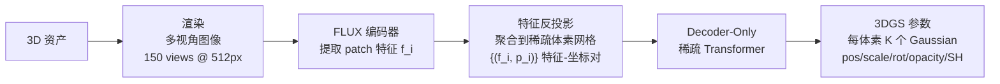
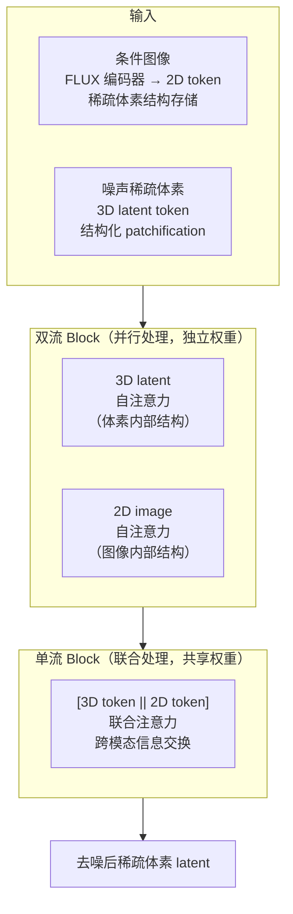

# FLUX3D 深度精读：用扩散特征对齐稀疏体素 latent，超越 TRELLIS 的单图 3D 生成

> **论文标题**：FLUX3D: Improving 3D Generation with Diffusion-Aligned Sparse Latents
> **时间**：2026 年 6 月
> **arXiv**：2606.24874

**知识链接**：
- [TRELLIS 深度解析：从一张图到三维资产的完整链路](/系列/trellis_deep_dive/index) — FLUX3D 是 TRELLIS 框架的直接改进，必须先理解 TRELLIS 的稀疏体素 latent + DiT 扩散架构
- [3D Gaussian Splatting：用一堆椭球把真实场景搬进电脑](/前置知识/007a_前置知识_3D_Gaussian_Splatting三维场景重建) — FLUX3D 的输出表示
- [DINOv2 视觉特征提取器](/前置知识/013b_前置知识_DINOv2视觉特征提取器) — TRELLIS 使用 DINOv2 特征，FLUX3D 指出了它的局限并给出替换方案

---

> **一句话**：TRELLIS 用 DINOv2 语义特征填充稀疏体素 latent，再用标准 DiT 做扩散——这两处设计都有根本缺陷；FLUX3D 把特征换成 FLUX 扩散编码器输出（保留高频纹理），把解码器换成 decoder-only 架构（消除压缩损失），把 DiT 换成感知稀疏拓扑的 SMDiT（引入跨模态位置编码 MARoPE）——三改同时发力，在 Toys4k 上 PSNR 提升 +2.58 dB、FD_incep 降低 23%。
>
> **为什么要读**：TRELLIS 是 2024 年底最强的单图/文本 → 3D 方法，但它的两个核心设计决策——特征来源和 2D-3D 对齐方式——本质上是凑合之举。FLUX3D 第一次把这两个问题系统拆开来分析和修复，消融实验也清楚地分离了"换特征"和"改架构"各自的贡献。读懂 FLUX3D，就能理解为什么 TRELLIS 在带文字 logo、精细纹理的物体上效果差，以及怎么从数学角度把这个问题彻底解决。

---

## 贯穿全文的例子

> **场景**：重建一个印有品牌 logo 的运动鞋——鞋身侧面有细小英文字母，鞋底有交叉网格纹路。用这个例子来感受 TRELLIS 和 FLUX3D 的差距：
>
> - TRELLIS 的结果：整体形状对，但 logo 字母糊成一团，网格纹路消失；
> - FLUX3D 的结果：logo 字母清晰可辨，网格纹路保留，鞋面材质光泽感准确。
>
> 这一切差距，归根结底来自"选了什么特征"。

---

## 一、TRELLIS 的两个瓶颈

TRELLIS 的核心流程是：提取图像的 DINOv2 特征 → 构建稀疏体素 latent → 用 DiT 在 latent 空间做扩散生成 → 解码成 3DGS。这个流程在概念上是优雅的，但在两个地方埋下了隐患。

**瓶颈一：表示瓶颈（Representation Bottleneck）**

DINOv2 是通过自监督对比学习（DINO）训练的视觉骨干，训练目标是"不同视角、不同光照下的同一物体特征要相似"。这个目标天然会让网络丢弃纹理细节——你拿一张正面照和一张侧面照比较，网络认为它们描述同一个物体，但文字 logo 在这两张图里位置完全不同，网络只能把 logo 的影响"平均掉"。

结果就是：DINOv2 的 patch feature 携带的是语义信息（"这里是鞋面"），而不是外观信息（"这里有三个红色字母，字号 6pt"）。用这样的特征构建 latent，再怎么扩散，也还原不出精细纹理。

**瓶颈二：跨模态对齐瓶颈（Cross-modal Alignment Bottleneck）**

TRELLIS 的扩散模型需要同时处理两种 token：代表条件图像的 2D token（H×W 个 patch），和代表待生成 3D 结构的体素 token（稀疏分布在三维空间）。标准的 DiT 架构把所有 token 一视同仁，没有任何机制告诉网络"这个 2D patch 对应哪些 3D 体素"。

网络只能从数据里猜这种对应关系，但 2D 和 3D 的坐标系完全不同，没有几何先验辅助，学习效率极低，效果上表现为多视角渲染不一致——正面好看，侧面和背面出现伪影。

---

## 二、贡献一：DA-SLAT（扩散对齐结构化 Latent）

DA-SLAT 的核心思路是：**换掉 DINOv2，改用 FLUX 扩散编码器的特征**。

FLUX 是一个图像生成扩散模型，它的编码器是为"给定一张图，重建/合成尽可能细节丰富的图像"优化的。这个训练目标和 DINOv2 正好相反——FLUX 编码器被迫保留高频纹理（否则解码时细节就没了），而 DINOv2 被允许丢掉纹理（语义不变性不需要纹理）。

**DA-SLAT 的构建流程**如下：

> 图中最关键的一跳是从 FLUX 编码器到稀疏体素的"反投影聚合"：每张视角图的每个 patch 特征，按照已知的相机位姿投影回三维，落在对应体素上；多个视角的特征在同一个体素处做加权平均，得到该体素的 FLUX feature。

**Decoder-Only 设计的原因**

TRELLIS 在稀疏体素 latent 上用了标准 encoder-decoder VAE：encoder 把 1024 维特征压缩到 8 维，decoder 再还原。这个压缩比（128:1）会不可逆地丢失高频信息。

FLUX3D 直接删掉 encoder，只保留 decoder-only 稀疏 transformer，把 FLUX 特征（已经是信息丰富的 1024 维）直接解码成 3DGS 参数。没有压缩，就没有压缩损失。

**鲁棒性训练技巧**

扩散模型在推理时输出是随机的——不同 run 得到的稀疏体素 latent 有随机扰动。如果解码器只在"干净的 FLUX 特征"上训练，遇到扩散输出的带噪 latent 时性能会下降。

FLUX3D 的解决办法：训练时给特征加噪声，用 μ + σ·N(0,I) 替代干净特征 μ（σ 来自 FLUX VAE encoder 的方差预测），强迫解码器学会在有噪声的 latent 上也能正常工作。

重建损失：

$$\mathcal{L}_{recon} = L_1 + \lambda_{ssim}(1 - \text{SSIM}) + \lambda_{lpips}\text{LPIPS} + \lambda_{vol}\mathcal{L}_{vol} + \lambda_\alpha \mathcal{L}_\alpha$$

**这个公式在做什么**：同时从像素精度（L1）、结构相似度（SSIM）、感知质量（LPIPS）三个维度监督重建，加上体积正则和不透明度正则防止 Gaussian 过大或过多。

::: details 📐 公式详解

| 子表达式 | 它是谁 | 它在干嘛 |
|---------|--------|---------|
| $L_1$ | **像素距离** | 渲染结果和真实图像的绝对像素差，对颜色准确性直接监督 |
| $(1 - \text{SSIM})$ | **结构相似度损失** | 衡量局部纹理、对比度、亮度的匹配程度 |
| $\text{LPIPS}$ | **感知损失** | 用预训练网络的 feature 差衡量"看起来像不像"，对高频细节敏感 |
| $\mathcal{L}_{vol}$ | **体积正则** | 惩罚 Gaussian 椭球体积过大，防止用大 Gaussian 糊弄渲染 |
| $\mathcal{L}_\alpha$ | **不透明度正则** | 鼓励 Gaussian 要么完全不透明要么接近透明，去除浮游半透明噪点 |

**用人话读**："渲染出来的图要和真图像素接近、结构一致、感知相似，同时 Gaussian 不能太大也不能太半透明。"

**λ 取值**：λ_ssim=0.2，λ_lpips=0.1，λ_vol=λ_α=1×10⁻³。LPIPS 权重低于 SSIM，避免感知损失把网格推向非物理的风格化结果。
:::

---

## 三、贡献二：SMDiT（稀疏结构多模态扩散 Transformer）

SMDiT 解决的是第二个瓶颈：如何让 2D 图像 token 和 3D 体素 token 正确对应。

基础架构来自 MMDiT（SD3 和 FLUX 使用的多模态 DiT），FLUX3D 在此基础上加入了稀疏拓扑感知。

> 双流块保证每种模态的内部结构不被另一种模态干扰；单流块负责让两种模态实际"对话"。这个分工和 MMDiT 的设计哲学一致，但加入了稀疏体素的拓扑感知。

**结构化 patchification**（序列压缩）

稀疏体素可能有数万个 token，直接做全局注意力成本极高。FLUX3D 引入分组机制：

- 3D token：用稀疏下采样把相邻 2³=8 个体素邻域合并为一个 patch token
- 2D token：用标准 2²=4 个像素合并为一个 patch token

序列长度减半，但每个 patch 内的局部结构通过 token 内的特征聚合保留。

**模型规模**：24 层，16 注意力头，channel size 1156，总 820M 参数；DA-SLAT 解码器 85M 参数。

---

## 四、贡献三：MARoPE（模态感知旋转位置编码）

RoPE（Rotary Position Embedding，旋转位置编码）是 Transformer 中编码位置关系的主流方法——两个 token 的位置越近，注意力分数越高。

问题在于：2D 图像 patch 的坐标是 (i, j)（行列索引），3D 体素的坐标是 (x, y, z)（三维空间坐标）。这两个坐标系无法直接比较，RoPE 不知道 patch (i, j) 和体素 (x, y, z) 之间的"距离"是多少。

**MARoPE 的解法**：把 2D 图像坐标升维，放到 3D 坐标系里。

具体来说，把每个图像 patch 的坐标从 (i, j) 变为 (i, j, z_max+1)——在 z 轴上放到体素体积的边界之外一层。三维 RoPE 现在可以计算任意一个 2D token 和任意一个 3D 体素 token 之间的三维距离了。

直觉：想象把一张照片悬空放在三维体素模型的上方（z = z_max+1 那层），相机像素和正对着它的体素几何上最近，RoPE 的距离衰减自然让这些 token 相互注意到对方。

这样设计的好处：
1. 无需相机内外参——不做精确的像素→体素光线投影，只是利用几何相邻性作为软先验，具体对应关系由数据学习
2. 对 in-the-wild 图片有效——不需要标定相机
3. 延续 RoPE 的理论性质——相对位置信息，泛化到任意序列长度

---

## 五、训练流程

**数据准备**

- 来源：3D-FUTURE、ABO、HSSD、Objaverse-XL，共 36 万 3D 资产
- 过滤：用 VLM 分类器检测"纯粉色/白色渲染"（缺纹理资产），过滤后保留有有效纹理的资产
- 渲染：重建训练用每资产 150 视角 512px；生成条件用每资产 24 视角 1024px

**训练阶段**

两个模块分开训练：

1. **DA-SLAT 解码器**（重建任务）：100K steps，AdamW，lr=1×10⁻⁴，batch=8/GPU，8×A100
2. **SMDiT**（生成任务）：200K steps，同配置

生成使用 Conditional Flow Matching（CFM）：前向过程是噪声到数据的线性插值，比 DDPM 更简洁，推理 50 步。

---

## 六、结果与消融

**重建任务（Toys4k 数据集）**

| 方法 | SSIM ↑ | PSNR ↑ | LPIPS ↓ |
|------|--------|--------|---------|
| TRELLIS | 0.9719 | 31.54 | 0.02964 |
| FLUX3D（Enc-Dec） | 0.9779 | 33.80 | 0.02699 |
| FLUX3D（Dec-Only） | **0.9783** | **34.12** | **0.02668** |

PSNR 提升 2.58 dB。Enc-Dec vs Dec-Only 的差距（33.80 vs 34.12）单独验证了"去掉 encoder 压缩"这一改动的效果。

**生成任务（Toys4k 数据集）**

| 方法 | PSNR ↑ | LPIPS ↓ | CLIP ↑ | FD_incep ↓ |
|------|--------|---------|--------|-----------|
| TRELLIS | 25.48 | 0.04389 | 97.92 | 11.29 |
| FLUX3D | **26.26** | **0.03509** | **98.37** | **8.73** |

FD_incep（Fréchet Inception Distance，衡量生成分布质量）降低 23%，说明生成的 3D 资产在整体分布上更接近真实。

**消融：特征贡献 vs 架构贡献**

这是论文里最有价值的分析之一。把 TRELLIS 到 FLUX3D 的改进拆成两步：

| 配置 | FD_incep ↓ | 改进幅度 |
|------|-----------|---------|
| TRELLIS（基线） | 11.29 | — |
| + 仅换 DINOv2→FLUX 特征 | 10.47 | 7.3% |
| + 完整 FLUX3D（+Dec-Only+SMDiT+MARoPE） | 8.73 | 16.6% |

结论：**架构改动（16.6% - 7.3% = 9.3%）的贡献大于特征替换（7.3%）**。这说明仅仅换好特征还不够——如果 2D-3D 对齐问题没有解决，更好的特征也发挥不出全部效果。两个瓶颈是相互耦合的，必须同时修。

**多视角一致性**

在 24 个视角上统计每个视角的 PSNR，FLUX3D 的标准差比 TRELLIS 低 18%。这意味着增益不是只在正面（输入视角附近）集中，而是均匀分布在物体整圈。对于运动鞋这个例子，背面和鞋底的重建也同步提升了。

**布局鲁棒性实验**

让两个方法都使用 TRELLIS 的 stage-1 预测布局（比 ground-truth 布局更嘈杂），FLUX3D 的 FD_incep 优势从 23% 扩大到 33%。这说明 FLUX3D 的增益来自模型本身，而不是因为它有更好的初始布局条件——SMDiT 和 MARoPE 让模型在面对不完美的稀疏结构时也能正确对齐，这一点比 TRELLIS 更鲁棒。
