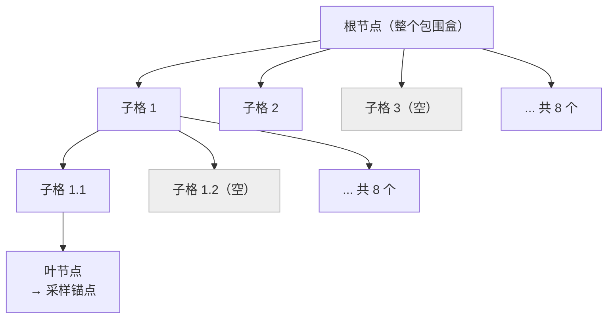
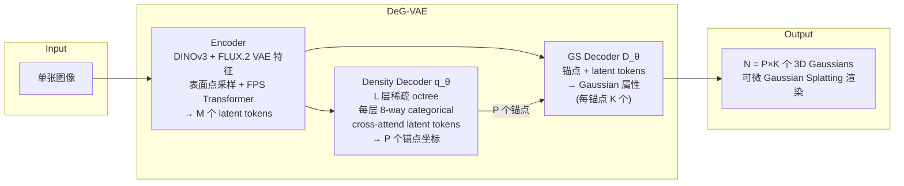
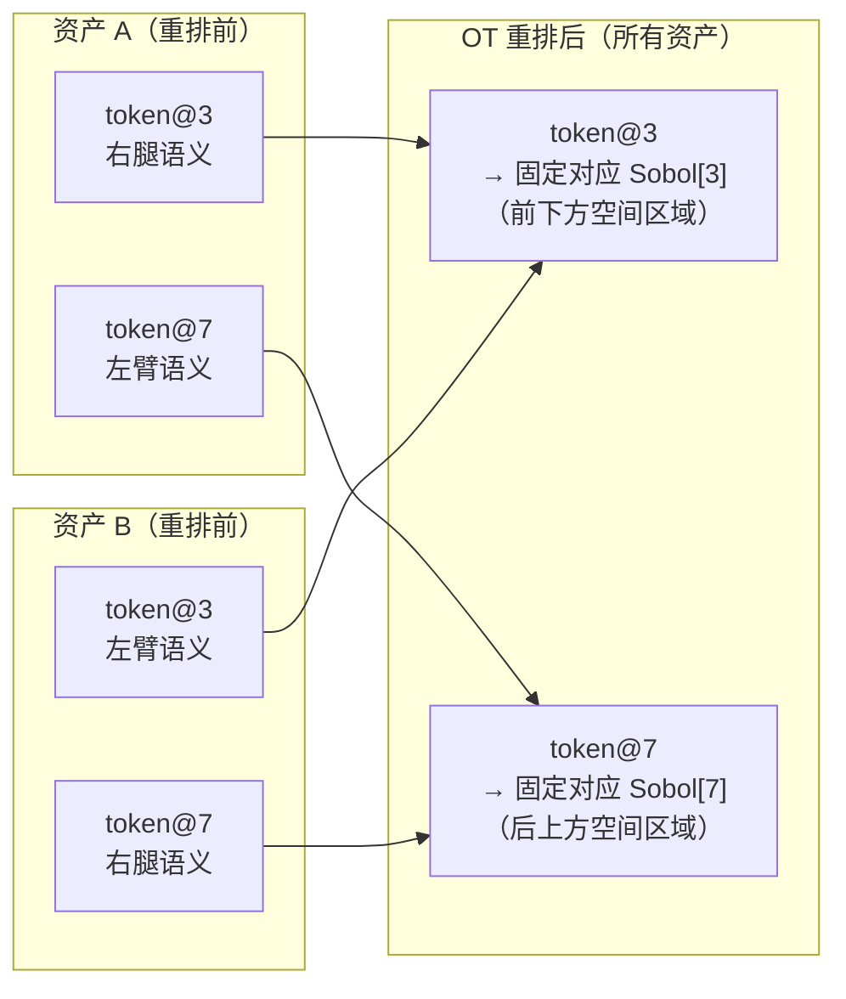
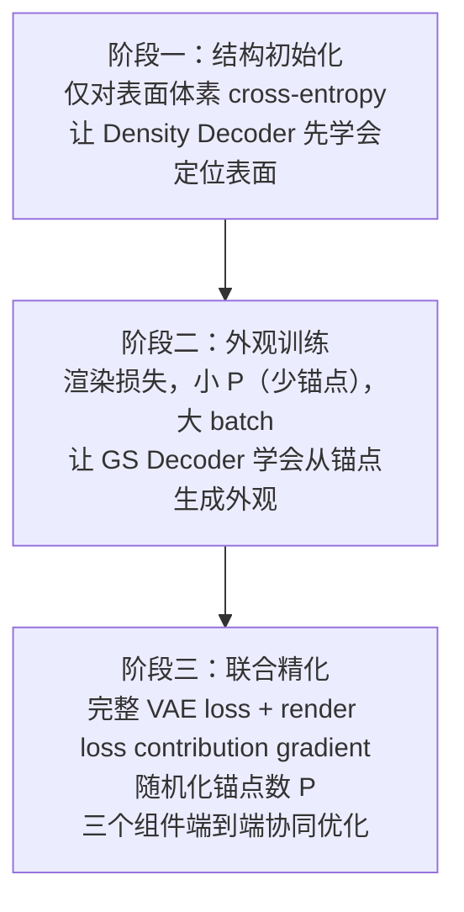

# DeG / TripoSplat 深度精读：用可学习密度控制把 3D Gaussian 生成从网格束缚中解放

> **论文标题**：Generative 3D Gaussians with Learned Density Control
> **简称**：DeG（对应产品 TripoSplat）
> **机构**：VAST-AI Research / TripoAI
> **arXiv**：2605.16355
> **发表时间**：2025 年

**知识链接**：
- [3DGS 训练循环与密度自适应控制](/系列/3dgs_from_scratch/11_训练循环与密度自适应控制) — DeG 的核心突破就是把这一节里讲的启发式密度控制替换成可学习版本
- [Flow Matching：比 DDPM 更直接的生成路径](/前置知识/000g_前置知识_Flow_Matching) — DeG 的扩散模型骨干用 Flow Matching 训练
- [TRELLIS 系列：稀疏体素高斯生成全解析](/系列/trellis_deep_dive/) — DeG 和 TRELLIS 是同代最强竞争者，理解 TRELLIS 的设计才能看懂 DeG 的不同选择

---

> **一句话**：DeG 把"应该在哪里放多少个 Gaussian"变成可微分的可学习 PDF，用 octree 分层预测空间密度、采样锚点再展开 Gaussian，配合渲染损失贡献梯度（render loss contribution gradient）端到端训练，在 Toys4K 上以更少的 Gaussian 数量同时刷新了重建和生成两项指标。
>
> **为什么要读**：3DGS 的标准密度控制（add/split/prune）是硬编码启发式规则，无法嵌入前馈生成模型——这是业界公开的痛点。DeG 给出的解法既干净（octree PDF + policy gradient）又实用（几乎不增加计算代价），配套的 VecSeq 技巧让生成侧 DiT 的序列结构稳定，训练收敛快。

---

## 贯穿全文的例子

> **场景**：一个印有品牌文字的手办公仔，你只拍到了正面。背面的文字、接缝纹路完全遮挡在镜头后方。目标是用一张图重建出可以 360° 渲染的完整 3D 模型——这需要模型既能正确分配正面可见区域的 Gaussian 密度，又能对背面做合理的生成补全。DeG 的可学习密度控制解决前者，Flow Matching 扩散过程解决后者，两件事在同一个端到端框架里同时学习。

---

## 一、标准密度控制为什么是生成模型的死穴

3DGS 训练时用一套密度控制规则：当某个 Gaussian 的位置梯度过大，说明附近渲染不够精细，就在那里分裂出新 Gaussian（densify）；当不透明度低于阈值，就删掉（prune）。这套规则在逐场景优化里能工作，因为梯度积累指向渲染误差高的区域。

但它有一个根本缺陷：**分裂和删除本身不可微分**。一旦执行 densify/prune，模型无法通过这个操作回传梯度——"是否在这里加一个 Gaussian"这个决策完全脱离了反向传播链路。

对前馈生成模型来说，这是致命的。生成模型的目标是：给定一张图，直接输出一整组 Gaussian。要让这个输出"哪里该放更多 Gaussian"这件事通过训练来学，就必须有梯度能从渲染误差回传到"密度分配"的决策里。标准 3DGS 的密度控制做不到这一点。

DeG 的解法：**把密度分配变成一个可学习的概率分布（PDF），对它进行可微分采样，再用 policy gradient 技巧把渲染误差的梯度传回分布参数**。

---

## 二、可学习密度控制：octree PDF 与锚点采样

DeG 把"在哪里放 Gaussian"这个问题建模成一个空间概率密度函数。具体地说，用一棵稀疏 octree 来表示这个 PDF：

> 每层把父格子分成 8 个子格，预测每个子格的占据概率（8-way categorical 分布）。只有被占据的分支继续往下展开，空格子剪枝，等效分辨率是 (2^L)³，但实际计算量只和被占据的体素数成正比。

每层 octree 节点对应一个 transformer，cross-attend 到从图像编码出的 latent tokens，预测本层 8 个子格的 logits。

**这个设计解决了什么问题**：不可能在 (2^L)³ 的密集格点上跑 transformer——哪怕 L=7 就是 128³ ≈ 200 万个格子。稀疏 octree 让模型只在真正有表面的地方展开，计算量随表面积增长而非体积。

从 octree 叶节点采样出 P 个**锚点**（anchor points）。P 在训练时随机化，推理时用户可以自由指定——Gaussian 总数 N = P × K，K 是每个锚点周围展开的局部 Gaussian 数。

---

## 三、梯度信号：渲染损失贡献梯度

采样本身是离散的随机操作（从 categorical 分布里选哪个子格），不可微分——这正是标准 densify 面临的同款问题。DeG 用 **policy gradient identity** 绕过这一障碍：

$$\nabla_\theta \mathbb{E}_{x \sim q_\theta}[\mathcal{L}(x)] = \mathbb{E}_{x \sim q_\theta}\!\left[\mathcal{L}(x)\, \nabla_\theta \log q_\theta(x)\right]$$

**这个公式在做什么**：把"期望损失对分布参数 θ 的梯度"，转化为"在当前分布下采样出的路径上，损失值乘以对数概率梯度的期望"。后者可以用蒙特卡洛估计，不需要对采样操作本身求导。

::: details 📐 公式推导直觉
把损失 L(x) 想成"如果采样到这组锚点 x，渲染误差是多少"。梯度方向的意思是：如果 L(x) 很大（这组锚点的渲染很差），就降低 q_θ 给它们的 log 概率；如果 L(x) 很小（渲染好），就升高它们的概率。整个过程不需要 L 对采样操作求导，只需要 L 的值。

每个锚点的贡献 ΔL_j 用留一法（leave-one-out）估计：从完整渲染损失减去去掉锚点 j 之后的损失。标准 3DGS CUDA backward pass 在 alpha-compositing 时已经积累了每个 Gaussian 的 transmittance 和 accumulated color，这两个量足以在近似中重建 ΔL_j，额外计算代价接近零。
:::

**为什么几乎零开销**：标准 3DGS 的 CUDA 反向传播已经在每条光线上维护了 transmittance 和 back-color 两个累积量，这两个量足以近似计算每个锚点的渲染贡献差 ΔL_j，不需要额外的正向/反向 pass。

---

## 四、完整架构

> 三个可学习组件共享同一组 latent tokens：Encoder 编码图像语义，Density Decoder 决定空间分布，GS Decoder 决定每个 Gaussian 的具体属性。梯度从渲染损失同时流回三个组件——Density Decoder 经由 policy gradient，另两个经由标准反向传播。

**Encoder 细节**：提取两路特征——DINOv3 负责语义（哪里是物体），FLUX.2 VAE 负责纹理细节（边缘、材质）。用 farthest-point sampling（FPS）在预测的表面点上选 seed，再用 transformer 把稠密特征图聚合成 M 个 latent tokens。这组 tokens 是整个 VAE 的"压缩表示"。

**GS Decoder 细节**：接收锚点坐标和 latent tokens，输出每个 Gaussian 的 opacity、scale、rotation、球谐函数系数（SH），以及 K 个局部偏移（local offset）——每个锚点周围展开 K 个实际 Gaussian，允许锚点级别的精细几何。

---

## 五、VecSeq：OT 重排序让扩散训练收敛更快

DeG 用 Flow Matching + S3-DiT 作为生成侧骨干。输入是图像条件，输出是 M 个 latent tokens 的序列。一个自然的问题：不同资产的 latent tokens 在序列中的顺序是随机的，索引 3 在资产 A 对应右腿、在资产 B 对应左臂——DiT 在学什么？

**VecSeq** 解决这个问题：对每个资产，用最优传输（Optimal Transport）把它的 M 个 latent tokens 重新排列，使排列后每个索引对应固定的 3D Sobol 序列位置。

> OT 重排后，索引相同的 token 在所有资产里都对应大致相同的 3D 空间区域——不同资产的"右腿"都聚集在序列的同一段，DiT 学到的位置-语义对应关系更稳定。

**为什么这能加速收敛**：扩散模型本质上在学习序列中每个位置的条件分布。如果索引没有空间含义，模型要同时学"排列映射"和"空间内容"，训练信号混乱。OT 重排后，位置编码（用 Sobol 点坐标的正弦嵌入注入 DiT）和序列索引对齐，模型只需专注学内容。

消融结果直接说明问题：去掉 VecSeq 后，生成质量指标 FD_dinov2 从 31.16 上升到 75.08（越低越好），差距超过一倍。

---

## 六、三阶段课程训练

直接端到端训练会失败：Density Decoder 在随机初始化状态下采样出混乱锚点，GS Decoder 无法从混乱锚点学到有意义的渲染，policy gradient 信号也无从建立。三阶段课程解决了冷启动问题：先让密度解码器定位表面，再让外观解码器学会渲染，最后让两者通过 policy gradient 协同调整。

训练规模：VAE 约 10 天 32×A800，Flow Matching 约 11 天 32×A800。数据来自 Objaverse + Objaverse-XL（与 TRELLIS-500K 子集相同，保证对比公平）。

---

## 七、基准测试

**重建任务（Toys4K 测试集）**：

| 方法 | Gaussian 数 | PSNR ↑ | SSIM ↑ | LPIPS ↓ |
|------|------------|--------|--------|---------|
| TRELLIS | ~310K | 32.72 | 0.9734 | 0.0269 |
| UniLat3D | ~310K | 32.10 | 0.9715 | 0.0307 |
| **DeG（本文）** | **262K** | **35.89** | **0.9787** | **0.0223** |

DeG 用比 TRELLIS 少约 15% 的 Gaussian，把 PSNR 提升了 3 dB 以上。这说明可学习密度控制把 Gaussian 放到了更"值得放"的位置——每个 Gaussian 的渲染贡献更高。

**生成任务**：CLIP-I 92.26（最高），FD_incep 2.42（最优），FD_dinov2 31.16（最优）。这两项分别衡量生成图像与输入图像的语义一致性，以及生成分布与真实分布的距离。

**关键消融**：
- 去掉 VecSeq（OT 重排序）：FD_dinov2 从 31.16 → 75.08，生成质量大幅下降
- 去掉 policy gradient（密度解码器不接受来自渲染的梯度）：PSNR 下降 ~1.5 dB
- 固定锚点数 P（不随机化）：生成多样性下降，PSNR 轻微下降

---

## 八、局限性

**训练代价高**：两个阶段合计约三周 32×A800，对大多数团队来说是不现实的复现成本。

**P 的选择需要调整**：推理时锚点数 P 影响质量和速度的 tradeoff——P 过小细节损失明显，P 过大推理慢且边际收益递减，实际使用时需要针对具体场景调参。

**背面补全质量**：手办例子里，背面的品牌文字和接缝纹路仍然依赖 Flow Matching 的生成能力，而不是可学习密度控制直接解决的。当训练数据里类似物体的背面样本不足时，补全质量会下降。

**与 TRELLIS 的对比**：TRELLIS 用稀疏体素作为 latent 空间，DeG 用 octree PDF + GS 直接解码。两者都避免了固定网格，但 DeG 在推理灵活性（P 可变）和渲染质量上占优，TRELLIS 的 latent 空间更适合编辑和插值操作。

