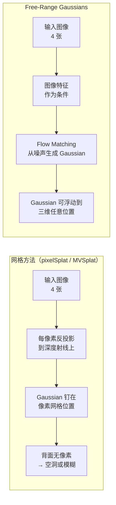
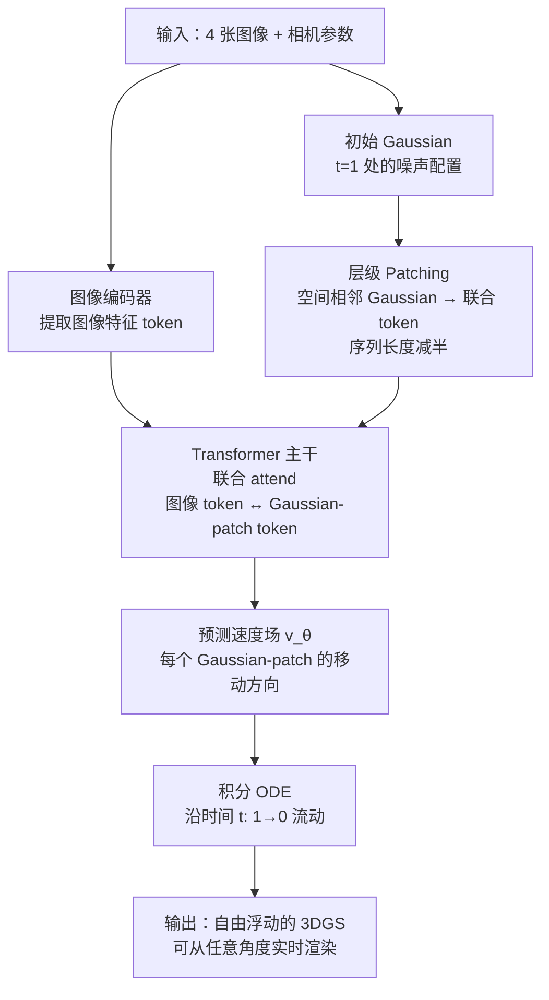

# Free-Range Gaussians 深度精读：用 Flow Matching 把高斯从网格束缚中解放出来

> **论文标题**：Non-Grid-Aligned Generative 3D Gaussian Reconstruction
> **时间**：2025 年 4 月
> **arXiv**：2604.04874

**知识链接**：
- [3D Gaussian Splatting：用一堆椭球把真实场景搬进电脑](/前置知识/007a_前置知识_3D_Gaussian_Splatting三维场景重建) — Free-Range Gaussians 的输出格式是标准 3DGS，必须先理解 3DGS 的表示方式
- [Flow Matching 与连续归一化流](/前置知识/000g_前置知识_Flow_Matching与连续归一化流) — 本文的核心训练框架，理解"从噪声流向目标分布"是读懂方法的前提

---

> **一句话**：把多视图 3D 重建从"网格上的回归"改成"自由空间中的生成"——用 Flow Matching 学习 Gaussian 从噪声流向正确位置的轨迹，彻底解除像素网格或体素网格对 Gaussian 位置的束缚，让未被输入视角覆盖的背面和遮挡区域也能获得合理的几何补全。
>
> **为什么要读**：主流前馈多视图重建方法（pixelSplat、MVSplat 等）在工业界广泛使用，但它们有一个根本限制：Gaussian 被钉死在像素或体素网格上。这个设计在输入视角充足时没问题，但只要有背面、遮挡或稀疏观测，网格方法要么留空洞要么给出模糊平均。Free-Range Gaussians 从框架层面换掉了这个假设，且在使用更少 Gaussian 的情况下超越了基线，值得关注它给出的新方向。

---

## 贯穿全文的例子

> **场景**：用 4 张从不同角度拍摄的陶瓷杯照片做 3D 重建。4 张视角覆盖了杯子的正面、两侧和顶部，但杯子背面（把手背侧、底部弧面）从未出现在任何一张图里。目标是得到一个完整的、可以从任意角度实时渲染的 3DGS。

本文所有概念都会用这个陶瓷杯例子来具体化。

---

## 一、网格约束为什么是个问题

以 MVSplat 为代表的主流方法的核心逻辑是：把每张输入图的每个像素"反投影"到 3D 空间，在对应的深度上放置一个 Gaussian。这样做的好处是简单、快、天然对齐——图像特征直接变成 Gaussian 参数，不需要额外的位置搜索。

**但这个设计对陶瓷杯有三个具体问题：**

**冗余**。杯子正面被 4 张图都拍到了，4 张图在正面各自"反投影"出一层 Gaussian，正面附近堆了大量重复的 Gaussian。这些冗余 Gaussian 消耗了模型容量，却没有带来更多信息。

**空洞与模糊**。背面没有任何输入视角覆盖，网格方法在背面没有像素可以反投影，于是只能在那里留空洞，或者用其他视角的平均值填充——结果是背面模糊或者根本没有几何。

**位置不自由**。每个 Gaussian 只能出现在某张图的某个像素对应的深度射线上，无法"跑"到三维空间里真正需要它的位置。如果表面在两条射线之间，Gaussian 就无法精确覆盖。

> 上图对比两类方法的核心差异：网格方法的 Gaussian 位置被像素坐标决定；Free-Range Gaussians 用生成式框架，Gaussian 的最终位置由模型从数据中学到的分布决定。

---

## 二、生成式框架：为什么 Flow Matching 能解决这个问题

**回归式方法的根本缺陷**：对于陶瓷杯背面，输入图像没有提供任何直接信息。回归式方法被迫输出一个确定性预测，它只能给出"背面最可能长什么样"的均值——而这个均值通常是模糊的、不真实的，因为背面的真实外观有多种合理可能性（把手弧度、底部形状），对这些可能性取均值会抹平所有细节。

**生成式方法的优势**：与其输出一个确定值，不如学习一个**分布**。给定 4 张图像，背面可能有几种合理的几何形态——生成式模型可以在这个分布上采样，每次都给出一个内部一致、细节真实的补全，而不是把所有可能性压成一个糊涂的均值。

Free-Range Gaussians 把整个重建过程建模为：**在 Gaussian 参数空间里，从噪声分布流向条件于输入图像的合理 Gaussian 分布**。

### Flow Matching 的工作方式

Flow Matching（连续归一化流的一种高效变体，详见[前置知识](/前置知识/000g_前置知识_Flow_Matching与连续归一化流)）学习一个向量场 $v_\theta$，它在时间 $t \in [0,1]$ 时告诉每个噪声 Gaussian 应该往哪个方向移动：$t=0$ 是随机噪声，$t=1$ 是对应场景的真实 Gaussian 配置。

$$\mathcal{L}_{\text{FM}} = \mathbb{E}_{t, \mathbf{G}_0, \mathbf{G}_1} \left[ \| v_\theta(\mathbf{G}_t, t, I) - (\mathbf{G}_1 - \mathbf{G}_0) \|^2 \right]$$

**这个公式在做什么**：在噪声 Gaussian 配置和真实 Gaussian 配置之间画一条直线路径，让网络学会"站在路上任意一点，给出正确的前进方向"——条件是输入图像 $I$。

::: details 📐 公式详解（点击展开）

| 子表达式 | 它是谁 | 它在干嘛 |
|---------|--------|---------|
| $\mathbf{G}_0$ | **起点（纯噪声）** | 随机初始化的 Gaussian 参数集合 |
| $\mathbf{G}_1$ | **终点（真实场景）** | 从训练数据来的真实 Gaussian 配置 |
| $\mathbf{G}_t = (1-t)\mathbf{G}_0 + t\mathbf{G}_1$ | **路上某点** | 线性插值的中间状态 |
| $\mathbf{G}_1 - \mathbf{G}_0$ | **正确方向（GPS）** | 从当前位置指向终点的向量 |
| $v_\theta(\mathbf{G}_t, t, I)$ | **网络的猜测** | 模型在位置 $t$、条件于图像 $I$ 时预测的方向 |
| $\mathbb{E}_{t, \mathbf{G}_0, \mathbf{G}_1}[\|\cdot\|^2]$ | **平均考核** | 在所有时间步、所有训练样本上取均值 |

**用人话读**："随机在噪声→真实的路上停一点，问网络往哪走，预测方向和真实方向的偏差就是 loss。"

**为什么选直线路径**：直线是最短路径（最优传输意义下），沿直线走只需较少步数就能从噪声到达目标，推理时 20-50 步就够了。
:::

对于陶瓷杯，推理时模型从一堆随机散布在空间中的 Gaussian 出发，在图像特征引导下，逐步把这些 Gaussian "流向"合理的杯子几何——包括那些没有被任何输入图像直接照到的背面区域。

---

## 三、架构：层级 Patching Transformer

高质量渲染需要成千上万个 Gaussian，如果每个 Gaussian 都是一个 Transformer token，序列长度会让计算不可接受。本文的解法是**层级 patch 方案**。

> 上图是完整推理流程。注意 Gaussian 与图像特征在 Transformer 里通过交叉注意力互相影响，而不是单向地由图像"决定"Gaussian 位置。

**层级 patching 的具体做法**：把三维空间划分成局部邻域，每个邻域内空间相近的若干 Gaussian 被打包成一个联合 token。这个 token 表示一组 Gaussian 的局部几何，内部结构被隐式编码到 token 的特征维度里。结果是 Transformer 的序列长度减半，同时局部几何关系（相邻 Gaussian 之间的相对位置、方向）被完整保留。

Transformer 骨干对图像 token 和 Gaussian-patch token 做联合注意力（joint attention）。图像 token 提供外观和已观测区域的几何约束，Gaussian-patch token 在流动过程中不断查询图像信息来校正自己的方向。

---

## 四、三个关键技巧

### 技巧一：Timestep-Weighted Rendering Loss

Flow Matching 的训练 loss 通常对所有时间步 $t$ 加权相同。但对于渲染质量来说，$t$ 接近 0（几乎是真实 Gaussian 配置）时的预测质量更重要——这时候模型已经接近收敛，细节差异会直接反映在渲染结果里。$t$ 接近 1（几乎是纯噪声）时的预测误差只影响大尺度结构，不影响最终渲染细节。

本文在训练时给后期（$t$ 小）的 timestep 加更高的渲染损失权重，把监督信号集中在视觉质量最重要的阶段。

### 技巧二：Photometric Gradient Guidance

训练时模型见过很多物体，但推理时面对的是一个新物体——输入的 4 张图像是关于这个特定物体最直接的信息来源。

Photometric gradient guidance 把这 4 张图像作为测试时的监督信号：在每个 ODE 积分步之后，计算当前 Gaussian 配置从输入视角渲染出的图像和真实输入图像之间的光度损失，用这个损失的梯度微调 Gaussian 的移动方向。这相当于让模型在流动过程中不断"对照着输入图像做修正"。

### 技巧三：Classifier-Free Guidance（CFG）

训练时随机将图像条件 $I$ 置为空（约 10-15% 的概率），让模型学会无条件生成。推理时，有条件预测和无条件预测的差值方向乘以一个大于 1 的引导系数：

$$\tilde{v}_\theta = v_\theta(\cdot | \emptyset) + w \cdot (v_\theta(\cdot | I) - v_\theta(\cdot | \emptyset))$$

**这个公式在做什么**：把无条件方向作为基准，沿"有条件比无条件更往哪走"这个差值方向放大 $w$ 倍，锐化输出分布，让生成结果更贴近输入图像的约束。

---

## 五、关键结果

在 Objaverse 和 Google Scanned Objects（GSO）上与 pixel-aligned（pixelSplat）和 voxel-aligned（MVSplat）基线对比：

**背面和遮挡区域**：这是差距最明显的地方。网格方法在输入视角未覆盖的区域产生明显空洞或模糊伪影；Free-Range Gaussians 在这些区域给出几何完整、细节合理的补全。对于陶瓷杯的背面把手弧度，Free-Range Gaussians 生成的结果可以从任意角度渲染而不露馅。

**Gaussian 数量**：Free-Range Gaussians 使用显著更少的 Gaussian 就达到相当或更好的渲染质量。原因是它不被迫在像素网格上密集布置——每个 Gaussian 都被放在三维空间中真正需要它的位置，没有因为网格对齐带来的冗余。

**整体渲染质量**：在 PSNR、LPIPS 等新视角合成指标上，在充分观测和稀疏观测两种设置下都优于网格基线，稀疏观测（输入视角少）下的优势更为明显——这正是生成式框架对未观测区域建模能力发挥作用的场合。

---

Free-Range Gaussians 的核心贡献不是一个更复杂的架构，而是**换掉了一个被广泛接受但有根本缺陷的假设**：Gaussian 不必住在像素网格上。Flow Matching 为 Gaussian 的位置提供了一个有原则的生成式框架，让背面补全从"做不了"变成了"自然就有"。这个框架对后续研究的影响可能大于具体的架构选择。
