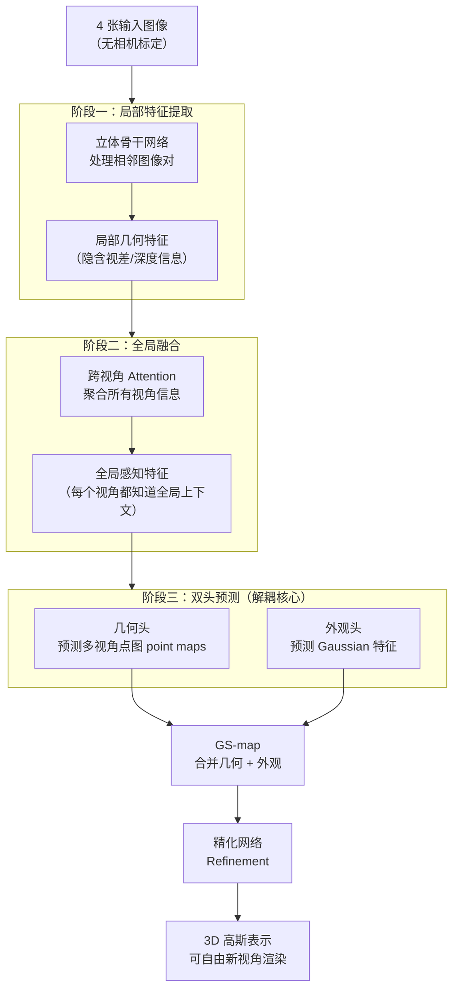

# Stereo-GS 深度精读：几何与外观解耦的立体视觉多视图高斯重建

> **论文标题**：Multi-View Stereo Vision Model for Generalizable 3D Gaussian Splatting Reconstruction
> **会议**：ACM Multimedia 2025
> **arXiv**：2507.14921

**知识链接**：
- [3D Gaussian Splatting：用一堆椭球把真实场景搬进电脑](/前置知识/007a_前置知识_3D_Gaussian_Splatting三维场景重建) — Stereo-GS 的输出格式就是 3DGS，理解椭球表示是前提
- [对极几何与两视图几何基础](/前置知识/014b_前置知识_对极几何两视图几何基础) — 立体视觉骨干网络提取特征依赖立体对应关系，理解极线约束有助于把握为什么图像对比单图对几何更敏感

---

> **一句话**：把原本耦合在同一网络里的"这里是什么形状"和"这里是什么颜色"两件事拆给两个专用头分别来做，让立体视觉骨干负责几何感知、无需相机标定输入，从多张图前向推理出高质量 3D 高斯表示。
>
> **为什么要读**：可泛化 3DGS（不需要对每个场景单独优化、一次前向传播就出结果）正在成为 3D 内容生成的主流路线，但主流方法的几何-外观耦合设计是一个隐患：让同一个网络同时猜形状和猜颜色，两件事会互相干扰，还需要大量训练数据和相机位姿输入。Stereo-GS 用一个直觉上很干净的解法——解耦+立体视觉先验——解决了这件事，结构清晰，适合作为理解这类方法设计权衡的入门参考。

---

## 贯穿全文的例子

> **场景**：从 4 个角度拍摄一辆玩具车，没有相机标定数据（不知道每个相机的焦距、位置和朝向）。目标是直接从这 4 张图推理出完整的 3DGS 表示，可以从任意新视角渲染玩具车。
>
> 本文会反复用这个例子解释 Stereo-GS 的每个阶段，对照着看会更清楚每一步在做什么。

---

## 一、耦合设计的问题：一个网络同时猜形状和颜色

要理解 Stereo-GS 的出发点，先要搞清楚"耦合"在这里意味着什么问题。

现有可泛化 3DGS 方法的典型做法是：把所有输入图像送进一个大网络，这个网络一次性输出每个像素对应的 3D 高斯参数，包括空间位置、尺度、旋转（描述形状），以及颜色球谐系数（描述外观）。这个做法看起来简洁，但把两件性质很不同的事压在一起有几个具体问题。

**几何预测依赖几何线索，外观预测依赖外观线索，但两者的梯度信号会混淆。** 重建损失（渲染后和真实图像做对比）对颜色很敏感，对几何的约束则比较间接——一个颜色猜得准的高斯，几何可以离正确位置不远也可以很远，优化器有时会选择用颜色覆盖来弥补几何误差。

**对相机位姿的依赖变成了硬约束。** 大多数方法需要把相机内外参（焦距、位置、朝向）显式输入网络，网络才知道如何把多张图的特征对齐到同一个 3D 空间里。这在真实场景里是一个很强的假设：拍摄玩具车的 4 张照片，用手机拍的话根本不会有精确标定数据。

**数据饥渴。** 几何和外观耦合在一起，网络需要从渲染误差里同时学会两件事，样本效率低，通常需要大规模数据集才能泛化。

Stereo-GS 的思路是：把这两件事分开，给每件事一个专门的归宿。

---

## 二、整体架构：三阶段流程

先看全局，再逐阶段解释。

> 关键观察：几何头和外观头从同一份全局特征出发，但沿着两条独立的通道走到各自的输出，中间不共享参数。GS-map 是最后把两条通道的结果合并成完整 3DGS 描述的结构化表示。

---

## 三、阶段一：立体骨干网络——让几何感知更容易

用 4 张图重建玩具车，最大的挑战之一是：单张图看到的是 2D 投影，深度信息是丢失的。传统可泛化方法通常靠网络从单张或多张图的特征里隐式学出深度，但这要求网络自己发现"这个区域在多张图里对应同一个 3D 点"的规律，难度大，需要大量数据。

立体视觉（Stereo Vision）提供了一个更直接的几何感知路径：给定两张从不同位置拍的图，同一个 3D 点在两张图里的像素位置差（视差，disparity）和深度成反比关系。立体视觉骨干网络在处理图像对时，天然地在寻找跨图对应关系，这个特征本身就是几何敏感的。

Stereo-GS 不把 4 张图独立处理，而是构建相邻图像对送入立体骨干：

- 每对图像经过立体骨干后，输出隐含了跨视角对应信息的局部特征
- 这些特征对形状（"这里有个凸起"、"这里是凹陷"）更敏感，对颜色（"这里是红色"）相对不那么敏感
- 不需要外部提供视差标注或深度监督，立体对应关系是骨干网络从数据里自然学出来的

回到例子：4 张玩具车照片，骨干网络会处理相邻的图像对，从每对图里提取出含有立体对应线索的特征。玩具车的轮廓、曲面在不同视角有视差，立体骨干捕捉到这种视差，就隐式知道了这个表面大致在哪个深度。

---

## 四、阶段二：全局融合——让每个视角知道全局

立体骨干处理的是局部图像对，输出的特征是局部的——每对图只知道两个视角之间的几何关系。但完整重建需要把 4 个视角的信息整合成一致的全局理解。

这个阶段用跨视角的 Attention block 来做：把 4 个视角的特征全部送入注意力机制，让每个视角的 token 都能看到所有其他视角的 token。结果是每个视角的特征被"更新"了——现在每个视角的特征不仅包含自己视角看到的信息，也包含了其他视角提供的上下文。

对于被某个视角遮挡住的玩具车背面，前面视角的特征可以通过 Attention 把"背面大概是这个形状"的信息传递过来，帮助网络在后面的预测阶段做出更合理的猜测。

---

## 五、阶段三：双头预测——解耦的关键设计

这是 Stereo-GS 最核心的贡献。从全局融合特征出发，分成两条完全独立的分支：

**几何头（Geometry Head）**

输出多视角点图（multi-view point maps）：对每张输入图的每个像素，预测这个像素对应的 3D 空间坐标 $(x, y, z)$。点图是一种纯几何描述，完全不包含颜色信息。

几何头用于回答"这里有什么形状"：玩具车的车轮在 3D 空间的哪里、车窗的深度是多少、车顶的曲面形状如何。

**外观头（Appearance Head）**

输出每个 3D 高斯的外观参数：位置、尺度、旋转（决定椭球的形状和朝向）、颜色球谐系数（决定从不同方向看到的颜色）。

外观头用于回答"这里是什么颜色"：玩具车的红色车身、银色轮毂、透明车窗在不同光照下分别长什么样。

**GS-map：合并两条通道**

两个头的输出合并为 GS-map，这是一个结构化表示，每个 entry 包含一个完整 3DGS 高斯所需的全部参数：几何头给出的 3D 位置信息 + 外观头给出的颜色信息。GS-map 就是这些 entry 在图像空间上的组织（类似像素图，但每个"像素"对应一个 3D 高斯的完整描述）。

**为什么解耦能降低数据需求**：当几何头只需要学"给定多视角特征，预测每个像素的 3D 坐标"时，它的监督信号是纯几何的（点图误差），不会被颜色误差干扰。外观头同理。两个头的学习目标明确，不用互相竞争梯度信号，样本效率更高。

---

## 六、无姿态设计：不需要告诉网络相机在哪里

这一点值得单独解释，因为它在实用性上有直接意义。

大多数可泛化 3DGS 方法需要相机内外参（intrinsics + extrinsics）作为网络输入的一部分，用于把多个视角的特征投影到统一的 3D 空间。这意味着：要么用标定好的相机，要么先跑 COLMAP 等工具估计位姿，才能送入网络。

Stereo-GS 不需要这步。立体骨干网络从图像对本身提取几何对应特征，这些特征隐含了视角间的几何关系，而不依赖显式位姿输入。网络从数据里学会了"这两张图之间的几何关系大概是这样的"，不需要外部告诉它。

对于拍摄玩具车的手机照片，可以直接送入 Stereo-GS，不需要先标定相机或估计每张照片的位置。这让方法在真实世界场景中（位姿估计有噪声，或者根本没有标定数据）更加实用。

---

## 七、精化网络与输出

GS-map 经过最后的精化网络（Refinement Network）做一次整体的质量提升。精化网络对 GS-map 做一个全局的调整，修正几何头和外观头各自预测中的局部误差，让最终输出的 3D 高斯表示更加一致和高质量。

最终输出是标准的 3DGS 表示，可以直接用现有的高斯渲染管线做任意新视角合成。

---

## 八、局限与展望

Stereo-GS 是 2025 年 7 月的新论文，目前有几个客观的局限需要了解：

**benchmark 数字有限**。论文未提供详细的定量对比表格（至少在摘要和早期版本中），主要论断以定性描述为主（"高质量"、"高效"、"可扩展"）。相比 SPAR3D 或 Free-Range Gaussians 这类有完整 GSO/OmniObject3D 测评的工作，实力对比目前还不够清晰。

**立体对假设的局限**。立体骨干依赖局部图像对，如果多张图的相邻视角之间重叠区域太小（拍摄角度跨度很大），立体对应特征的质量会下降。对于视角差异极大的输入，方法的鲁棒性还有待验证。

**无姿态的代价**。不需要相机位姿输入，意味着网络要隐式地从图像对推断相机关系。这比有位姿输入的方法对网络容量和训练数据的要求更高，在极端相机配置下（如鱼眼镜头、超大视角）可能表现不稳定。

从研究方向来看，几何-外观解耦的思路具有普遍性，未来可以和更强的生成式先验（扩散模型补全遮挡区域）结合，或者扩展到动态场景（时序解耦：静态几何 + 动态外观）。
