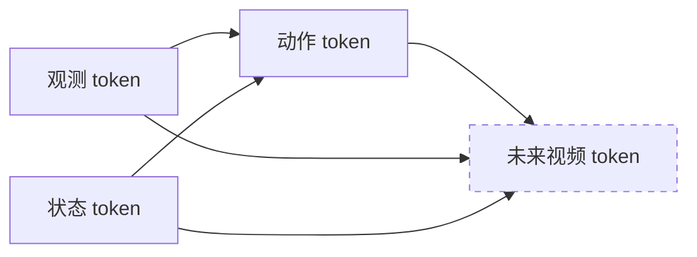
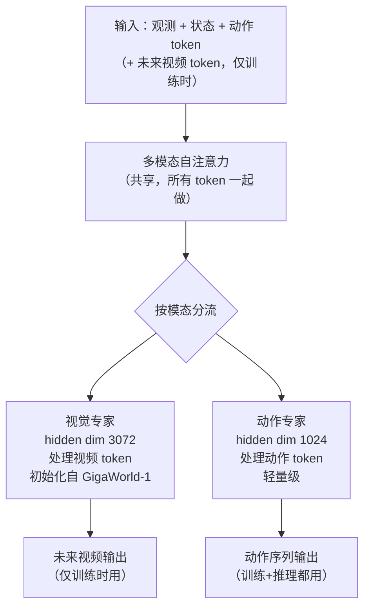
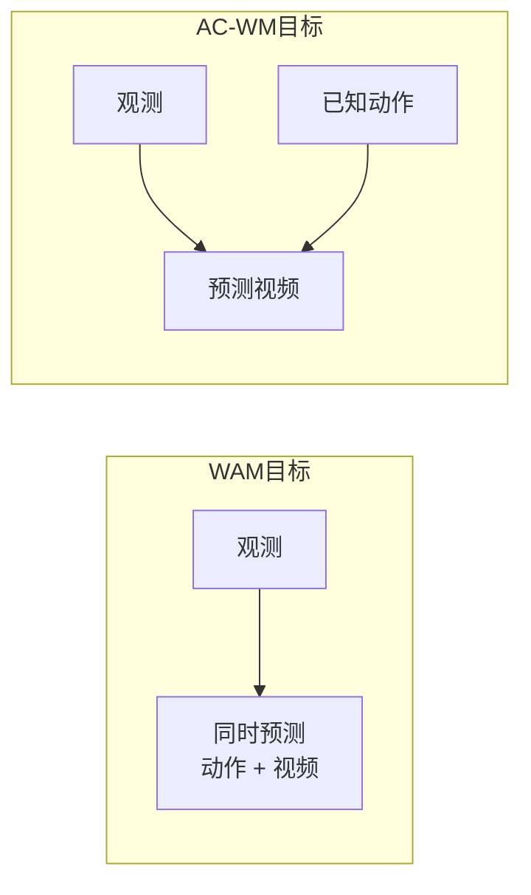
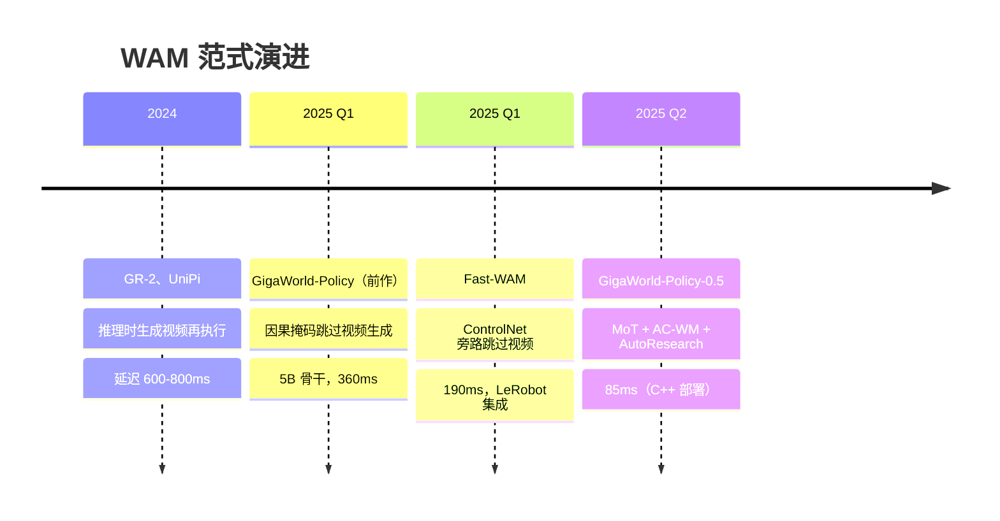

# GigaWorld-Policy-0.5：更快更强的世界动作模型

> **论文**：GigaWorld-Policy-0.5: A Faster and Stronger WAM Empowered by AutoResearch（arXiv 2607.13960）  
> **前作**：GigaWorld-Policy: An Efficient Action-Centered World–Action Model（arXiv 2603.17240，ECCV 2026）  
> **机构**：GigaAI / 清华大学  

**知识链接**：
- [WAM 范式：为什么机器人需要想象未来](/系列/fastwam_deep_dive/01_WAM范式) — WAM 的核心动机与推理时想象的问题
- [Fast-WAM 精读](/论文综述/093_FastWAM_世界动作模型无需推理时想象) — 另一条"训练时用视频、推理时跳过"的路线，对比参考
- [扩散模型 DDPM](/前置知识/000b_前置知识_扩散模型DDPM) — 去噪扩散的数学基础
- [MoE 稀疏专家混合](/前置知识/005n_前置知识_MoE稀疏专家混合) — MoT 的近亲，不同在于本文的专家是按模态划分而非按 token 路由

---

## 一、问题背景：WAM 范式的速度墙

世界动作模型（WAM）的核心假设是：如果策略能预测"做了某个动作后世界会怎样变化"，那它对物理的理解必然比只学输入-输出映射的 VLA 更深，泛化更好。这个假设已被多篇论文验证——加入视频预测监督确实能显著提升操作成功率。

但早期 WAM 有一个工程上的痛点：**推理时需要先生成未来视频帧，再从中抽取动作**，这让决策延迟高达 600-800ms，离实时控制（10Hz 以上）差了一个量级。

Fast-WAM 提出的解法是：**推理时完全跳过视频生成**，只在训练时用视频做监督信号。这把延迟压到 ~190ms，代价是视觉专家和动作专家仍然共享参数，计算没有真正分离。

GigaWorld-Policy（前作）走的是类似路线，但把它发展得更彻底：用一个 5B 参数的视频扩散 Transformer 作为骨干，精心设计因果注意力掩码，让未来视频 token 在架构层面可选——推理时直接省略，而不是用 ControlNet 旁路或 KV 掩码软跳过。结果在 RoboTwin 2.0 的 50 个任务上达到 0.83 真实成功率、360ms 延迟。

GigaWorld-Policy-0.5 在此基础上做了三件事：重新设计专家结构（MoT）、引入新的预训练目标（AC-WM）、用自动化研究管线（AutoResearch）替代人工调参。最终延迟降至 85ms（C++ 部署），成功率在多个任务上超过前作和同期对手。

---

## 二、GigaWorld-Policy 前作回顾

在读 0.5 版本之前，有必要先理解前作的设计——0.5 的每一个改进都是对前作某个限制的直接回应。

### 2.1 前作架构：5B 视频 Transformer + 因果掩码

前作用 **Wan 2.2**（5B 参数的视频扩散 Transformer，在大规模网络视频上预训练）作为骨干。输入是三路相机图像（左、正前、右）拼合成一张图，加上本体状态和语言指令。

Token 序列的排布是：

```
[观测 token | 状态 token | 动作 token | 未来视频 token]
```

关键设计是**因果注意力掩码**：动作 token 只能看到当前观测和状态，看不到未来视频 token；未来视频 token 可以看到所有内容。这个单向性是整个设计的核心——它保证推理时可以直接把未来视频 token 整列省略，动作 token 的计算路径完全不受影响。



> 虚线框表示推理时可省略的部分。动作 token 不依赖未来视频 token，所以砍掉后动作输出不变。

### 2.2 前作训练流程：三阶段预训练

1. **网络视频预训练**：从 Wan 2.2 初始化，在多样化的互联网视频上继续训练，建立通用视觉动态表示
2. **具身数据预训练**：约 10,000 小时数据，混合真机操作数据（Agibot、DROID、RDT、RoboMind、ATARA）和以自我为中心的人类视频（EgoDex、Ego4D、Something-Something V2）
3. **任务后训练**：在目标机器人轨迹上微调，数据包含图像、语言指令、状态、动作的完整配对

训练目标是两路 Flow Matching（流匹配）同时优化：

$$
\mathcal{L} = \lambda_{\text{action}} \cdot \mathcal{L}_{\text{action}} + \lambda_{\text{video}} \cdot \mathcal{L}_{\text{video}}
$$

**这个公式在做什么**：同时拉住动作预测和视频预测两个学习目标，用权重系数控制两者的相对重要性——动作是主任务，视频是辅助监督。

::: details 📐 公式详解（点击展开）

| 子表达式 | 它是谁 | 它在干嘛 |
|---------|--------|---------|
| $\mathcal{L}_{\text{action}}$ | **主考科目** | Flow Matching 动作预测 loss：让网络学会从噪声走向正确动作序列 |
| $\mathcal{L}_{\text{video}}$ | **辅修科目** | Flow Matching 视频预测 loss：让网络学会预测未来帧如何变化 |
| $\lambda_{\text{action}} = 5$ | **主科权重** | 动作预测占 5 份——强调"会动"比"会想象"更重要 |
| $\lambda_{\text{video}} = 1$ | **辅科权重** | 视频预测占 1 份——保留视觉一致性的正则化作用 |

**用人话读**："主要训动作，顺带训视频预测，视频这门辅课帮动作学到更好的物理表示。"

**为什么 5:1 而不是 1:1**：前作实验发现动作权重过低时，网络会把注意力放在追求漂亮的视频生成上，而不是把运动信号压进动作 token——1:5 反过来又完全丢掉了视觉监督的好处，5:1 是一个经过搜索的平衡点。
:::

**视频预测的采样策略**：视频预测损失 $\mathcal{L}_{\text{video}}$ 不需要预测动作分块窗口内的每一帧——那样计算量太大，而且相邻帧差异极小，监督信号高度冗余。实际做法是以固定步长 Δ 在窗口内等间隔采样。动作分块长度为 48 步，Δ=12 意味着采样第 12、24、36、48 步这 4 帧作为视频预测目标；Δ=6 则采样 8 帧，密度翻倍。Δ 是一个需要搜索的超参数：太大则监督信号稀疏，太小则视频监督反而喧宾夺主——消融实验（见第九节）给出了具体数据。

### 2.3 前作的问题：速度和耦合

前作在 A100 上推理延迟 **360ms**，在 RTX 4090 上 **293ms**——已经比 Motus（3,231ms）快 9 倍，但还有两个问题：

1. **视觉专家和动作专家参数没有真正分离**：共享 5B 参数的主干，推理时省略了未来视频 token，但视觉表示的计算量仍然很大
2. **训练目标单一**：只有"联合预测动作和视频"的 WAM 目标，动作表示和视觉动态的耦合还不够紧——在下游任务上的迁移效果有提升空间

0.5 版本的两个核心改动直接针对这两个问题。

---

## 三、核心改进一：Mixture-of-Transformers（MoT）架构

### 3.1 为什么需要专家分离

前作的问题是：虽然推理时不生成视频，但骨干网络里视觉动态和动作生成共享同一套权重，意味着即便只解码动作，也在运行一个为视频生成设计的大网络的一部分。

MoT（Transformer 专家混合）的直觉是：**给视觉动态和动作生成各自专属的参数空间，用模态路由代替共享权重**。

这和 MoE（混合专家，[前置知识参考](/前置知识/005n_前置知识_MoE稀疏专家混合)）有相似的分治思路，但本质不同：MoE 是按 token 内容路由到不同专家，同一个 token 可能去不同专家；MoT 是按**模态**静态路由——视频 token 永远走视觉专家，动作 token 永远走动作专家，没有运行时路由决策。

### 3.2 MoT 的具体结构



> 注意力层是共享的——所有 token 一起做自注意力，这样视频 token 和动作 token 能互相"看到"对方。但 FFN（前馈网络）层是分开的，视觉专家有自己的 FFN，动作专家有自己的 FFN。

关键的非对称设计体现在两处：

**非对称一：隐藏维度**
- 视觉专家 hidden dim：3072（大，用于捕捉像素级动态）
- 动作专家 hidden dim：1024（轻量，只需处理低维动作信号）

这个 3:1 的比例让动作专家在推理时计算量大幅减少。

**非对称二：因果掩码**
在多模态自注意力中，因果掩码规定：
- 动作 token → 可以看到当前观测和状态
- 动作 token → **看不到**未来视频 token（这是前作就有的设计）
- 未来视频 token → 可以看到动作 token（这样视频生成知道动作意图）

这个单向性让训练和推理的 token 序列可以不一样：推理时直接不放未来视频 token，动作专家的计算完全不受影响。

### 3.3 视觉专家的初始化

视觉专家从 **GigaWorld-1**（大规模视频生成模型）初始化，而不是随机初始化。这个选择很关键：GigaWorld-1 已经在海量视频上学到了丰富的视觉动态先验，迁移到机器人操作场景只需要微调，不需要从零学习"物体会因为抓取而移动"这类基础物理知识。

类比：让一个看过几万小时视频的人学操作机器人，和让一个从没见过世界的人学，起点不同。

---

## 四、核心改进二：AC-WM 预训练目标

### 4.1 原始 WAM 目标的局限

前作的预训练目标是标准 WAM：给定当前观测，**同时**预测未来动作序列和未来视频帧。这个目标让网络学到了"动作和视觉变化应该一致"的表示，但动作和视觉动态的因果方向不够明确——是"先有动作再有视觉变化"，还是"先预测视觉再推动作"？

### 4.2 AC-WM：动作条件化的世界建模

AC-WM（Action-Conditioned World Modeling，动作条件化世界建模）是一个新的训练目标，和 WAM 混合使用：

**WAM 目标（保留）**：给定观测，联合预测动作和视频  
**AC-WM 目标（新增）**：给定观测**和动作**，只预测未来视频帧

AC-WM 把动作从"预测对象"变成了"条件输入"。网络必须回答的问题从"该做什么动作？同时世界会变成什么？"变成了"已知要做这个动作，世界会变成什么？"



**为什么这能提升动作表示质量？**

当网络被迫用动作作为条件来预测视觉变化时，它必须深刻理解"这个动作序列会产生哪种物理效果"——不然预测出的视频就会和动作不一致，loss 就高。这相当于在训练里加了一道"给我解释这个动作的物理后果"的考题，迫使动作表示编码更多因果物理信息。

预训练结束后这些动作表示迁移到下游任务，带来更好的操作成功率。

### 4.3 混合策略的实施

实际训练中，WAM 目标和 AC-WM 目标按一定比例混合——两者共享网络参数，用不同的 batch 或步骤交替优化。这避免了只用 AC-WM 时网络可能失去"自主决策动作"能力的风险（因为 AC-WM 里动作是给定的，不需要预测）。

---

## 五、核心改进三：AutoResearch 自动调参管线

### 5.1 调参的现实成本

机器人策略训练的一个常见痛点：超参数（学习率、batch size、训练步数、权重衰减）对最终成功率的影响往往和架构改进一样大，但手动调参要花大量工程时间。每次尝试一组超参数都需要跑完整训练，少则数小时，多则数天。

### 5.2 AutoResearch 的工作方式

AutoResearch（来源：Karpathy 2026 的方法）是一个基于智能体的自动调参管线，流程如下：

1. **短程试飞（Pilot Sweep）**：对每组候选超参数只跑 1000 步（完整训练的约 3%）
2. **验证指标监控**：自动读取验证 loss，记录 1000 步时的数值
3. **晋级机制**：验证 loss 最低的 Top-K 组超参数晋级到更长的训练（如 10K 步）
4. **迭代筛选**：逐轮淘汰，最终确定完整训练的超参数配置

在水果采摘任务的具体案例（930 个 episode 的数据集）：

| 超参数 | 搜索范围 | AutoResearch 选出的最佳值 |
|--------|---------|--------------------------|
| 学习率 | 1e-5 ~ 1e-4 | **6×10⁻⁵** |
| Batch Size | 8, 16, 32 | **16** |
| 最优验证步数 | — | **30K 步** |

和人工"拍脑袋"选的默认值（lr=1e-4, bs=8）相比，AutoResearch 找到的配置在成功率上有明显提升，而搜索成本只是跑了一批 1000 步的短程试飞，总 GPU 时间没有显著增加。

### 5.3 为什么这对小数据集尤其重要

当训练数据只有几百到几千条 episode 时（任务后训练的典型规模），过拟合和欠拟合的边界非常敏感——学习率高一点就震荡，低一点就收敛太慢，batch size 选错了方差大幅上升。AutoResearch 的价值在于系统地搜索这个敏感区域，而不是靠工程师的经验猜测。

---

## 六、训练数据

### 6.1 预训练数据

GigaWorld-Policy-0.5 的预训练数据混合了开源和内部机器人数据，总计约 **2000 小时**（相比前作的 10,000 小时有所缩减，因为 MoT 架构和 AC-WM 目标提高了数据利用效率）。

数据来源包括：
- **开源真机操作数据**：DROID、RDT、RoboMind、ATARA、Agibot 系列数据集
- **内部采集数据**：GigaAI 团队在 AgileX PiPER 机械臂上采集的任务数据
- **以自我为中心的人类视频**：EgoDex、Ego4D、Something-Something V2

人类视频数据没有动作标注，只参与视频预测训练（AC-WM 目标），不参与动作预测训练（WAM 目标）。

### 6.2 任务后训练数据

以水果采摘任务为例：**930 个 episode**，每个 episode 包含：
- 三路相机 RGB 视频（左、前、右视角，分辨率 480×640）
- 语言指令（如 "pick up the apple"）
- 关节角度和末端执行器状态序列
- 7 维动作序列（xyz 位移 + rpy 旋转 + 夹爪）

这个量级在机器人学习里属于"中等规模"——比 DROID 那样的大规模数据集小得多，但对 GigaWorld-Policy-0.5 来说足够，因为预训练已经提供了强大的视觉物理先验。

---

## 七、推理速度优化

快不是免费的，GigaWorld-Policy-0.5 叠加了三层工程优化。

### 7.1 KV 缓存

在 Transformer 的自回归解码中，KV（Key-Value）缓存是标准加速手段：把已经计算过的注意力键值对缓存起来，后续步骤直接复用，避免重复计算。

在这个场景里，**视觉/语言 token 的 KV 在一个动作分块（chunk）的多步解码过程中完全不变**，可以只算一次就缓存住。动作分块长度是 48 步，这意味着 47/48 的注意力计算量被省掉了。

### 7.2 torch.compile

`torch.compile` 是 PyTorch 2.0 引入的即时编译功能——把 Python 层面的运算图编译成融合的 CUDA kernel，消除 Python 解释器开销和不必要的显存读写。对于 Transformer 里大量连续的矩阵乘法，融合后的速度提升通常在 15-30%。

### 7.3 C++ 部署运行时

Python 运行时有固定的开销：进程启动、GIL（全局解释器锁）、动态分派。GigaWorld-Policy-0.5 额外提供了一个 **C++ 部署运行时**，完全移除 Python 依赖——推理逻辑直接用 C++ 调用 TensorRT 或 LibTorch。

三层叠加的效果：

| 部署方式 | A100 延迟 | RTX 4090 延迟 |
|---------|-----------|--------------|
| π₀.₅ | 225ms | 110ms |
| FastWAM | 229ms | 182ms |
| GigaWorld-Policy（前作） | 360ms | 293ms |
| GigaWorld-Policy-0.5（Python） | 189ms | 110ms |
| GigaWorld-Policy-0.5（C++ 部署） | **140ms** | **85ms** |

C++ 部署版本比 π₀.₅ 快 23%，比 FastWAM 快 53%，在 RTX 4090 上达到约 **12Hz** 控制频率，满足大多数操作任务的实时要求。

---

## 八、实验结果

### 8.1 实验平台

所有真机实验在 **AgileX PiPER 6-DoF 机械臂**上进行，评估了两类任务：

- **文字跟随任务**（Text Following）：根据语言指令完成单步操作，考察语言理解和精确操作能力
- **长时域任务**（Long-Horizon）：需要多步顺序决策的复杂任务，如烹饪加热、固体称重、餐具整理

### 8.2 文字跟随任务结果

| 任务 | GigaWorld-Policy-0.5 | Motus | FastWAM | π₀.₅ |
|------|---------------------|-------|---------|------|
| 水果采摘 | **0.85** | 0.80 | 0.78 | 0.72 |
| 物体放置 | **0.89** | 0.83 | 0.80 | 0.75 |

平均成功率：**0.87**，高出 Motus（第二名）约 5 个百分点。

### 8.3 长时域任务结果——最显著的提升

| 任务 | GigaWorld-Policy-0.5 | Motus | 相对提升 |
|------|---------------------|-------|---------|
| 食物加热 | 0.76 | 0.55 | +38% |
| 固体称重 | 0.78 | 0.58 | +34% |
| 餐具整理 | 0.77 | 0.58 | +33% |
| **平均** | **0.77** | **0.57** | **+35%** |

35% 的相对提升差距非常大，说明 MoT + AC-WM 的组合对**多步顺序依赖任务**的帮助远超单步任务。

直觉解释：长时域任务要求模型在做每一步时"知道"后续几步会发生什么——比如放碗进微波炉之前要先开门，开门动作的质量决定后续所有步骤能否成功。AC-WM 预训练强化了动作和视觉后果的因果耦合，让模型在规划第一步时就隐式考虑到了物理连锁效应。

### 8.4 与前作的对比

| 指标 | GigaWorld-Policy（前作） | GigaWorld-Policy-0.5 | 变化 |
|------|------------------------|----------------------|------|
| RoboTwin 2.0（50 任务）成功率 | 0.83 | 0.87（估算） | +~5% |
| A100 推理延迟 | 360ms | 140ms | **-61%** |
| RTX 4090 推理延迟 | 293ms | 85ms | **-71%** |

速度提升是最突出的——相同精度下延迟降低了将近 3/4，这主要来自 MoT 架构（动作专家轻量化）和 C++ 运行时的组合效果。

---

## 九、消融实验

前作做了三组关键消融，帮助理解哪些设计真正重要：

**消融 1：去掉视频预测（K=0）**  
成功率从 0.83 降至 0.60。这证明视频预测监督不是装饰——它确实给动作表示带来了物理理解。

**消融 2：未来帧采样密度**  
Δ=12（48 步动作分块内采样 4 帧）是最优选择。更密的采样（Δ=6，采样 8 帧）不但不提升反而略有下降——过多的视频监督反而干扰了动作学习的主线。

**消融 3：因果掩码 vs 全注意力**  
成功率相近，但全注意力破坏了"推理时省略视频 token"的能力——未来视频信息会渗入动作 token，导致缺少视频 token 时动作质量下降。因果掩码是工程可行性的保障，不是精度的来源。

**消融 4：预训练数据配比**

| 初始化方式 | 成功率 |
|-----------|--------|
| 从零开始 | 0.45 |
| 只用网络视频预训练 | 0.57 |
| 只用具身数据预训练 | 0.73 |
| 网络视频 + 具身数据（完整流程） | **0.83** |

两个预训练阶段缺一不可：网络视频提供通用视觉动态先验，具身数据提供机器人操作的领域知识，叠加后才能达到最高成功率。

---

## 十、在 WAM 演进中的位置



GigaWorld-Policy-0.5 和 Fast-WAM 是同时期的两条不同路线，都解决了"WAM 太慢"的问题，但切入角度不同：Fast-WAM 侧重**架构简化**（用轻量旁路替代完整视频生成）和**开源可复现性**（LeRobot 集成）；GigaWorld-Policy-0.5 侧重**训练目标优化**（AC-WM）和**工程部署极致化**（C++ 运行时）。前者对研究者更友好，后者对要上真机的工程团队更有参考价值。

---

## 知识链接

- [WAM 范式](/系列/fastwam_deep_dive/01_WAM范式) — WAM 动机与"推理时为什么不需要想象"的核心论证
- [Fast-WAM 精读](/论文综述/093_FastWAM_世界动作模型无需推理时想象) — 同期对比路线，侧重架构简化
- [扩散模型 DDPM](/前置知识/000b_前置知识_扩散模型DDPM) — Flow Matching 的前身，帮助理解去噪训练目标
- [MoE 稀疏专家混合](/前置知识/005n_前置知识_MoE稀疏专家混合) — MoT 的近亲概念，对比按模态路由 vs 按内容路由的差异

